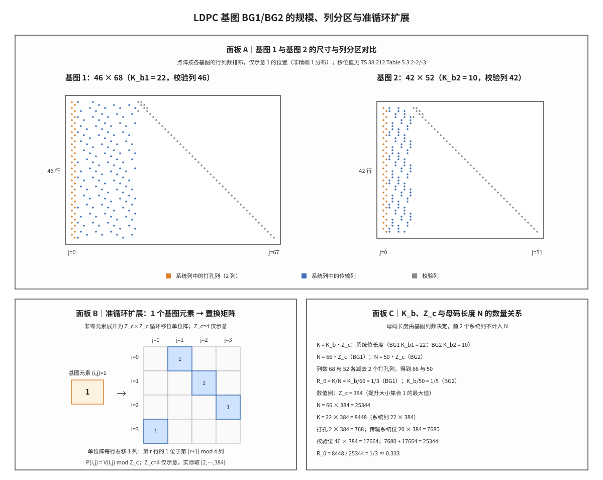

# LDPC 基图 BG1/BG2

## 符号与记号约定

本笔记从基图的尺寸讲到提升与母码长度，用到的每个数学符号先在此定义，后文直接引用时不再重复解释。表中「读法」一列说明该符号在书面语中的称呼，「含义与取值」一列给出协议规定的范围或本笔记使用的具体值。

| 符号 | 读法 | 含义与取值 | 协议锚点 |
|:---|:---|:---|:---|
| $A$ | 传输块载荷 | 一个传输块（Transport Block, TB）的载荷比特数，基图选择的第一个判据；正整数，判据边界为 292 与 3824；单位为 bit；MAC 层交付给物理层的 TB 载荷，协议在 TS 38.212 §6.2.1 记作 $a_0,\ldots,a_{A-1}$。 | TS 38.212 §6.2.1 |
| $L$ | 校验位数 | 循环冗余校验（Cyclic Redundancy Check, CRC）的位数；传输块 CRC 为 24（$A>3824$）或 16，码块 CRC 为 24；单位为 bit；由载荷大小按 TS 38.212 §6.2.1 选定。 | TS 38.212 §6.2.1 |
| $B$ | 分段输入长度 | 附加 CRC 后的比特数，即码块分段的输入长度；$B=A+L$，即 $A+16$ 或 $A+24$；单位为 bit；由 $A$ 与 $L$ 相加得到，基图选择不使用该量。 | 由 TS 38.212 §6.2.1 导出 |
| $C$ | 码块数 | 传输块分段后的码块个数；不分段时为 1，否则为 $\lceil B/(K_{cb}-L)\rceil$；单位为个；由 $B$ 与 $K_{cb}$ 按 TS 38.212 §5.2.2 的分段规则算出。 | 由 TS 38.212 §5.2.2 导出 |
| $R$ | 目标码率 | 由调制编码方案（Modulation and Coding Scheme, MCS）索引查表得到的码率，基图选择的第二个判据；判据边界为 0.67 与 0.25，MCS 表最高目标码率 948/1024 约 0.926；单位为无量纲比值（信息比特/编码比特）；下行按 TS 38.214 §5.1.3.1、上行按 §6.1.4.1 的 MCS 表查得。 | TS 38.214 §5.1.3.1 |
| $K_b$ | 信息列数 | 基图中系统列的列数，乘以 $Z_c$ 得信息位长度；BG1 为 22、BG2 为 10（列分区口径）；单位为块列；TS 38.212 §5.2.2 的基图规定。 | TS 38.212 §5.2.2 |
| $K_{b1}$ | 基图 1 信息列数 | 基图 1 的系统列数；常数 22；单位为块列；TS 38.212 §5.2.2 对 BG1 的规定。 | TS 38.212 §5.2.2 |
| $K_{b2}$ | 基图 2 信息列数 | 基图 2 的系统列数，用于列分区；常数 10（选 $Z_c$ 时另有 6/8/9/10 的分段取值，见边界情形）；单位为块列；TS 38.212 §5.2.2 对 BG2 的规定。 | TS 38.212 §5.2.2 |
| $Z_c$ | 提升大小 | 循环置换矩阵的阶，即基图每个格展开后的块边长；Table 5.3.2-1 八个集合共 51 个离散值，范围 2 至 384，本笔记数值例取 384；单位为 bit（每块含 $Z_c$ 行与 $Z_c$ 列比特）；协议表格固定，选取规则为满足 $K_bZ_c\ge K'$ 的最小值。 | TS 38.212 Table 5.3.2-1 |
| $K$ | 码块信息位数 | 送入 LDPC 编码器的比特数；BG1 为 $22Z_c$、BG2 为 $10Z_c$，$Z_c=384$ 时分别为 8448 与 3840；单位为 bit；由 $K_b$ 与 $Z_c$ 相乘得到。 | 由 TS 38.212 §5.2.2 导出 |
| $N$ | 母码长度 | 编码输出比特数，即进入速率匹配的母码长度；BG1 为 $66Z_c$、BG2 为 $50Z_c$，$Z_c=384$ 时分别为 25344 与 19200；单位为 bit；基图列数扣除 2 个打孔系统列，见 TS 38.212 §5.3.2。 | TS 38.212 §5.3.2 |
| $N_{cb}$ | 循环缓存长度 | 速率匹配写入循环缓存的比特数，是比特选择地址空间的上界；未配置限缓存（limited buffer）时 $N_{cb}=N$，配置后 $N_{cb}=\min(N,N_{ref})$，BG1 在 $Z_c=384$ 时不超过 25344；单位为 bit；由 TS 38.212 §5.4.2.1 的有限缓存速率匹配规则给出。 | TS 38.212 §5.4.2.1 |
| $E$ | 速率匹配输出长度 | 一次传输实际发送的编码比特数；正整数，由调度分配的编码比特预算决定；单位为 bit；TS 38.212 §5.4.2.1 的比特选择；本笔记只用它说明有效码率 $K/E$。 | TS 38.212 §5.4.2.1 |
| $R_0$ | 母码码率 | 按母码长度计的码率，是速率匹配的基准；$R_0=K/N$，BG1 为 1/3、BG2 为 1/5；单位为无量纲比值（信息比特/编码比特）；由 $K$ 与 $N$ 相除得到。 | 由 TS 38.212 §5.3.2 导出 |
| $K_{cb}$ | 最大码块长度 | 单个码块允许的最大信息位数，也是分段判据与 $Z_c$ 上限的来源；BG1 为 8448、BG2 为 3840；单位为 bit；TS 38.212 §5.2.2。 | TS 38.212 §5.2.2 |
| $n$ | 基图列数 | 基图的块列数，扣除 2 个打孔系统列后得到母码长度；BG1 为 68、BG2 为 52，母码长度 $N=(n-2)Z_c$；单位为块列；协议基图尺寸。 | TS 38.212 §5.3.2 |
| $i$ | 行索引 | 基图行号，每一行对应一组校验方程；BG1 取 0 至 45、BG2 取 0 至 41；单位为块行号（无量纲序号）；协议基图行号约定。 | 由 TS 38.212 §5.3.2 导出 |
| $j$ | 列索引 | 基图列号，前 $K_b$ 列为系统列、其余为校验列；BG1 取 0 至 67、BG2 取 0 至 51；单位为块列号（无量纲序号）；协议基图列号约定。 | 由 TS 38.212 §5.3.2 导出 |
| $i_{LS}$ | 提升大小集合索引 | $Z_c$ 所属的提升大小集合编号，用于在移位值表中选取列；0 至 7；单位为无量纲序号；Table 5.3.2-1 的集合分组，Table 5.3.2-2/-3 按它给出移位值。 | TS 38.212 Table 5.3.2-1 |
| $V_{i,j}$ | 表中移位值 | Table 5.3.2-2/-3 在给定 $i_{LS}$ 下给出的整数，是取模前的原始移位值；0 至 383；单位为无（原始移位计数）；按 $i_{LS}$ 在协议移位值表中查得。 | TS 38.212 Table 5.3.2-2 |
| $P_{i,j}$ | 实际循环移位 | 单位阵循环右移的次数，即块内 1 的实际列偏移；$P_{i,j}=V_{i,j}\bmod Z_c$，落在 0 至 $Z_c-1$；单位为移位次数（无量纲）；由 $V_{i,j}$ 对 $Z_c$ 取模得到。 | 由 TS 38.212 §5.3.2 导出 |
| $I$ | 单位阵 | $Z_c\times Z_c$ 单位阵，是循环置换矩阵的原型；对角元为 1、其余为 0，$I(P_{i,j})$ 表示把它循环右移 $P_{i,j}$ 次；单位为无（$Z_c\times Z_c$ 的 0/1 矩阵）；线性代数记号，协议只写替换规则不引入该符号。 | 非 3GPP 标准 |
| $H$ | 校验矩阵 | 由基图逐元素替换得到的稀疏校验矩阵；BG1 规模为 $46Z_c\times68Z_c$，$Z_c=384$ 时为 $17664\times26112$；单位为无（比特行×比特列）；由 TS 38.212 §5.3.2 的准循环扩展得到。 | TS 38.212 §5.3.2 |

运算符方面，$\lfloor\cdot\rfloor$ 表示向下取整，$\bmod$ 表示取余（$V_{i,j}\bmod Z_c$ 的余数落在 0 至 $Z_c-1$），$\min(\cdot)$ 表示取较小值，$\cdot$ 与 $\times$ 都表示乘法。下标表示限定：$K_{b1}$ 的 $b1$ 指基图 1，$P_{i,j}$ 的 $i$、$j$ 指元素所在的行与列。撇号不表示导数。

三个容易混淆的长度在此一并区分：$K$ 是送入编码器的信息位数，$K_{cb}$ 是单个码块允许的最大信息位数，$N$ 是编码输出的母码长度。$K_b$ 是列数而不是比特数，乘上 $Z_c$ 之后才是 $K$；同理列数 $n$ 乘 $Z_c$ 也不等于 $N$，因为前 2 个系统列打孔。

记号确定后，先把基图放回发送链路的位置，再逐项展开它的尺寸、选择判据与扩展规则。

基图（Base Graph, BG）是 NR LDPC 的校验矩阵模板，在链路上位于码块分段之后、LDPC 编码之前：分段确定每个码块的信息位数，基图确定使用哪一套行列结构与移位值表，提升大小把基图的每个格展开成 $Z_c\times Z_c$ 的子矩阵。一句话本质：**基图固定的是校验矩阵的列分区与稀疏连接图——它决定母码的列数、系统列与校验列的分界，以及哪些位置在提升后成为循环移位子矩阵；提升大小只改变每个格子的分辨率，不改变格子的排布。**

## 解释目标与范围

本节目标：讲清 NR LDPC 基图 BG1 与 BG2 的矩阵规模与列分区、两张基图的选择判据、准循环扩展的替换规则，以及基图、提升大小与母码长度之间的数量关系。

阅读本节前应能回答传输块如何分段成码块、目标码率由谁给出；读完之后应能仅凭载荷 $A$ 与码率 $R$ 判定基图，由 $K_b$ 与 $Z_c$ 算出 $K$ 与 $N$，并说明为什么母码长度不等于列数乘 $Z_c$。后文反复使用的对象有六个，先补齐它们的定义。

## 前置概念

第一个对象是低密度奇偶校验码（Low-Density Parity-Check code, LDPC）。它是以稀疏校验矩阵定义的线性分组码，译码时在矩阵的非零位置上迭代传递消息，性能与复杂度都由校验矩阵的结构决定，基础内容见 [[LDPC_低密度奇偶校验码]]；在本笔记中，基图就是这套结构的模板。

第二个对象是稀疏校验矩阵（sparse parity-check matrix）。它是非零元素占比很低的矩阵，行对应校验方程、列对应码字比特，矩阵中 1 的位置决定哪些比特参与哪些校验。基图是它的压缩写法，只记录 1 的位置与移位值，完整矩阵由模板逐元素替换得到。

第三个对象是提升因子（lifting size，本笔记记作 $Z_c$）。它把基图的一个格展开成 $Z_c\times Z_c$ 的子矩阵，取值为 Table 5.3.2-1 给出的 51 个离散值，不是任意整数。提升大小同时决定码块长度、编码器的移位寄存器级数与译码器的并行粒度，因此在同一基图下选 $Z_c$ 等于选码块规模。

第四个对象是准循环（quasi-cyclic, QC）结构。完整校验矩阵由循环移位单位阵与全零块拼接而成，每个 $Z_c\times Z_c$ 块都是单位阵的循环移位或全零阵。该结构使编码可由移位寄存器实现、译码可按块并行，展开规则详见 [[QC_LDPC_准循环LDPC]]。

第五个对象是系统位（systematic bits）与校验位（parity bits）。系统位与输入信息比特一一对应，校验位是为满足校验方程而解出的冗余分量。BG1 的 68 列中前 22 列为系统列，其中前 2 列打孔、不传输；后 46 列为校验列，每一列对应一个校验位。

第六个对象是母码（mother code）。它是编码器直接生成、未经速率匹配的码字，长度记为 $N$，BG1 为 $66Z_c$、BG2 为 $50Z_c$。速率匹配在这条序列上按冗余版本取址，取出的 $E$ 个比特才进入调制，二者的关系见 [[Rate_Matching_速率匹配]]。

六个对象就位后，可以看两张基图是如何从同一组设计约束中分化出来的。

## 起源与演进

要理解 46×68 与 42×52 这两个尺寸的来历，需要回到 NR LDPC 设计时的三个约束：载荷跨度、码率跨度与译码并行度。下面按设计顺序分五步说明，每步给出对应的数值或协议条款。

(1) **单一矩阵无法覆盖的区间。** NR 的 TB 载荷从几十比特到近百万比特，目标码率从 0.1 量级到 0.93 量级。若只用一套矩阵，短块会因矩阵过大而填入大量填充位，长块又会因矩阵过小而被迫多次分段，于是协议提供两个模板分治：BG1 面向大载荷高吞吐（$K_b=22$），BG2 面向短块与低码率（$K_b=10$）。

(2) **列分区决定母码长度。** BG1 的 68 列中前 22 列为系统列、后 46 列为校验列，前 2 个系统列在编码后打孔；BG2 的 52 列中前 10 列为系统列、后 42 列为校验列，同样打孔 2 列。故传输的母码长度为 $N=(n-2)Z_c$，即 $66Z_c$ 与 $50Z_c$——两个数都比列数少 2 列。

(3) **选择规则按载荷与码率分三条分支。** TS 38.212 §6.2.2（上行共享信道 UL-SCH）与 §7.2.2（下行共享信道 DL-SCH 与寻呼信道 PCH）规定：$A\le 292$，或 $A\le 3824$ 且 $R\le 0.67$，或 $R\le 0.25$，三者满足任一即用 BG2，否则用 BG1。三条分支分别对应极短块、中等长度中低码率、任意长度低码率三种场景。

(4) **提升把模板变成完整矩阵。** 基图的每个 1 按 Table 5.3.2-2/-3 取移位值 $V_{i,j}$，再对 $Z_c$ 取模得到 $P_{i,j}$，替换为循环右移 $P_{i,j}$ 次的单位阵；每个 0 替换为全零阵。BG1 的完整矩阵规模为 $46Z_c\times 68Z_c$，稀疏性只保留在基图这一层。

(5) **与分段、速率匹配的衔接。** 基图选择发生在分段之前：选定基图后 $K_{cb}$ 才确定，$B$ 超过 $K_{cb}$ 时先分段，分段后每个码块的信息位数才记为 $K$。编码输出 $N$ 个比特进入循环缓存，速率匹配再取出 $E$ 个比特发送。基图选错时 $K_b$、$N$ 与移位值表三者同时错位，译码器的消息地址与层边界随之全错。

上述五步给出的是设计脉络，下面把它固定成可引用的定义与算式。

## 科学定义

### 尺寸、列分区与母码长度

TS 38.212 §5.3.2 对两张基图给出同一套定义。BG1 的基图矩阵有 46 行（$i=0,1,\dots,45$）与 68 列（$j=0,1,\dots,67$），BG2 有 42 行与 52 列；表中列出的行列位置取值为 1，其余位置取值为 0。行数与列数一经确定，列分区随之确定：系统列数为 $K_b$，校验列数等于行数——基图的每一行对应一组校验方程，校验部分的每一列对应一组校验位，提升后每组各含 $Z_c$ 个。

两张基图的尺寸与派生量汇总如下。表中 $K$、$N$、$R_0$ 按 $Z_c$ 表出，故同一张基图在不同 $Z_c$ 下对应不同的码块长度，而列分区与设计码率保持不变。

| 项目 | BG1 | BG2 |
|:---|:---|:---|
| 行数 | 46 | 42 |
| 列数 $n$ | 68 | 52 |
| 系统列数 $K_b$ | 22 | 10 |
| 校验列数 | 46 | 42 |
| 打孔系统列数 | 2 | 2 |
| 信息位数 $K$ | $22Z_c$ | $10Z_c$ |
| 母码长度 $N$ | $66Z_c$ | $50Z_c$ |
| 母码码率 $R_0$ | $1/3$ | $1/5$ |
| 最大码块长度 $K_{cb}$ | 8448 | 3840 |

以 $Z_c=384$（提升大小集合 1 的最大值）代入 BG1，可把上表逐行算成具体数值。母码长度 $N=66\times384=25344$ 比特；信息位数 $K=K_bZ_c=22\times384=8448$ 比特，恰好等于最大码块长度 $K_{cb}=8448$，即 $Z_c=384$ 是 BG1 在不分段前提下的提升上限。这 8448 比特中，前 2 个系统列共 $2\times384=768$ 比特在编码后打孔、不进入传输，实际传输的系统位为 $20\times384=7680$ 比特；校验位为 $46\times384=17664$ 比特，二者相加 $7680+17664=25344=N$，与母码长度一致。母码码率为 $R_0=K/N=8448/25344=1/3\approx0.333$。

这里的 $1/3$ 是速率匹配的基准，而不是传输码率的上界。速率匹配把 $N$ 个编码比特打孔到 $E$ 个时，有效码率 $K/E$ 可以高于 $1/3$（MCS 表最高目标码率 948/1024，约 0.926），重复发送时则低于 $1/3$；母码码率只描述编码器输出的固定比例。BG2 在 $Z_c=384$ 时的对应数值为 $N=50\times384=19200$、$K=10\times384=3840=K_{cb}$，母码码率 $1/5$。在 $Z_c=384$ 下两张基图的 $K$ 都取到 $K_{cb}$，且 $K_{cb}/384$ 恰为各自的 $K_b$（$8448/384=22$，$3840/384=10$）。

尺寸与母码长度确定之后，下一个问题是协议在什么条件下选用哪一张基图。

### 基图选择规则

选择规则在 TS 38.212 §6.2.2 与 §7.2.2 中各出现一次，条文相同。判据的两个输入是载荷 $A$ 与目标码率 $R$：$A$ 即传输块大小（Transport Block Size, TBS），也就是送入 CRC 附加的载荷比特数；$R$ 由 MCS 索引按 TS 38.214 §5.1.3.1（下行）或 §6.1.4.1（上行）确定；满足 $A\le 292$、或 $A\le 3824$ 且 $R\le 0.67$、或 $R\le 0.25$ 三者之一时用 BG2，否则用 BG1。

三条分支的物理含义各不相同。$A\le 292$ 覆盖极短块，BG1 的 22 个系统列在这种长度下会带来大量填充位；$A\le 3824$ 且 $R\le 0.67$ 覆盖中等长度、中低码率，BG2 的 42 个校验列足以支撑；$R\le 0.25$ 覆盖任意长度的低码率，此时 BG2 的 $1/5$ 母码更接近目标码率，可减少重复发送的比特数。

分支走读三例。$A=5000$、$R=0.50$ 时三条 BG2 条件均不满足（$A>292$、$A>3824$、$R>0.25$），选 BG1；$A=3000$、$R=0.50$ 满足第二条，选 BG2；$A=6000$、$R=0.20$ 满足第三条，选 BG2。判据只使用 $A$ 与 $R$，不使用 $B$（附加 CRC 后的长度）或 $E$（速率匹配输出长度）；把 $B$ 当成 $A$ 会在 292 与 3824 两条边界上给出相反的结论。

基图选定之后，剩下的一步是把基图的每个格展开成完整矩阵中的子矩阵。

### 准循环扩展与移位值

基图到完整矩阵的替换规则由 §5.3.2 给出。0 元素替换为 $Z_c\times Z_c$ 全零阵；1 元素替换为循环置换矩阵 $I(P_{i,j})$，即把单位阵循环右移 $P_{i,j}$ 次得到的矩阵，其中 $P_{i,j}=V_{i,j}\bmod Z_c$。$V_{i,j}$ 由 Table 5.3.2-2（BG1）与 Table 5.3.2-3（BG2）按 $i_{LS}$ 查得，$i_{LS}$ 是 $Z_c$ 在 Table 5.3.2-1 中所属集合的编号。

取模使同一张表可以服务全部 51 个提升大小。表中的 $V_{i,j}$ 是 0 至 383 的整数；当 $Z_c$ 小于 384 时，$V_{i,j}\bmod Z_c$ 把移位折叠回 $Z_c$ 个可能位置，不必为每个 $Z_c$ 单独准备一张表。以 $Z_c=384$ 为例，$V_{i,j}\bmod384=V_{i,j}$，移位值就是表中数值；取同一集合中的 $Z_c=192$ 时，$V_{i,j}=307$ 对应 $P_{i,j}=307\bmod192=115$。

完整矩阵的规模为 $(46Z_c)\times(68Z_c)$（BG1）与 $(42Z_c)\times(52Z_c)$（BG2），其中行数乘 $Z_c$ 是校验方程数，列数乘 $Z_c$ 是含打孔列的码字比特数。以 $Z_c=384$ 的 BG1 为例，完整矩阵为 $17664\times26112$ 个元素，但其中只有基图列出的位置非零，每个非零位置是一个 $384\times384$ 的循环置换矩阵——稀疏性体现在基图这一层，展开后的矩阵在数值上并不稀疏。

**图 1｜基图 1/基图 2 的规模、列分区与准循环扩展。**
面板 A 按 TS 38.212 §5.3.2 的 46×68 与 42×52 画出两张基图的示意点阵，橙色为打孔系统列（各 2 列），蓝色为传输系统列（BG1 为 20 列、BG2 为 8 列），灰色为校验列（46 列、42 列），点阵只示意 1 的位置、非精确 1 分布。面板 B 把一个非零元素展开为 $Z_c\times Z_c$ 循环置换矩阵，以 $Z_c=4$ 示意单位阵每行右移 1 列后的结果，并注明实际 $Z_c$ 取提升大小集合中的值。面板 C 给出 $K=K_bZ_c$、$N=66Z_c$/$50Z_c$ 与 $Z_c=384$ 的数值例：$N=25344$、$K=8448$、母码码率 $1/3$。

图中三块内容分别对应下节直观模型的三层结构：矩阵分区、准循环膨胀与数值走读。

## 直观模型

基图的作用可以分三层描述，每一层的对象不同。

第一层是矩阵分区。把 68 列切成 22 个系统列与 46 个校验列，再把系统列的前 2 列单独标出：列 0 与列 1 在编码后打孔，不进入母码，余下 20 列承载输入比特。行数与校验列数相等，因为每一行对应一组校验方程、每一列对应一组校验位。分区一旦确定，$K$ 与 $N$ 就只剩乘 $Z_c$ 一步。

第二层是准循环膨胀。基图的每个格是一个 $Z_c\times Z_c$ 块的占位：格为 0 时放全零块，格为 1 时放单位阵的一个循环移位，移位量由 $V_{i,j}\bmod Z_c$ 决定。膨胀不改变格与格的相对位置，只改变格内的分辨率——基图给出连接图，$Z_c$ 给出每个连接占用的比特宽度。

第三层是数值走读。取 $Z_c=384$ 与 BG1：$N=25344$、$K=8448$、打孔 768 位、传输系统位 7680 位、校验位 17664 位。若换用更小的 $Z_c$，则 $K$ 与 $N$ 按同一比例缩小、设计码率不变；若 $B$ 超过 $K_{cb}=8448$，则先分段成多个码块，每个码块各自选基图与提升大小。三层对应同一组数字，差别只在观察的粗细。

## 常见误解

| 误解 | 正确理解 |
|:---|:---|
| BG1 是 22×68、BG2 是 10×42 | 22 与 10 是系统列数 $K_b$，42 与 46 是校验列数（也等于行数）；协议矩阵尺寸是 BG1 46×68、BG2 42×52。 |
| 基图就是完整校验矩阵 $H$ | 基图是模板；完整 $H$ 按 $Z_c$ 逐元素替换得到，BG1 的规模为 $46Z_c\times68Z_c$。 |
| 母码长度是列数乘 $Z_c$，即 $68Z_c$ | 前 2 个系统列打孔，$N=(68-2)Z_c=66Z_c$；BG2 同理为 $50Z_c$。 |
| BG2 的 $K_b$ 恒为 10，选 $Z_c$ 时也一样 | 列分区恒为 10；§5.2.2 选 $Z_c$ 用的 $K_b$ 按 $B$ 分段取 6/8/9/10，$K$ 仍为 $10Z_c$，差额由填充位补齐。 |
| 基图选择看 $B$ 或 $E$ | 只看 $A$ 与 $R$；用 $B=A+L$ 代入会错判 292/3824 边界。 |
| BG2 是性能更差的降级方案 | 两张基图是载荷与码率的适配性分工：BG1 大载荷高吞吐，BG2 短块低码率，不是质量分级。 |
| 移位值直接使用表中数字 | 实际移位 $P_{i,j}=V_{i,j}\bmod Z_c$；$Z_c<384$ 时必须取模。 |
| 母码码率 1/3 就是传输码率上界 | 1/3 是母码码率；速率匹配打孔后有效码率 $K/E$ 可达 0.93 量级，重复时更低。 |

误解多集中在尺寸、口径与选择判据三处，下面把判据的边界条件单独列出。

## 边界情形

第一处边界是阈值的等号归属。条文写的是 $A\le 292$ 与 $A\le 3824$，$A$ 恰为 292 或 3824 时条件成立（选 BG2），不是从 293 或 3825 才生效；$R\le 0.67$ 与 $R\le 0.25$ 同理。重传沿用初传的基图选择结果，不因重传时有效码率变化而重新选图；这也是同一传输块各次重传的码块结构保持一致的前提。

第二处边界是 $Z_c$ 的上限与 $K_{cb}$ 的饱和。提升大小集合的最大值为 384，BG1 在 $Z_c=384$ 时 $K=8448=K_{cb}$、BG2 在 $Z_c=384$ 时 $K=3840=K_{cb}$；若分段后的单个码块仍需承载更多信息位，只能增加码块数 $C$，不能增大 $Z_c$。反过来，$Z_c$ 由 Table 5.3.2-1 中满足 $K_bZ_c\ge K'$ 的最小值确定，其中 $K'$ 是本码块的有效信息位数，因此 $Z_c$ 不是按目标码率连续计算的，而是从集合中离散选取。

第三处边界是 BG2 的 $K_b$ 在选 $Z_c$ 时是分段量。§5.2.2 规定 $B>640$ 时 $K_b=10$、$B>560$ 时取 9、$B>192$ 时取 8，否则取 6；该取值只影响 $Z_c$ 的选取，$K$ 仍按 $10Z_c$ 设定，差额由填充位（filler bits）补齐，见 [[Filler_Bits_填充位]]。这意味着 BG2 的小载荷场景不会因 $K_b$ 变小而缩短码块，填充位在编码前标记为 NULL、编码后不传输，接收端按已知位置置零处理。

边界条件明确后，协议条款与关键要点可作为复核清单。

## 协议锚点

- TS 38.212 §5.3.2 定义 BG1 的 46 行 × 68 列与 BG2 的 42 行 × 52 列、$N=66Z_c$/$50Z_c$，以及 $P_{i,j}=V_{i,j}\bmod Z_c$ 的循环移位规则；本地 `3GPP_Rel19/processed/TS_38.212_38212-j30/full.md:1178-1210`。
- Table 5.3.2-1 给出八个提升大小集合，共 51 个取值，最大 384；本地 `full.md:1218-1229`。
- Table 5.3.2-2 与 Table 5.3.2-3 分别给出 BG1 与 BG2 的 1 位置与移位值 $V_{i,j}$；本地 `full.md:1231` 与 `full.md:1396`。
- TS 38.212 §5.2.2 定义 $K_{cb}=8448$（BG1）/3840（BG2）、$K_b$ 的分段取值与 $K=22Z_c$/$10Z_c$；本地 `full.md:765-830`。
- TS 38.212 §6.2.2 与 §7.2.2 分别给出 UL-SCH 与 DL-SCH/PCH 的基图选择判据；本地 `full.md:1970-1976` 与 `full.md:5600-5606`。
- 目标码率 $R$ 的来源：TS 38.214 §5.1.3.1（下行 MCS 表 5.1.3.1-1 至 -4）与 §6.1.4.1（上行）；本地 `TS_38.214_38214-j30/full.md:1499` 与 `full.md:8502`，最高目标码率 948/1024 见 MCS 表。
- 讲义：`docs/L2_协议算法/T8.2_NR_LDPC_base_graph_selection.md` 讲选择规则与算例，`docs/L2_协议算法/T8.3_NR_LDPC_lifting_QC_matrix.md` 讲提升与 QC 展开。

以上条款与本地行号可逐条复核；关键要点汇总如下。

## 关键要点

1. BG1 为 46×68、$K_{b1}=22$、校验列 46；BG2 为 42×52、$K_{b2}=10$、校验列 42。
2. 母码长度比列数少 2 列：前 2 个系统列编码后打孔，$N=(n-2)Z_c$，即 $66Z_c$ 与 $50Z_c$。
3. 基图选择只看 $A$ 与 $R$：$A\le 292$、或 $A\le 3824$ 且 $R\le 0.67$、或 $R\le 0.25$ 任一成立选 BG2，否则选 BG1。
4. $K=K_bZ_c$，$K_{cb}=8448$（BG1）/3840（BG2）；$Z_c=384$ 时两者恰好饱和。
5. 提升把每个 1 换成循环右移 $P_{i,j}=V_{i,j}\bmod Z_c$ 次的 $Z_c\times Z_c$ 单位阵，把每个 0 换成全零阵。
6. 同一张移位值表服务全部 51 个提升大小，靠 $V_{i,j}\bmod Z_c$ 折叠移位量。
7. $Z_c=384$ 的 BG1：$N=25344$、$K=8448$、打孔 768 位、传输系统位 7680 位、校验位 17664 位。
8. 母码码率 BG1 为 $1/3$、BG2 为 $1/5$，它是速率匹配的基准而不是传输码率上限。
9. BG2 的 $K_b$ 在选 $Z_c$ 时按 $B$ 取 6/8/9/10，列分区与 $K$ 不变，差额为填充位。
10. 基图选错会使 $K_b$、$N$ 与移位值表同时错位，译码消息地址与层边界全错。

## 图谱关联

- [[LDPC_低密度奇偶校验码]]
- [[QC_LDPC_准循环LDPC]]
- [[Filler_Bits_填充位]]
- [[Segmentation_码块分段]]
- [[Rate_Matching_速率匹配]]
- [[Circular_Buffer_循环缓存]]
- [[MCS_Table_Effective_Code_Rate_MCS表与有效码率]]
- [[概念图谱入口]]
- [[T8.2_NR_LDPC_base_graph_selection]]
- [[T8.3_NR_LDPC_lifting_QC_matrix]]
- 关系语义：基图决定 LDPC 码的列分区与稀疏连接图，经 $Z_c$ 提升后得到完整 QC-LDPC 矩阵，编码输出即母码；分段在基图选定后确定码块数与 $K_{cb}$，速率匹配在母码序列上取址决定有效码率，填充位则补齐 $K$ 与 $K'$ 的差额。
