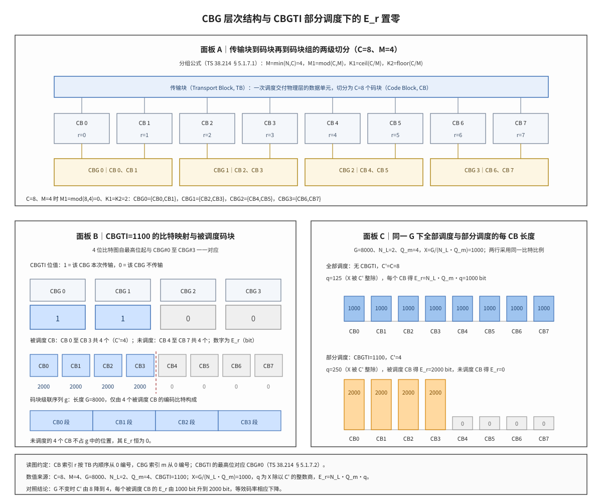

# CBG 码块组

CBG（码块组，Code Block Group）是 NR 为下行共享信道与上行共享信道引入的部分重传机制：一个传输块（Transport Block, TB）在信道编码前被切分为若干码块（Code Block, CB），CBG 把这些 CB 归入若干组，使混合自动重传请求（Hybrid Automatic Repeat Request, HARQ）的重传与 HARQ-ACK 反馈都可以按组进行。一句话本质：**CBG 把 HARQ 的重传单元与反馈单元从整个 TB 收缩为 TB 内部的一个 CB 子集**，因此重传只覆盖出错的那部分 CB。

## 符号与记号约定

本笔记的全部数学片段的读法在此统一给出。后文出现这些符号时不再重复定义，只解释规则本身。表中「读法」一列用于口述与朗读，「含义与取值」一列说明该量的物理意义与取值范围。

| 符号 | 读法 | 含义与取值 |
|:---|:---|:---|
| $C$ | 大写 C | 一个 TB 内的码块（Code Block, CB）总数，由 TB 大小与最大码块长度分段得到，重传之间保持不变 |
| $C'$ | C 撇 | 本次传输实际被调度的 CB 数；DCI 不含 CBGTI 字段时 $C'=C$ |
| $M$ | 大写 M | 一个 TB 的码块组（Code Block Group, CBG）数，$M=\min(N,C)$，取值 1 至 8 |
| $N$ | 大写 N | RRC 配置的每 TB 最大 CBG 数，取自集合 2、4、6、8 |
| $M_1$ | M 下标 1 | 比其余组多含一个 CB 的组数，$M_1=(C\bmod M)$，取值 0 至 M−1 |
| $K_1$ | K 下标 1 | 前 $M_1$ 个 CBG 各含的 CB 数，$K_1=\left\lceil C/M\right\rceil$ |
| $K_2$ | K 下标 2 | 其余 CBG 各含的 CB 数，$K_2=\left\lfloor C/M\right\rfloor$ |
| $m$ | 小写 m | CBG 索引，从 0 起按 CBG#0、CBG#1 顺序递增，上界为 M−1 |
| $r$ | 小写 r | CB 索引，从 0 起按 TB 内码块顺序递增，上界为 C−1 |
| $k$ | 小写 k | CBG 内部的 CB 序号，取值 0 至 K−1（K 为该组的 CB 数） |
| $G$ | 大写 G | 一个 TB 本次可用的编码比特总数，由本次调度的资源、调制阶数与层数共同决定 |
| $g$ | 小写 g | 码块级联输出的编码比特序列 $g_0,\dots,g_{G-1}$，长度恰好为 $G$，未调度的 CB 在其中只贡献空段 |
| $E_r$ | E 下标 r | 第 r 个 CB 的速率匹配输出长度（bit）；未调度的 CB 取 0 |
| $N_L$ | N 下标 L | TB 映射到的层数；TS 38.214 用 $\nu$ 表示同一个量 |
| $\nu$ | 小写 nu | 层数，与 $N_L$ 同义，仅出现在引用 TS 38.214 的场合 |
| $Q_m$ | Q 下标 m | 调制阶数，即一个调制符号承载的编码比特数 |
| $X$ | 大写 X | 把 G 换算成「每层各一个调制符号」为单位的整数计数，$X=G/(N_LQ_m)$ |
| $q$ | 小写 q | 每个被调度 CB 分到的基础单位数，$q=\left\lfloor X/C'\right\rfloor$ |
| $R_{rem}$ | R 下标 rem | X 除以 C' 的余数，也等于取 $q+1$ 个单位的被调度 CB 数 |
| $K_r$ | K 下标 r | 第 r 个 CB 的分段长度，即该 CB 含 CB CRC 的信息比特数 |
| $K_{cb}$ | K 下标 cb | LDPC 最大码块长度：基图 1 为 8448 bit，基图 2 为 3840 bit |

运算符与上下标的读法：

- $\lfloor x\rfloor$ 表示对 x 向下取整，$\lceil x\rceil$ 表示向上取整；$a\bmod b$ 表示 a 除以 b 的余数；$\min(a,b)$ 取两者中的较小值。
- $\sum_r E_r$ 表示对一个 TB 内所有 CB 的长度求和；下标 r 指示「第 r 个」，不表示乘法。
- 上标撇号是独立符号：$C'$ 与 $C$ 是两个不同的量，前者随 CBGTI 变化、后者固定。大写字母加下标（$N_L$、$Q_m$、$E_r$、$K_r$、$K_{cb}$）一律按上表读作「某量的下标是该限定词」，不读作乘积。
- 公式末尾的编号标记（`\tag{n}`）只用于交叉引用，编号本身不参与任何运算。

三组容易混淆的量：

| 容易混淆 | 区别 |
|:---|:---|
| $C$ 与 $C'$ | C 是分段结果，只要 TBS 不变就不变；C' 是本次传输实际携带的 CB 数，随 CBGTI 中取值为 1 的组数变化 |
| $M$ 与 $N$ | N 是 RRC 配置的上限，与实际 CB 数无关；M 是本次实际的组数，$M=\min(N,C)$，C 小于 N 时 M 等于 C |
| $E_r$ 与 $G$ | G 是整个 TB 的编码比特总量，$E_r$ 是第 r 个 CB 从 G 中分得的长度，二者由 $\sum_r E_r=G$ 联系 |

## 独立解释任务

任务目标：解释 CBG 如何把一个 TB 的 $C$ 个 CB 划分为 $M$ 个组，DCI 中的 CBGTI 如何按位指示本次传输包含哪些组，被调度码块数 $C'$ 如何由这些位确定，以及未被调度的 CB 为何取 $E_r=0$、这一取零对速率匹配、码块级联与 HARQ-ACK 反馈分别产生什么后果。

## 前置概念

本节列出后文反复出现的对象。若已熟悉，可跳过本节直接阅读「起源与演进」；若某一节读不通，多半是本节中的某个对象尚未建立。

### 传输块与码块

传输块（Transport Block, TB）是 MAC 层在一次调度中交付给物理层的数据单元，其比特规模称为传输块大小（Transport Block Size, TBS）。LDPC 编码器能处理的单个码块长度有上限，超过上限时按 TS 38.212 §7.2.3 分段为 $C$ 个码块（Code Block, CB），每个 CB 追加 24 bit 的 CB 级 CRC 后独立编码、独立速率匹配。本笔记中 TB 是切分的起点，CB 是最小编码单元，CBG 位于两者之间。参见 [[TB_传输块]]、[[CB_码块]]、[[Segmentation_码块分段]]。

### 码块组与码块组传输信息

码块组（Code Block Group, CBG）是一个 TB 内若干连续 CB 构成的集合，其数量 $M$ 由配置上限 $N$ 与实际 CB 数 $C$ 共同决定。码块组传输信息（Code Block Group Transmission Information, CBGTI）是下行控制信息（Downlink Control Information, DCI）中的一个比特图字段，每一位对应一个 CBG，指示该组是否参与本次传输。二者构成本笔记的主线：CBG 是划分对象，CBGTI 是划分结果在控制信令上的表示。参见 [[DCI_下行控制信息]]、[[HARQ_混合自动重传请求]]。

### 码块组冲刷指示

码块组冲刷指示（Code Block Group Flushing Indicator, CBGFI）是 DCI 中长度为 1 bit 的字段，仅当 RRC 参数 codeBlockGroupFlushIndicator 配置为 TRUE 时存在，指示本次重传的 CBG 能否与此前收到的同一 CBG 的软缓存内容合并。软缓存（Soft Buffer）是接收端保存未译码成功码块的比特置信度的存储区，比特置信度以对数似然比（Log-Likelihood Ratio, LLR）表示。参见 [[Soft_Buffer_软缓存]]、[[LLR_对数似然比]]。

### 被调度码块数与速率匹配长度

被调度码块数 $C'$ 是本次传输实际包含的 CB 个数，等于 CBGTI 中取值为 1 的 CBG 所含 CB 数之和；DCI 不含 CBGTI 字段时全部 CB 都参与传输，$C'=C$。速率匹配输出长度 $E_r$ 是第 r 个 CB 从总预算 $G$ 中分得的编码比特数，未参与传输的 CB 取 $E_r=0$。这两个量是 CBG 与译码链路之间的接口，详见 [[E_Value_G_Value_E值与G值]]、[[Rate_Matching_速率匹配]]。

## 起源与演进

(1) **起点：一次传输的打包顺序。** 物理层一次调度处理的数据单元是 TB，但 TB 不是一次信道编码的输入。LDPC 编码器对单个码块的长度设上限（$K_{cb}$ 为 8448 bit 或 3840 bit），TBS 超过上限时按 TS 38.212 §7.2.3 分段为 $C$ 个 CB，每个 CB 各加 24 bit CRC 后独立编码。TB 只在两个位置作为整体出现：TB 级 CRC 的校验对象，以及总编码比特预算 $G$ 的归属对象。

(2) **痛点：HARQ 的确认单位长期是整个 TB。** LTE 已经按 CB 编码，但 HARQ 的确认与重传单位是 TB：接收端只要有一个 CB 译错就回 NACK，发送端把整个 TB 重新编码并重发。设一个 TB 含 100 个 CB，其中 1 个译错，则重传的 100 个 CB 里有 99 个是接收端已正确译出的，这部分重传资源与出错位置无关，等于按 TB 粒度支付了冗余代价。

(3) **动机：TBS 增大后整块重传的代价按比例上升。** NR 单载波最大 275 个 PRB，配合 256QAM 与多层传输时单次调度的 TBS 显著大于 LTE，按 8448 bit 上限分段后一个 TB 可含数十个 CB。TB 越大，TB 内至少一个 CB 出错的概率越高，而整块重传的相对开销几乎不变。两端一乘，整块重传在大流量场景下的浪费成为主要矛盾，这是 NR 在 Rel-15 引入 CBG 的直接动因。

(4) **解法：在 TB 与 CB 之间插入 CBG 层。** TS 38.214 §5.1.7.1（PDSCH）与 §6.1.5.1（PUSCH）给出分组规则：组数 $M=\min(N,C)$，前 $M_1=(C\bmod M)$ 个组各含 $K_1=\left\lceil C/M\right\rceil$ 个 CB，其余组各含 $K_2=\left\lfloor C/M\right\rfloor$ 个 CB，组内 CB 索引连续、组间不重叠。以 100 个 CB、8 个组为例：$M_1=4$、$K_1=13$、$K_2=12$，前 4 组各 13 个、后 4 组各 12 个；1 个 CB 出错时只需重传约 13 个 CB，重传量为整块的八分之一左右。

(5) **机制：CBGTI、CBGFI 与每 CBG 一比特反馈。** 调度 DCI 的 CBGTI 字段按 CBG 编号升序逐位指示本次传输包含哪些组，位值 1 表示传输、0 表示不传输；同一 DCI 的 CBGFI 字段（配置开启时 1 bit）指示本次重传的 CBG 能否与此前的软缓存内容合并。反馈侧由 TS 38.213 §9.1.1 规定：每个 CBG 生成一个 HARQ-ACK 比特，一个组内所有 CB 都译对才回 ACK，任一 CB 译错即回 NACK。

(6) **边界：可选配置与最终判据。** CBG 由 RRC 配置为可选特性，LTE 没有对应机制。启用后 TB 级 CRC 仍是交付判据：若某个 CBG 的 CB 未被调度，该组的编码比特不进入码块级联输出 $g$，接收端无法从本次传输得到该组的任何新置信度，TB 级 CRC 通常失败；反过来，即使所有 CBG 都回 ACK，只要 TB 级 CRC 校验失败，TS 38.213 §9.1.1 要求对每个 CBG 都回 NACK。

## 科学定义

本节公式沿用文首「符号与记号约定」的记法，不再重复各符号的含义；下文只说明分组、比特映射与长度分配三条规则本身。

### 由 C 到 M 的分组规则

组数由配置上限与实际 CB 数取小得到，组内 CB 数的差异最多为 1：

$$M=\min(N,C),\qquad M_1=(C\bmod M),\qquad K_1=\left\lceil\frac{C}{M}\right\rceil,\qquad K_2=\left\lfloor\frac{C}{M}\right\rfloor \tag{1}$$

分组按组索引顺序连续切分，不跳号、不重排：

- 前 $M_1$ 个组（$m=0,\dots,M_1-1$）含 CB 索引 $m\cdot K_1+k$，$k=0,\dots,K_1-1$；
- 其余各组（$m=M_1,\dots,M-1$）含 CB 索引 $M_1\cdot K_1+(m-M_1)\cdot K_2+k$，$k=0,\dots,K_2-1$。

三组数值可以校验上式是否抄对：$C=8$、$M=4$ 时 $M_1=0$、$K_1=K_2=2$，四个组各含 2 个 CB，CBG0 为 CB0 与 CB1、CBG3 为 CB6 与 CB7；$C=100$、$M=8$ 时 $M_1=4$、$K_1=13$、$K_2=12$，前 4 组覆盖 CB0 至 CB51、后 4 组覆盖 CB52 至 CB99；$C=10$、$M=4$ 时 $M_1=2$、$K_1=3$、$K_2=2$，四个组分别含 3、3、2、2 个 CB。三例的共同判据是：各组 CB 数之和必须等于 $C$，且每组 CB 索引连续。

### CBGTI 的比特映射与 C' 的确定

CBGTI 的映射规则由 TS 38.214 §5.1.7.2（PDSCH）与 §6.1.5.2（PUSCH）给出，三条要点：

1. **位宽固定**：DCI 格式 1_1 的 CBGTI 位宽为码字数与 $N$ 的乘积；格式 0_1 在最大秩大于 4 时为 $2N$ 位、否则为 $N$ 位。位宽由配置的 $N$ 决定，不随本次实际组数 $M$ 变化。
2. **映射顺序**：每组 $N$ 位中，前 $M$ 位按 CBG#0 起顺序一一对应，最高位对应 CBG#0；$M$ 小于 $N$ 时，末位剩余的 $N-M$ 位不使用。
3. **位值语义**：位值 1 表示对应 CBG 参与本次传输，0 表示不参与。被调度码块数 $C'$ 等于取值为 1 的各组所含 CB 数之和。

由这三条可得两个直接后果：$C'$ 只取若干个组的 CB 数之和，因此它不是任意整数；未取值为 1 的组整体不参与传输，其 CB 在本次传输中一个编码比特也不发送。

### 每码块长度的分配与置零

速率匹配长度由 TS 38.212 §5.4.2.1 分配。先把总预算 $G$ 换算成以「每层各一个调制符号」为单位的计数，再在 $C'$ 个被调度 CB 之间均分：

$$X=\frac{G}{N_LQ_m},\qquad q=\left\lfloor\frac{X}{C'}\right\rfloor,\qquad R_{rem}=(X\bmod C') \tag{2}$$

分配结果按三类给出：

- 未被 CBGTI 调度的 CB：$E_r=0$，一个编码比特也不输出；
- 前 $C'-R_{rem}$ 个被调度 CB：$E_r=N_LQ_mq$；
- 后 $R_{rem}$ 个被调度 CB：$E_r=N_LQ_m(q+1)$。

求和恒等式由此直接得到，它也是校验分配式是否抄错的手段：

$$\sum_r E_r=N_LQ_m\left[(C'-R_{rem})q+R_{rem}(q+1)\right]=N_LQ_mX=G \tag{3}$$

三点必须连起来读：$G$ 不随 $C'$ 缩小，因为它描述的是本次资源能承载的编码比特总量；预算只在被调度的 CB 之间分配，未调度 CB 不参与分母；因此 $C'$ 越小，每个被调度 CB 分到的 $E_r$ 越大，该 CB 的等效码率 $K_r/E_r$ 越低，冗余越高。$E_r=0$ 是「不发送」而不是「发送零比特的码字」，它在 §5.5 码块级联中贡献零长度的空段，不占用 $g$ 序列的位置。

### 数值例：C=8、M=4、CBGTI=1100

取 $C=8$、$N=4$（故 $M=4$、$K_1=K_2=2$）、$G=8000$、$N_L=2$、$Q_m=4$，CBGTI 为 1100。位图逐位对应 CBG0 至 CBG3，因此只有 CBG0（含 CB0、CB1）与 CBG1（含 CB2、CB3）参与本次传输，CBG2 与 CBG3 的 4 个 CB 不参与。

| 量 | 全部调度（无 CBGTI） | 部分调度（CBGTI=1100） |
|:---|:---|:---|
| $C$ | 8 | 8 |
| $C'$ | 8 | 4 |
| $X=G/(N_LQ_m)$ | 1000 | 1000 |
| $q=\left\lfloor X/C'\right\rfloor$ | 125 | 250 |
| $R_{rem}=(X\bmod C')$ | 0 | 0 |
| 每个被调度 CB 的 $E_r$ | 1000 bit | 2000 bit |
| 未被调度 CB 的 $E_r$ | 无此情形 | 0 |
| $\sum_r E_r$ | 8000 bit | 8000 bit |
| 每 CB 等效码率 | 约 0.50 | 约 0.25 |

等效码率一栏设该 TB 的 TBS 为 4000 bit、忽略 CRC 开销，则每个 CB 的信息位约 500 bit，$K_r/E_r$ 在全部调度时为 0.50、部分调度时为 0.25。两次传输的编码比特总量都是 8000 bit，区别只在分配对象：部分调度把同一份预算集中到 4 个 CB 上，每个 CB 的冗余翻倍。

**图 1｜TB 到 CB 再到 CBG 的两级切分与 CBGTI 部分调度下的 $E_r$ 置零。** 面板 A 给出 $C=8$、$M=4$ 时的层次与编号，四个组各含两个连续 CB。面板 B 给出 CBGTI=1100 的比特映射：被调度的 4 个 CB（CB0 至 CB3）进入码块级联序列 $g$，未调度的 4 个 CB（CB4 至 CB7）取 $E_r=0$，在 $g$ 中不占位置。面板 C 在同一 $G=8000$ 的资源下对比两种调度的每 CB 长度：$C'$ 由 8 降为 4 使 $q$ 由 125 升为 250，每个被调度 CB 的 $E_r$ 由 1000 bit 升为 2000 bit，等效码率相应下降。

## 边界情形

### 置零且软缓存无旧置信度

$E_r=0$ 的直接后果是该 CB 在本次传输中没有任何编码比特到达接收端。接收端对第 r 个 CB 的输入只能来自软缓存中此前存下的 LLR；若该 CB 从未被传输过，或软缓存已被清空，则该 CB 的译码器输入全为未知，CB 级 CRC 必然失败，TB 级 CRC 随之必然失败——因此部分调度只对重传成立：它假设未调度的 CB 此前已被正确接收，其正确性已由先前的 HARQ-ACK 确认，本次不再重复发送。

### CBGFI 与软缓存清空

CBGFI 处理的是另一个方向的风险：此前收到的同一 CBG 的置信度可能已经不可用。TS 38.214 §5.1.7.2 规定，CBGFI 置 0 表示本次重传的 CBG 的先前接收实例可能已损坏，置 1 表示本次重传的 CBG 可与先前实例合并。因此 CBGFI=0 时，接收端不把该 CBG 的旧 LLR 与本次合并，等效于先清空该组的软缓存再写入本次的 LLR；CBGFI=1 时保留旧 LLR 并与新 LLR 累加，即软合并（soft combining）。需要注意 CBGFI 只有 1 bit，作用于本次传输包含的全部 CBG，不能按组分别指示。

### 初传与重传的 CBGTI 约束

CBGTI 的语义按传输类型分档：对初传（DCI 的 NDI 字段指示新数据），UE 可假设 CBG 全部在场，发送端也必须发送全部 CBG；只有对重传（NDI 未翻转），CBGTI 才用于指示本次实际包含哪几组。这条约束与分组稳定性配套：一个 CBG 在重传中必须包含与初传相同的 CB（TS 38.214 §5.1.7.2 明确规定），因此重传的 TBS、$C$、$M$ 与初传一致，变化只发生在 $C'$ 与各 $E_r$ 上。

### 反馈侧的边界

HARQ-ACK 码本按配置的 $N$ 留位而非按实际的 $M$ 留位：若 $M$ 小于配置上限，码本中最后几位补 NACK。这是为了让反馈码本的比特数与调度器已知的配置对齐，避免两端对位序的理解不一致。另一条边界是：所有 CBG 都回 ACK 并不等于 TB 交付成功——若 TB 级 CRC 校验失败，接收端按 TS 38.213 §9.1.1 对每个 CBG 都回 NACK。反过来，单个 CBG 内只要有一个 CB 译错，该组就回 NACK，即使该组其余 CB 全部正确。

## 直观模型

本节以结构化方式给出三个关系：编号的三级映射、两个集合的划分、置零对总量的影响，不使用拟物化表述。

### 三级编号与区间划分

TB 内存在三级编号：比特位置 → CB 索引 $r$ → CBG 索引 $m$。从 $r$ 到 $m$ 的映射是一个分段常数函数，分段点由 $M_1$、$K_1$、$K_2$ 唯一确定：

- 区间 $r\in[0,\,M_1K_1)$：$m=\left\lfloor r/K_1\right\rfloor$，每组长度 $K_1$；
- 区间 $r\in[M_1K_1,\,C)$：$m=M_1+\left\lfloor (r-M_1K_1)/K_2\right\rfloor$，每组长度 $K_2$。

两段区间首尾相接，合起来恰好覆盖 $0$ 至 $C-1$ 的全部索引，既无空隙也无重叠，这是分组规则自洽的判据。两段的组长度不同：$M_1>0$ 时前段每组 $K_1$ 个、后段每组 $K_2$ 个，二者相差 1。

### 被调度集合与未调度集合

CBGTI 把 CB 索引集合 $\{0,\dots,C-1\}$ 分成两个子集：被调度集合由位值为 1 的 CBG 所含 CB 组成，其大小记作 $C'$；未调度集合是补集，大小为 $C-C'$。$E_r$ 是定义在被调度集合上的长度函数，在未调度集合上恒取 0。两个集合的划分只依赖 CBGTI，不依赖资源。

### 置零不缩量

$G$ 与 $C'$ 是相互独立的两个量：$G$ 由本次调度的时频资源、调制阶数与层数决定，$C'$ 由 DCI 的 CBGTI 决定。因此 $C'$ 的变化不改变 $G$，只改变分配的分母。三条结论由此得到：预算是守恒的（$\sum_r E_r=G$）；每 CB 长度与 $C'$ 成反比（$q=\left\lfloor X/C'\right\rfloor$）；未调度 CB 的 $E_r=0$ 是长度取零，不是从预算中扣除。

## 常见误解

| 误解 | 正确理解 |
|:---|:---|
| CBG 改变 LDPC 译码算法 | CBG 只改变 HARQ 与调度粒度；单个 CB 的校验矩阵、提升因子与译码流程不变。 |
| 未调度的 CBG 应把软缓存清零 | 未调度表示本次不发送该组，旧置信度保留供下次合并；清零由 CBGFI=0 单独指示，二者不是同一动作。 |
| CBG 与 CB 可以混用编号 | 二者粒度不同：$r$ 编号到 CB，$m$ 编号到组，$C'$ 是 CB 的计数而非组的计数。 |
| CBGTI 的位数等于实际 CBG 数 | 位宽按配置的 $N$ 固定，只有前 $M$ 位有效；$M<N$ 时末位剩余不用。 |
| 部分调度会减少本次传输的编码比特总量 | $G$ 由资源决定，与 CBGTI 无关；部分调度只是把同一 $G$ 分给更少的 CB。 |
| 初传即可只发部分 CBG | 初传（NDI 翻转）时 CBG 全部在场；部分发送只用于重传。 |
| 所有 CBG 回 ACK 就等于 TB 正确 | TB 级 CRC 是最终判据；TB CRC 失败时全部 CBG 都要回 NACK。 |

## 协议锚点

- NR：TS 38.214 Rel-19 §5.1.7 PDSCH CBG transmission（§5.1.7.1 分组公式、§5.1.7.2 接收流程与 CBGTI/CBGFI 语义）。
- NR：TS 38.214 Rel-19 §6.1.5 PUSCH CBG transmission（§6.1.5.1 分组公式、§6.1.5.2 发送流程与 CBGTI 位宽）。
- NR：TS 38.212 Rel-19 §5.4.2.1 速率匹配，含 $E_r=0$ 的置零条件与 $C'$ 的定义；§5.5 码块级联，级联输出长度为 $G$。
- NR：TS 38.212 Rel-19 §7.2.3（PDSCH 侧）与 §6.2.3（PUSCH 侧）码块分段与 CB CRC 附加，$K_{cb}$ 的取值见该处。
- NR：TS 38.212 Rel-19 §7.3.1 DCI 格式字段，CBGTI 与 CBGFI 的位宽来源。
- NR：TS 38.213 Rel-19 §9.1.1 CBG 级 HARQ-ACK 码本：每 CBG 一比特、按 CBG 索引升序、补位与 TB CRC 失败时的全 NACK 规则。
- NR：TS 38.331：IE `PDSCH-CodeBlockGroupTransmission`（`maxCodeBlockGroupsPerTransportBlock` 取值 n2/n4/n6/n8、`codeBlockGroupFlushIndicator`）与 `PUSCH-CodeBlockGroupTransmission`。
- 本地锚点：`3GPP_Rel19/processed/TS_38.214_38214-j30/content.md`、`3GPP_Rel19/processed/TS_38.212_38212-j30/full.md`、`3GPP_Rel19/processed/TS_38.213_38213-j30/full.md`。

## CBG 在协议族中的分布（五层职责）

CBG 横跨五层规范，每层回答不同问题。理解协议间联系的关键是分清分层职责：谁配置开关、谁定义分段、谁决定分组与调度、谁汇报对错、谁管理进程。

| 协议层 | 回答的问题 | 代表 TS（本地 Rel-19 资料） |
|:---|:---|:---|
| 物理层过程 | CBG 怎么分组（$M=\min(N,C)$）、怎么调度与重传（CBGTI 语义、CBGFI 语义） | TS 38.214 §5.1.7（PDSCH 侧）/ §6.1.5（PUSCH 侧） |
| 信道编码 | CB 从哪来（TB 分段产生 $C$ 个 CB）、$E_r$ 如何分配与置零、DCI 中 CBGTI/CBGFI 的字段位宽 | TS 38.212 §7.2.3（分段）/ §5.4.2.1（速率匹配）/ §7.3.1（DCI 字段） |
| 物理层控制 | CBG 级 HARQ-ACK 反馈码本怎么构造（每 CBG 一比特、按 CBG 索引升序、末位补 NACK） | TS 38.213 §9.1.1 |
| RRC 信令 | CBG 怎么配置（开关、$N$ 取值、CBGFI 是否启用） | TS 38.331：IE `PDSCH-CodeBlockGroupTransmission` 与 `PUSCH-CodeBlockGroupTransmission` |
| MAC | HARQ 信息组成（NDI、RV、HARQ 进程 ID）与重传管理 | TS 38.321 §5.3.2.2 |

**联系链**：331 打开开关并给出 $N$，回答「是否启用、最多几组」→ 212 把 TB 切成 $C$ 个 CB，并在 DCI 中留出 CBGTI/CBGFI 字段，回答「CB 从哪来、指示位在哪」→ 214 按 $M=\min(N,C)$ 分组、按 CBGTI 决定本次传哪些组，回答「怎么分组、传哪几组」→ 212 §5.4.2.1 按 $C'$ 重算每个被调度 CB 的 $E_r$，回答「每个 CB 分多少比特」→ 213 定义每 CBG 一比特的反馈码本，回答「每组对错如何汇报」→ 321 从 HARQ 实体角度管理进程与软缓存状态，回答「重传状态如何维护」。整条链围绕同一个目标：让收发双方对「这次传的是哪几组 CB、每组占多少比特」达成共同认知。

## 关键要点

1. CBG 是 TB 与 CB 之间的部分重传管理层，NR Rel-15 引入，LTE 没有对应机制，属于 RRC 可选配置。
2. 分组公式 $M=\min(N,C)$、$M_1=(C\bmod M)$、$K_1=\left\lceil C/M\right\rceil$、$K_2=\left\lfloor C/M\right\rfloor$：前 $M_1$ 组各含 $K_1$ 个 CB，其余组各含 $K_2$ 个 CB。
3. 三个配套件：CBGTI（传哪几组）、CBGFI（能否与旧软缓存合并）、每 CBG 一比特 HARQ-ACK（码本按配置上限留位、末位补 NACK）。
4. $C'$ 等于位值为 1 的 CBG 所含 CB 数之和；无 CBGTI 时 $C'=C$。
5. $E_r=0$ 表示该 CB 本次不发送；若软缓存中也没有该 CB 的旧 LLR，则该 CB 无法译出，TB 级 CRC 必然失败。
6. $G$ 不随 $C'$ 缩小，故 $C'$ 越小、每个被调度 CB 的 $E_r$ 越大、等效码率 $K_r/E_r$ 越低。
7. CBG 不改变 LDPC 译码本身，只改变调度与缓存粒度；TB 级 CRC 始终是最终交付判据。

## 图谱关联

- [[概念图谱入口]]
- [[CB_码块]]
- [[TB_传输块]]
- [[Segmentation_码块分段]]
- [[HARQ_混合自动重传请求]]
- [[HARQ_Process_HARQ进程管理]]
- [[Soft_Buffer_软缓存]]
- [[Rate_Matching_速率匹配]]
- [[Circular_Buffer_循环缓存]]
- [[LDPC_低密度奇偶校验码]]
- [[DCI_下行控制信息]]
- [[T9.3_NR_LDPC_HARQ_soft_buffer_RV_k0]]
- [[T9.6_NR_LDPC_decoder_edge_cases]]
- [[Preemption_Indication_抢占指示]]
- [[E_Value_G_Value_E值与G值]]
- 关系语义：CBG 把 HARQ 部分重传语义映射到一组 CB 的 soft buffer 状态与速率匹配长度。
