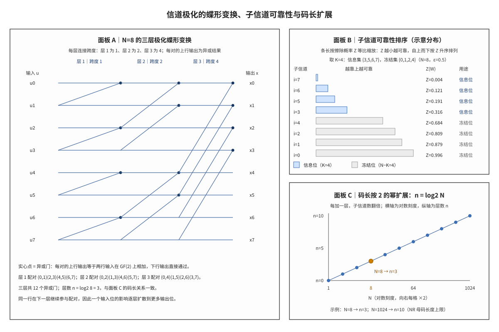

# Channel Polarization 信道极化

## 符号与记号约定

本文把全部数学符号先列在表 1 中：表中「读法」给出该符号的口述名称，「含义与取值」给出它在本文中的物理意义、取值范围与来源。后文出现这些符号时不再重复定义，只有含义发生局部改写时才另行说明。

**表 1｜信道、码长与变换**

| 符号 | 含义与取值 | 协议锚点 |
|:---|:---|:---|
| $N$ | 码长，同时也是极化变换的母码长度；$N=2^n$，NR 中 $N\le N_{\max}=1024$；单位为 bit；母码长度由 TS 38.212 §5.3.1 的 Polar 编码流程限定为 2 的幂。 | TS 38.212 §5.3.1 |
| $n$ | 递归层数，即极化变换做克罗内克积的次数；$n=\log_2N$，$N=8$ 时 $n=3$、$N=1024$ 时 $n=10$；单位为层（无量纲计数）；由 $N=2^n$ 反解得到。 | 由 TS 38.212 §5.3.1 导出 |
| $N_{\max}$ | 母码长度上限，决定可靠性序列的表长；1024；单位为 bit；TS 38.212 Table 5.3.1.2-1 的序列长度即 1024 项。 | TS 38.212 Table 5.3.1.2-1 |
| $K$ | 一个码块中信息位的个数，等于信息集 $\mathcal{I}$ 的元素个数；$0\le K\le N$，$N=8$ 的数值例取 4；单位为 bit；由调度给出的信息比特数，按 TS 38.212 §5.3.1.2 映射到最可靠的 $K$ 个位置。 | TS 38.212 §5.3.1.2 |
| $i$ | 子信道编号，同时是编码前比特与子信道的下标；$i=0,1,\ldots,N-1$；单位为无量纲序号；TS 38.212 §5.3.1.2 的比特索引编号约定。 | TS 38.212 §5.3.1.2 |
| $r$ | 递归层号，第 r 层蝶形连接跨度为 $2^{r-1}$；$r=1,\ldots,n$；单位为层号（无量纲）；本笔记为写清蝶形分层引入的记法，协议不按层编号。 | 非 3GPP 标准 |
| $G_2$ | 2×2 极化核，即极化变换的最小单元；$\begin{bmatrix}1&0\\1&1\end{bmatrix}$ 这个 0/1 矩阵；单位为无（GF(2) 上的矩阵）；TS 38.212 §5.3.1.2 的生成矩阵定义。 | TS 38.212 §5.3.1.2 |
| $G_N$ | N 阶生成矩阵，把 $N$ 个比特映射为 $N$ 个编码比特；$G_N=G_2^{\otimes n}$，即 $G_2$ 的 n 次克罗内克积，$N\times N$ 的 0/1 矩阵；单位为无（GF(2) 矩阵）；TS 38.212 §5.3.1.2 的 $G_N=(G_2)^{\otimes n}$。 | TS 38.212 §5.3.1.2 |
| $B_N$ | 位反转置换矩阵，Arikan 原始构造用它把子信道编号重排；$N\times N$ 的 0/1 置换阵，Arikan 原始构造写作 $G_N=B_NG_2^{\otimes n}$；单位为无（置换矩阵）；Arikan 2009 的构造；NR 把该置换并入可靠性序列的索引约定，不再显式执行。 | 非 3GPP 标准 |
| $u_i$ | 第 i 个编码前比特，冻结位固定为 0、信息位承载载荷；0 或 1；单位为 bit；如 $u_0,u_1,u_3$，全部输入记为 $u=(u_0,\ldots,u_{N-1})$；由 $K$ 个信息比特与 $N-K$ 个冻结位按信息集 $\mathcal{I}$ 拼成，见 TS 38.212 §5.3.1.2。 | TS 38.212 §5.3.1.2 |
| $x_i$ | 第 i 个编码后比特，即极化变换的输出；0 或 1，满足 $x=uG_N$，如 $x_0,x_1,x_3$，全部输出记为 $x=(x_0,\ldots,x_{N-1})$；单位为 bit；由输入向量 $u$ 与 $G_N$ 在 GF(2) 上相乘得到。 | TS 38.212 §5.3.1.2 |
| $W$ | 一个二进制输入离散无记忆信道，是极化的起点；以 0/1 为输入、输出为比特或符号的抽象信道；单位为无（信道模型）；Arikan 2009 的理论模型，协议不定义该对象。 | 非 3GPP 标准 |
| $W_N$ | N 次使用合并后的向量信道，输入为 $u$、输出为整段 $y_0^{N-1}$；由 $N$ 个 $W$ 副本按 $x=uG_N$ 合并得到；单位为无（信道模型）；Arikan 2009 的信道合并构造。 | 非 3GPP 标准 |
| $W^-$ | 拆分出的差信道，擦除概率更高、容量更低；由父信道按 $\varepsilon^-=1-(1-\varepsilon)^2$ 递推；单位为无（信道模型）；Arikan 2009 的信道拆分。 | 非 3GPP 标准 |
| $W^+$ | 拆分出的好信道，擦除概率更低、容量更高；由父信道按 $\varepsilon^+=\varepsilon^2$ 递推；单位为无（信道模型）；Arikan 2009 的信道拆分。 | 非 3GPP 标准 |
| $W_N^{(i)}$ | 第 i 个子信道（bit-channel），即接收端在已知前 i 个判决值的条件下判断 $u_i$ 的等效信道；$i=0,\ldots,N-1$ 共 $N$ 个，如 $W_N^{(0)},\ldots,W_N^{(N-1)}$；单位为无（信道模型）；由向量信道 $W_N$ 按 SC 判决顺序条件化得到。 | 非 3GPP 标准 |
| $y$ | 信道输出符号，$y_0^{N-1}$ 表示整段输出；BEC 下为 $\{0,1\}$ 或擦除符号，一般信道为实数或复数观测；单位为随信道模型而定（BEC 无单位）；接收端观测，协议不定义该记号。 | 非 3GPP 标准 |
| $\varepsilon$ | 二元删除信道（Binary Erasure Channel, BEC）的擦除概率；$[0,1]$ 内的实数，递推中出现 $\varepsilon^2$ 与 $(1-\varepsilon)^2$；单位为无量纲（概率）；信道模型的参数，$Z(W)=\varepsilon$。 | 非 3GPP 标准 |
| $\varepsilon^-$、$\varepsilon^+$ | 差信道与好信道的擦除概率；$\varepsilon^-=1-(1-\varepsilon)^2$、$\varepsilon^+=\varepsilon^2$，均落在 $[0,1]$，$\varepsilon=0.5$ 时分别为 0.75 与 0.25；单位为无量纲（概率）；由父信道的 $\varepsilon$ 递推得到。 | 非 3GPP 标准 |
| $Z(W)$ | Bhattacharyya 参数，度量两种输入所产生输出分布的重叠程度；$[0,1]$，越小越可靠，BEC 下等于 $\varepsilon$；单位为无量纲；由信道转移概率 $W(y\mid0)$、$W(y\mid1)$ 按定义求和得到。 | 非 3GPP 标准 |
| $I(W)$ | 对称容量，把输入限定为等概分布后取互信息；$[0,1]$，越大越可靠，BEC 下为 $1-\varepsilon$；单位为无量纲（bit/信道使用，取值归一化后为比值）；由信道转移概率计算。 | 非 3GPP 标准 |
| $C(W)$ | 信道容量，输入分布可自由选择时可靠传输速率的上确界；BEC 下 $C(W)=1-\varepsilon$，与 $I(W)$ 相等；单位为无量纲（bit/信道使用）；香农信息论定义。 | 非 3GPP 标准 |
| $\mathcal{F}$ | 冻结位下标集合，这些位置放收发约定的 0；元素个数为 $N-K$，$N=8$、$K=4$ 时为 4 个，与 $\mathcal{I}$ 互补且覆盖全部 $N$ 个位置；单位为下标集合（元素为无量纲序号）；信息集取定后取补集，见 TS 38.212 §5.3.1.2 的 $Q_F^N$。 | TS 38.212 §5.3.1.2 |
| $\mathcal{I}$ | 信息位下标集合，这些位置放载荷；元素个数为 $K$，即可靠性序列中最可靠的 $K$ 个位置；单位为下标集合（元素为无量纲序号）；由 TS 38.212 §5.3.1.2 的 $Q_I^N$ 给出。 | TS 38.212 §5.3.1.2 |
| $Q$ | NR 可靠性序列，按可靠性升序排列的比特索引表；1024 项，元素取 $0$ 至 $N_{\max}-1$，实际码长 $N$ 只取其中小于 $N$ 的项并保持相对顺序；单位为无量纲索引序列；TS 38.212 Table 5.3.1.2-1。 | TS 38.212 Table 5.3.1.2-1 |

运算符与记号约定如下。$\oplus$ 表示 GF(2) 加法（异或），$\otimes$ 表示克罗内克积，$\sqrt{\cdot}$ 表示算术平方根。$2^{r-1}$ 的上标是幂次；$W^-$ 与 $W^+$ 的上标减、加是拆分方向标记，不表示减法或加法。$W_N^{(i)}$ 的上标 $(i)$ 与 $u_i$ 的下标 i 属于同一套编号体系，指同一个子信道编号。

花体 $\mathcal{F}$、$\mathcal{I}$ 用于把下标集合与函数 $I(W)$ 区分开：前者是集合，后者是以信道为自变量的函数。$Z(W)$ 中的 W 是函数参数而非下标。序列 $u_0,\ldots,u_{N-1}$ 的下标从 0 起，长度写在下标末项，$\mathcal{F}$ 的元素个数用 $|\mathcal{F}|$ 表示。

一句话本质：**信道极化是一次可递归的坐标变换，它把 N 个相同信道的可靠性按位置重新分布，使可靠位置与不可靠位置都能在编码前算出**。本笔记先交代历史脉络与前置对象，再给出生成矩阵与拆分的形式定义，随后用 BEC 上的两级拆分手算说明数值如何产生，最后指出有限码长下的边界。

## 解释目标与范围

本节目标：解释信道极化的对象、变换与判据——$N$ 个相同信道如何经 $G_N$ 合并为向量信道、又如何拆分为 $N$ 个子信道，子信道的可靠性用什么量排序，信息位与冻结位如何据此放置。

这一机制决定 NR 控制信道所承载的 Polar 编码信息集合：物理下行控制信道（Physical Downlink Control Channel, PDCCH）承载的下行控制信息，以及物理上行控制信道（Physical Uplink Control Channel, PUCCH）与物理上行共享信道（Physical Uplink Shared Channel, PUSCH）承载的上行控制信息，两类信息都按同一套可靠性排序取信息位。这一排序贯穿发送端编码与接收端连续消除（Successive Cancellation, SC）、连续消除列表（Successive Cancellation List, SCL）译码全链。要读懂后面的定义，先建立五个前置对象：信道容量与对称容量、Bhattacharyya 参数、递归信道合并、冻结位与信息位。

## 前置概念

信道容量（Channel Capacity）$C(W)$ 是一个信道在输入分布可自由选择时可靠传输速率的上确界，也是编码理论追求的上界；对称容量（Symmetric Capacity）$I(W)$ 把输入限定为等概分布后取互信息，取值同样落在 $[0,1]$。对 BEC 与二进制对称信道这类对称信道，两者相等，BEC 下都等于 $1-\varepsilon$。极化定理陈述的极限是后者：$I(W)$ 决定最终有多少子信道趋于可靠，因此本笔记的排序与数值都以它和 $Z(W)$ 为准，一般信息论背景参见 [[Information_Theory_信息论基础]]。

Bhattacharyya 参数（Bhattacharyya Parameter）$Z(W)$ 度量两种输入所产生输出分布的重叠程度，定义为 $Z(W)=\sum_{y}\sqrt{W(y\mid0)W(y\mid1)}$，取值 $[0,1]$：$Z=0$ 表示两种输入的输出分布完全分开、判决不会错，$Z=1$ 表示两种输入的输出分布相同、判决只能靠猜。它与对称容量方向相反，越小越可靠；在 BEC 下 $Z(W)$ 恰好等于擦除概率 $\varepsilon$，这是后文能手算的原因。

递归信道合并（Recursive Channel Combining）是把两个独立信道副本按 $x_0=u_0\oplus u_1$、$x_1=u_1$ 接成一个二输入二输出的向量信道，再把这个操作递归 $n$ 次的过程。每次合并都同时定义了一次拆分：合并后的向量信道在接收端被看成两个条件不同的子信道 $W^-$ 与 $W^+$，分别对应"两路观测都要用上"和"已知一路之后再判另一路"两种判决条件。合并与拆分是同一构造的两面，参见 [[Polar_码]]。

冻结位（Frozen Bit）是发送端与接收端事先约定取值的编码前比特，NR 约定为 0；信息位（Information Bit）承载载荷、循环冗余校验（Cyclic Redundancy Check, CRC）与协议规定的辅助比特。两者按可靠性排序划分：可靠位置放信息位、不可靠位置放冻结位，两个集合互补且覆盖全部 $N$ 个位置。冻结位的取值不是可选项而是收发约定，一旦两侧的冻结图样不一致，译码树就会在错误位置强制或分裂路径。SC 与 SCL 译码如何按这个顺序逐位推进，见 [[SCL_Decoding_SCL译码]]。

这五个对象建立后，极化的历史脉络可以按同一条线索读出：先有容量可达性的追问，再有 2×2 核的构造，接着是从合并到拆分的递归，最后才是可靠性排序与协议实现。

## 起源与演进

(1) **起点：容量可达性的追问。** 香农定理给出了信道容量的上界，却没有给出达到上界的构造。Arikan 在 2009 年提出的思路是：既然无法直接造出无损信道，就把大量相同的信道按固定规则组合起来，让组合后的等效信道中有一部分趋于无损、另一部分趋于全噪，再把信息只放在无损的那部分上。这个构造第一次以显式编码与显式译码达到了二进制输入离散无记忆信道的对称容量，Polar 码由此成为第一类被证明容量可达的构造性码。

(2) **机制：2×2 核的一次分化。** 最小构造只涉及两个比特：$x_0=u_0\oplus u_1$、$x_1=u_1$。接收端判 $u_0$ 时必须同时解释两路观测之间的关系，此时 $u_1$ 尚未判决，等效信道的擦除概率上升；判 $u_1$ 时 $u_0$ 已经判决，两路观测都可用，等效信道的擦除概率下降。一次 2×2 变换就把两个相同的 $W$ 变成一差一好的 $W^-$ 与 $W^+$。

(3) **递归：从一次分化到 N 个子信道。** 把 2×2 核按克罗内克积递归 $n$ 次，得到 $G_N=G_2^{\otimes n}$，$N=2^n$ 个副本被合并成一个 $N$ 输入 $N$ 输出的向量信道，再拆成 $N$ 个子信道 $W_N^{(0)},\ldots,W_N^{(N-1)}$。每经过一层，子信道的可靠性就按"差者更差、好者更好"的方向再分化一次；层数越多，两端越极端，中间的子信道占比越小。

(4) **判据：可靠性排序与信息集。** 分化的结果是每个子信道都有一个可算的可靠性指标。把所有子信道按可靠性升序排列，取最可靠的 $K$ 个位置放信息位、其余放冻结位，就得到码率 $K/N$ 的 Polar 码。这一步把"构造码"归结为"排序并取前 K 个"，也是 NR 把可靠性序列固化进协议的原因。

(5) **工程化：NR 的固定序列与码长上限。** 3GPP 在 TS 38.212 §5.3.1.2 把母码长度上限取为 $N_{\max}=1024$，并把 1024 项的可靠性序列 $Q$ 写成表格；实际码长 $N$ 取表中所有小于 $N$ 的索引并保持相对顺序。有限码长下的排序由预先生成的序列给出，实际发送长度与母码长度不等时由速率匹配调整，极化本身仍只在 $N=2^n$ 上定义，这一段边界见后文「边界情形」。

## 科学定义

极化的形式定义由三部分组成：生成矩阵给出变换，信道合并与拆分给出子信道的来源，可靠性度量给出排序依据。三部分共用同一套编号：输入位 $u_i$、输出位 $x_i$、子信道 $W_N^{(i)}$ 的编号 i 一致，编号的排列顺序由 $G_N$ 的行列结构决定。

### 生成矩阵与递归结构

极化变换的核是 $G_2=\begin{bmatrix}1&0\\1&1\end{bmatrix}$，它作用在两个比特上得到 $x_0=u_0\oplus u_1$ 与 $x_1=u_1$。把核做 $n$ 次克罗内克积得到 $N$ 阶生成矩阵：

$$G_N=G_2^{\otimes n},\qquad N=2^n$$

编码就是一次 GF(2) 上的矩阵乘法 $x=uG_N$，其中 $u$ 与 $x$ 都是长度 $N$ 的行向量。Arikan 的原始构造还带一个位反转置换 $B_N$，写作 $G_N=B_NG_2^{\otimes n}$；NR 把这个置换并入可靠性序列的索引约定，实现上只需按协议给出的序列取信息位置，不必显式做位反转。矩阵的递归结构说明变换可以分层执行：$G_N$ 等于 $n$ 个稀疏矩阵的乘积，每个稀疏矩阵只在一部分行对上做 2×2 运算，这就是蝶形连接的来源。

### 信道合并与信道拆分

把 $N$ 个独立副本按 $x=uG_N$ 合并后，得到一个以 $u$ 为输入、以整段输出 $y_0^{N-1}$ 为输出的向量信道 $W_N$；它的转移概率是各副本转移概率之积，因为 $N$ 次使用之间相互独立。对第 i 个输入位而言，接收端在判决它时已经知道前 $i$ 个输入位的判决值（按 SC 顺序），因此条件化的等效信道——即子信道 $W_N^{(i)}$——同时以整段观测和前缀判决为条件。这个条件化就是"拆分"：同一个向量信道，按不同的已知信息切成 $N$ 个判决问题。

拆分的递推只用两个式子。设某个子信道的擦除概率为 $\varepsilon$，它向下拆出的差信道与好信道满足

$$\varepsilon^-=1-(1-\varepsilon)^2,\qquad \varepsilon^+=\varepsilon^2$$

对一般二进制输入信道，Bhattacharyya 参数满足 $Z(W^+)=Z(W)^2$ 与 $Z(W^-)\le 2Z(W)-Z(W)^2$，对 BEC 两式都取等号，即 $Z(W^-)=2Z(W)-Z(W)^2$、$Z(W^+)=Z(W)^2$；对称容量在 BEC 上满足 $I(W^-)=I(W)^2$、$I(W^+)=2I(W)-I(W)^2$，且 $I(W^-)+I(W^+)=2I(W)$。两个方向相反的量给出同一结论：一次拆分把可靠性拉开，好者更好、差者更差。级联的速率匹配如何改变实际发送位置，见 [[Rate_Matching_速率匹配]]。

### 可靠性度量与极化定理

排序依据可以取 $Z(W)$ 也可以取 $I(W)$，两者单调反向，BEC 上还互为 $Z=1-I$。极化定理断言：对任意二进制输入离散无记忆信道，当 $N\to\infty$ 时，容量接近 1 的子信道占比趋于 $I(W)$，容量接近 0 的子信道占比趋于 $1-I(W)$，处于中间地带的子信道占比趋于 0。换句话说，可靠性不是均匀提升，而是向两个端点集中；码率只要低于 $I(W)$，就可以把信息位全部放在趋于可靠的那一端。

这一定理是渐近结论，它不保证任何有限 $N$ 下子信道已经分化完全。工程上因此需要一张按码长预先算好的可靠性序列：序列把"哪个位置更可靠"的经验与数值结果固化下来，发送端与接收端查同一张表，从而在有限码长下取得接近极限的性能。NR 的 $Q$ 序列就是这张表，理论来源则是 Arikan 的论文而不是 3GPP 标准文件。

三段定义合起来给出一个可执行的构造：算矩阵、拆子信道、按可靠性排序取前 $K$ 个。要把这套构造落到图上，最直接的方式是按层画出蝶形连接，再把排好序的子信道与码长关系并列画在一起。

$G_N$ 的分层执行对应一张蝶形图：第 r 层只把行号相差 $2^{r-1}$ 的两行配对，每对的上行输出为两行输入之和、下行输出保持不变。图 1 面板 A 按这一规律画出 $N=8$ 的三层连接，层 1、2、3 的跨度依次为 1、2、4；实心点标出异或门的位置，连线只表示数据在层间的走向，不表示物理连线。把三层按顺序读完，就得到 $x=uG_N$ 在 $N=8$ 时的完整计算过程。

拆分的数值可以直接手算。取 BEC、$\varepsilon=0.5$、$N=4$，第一级把 0.5 拆成 0.75 与 0.25，第二级再分别拆分，两级共得到六个结果，如下表：

| 级 | 输入擦除概率 | 使用的递推 | 输出擦除概率 |
|:---|:---|:---|:---|
| 第 1 级 | 0.5 | $\varepsilon^-=1-(1-0.5)^2$ | 0.75 |
| 第 1 级 | 0.5 | $\varepsilon^+=0.5^2$ | 0.25 |
| 第 2 级 | 0.75 | $\varepsilon^-=1-(1-0.75)^2$ | 0.9375 |
| 第 2 级 | 0.75 | $\varepsilon^+=0.75^2$ | 0.5625 |
| 第 2 级 | 0.25 | $\varepsilon^-=1-(1-0.25)^2$ | 0.4375 |
| 第 2 级 | 0.25 | $\varepsilon^+=0.25^2$ | 0.0625 |

把第 1 级的 0.75 与 0.25 分别作为第 2 级两个父节点，四个结果按差、好顺序拼接，四个子信道 $i=0,1,2,3$ 的 $Z$ 值依次为 0.9375、0.5625、0.4375、0.0625：$i=0$ 最差、$i=3$ 最好，可靠顺序为 3、2、1、0。取 $K=2$ 时信息集为 $\{2,3\}$、冻结集为 $\{0,1\}$。这个手算例说明排序不是自然顺序：编号最大的位置反而最可靠，原因在两层配对中 $u_3$ 都处在被并入异或的一端，其影响经两次扩散覆盖全部四个输出位。

同一递推在 $N=8$、$\varepsilon=0.5$ 下得到八个 $Z$ 值，按 $i=0,\ldots,7$ 依次为 0.996、0.879、0.809、0.316、0.684、0.191、0.121、0.004；按 $Z$ 升序排列得到 7、6、5、3、4、2、1、0。取 $K=4$ 时前四个位置 7、6、5、3 放信息位，后四个位置 4、2、1、0 放冻结位，与 NR 在 $N=8$、$K=4$ 下的可靠性顺序一致。这一致性是 $N=8$ 这一规模上的结果，NR 的完整序列由 1024 项表格给出；BEC 的 $Z$ 排序只用于演示机制，不能替代协议表。

码长的扩展关系由此收束为一条对数式：$n=\log_2N$，每加一层子信道数翻倍，$N=8$ 时 $n=3$、$N=1024$ 时 $n=10$。图 1 面板 C 把这条关系画成直线，横轴取对数刻度后，$n$ 与 $\log_2N$ 成正比；面板 B 则把上面八个 $Z$ 值按升序排成可靠性阶梯。三个面板共用同一组参数，可以对照读出"变换结构—可靠性排序—码长扩展"三者的对应。

**图 1｜信道极化的三层蝶形变换、子信道可靠性排序与码长扩展。** 面板 A 把 $N=8$ 的变换画成三层连接，层 1、2、3 分别把相距 1、2、4 的行配对，实心点为异或门，上行输出取两输入之和、下行输出直接通过；面板 B 按 BEC、$\varepsilon=0.5$ 的 $Z$ 值升序排出 8 个子信道，前四个标为信息位、后四个标为冻结位。面板 C 把 $n=\log_2N$ 画成直线，标出 $N=8$ 对应 $n=3$ 的读数。三块面板共用 $N=8$ 与 $\varepsilon=0.5$ 这一组参数，面板 B 的横条长度按 $Z$ 等比缩放、最短条取 4 px 仅为可见性，故标注为示意分布。

## 直观模型

把 $n$ 层拆分看成一棵深度为 $n$ 的满二叉树：根是原始信道 $W$，每个节点向下分出两个子节点，左分支为差信道 $W^-$、右分支为好信道 $W^+$。第 r 层共有 $2^r$ 个节点，第 $n$ 层共有 $N=2^n$ 个叶子，叶子与 $N$ 个子信道一一对应；叶子的编号 i 就是子信道编号，按 0 到 $N-1$ 从左到右排列。编号的二进制表示中取值为 1 的位越多，该叶子经过的好信道分支越多，可靠性通常越高；按编号从小到大排列并不严格单调，$N=8$ 时 $i=3$ 的 $Z$ 值为 0.316，小于 $i=4$ 的 0.684，而 3 的二进制 011 含两个 1、4 的二进制 100 只含一个 1。

编码侧的同一过程写成矩阵分解更清楚：第 r 层使用 $N/2$ 个独立的 2×2 核，每个核只作用于行号相差 $2^{r-1}$ 的一对行，其余行原样传递。跨度逐层翻倍，行位置本身不动，因此蝶形图的横向可以按层切成 $n$ 段，每段的连线规律完全相同，只是配对的距离不同。图 1 面板 A 的层标题标出的正是这个跨度，配对列表可以直接按行号核对。

可靠性排序是一个独立的步骤：每个叶子带一个 $Z$ 值，把 $N$ 个叶子按 $Z$ 升序排成一列，前 $K$ 个位置放信息位、其余放冻结位。排序改变的是"哪些编号被选中"，不改变编号本身；发送端与接收端必须用同一张排序表，否则同一编号在两侧落在不同集合里。BEC 上的 $Z$ 值可以逐层手算，这正是前一节表格的用途。

三者的对应关系可以概括为一组计数：叶子数、蝶形行数、子信道个数都等于 $N$；树深、蝶形层数、对数式中的 $n$ 都相等；叶子的 $Z$ 值、排序依据、信息集与冻结集的划分依据是同一个量。抓住这组计数，就不必分别记忆三个面板。这些结构化关系也正好用来排除下面几类常见混淆。

## 常见误解

| 误解 | 正确理解 |
|:---|:---|
| 信道极化是天线极化 | 信道极化是编码变换后子信道可靠性的分化，与天线或电磁极化无关。 |
| 冻结位是编码后被删掉的比特 | 冻结位是编码前输入位置的固定值，NR 约定为 0，编码后仍参与输出。 |
| 冻结位与打孔位是一回事 | 冻结位是编码前约束；打孔位是编码输出未发送、接收端缺观测。 |
| 冻结位取值可以随便定 | 收发双方必须用同一约定与同一冻结图样，否则译码在错误位置分裂。 |
| 信息位按自然顺序排 | 信息位按可靠性序列选，不是自然顺序；$N=8$、$K=4$ 时选的是 3、5、6、7。 |
| $Z$ 越小表示信道越差 | $Z$ 是错误概率的度量，越小越可靠；容量 $I(W)$ 的方向相反，越大越可靠。 |
| 极化的可靠与不可靠是物理信道变了 | 物理信道没有变，变的是判断第 i 个编码前比特的等效子信道的观测结构。 |

表中最后两条针对可靠性的方向与作用对象：$Z$ 与 $I(W)$ 的方向相反，可靠性分化发生在等效子信道上而不是物理信道上。

## 边界情形

有限码长下极化并不完全。$N$ 取到 1024 时，两端的子信道已经明显分化，但仍有部分子信道的 $Z$ 值停在中间地带，信息集的选择只能依靠按码长算出的可靠性序列。这也解释了为什么 NR 要把 1024 项的序列写进协议：协议不要求终端在运行时重新计算各子信道的可靠性，只要求两侧查同一张表。

母码长度必须取 2 的幂。极化变换只在 $N=2^n$ 上有定义，NR 的母码长度也因此始终取 2 的幂；目标发送长度不是 2 的幂时，由速率匹配通过打孔、缩短或重复把码字调整到目标长度。这些操作会改变接收端对部分位置的观测，从而改变实际可靠性排序，因此信息位与冻结位的映射不能简单照搬母码的那一套，具体规则由 TS 38.212 的速率匹配条款约束。

BEC 的 $Z$ 排序是一套模型结果，不是协议结果。它适合演示递推与排序，也适合手算校验；但真实信道不是 BEC，NR 的序列是在多种信道模型与码长上设计并冻结的。把 BEC 数值当成协议表使用，会在 $N$ 较大时选错信息位置。以上三条边界对应到协议文本，就是下面列出的条款与本地锚点。

## 协议锚点

NR 侧：TS 38.212 Rel-19 §5.3.1 Polar coding 给出编码流程与生成矩阵，§5.3.1.2 Polar sequence 给出可靠性序列与信息集选取规则，Table 5.3.1.2-1 是 1024 项的序列表；§5.4.1 的速率匹配决定母码与目标长度不一致时哪些位置实际发送。本地锚点为 `3GPP_Rel19/processed/TS_38.212_38212-j30/content.md` 行 815-837 与 873-943，表格见 `tables/table_0012.csv` 与同名 html。

理论侧：信道极化与 Polar 码由 Arikan 在 2009 年提出，属于学术文献而非 3GPP 标准文件；3GPP 只规定工程参数与索引约定。本知识库的讲义展开见 `docs/L2_协议算法/T10.2_channel_polarization_frozen_bits.md`（极化与冻结位）与 `docs/L2_协议算法/T10.3_NR_Polar_reliability_sequence.md`（可靠性序列复现），后者给出 1024 项序列的完整取法与 $N$ 的筛选规则。把定义、数值与边界收束起来，本笔记的要点如下。

## 关键要点

1. 信道极化把 $N$ 个相同信道经 $G_N$ 变换后拆成 $N$ 个可靠性不同的子信道，是 Polar 码的理论基石。
2. 2×2 核 $G_2$ 一次作用即产生一差一好的 $W^-$ 与 $W^+$，递归 $n$ 次把分化放大到 $N=2^n$ 个子信道。
3. 蝶形连接按层划分，第 r 层的配对跨度为 $2^{r-1}$，$N=8$ 时依次为 1、2、4，共 12 个异或门。
4. BEC 上擦除概率按 $\varepsilon^-=1-(1-\varepsilon)^2$、$\varepsilon^+=\varepsilon^2$ 递推；$\varepsilon=0.5$、$N=4$ 时 $Z$ 值依次为 0.9375、0.5625、0.4375、0.0625。
5. 可靠性排序决定信息位与冻结位：取 $Z$ 最小的 $K$ 个位置放信息位，其余放冻结位，两集合互补且覆盖全部位置。
6. 码长只取 2 的幂，层数 $n=\log_2N$；NR 的母码上限为 1024，对应 $n=10$。
7. 此"极化"与天线极化无关；冻结位是编码前约束，打孔位是编码后不发送，两者语义不同。

## 图谱关联

- [[Polar_码]]
- [[SCL_Decoding_SCL译码]]
- [[CA_SCL_CRC辅助SCL]]
- [[Rate_Matching_速率匹配]]
- [[Information_Theory_信息论基础]]
- [[GF2_伽罗瓦域]]
- [[PDCCH_物理下行控制信道]]
- [[T10.2_channel_polarization_frozen_bits]]
- [[T10.3_NR_Polar_reliability_sequence]]
- [[概念图谱入口]]
- 关系语义：信道极化是 Polar 码的理论基石，可靠性排序决定信息集与冻结集，二者贯穿编码与 SC/SCL 译码全链。
