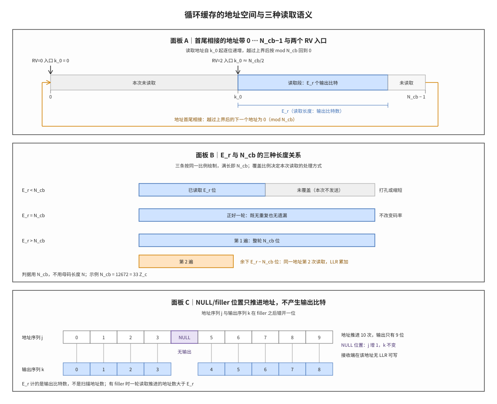

# Circular Buffer 循环缓存

## 符号与记号约定

阅读本笔记的公式前先明确记法。下表登记全文使用的每一个数学符号，后文出现时不再重复定义；运算符与下标语义见表后的约定。

| 符号 | 读法 | 含义与取值 |
|:---|:---|:---|
| $N$ | N | NR 的母码长度：基图 1 为 $66Z_c$，基图 2 为 $50Z_c$，已扣除不进入缓存的 $2Z_c$ 个系统位 |
| $N_{\mathrm{cb}}$ | N 下标 cb | 循环缓存长度，即可寻址比特位置的总数；LTE 与 NR 的取值方式不同 |
| $N_{ref}$ | N 下标 ref | NR 有限缓存速率匹配（LBRM）给出的缓存上限 |
| $N_{IR}$ | N 下标 IR | LTE 为整个传输块分配的软缓存比特数，由 UE 类别决定 |
| $K_w$ | K 下标 w | LTE 循环缓存的母码长度，$K_w=3K_{\Pi}$ |
| $K_{\Pi}$ | K 下标 Π（pi） | LTE 单个码块的长度（含 24 bit 码块 CRC），也是子块交织的输入长度 |
| $Z_c$ | Z 下标 c | NR LDPC 的提升因子，基图矩阵按该值扩展为校验矩阵 |
| $C$ | C | 一个传输块内的码块数 |
| $G$ | G | 一个传输块本次可用的编码比特总数，由资源侧的时频资源、调制阶数与层数算出 |
| $k_0$ | k 下标 0 | 本次读取的起始地址，由冗余版本决定 |
| $k$ | k | 输出比特序号，取值 $0,1,\dots,E_r-1$ |
| $j$ | j | 扫描地址的序号，每推进一次加 1，遇到 NULL 也加 1 |
| $E$ | E | LTE 单个码块的速率匹配输出长度 |
| $E_r$ | E 下标 r | NR 第 $r$ 个码块的速率匹配输出长度；LTE 的对应量写作 $E$ |
| $r$ | r | 码块序号 |
| $rv_{id}$ | rv 下标 id | NR 的冗余版本号，取 0、1、2、3 |
| $rv_{idx}$ | rv 下标 idx | LTE 的冗余版本号，取 0、1、2、3 |
| $R_{subblock}$ | R 下标 subblock | LTE 子块交织矩阵的行数，$R_{subblock}=\lceil(K_{\Pi}+4)/32\rceil$ |
| $w$ | w | 循环缓存的比特序列（写入后的缓存内容），$w_0,\dots,w_{N_{\mathrm{cb}}-1}$ |
| $d$ | d | 编码器输出、进入缓存的码字序列，长度 $N$ 或 $K_w$ |
| $f$ | f | 循环缓存中 NULL/filler 位置的个数，只推进地址、不产生输出比特 |
| $e$ | e | 速率匹配输出序列，长度 $E_r$，写作 $e_0,\dots,e_{E_r-1}$；第 k 个输出比特为 $e_k$ |
| $R_{LBRM}$ | R 下标 LBRM | LBRM 假设下的参考码率，协议取 $2/3$ |
| $TBS_{LBRM}$ | TBS 下标 LBRM | LBRM 假设下按最大配置算得的传输块大小（比特） |

运算符与下标语义（与符号同等重要，避免把运算符当作物理量）：

1. **下标语义**：$E_r$ 的下标 r 指"第 r 个码块"，不是乘法；$k_0$ 的下标 0 是版本入口的固定记法，不是变量取值；$N_{\mathrm{cb}}$ 的下标 cb 表示 circular buffer。上标不表示幂次，$2Z_c$ 中的 2 是倍数。
2. **取整与取余**：$\lfloor x\rfloor$ 为向下取整，$\lceil x\rceil$ 为向上取整，$x\bmod y$ 为 x 除以 y 的余数。
3. **取小**：$\min(a,b)$ 取两者中的较小值，用于把母码长度截到缓存上限。
4. **三套长度不可混用**：$N$ 是母码长度，$N_{\mathrm{cb}}$ 是缓存长度，$N_{ref}$ 是 LBRM 上限；关系为 $N_{\mathrm{cb}}=\min(N,N_{ref})$（NR）与 $N_{\mathrm{cb}}=\min(K_w,\lfloor N_{IR}/C\rfloor)$（LTE）。
5. **k 与 j 不同**：k 只对输出的比特计数，j 对扫描过的地址计数；NULL 位置只让 j 增加。$E$ 与 $E_r$ 是同一物理量在两代协议中的两套记号。

循环缓存（Circular Buffer, CircBuf）是速率匹配阶段使用的一段线性地址空间，长度为 $N_{\mathrm{cb}}$ 个比特位置。编码器输出的码字按系统位在前、校验位在后的顺序写入这段地址空间；读取时地址从起点 $k_0$ 起逐位递增，越过上界后按模 $N_{\mathrm{cb}}$ 回到地址 0，直到输出比特数达到 $E_r$。

一句话本质：**同一段地址空间与同一条读取规则，通过上界 $N_{\mathrm{cb}}$、起点 $k_0$ 与输出长度 $E_r$ 三个量的取值组合，同时表达打孔、整轮读取与重复三种传输语义。**

## 独立解释任务

任务目标：解释循环缓存如何以单一地址空间同时表达打孔、重复与不同冗余版本起点，说明 $N_{\mathrm{cb}}$、$k_0$、$E_r$ 三个参数各自决定什么、由哪一级信令或协议规则给出、在接收端如何反推，并给出 LTE 与 NR 两代结构差异与一组可直接核算的数值例。

## 前置概念

本节列出后文反复使用的对象。若已熟悉，可跳过本节直接阅读「起源与演进」；若某一节读不通，多半是本节中的某个对象尚未建立。

### 码块长度与母码长度

LTE 的 Turbo 编码以码块为单位进行：一个传输块（Transport Block, TB）按最大码块长度切分为若干码块（Code Block, CB），第 r 个码块的长度记为 $K_{\Pi}$，含 24 bit 码块 CRC。Turbo 编码器对每个码块输出系统位、第一校验位、第二校验位三路，每路经子块交织后长度仍为 $K_{\Pi}$，三路顺序拼接所得长度 $K_w=3K_{\Pi}$ 即 LTE 循环缓存的母码长度。NR 的 LDPC 编码以提升因子 $Z_c$ 为缩放单位，基图 1 的母码长度 $N=66Z_c$、基图 2 为 $N=50Z_c$；这两个数已扣除不进入缓存的 $2Z_c$ 个系统位。参见 [[CB_码块]]、[[Segmentation_码块分段]]、[[Turbo_码]]、[[LDPC_低密度奇偶校验码]]、[[Base_Graph_基图]]。

### 缓存长度与其上限

$N_{\mathrm{cb}}$ 是可寻址位置的总数，由"母码长度"与"接收端缓存上限"两者取较小值：LTE 为 $\min(K_w,\lfloor N_{IR}/C\rfloor)$，NR 为 $\min(N,N_{ref})$。$N_{IR}$ 是按 UE 类别为整个传输块分配的软缓存比特数，除以码块数 $C$ 得到每码块的份额；$N_{ref}$ 是有限缓存速率匹配（Limited Buffer Rate Matching, LBRM）给出的上限，由 LBRM 假设下的传输块大小 $TBS_{LBRM}$ 与参考码率 $R_{LBRM}=2/3$ 按 $N_{ref}=\lfloor TBS_{LBRM}/(C\cdot R_{LBRM})\rfloor$ 算出。两者的含义相同：缓存不为每个码块提供完整母码空间，只保留到上限为止。参见 [[Soft_Buffer_软缓存]]、[[Rate_Matching_速率匹配]]。

### 起点与冗余版本

冗余版本（Redundancy Version, RV）标识本次传输从母码的哪一段开始，$rv_{id}\in\{0,1,2,3\}$ 对应四个起点 $k_0$。LTE 按子块交织矩阵行数 $R_{subblock}$ 与缓存长度计算：$k_0=R_{subblock}\left(2\left\lceil N_{\mathrm{cb}}/(8R_{subblock})\right\rceil rv_{idx}+2\right)$；NR 按基图与 $Z_c$ 查表，四个起点都是 $Z_c$ 的整数倍。参见 [[RV_冗余版本]]、[[HARQ_混合自动重传请求]]、[[Incremental_Redundancy_增量冗余]]。

### 填充比特与 NULL

填充比特（filler）是编码前为凑齐码块长度或交织矩阵维度补入的占位比特，在缓存中以 NULL 标记。它占用地址、不承载信息，读取时被跳过：地址继续推进，输出比特不增加。LTE 的 dummy 位在子块交织第 3 步补入并记为 NULL；NR 的 filler 来自码块分段，当码块长度不足 $22Z_c$ 时补到 $22Z_c$。参见 [[Filler_Bits_填充位]]。

### 软缓存

软缓存（Soft Buffer）位于接收端，按地址保存每个编码比特的对数似然比（Log-Likelihood Ratio, LLR）。同一地址第二次被读到时，接收端把新 LLR 与旧值相加，该操作称为软合并（soft combining）；未被任何一次传输覆盖的地址保持未知状态。软缓存容量即 $N_{IR}$，它是 $N_{\mathrm{cb}}$ 的上限来源。参见 [[Soft_Buffer_软缓存]]、[[LLR_对数似然比]]、[[Chase_Combining_Chase合并]]。

## 起源与演进

(1) **起点：编码长度与资源长度不相等。** 编码器按其结构生成的码字长度固定，空口能承载的编码比特数由本次调度的时频资源决定，二者几乎从不相等。长度调整有三种手段——截取一段、重复一段、不发送其中一部分，若为三种手段各设一套数据结构，收发两端就要各维护三套地址规则。协议的做法是只保留一套地址空间，把三种手段统一为同一读取规则下的不同参数取值。

(2) **LTE：三段式缓存与 NULL 填充。** 系统位、第一校验位、第二校验位各自经子块交织（sub-block interleaver）后顺序拼接，缓存长度 $K_w=3K_{\Pi}$。子块交织按 32 列矩阵做列置换，码块长度不足矩阵容量时补 dummy 位，这些位置在缓存中记为 NULL，读取时跳过。$N_{\mathrm{cb}}$ 再按软缓存份额截断：$N_{\mathrm{cb}}=\min(K_w,\lfloor N_{IR}/C\rfloor)$，使每个码块占用的接收端存储不超过其份额。

(3) **NR：单段式缓存与前 $2Z_c$ 位不进入缓存。** LDPC 编码输出的码字按基图列序排列，基图 1 有 68 列、基图 2 有 52 列；最前面 2 列对应的 $2Z_c$ 个系统位不写入缓存序列 $d$，因此进入缓存的长度是 $66Z_c$ 或 $50Z_c$。这一步在编码侧完成，速率匹配看到的 $d$ 已经是扣除后的序列，所以四个冗余版本的起点都落在 $d$ 的地址范围内。

(4) **三类操作收敛到同一公式。** 设读取从 $k_0$ 开始、沿地址递增、越过上界回到 0，则"读多长"一个参数就足以区分三类操作：读不满一轮是不发送部分比特，读满一轮是一次完整覆盖，超过一轮是对已读地址的再次读取。前者按被省略比特的已知程度分为打孔（取值未知）与缩短（已知为 0），后者在接收端表现为软合并。

(5) **数值推演。** 同一公式在不同 $E_r$ 下分别表现为打孔与重复，具体推演见「科学定义」的手算数值例：$Z_c=384$、基图 1、LBRM 生效时 $N_{\mathrm{cb}}=12672$，RV=2 的起点为 6144，$E_r=32000$ 时回绕 3 次、软合并 19328 次。

## 科学定义

本节给出定义、读取规则与数值例；符号读法见文首「符号与记号约定」，本节不再重复定义。

### 读取规则与三个参数的分工

缓存内容记为 $w_0,\dots,w_{N_{\mathrm{cb}}-1}$，其中部分位置为 NULL。读取按扫描地址推进，输出序列记为 $e_0,\dots,e_{E_r-1}$：

```text
k = 0; j = 0
while k < E_r:
    if w[(k_0 + j) mod N_cb] is not NULL:
        e_k = w[(k_0 + j) mod N_cb]
        k = k + 1
    j = j + 1
```

当缓存中没有 NULL 位置时，该过程等价于闭式

$$e_k=w_{(k_0+k)\bmod N_{\mathrm{cb}}},\qquad k=0,1,\dots,E_r-1$$

三个参数的分工如下表。三者的来源不同，缺少任何一个都无法唯一确定读取轨迹。

| 参数 | 管什么 | 由谁决定 | 接收端的作用 |
|:---|:---|:---|:---|
| $N_{\mathrm{cb}}$ | 地址空间的上界 | NR：$\min(N,N_{ref})$，$N_{ref}$ 由 LBRM 与 $TBS_{LBRM}$ 决定；LTE：$\min(K_w,\lfloor N_{IR}/C\rfloor)$ | 决定回绕点，即重复从哪个地址开始 |
| $k_0$ | 本次读取的起点 | NR：$rv_{id}$ 与基图查表；LTE：$R_{subblock}$、$N_{\mathrm{cb}}$ 与 $rv_{idx}$ | 决定 LLR 写回缓存的第一个地址 |
| $E_r$ | 本次输出的比特数 | 由 $G$ 与码块数分配得到，与缓存长度无关 | 决定 LLR 切片的长度与码块边界 |

### 三种读取长度关系

$E_r$ 与 $N_{\mathrm{cb}}$ 的大小关系决定本次传输的语义，判据是比较对象为 $N_{\mathrm{cb}}$ 而非母码长度 $N$：

1. $E_r<N_{\mathrm{cb}}$：只覆盖地址空间的一段。未覆盖的位置不发送，接收端按打孔（取值未知）或缩短（已知为 0）处理，等效码率提高。
2. $E_r=N_{\mathrm{cb}}$：在缓存中没有 NULL 位置时恰好覆盖一轮，既不重复也不遗漏；此时不改变码率。
3. $E_r>N_{\mathrm{cb}}$：地址回绕，部分地址被读取两次以上，接收端在同一地址累加 LLR（软合并），等效码率降低，即增量冗余所用的重复。



**图 1｜循环缓存的地址轴与三种读取长度的覆盖关系。** 面板 A 把长度为 $N_{\mathrm{cb}}$ 的地址带画成首尾相接的形式，地址自 $k_0$ 起递增、越过上界后回到 0，并用括号标出本次读取的输出长度 $E_r$；面板 B 按 $E_r$ 与 $N_{\mathrm{cb}}$ 的大小关系给出未覆盖、整轮与回绕重复三种覆盖形态；面板 C 给出 NULL/filler 位置只推进扫描地址 $j$、不产生输出比特 $k$ 的错位关系；三幅面板使用同一套符号与同一读取规则，可对照读出"读多少"（$E_r$）、"从哪读"（$k_0$）与"读多远才回绕"（$N_{\mathrm{cb}}$）的分工。

### 手算数值例

取 NR 基图 1、提升因子 $Z_c=384$，一个含 2 个码块的传输块，LBRM 生效。各量按下表顺序算出，后一步依赖前一步：

| 步骤 | 计算式 | 结果 |
|:---|:---|:---|
| 母码长度 | $N=66Z_c=66\times384$ | $25344$ |
| LBRM 上限 | $N_{ref}=\lfloor TBS_{LBRM}/(C\cdot R_{LBRM})\rfloor=\lfloor16896/(2\times2/3)\rfloor$ | $12672$ |
| 缓存长度 | $N_{\mathrm{cb}}=\min(25344,12672)$ | $12672$（$=33Z_c$） |
| RV=0 起点 | $k_0=0$ | $0$ |
| RV=2 起点 | $k_0=\lfloor33N_{\mathrm{cb}}/(66Z_c)\rfloor Z_c=\lfloor16.5\rfloor\times384$ | $6144$（$=16Z_c$） |
| RV=1 起点 | $k_0=\lfloor17N_{\mathrm{cb}}/(66Z_c)\rfloor Z_c=\lfloor8.5\rfloor\times384$ | $3072$ |
| RV=3 起点 | $k_0=\lfloor56N_{\mathrm{cb}}/(66Z_c)\rfloor Z_c=\lfloor28\rfloor\times384$ | $10752$ |

取 $E_r=32000$，则 $E_r>N_{\mathrm{cb}}$，本次读取为回绕重复。以 RV=2 为例，起点 6144、上界 12672：

- 回绕次数为 $\lfloor(k_0+E_r)/N_{\mathrm{cb}}\rfloor=\lfloor(6144+32000)/12672\rfloor=\lfloor3.0098\rfloor=3$ 次。
- 四段长度依次为 $12672-6144=6528$、$12672$、$12672$、$38144-3\times12672=128$，合计 $6528+12672+12672+128=32000$，与 $E_r$ 一致。
- 该码块的长度恰为 $22Z_c=8448$，码块分段没有补 filler，缓存中没有 NULL 位置，地址推进次数等于输出比特数。
- 全部 $12672$ 个地址都被覆盖至少一次，因此软合并次数等于 $E_r-N_{\mathrm{cb}}=32000-12672=19328$，即 19328 个 LLR 与已有值相加。

若关闭 LBRM（不按有限缓存截断），则 $N_{\mathrm{cb}}=N=25344$，同一 RV=2 的起点变为 $\lfloor33\times25344/25344\rfloor\times384=12672$。起点随 $N_{\mathrm{cb}}$ 缩放、不随 $N$ 固定，这是下一节边界情形的直接来源。

### 边界情形

- **$N_{\mathrm{cb}}<N$（LBRM 生效）**：起点、回绕点与打孔/重复的判据全部以 $N_{\mathrm{cb}}$ 为准。上例中若仍按 $N=25344$ 计算 RV=2 的起点，得到 12672，恰好等于缓存上界，第一个比特就落回地址 0，等价于把起点整体平移，接收端写回地址随之全部错位。
- **存在 filler/NULL 时 $E_r=N_{\mathrm{cb}}$ 不是整轮**：一轮需要 $N_{\mathrm{cb}}$ 个输出比特，而每遇到一个 NULL 位置要多推进一次地址，因此读取会先越过上界一次再补齐，重复在所难免。判"整轮"要看覆盖的地址集合，不能只看 $E_r$ 与 $N_{\mathrm{cb}}$ 相等。
- **$E_r=0$**：码块组未被调度时不读取任何地址，也不产生 LLR；该码块只能依赖此前传输留在软缓存中的值。

## 直观模型

本节以地址空间的属性与约束清单呈现三个参数的关系，不使用生活化比拟。

### 地址空间的三项属性

一段地址空间由三个属性刻画，速率匹配的三个参数与之一一对应：

1. **上界**：可寻址位置的总数 $N_{\mathrm{cb}}$，决定地址从哪一个值回到 0；它由母码长度与缓存上限取小得到，是可变量，不是常数。
2. **起点**：本次读取的第一个地址 $k_0$，由冗余版本给出；NR 的起点是 $Z_c$ 的整数倍，LTE 的起点由子块交织矩阵行数决定。
3. **长度**：本次输出的比特数 $E_r$，由资源侧的比特预算分配得到，与地址空间大小无关。

三者互相独立取值，任意组合都有确定语义：上界确定回绕点，起点确定覆盖从哪一段开始，长度确定覆盖比例。

### 覆盖关系与判据

把读取轨迹在地址空间上展开，覆盖关系只有三类，判据全部针对 $N_{\mathrm{cb}}$：

| 长度关系 | 覆盖形态 | 未覆盖地址 | 重复地址 | 等效码率 |
|:---|:---|:---|:---|:---|
| $E_r<N_{\mathrm{cb}}$ | 单段 | 有 | 无 | 提高 |
| $E_r=N_{\mathrm{cb}}$ | 整轮（无 NULL 时） | 无 | 无 | 不变 |
| $E_r>N_{\mathrm{cb}}$ | 整轮加回绕段 | 无 | 有 | 降低 |

回绕段的长度恒为 $E_r-N_{\mathrm{cb}}$，即第二遍及以后读取的比特数。被重复读取的地址数是另一个量：在全部地址至少被覆盖一次的前提下，它等于 $E_r-N_{\mathrm{cb}}$，这也是把重复次数换算成软合并次数的依据；起点不为 0 时第二遍会先读到若干首次覆盖的地址，两者不相等。

### 输出计数与地址推进的分离

$E_r$ 计的是输出比特数，不是扫描地址数，两者只在缓存中没有 NULL 位置时相等。设缓存中有 $f$ 个 NULL 位置，则输出 $E_r$ 个比特需要推进约 $E_r+f\cdot E_r/N_{\mathrm{cb}}$ 次地址；NULL 位置越多，同样的输出长度推进得越远，回绕也越早发生。接收端必须按同一规则跳过 NULL，否则 LLR 会整体错位。参见图 1 面板 C。

### LTE 数值对照

取 LTE 一个 $K_{\Pi}=132$ 的码块，软缓存份额足够，故 $K_w=396$、$N_{\mathrm{cb}}=396$。子块交织矩阵行数 $R_{subblock}=\lceil(132+4)/32\rceil=5$，于是

$$k_0=5\times\left(2\left\lceil396/40\right\rceil rv_{idx}+2\right)=5\times(20\,rv_{idx}+2)$$

四个冗余版本的起点为 10、110、210、310。RV=0 的起点不是 0，而是 $2R_{subblock}=10$，这与 NR 的 RV=0 起点为 0 不同。取 $E=300$：读取地址 10 至 309，未覆盖的 96 个位置是地址 0 至 9 与 310 至 395，按打孔处理。若 $E=500$，读取在地址 395 之后回到 0，第二遍读取地址 0 至 113 共 114 位，其中 104 个地址是第二次读到（等于 $E-N_{\mathrm{cb}}$），接收端在这 104 个地址上累加 LLR。

## 常见误解

| 误解 | 正确理解 |
|:---|:---|
| 循环缓存是一段首尾相连的物理存储 | 物理存储是线性的，环形是地址推进规则：写完上界回到 0，由模运算实现，不需要物理回环。 |
| 缓存长度等于母码长度 | $N_{\mathrm{cb}}$ 是母码长度与缓存上限取小后的值；LBRM 或软缓存份额生效时 $N_{\mathrm{cb}}<N$。 |
| 打孔由 $E_r<N$ 判定 | 判据是比较 $E_r$ 与 $N_{\mathrm{cb}}$；$N_{\mathrm{cb}}<N$ 时用 $N$ 判定会得出错误的覆盖形态。 |
| 打孔位在接收端被丢弃 | 打孔位不发送，接收端在该地址填 0 并标记为未知，LLR 参与后续译码但权重为零。 |
| 缩短与打孔相同 | 缩短的比特取值已知为 0，接收端可用很大的负 LLR 表示；打孔的比特取值未知，只能用零 LLR。 |
| 重复读取等同于把同一段重发一遍 | 重复段的起点与长度由 $k_0$、$E_r$ 与 $N_{\mathrm{cb}}$ 共同决定，不同冗余版本重复的地址集合不同。 |
| NR 前 $2Z_c$ 位是速率匹配阶段打掉的 | 这 $2Z_c$ 个系统位在编码侧就不写入缓存序列，$N=66Z_c$ 已是扣除后的长度，速率匹配看不到它们。 |
| 有 filler 时 $E_r=N_{\mathrm{cb}}$ 就是整轮 | NULL 位置只推进地址不产生输出，整轮需要推进超过 $N_{\mathrm{cb}}$ 次地址，会先回绕一次。 |
| 接收端能从信令直接读到 $E_r$ 与 $k_0$ | 接收端按 MCS、RV、资源分配等参数自行重算 $E_r$ 与 $k_0$，两端参数不一致即导致地址错位。 |

## 协议锚点

- LTE：TS 36.212 Rel-19 `36212-j30` §5.1.4.1.1（子块交织，第 3 步补 dummy 位并记为 NULL）、Table 5.1.4-1（列间置换）、§5.1.4.1.2（bit collection 生成 $K_w=3K_{\Pi}$ 的循环缓存、$N_{\mathrm{cb}}=\min(K_w,\lfloor N_{IR}/C\rfloor)$、起点 $k_0$ 的计算式与 bit selection 循环）。
- NR：TS 38.212 Rel-19 `38212-j30` §5.3.2（LDPC 编码，$N=66Z_c$ 或 $50Z_c$，前 $2Z_c$ 位不写入 $d$）、§5.4.2.1（$N_{\mathrm{cb}}=\min(N,N_{ref})$、$N_{ref}=\lfloor TBS_{LBRM}/(C\cdot R_{LBRM})\rfloor$、bit selection 与 NULL 跳过）、Table 5.4.2.1-2（四个冗余版本的起点）。
- 本地锚点：`3GPP_Rel19/processed/TS_36.212_36212-j30/content.md`（§5.1.4 位于段落 777-880）；`3GPP_Rel19/processed/TS_38.212_38212-j30/full.md:1756`（$N_{\mathrm{cb}}$ 定义）、`full.md:1872-1890`（bit selection 与起点表）、`full.md:1176-1215`（$2Z_c$ 位不写入 $d$）。
- 非标准项：接收端的速率恢复（rate recovery）没有独立的逆公式条款，它按同一组 $E_r$、$k_0$、$N_{\mathrm{cb}}$ 反向寻址，属于实现域；软合并的累加方式同样不属发送端规范。

## 关键要点

1. 循环缓存是长度为 $N_{\mathrm{cb}}$ 的线性地址空间，读取地址按模 $N_{\mathrm{cb}}$ 推进，环形由模运算实现而非物理回环。
2. $N_{\mathrm{cb}}$ 由母码长度与缓存上限取小：NR 为 $\min(N,N_{ref})$，LTE 为 $\min(K_w,\lfloor N_{IR}/C\rfloor)$，因此 $N_{\mathrm{cb}}$ 可小于母码长度。
3. 起点 $k_0$ 由冗余版本决定：NR 按基图与 $Z_c$ 查表且为 $Z_c$ 的整数倍，LTE 由 $R_{subblock}$ 与 $N_{\mathrm{cb}}$ 按 $k_0=R_{subblock}(2\lceil N_{\mathrm{cb}}/(8R_{subblock})\rceil rv_{idx}+2)$ 算出，RV=0 的起点是 $2R_{subblock}$ 而非 0。
4. 输出长度 $E_r$ 由资源侧比特预算分配得到，与地址空间大小无关；判打孔或重复要看 $E_r$ 与 $N_{\mathrm{cb}}$ 的大小关系。
5. $E_r<N_{\mathrm{cb}}$ 未覆盖位置不发送（打孔或缩短，码率提高）；$E_r=N_{\mathrm{cb}}$ 无 NULL 时整轮覆盖；$E_r>N_{\mathrm{cb}}$ 回绕重复，重复地址上 LLR 累加即软合并。
6. 回绕段长度恒为 $E_r-N_{\mathrm{cb}}$；全部地址至少覆盖一次时，软合并次数等于该值。
7. $E_r$ 计输出比特、$j$ 计扫描地址，NULL 位置只让 $j$ 增加；有 filler 时 $E_r=N_{\mathrm{cb}}$ 也会回绕，判整轮要看覆盖的地址集合。
8. NR 的前 $2Z_c$ 个系统位在编码侧就不写入缓存序列，$N=66Z_c$ 或 $50Z_c$ 已是扣除后的长度；LTE 的 NULL 来自子块交织补入的 dummy 位。
9. 两端必须按同一组 $E_r$、$k_0$、$N_{\mathrm{cb}}$ 计算轨迹；任一个量不一致，写回地址即整体错位，表现为码块 CRC 全部失败。

## 图谱关联

- [[Rate_Matching_速率匹配]]
- [[RV_冗余版本]]
- [[HARQ_混合自动重传请求]]
- [[Soft_Buffer_软缓存]]
- [[Filler_Bits_填充位]]
- [[Incremental_Redundancy_增量冗余]]
- [[概念图谱入口]]
- [[T7.2_LTE_subblock_deinterleaver_circular_buffer]]
- [[T9.2_NR_LDPC_circular_buffer_states]]
- [[E_Value_G_Value_E值与G值]]
- 关系语义：CircBuf 把 Rate Matching 的长度参数（$E_r$）与 RV 的起点参数（$k_0$）绑定在同一段长度为 $N_{\mathrm{cb}}$ 的地址空间上，向上承接编码器输出的码字、向下交付调制器所需的比特序列；软缓存按同一地址规则保存 LLR，使打孔、重复与增量冗余成为同一读取规则的三种取值。
