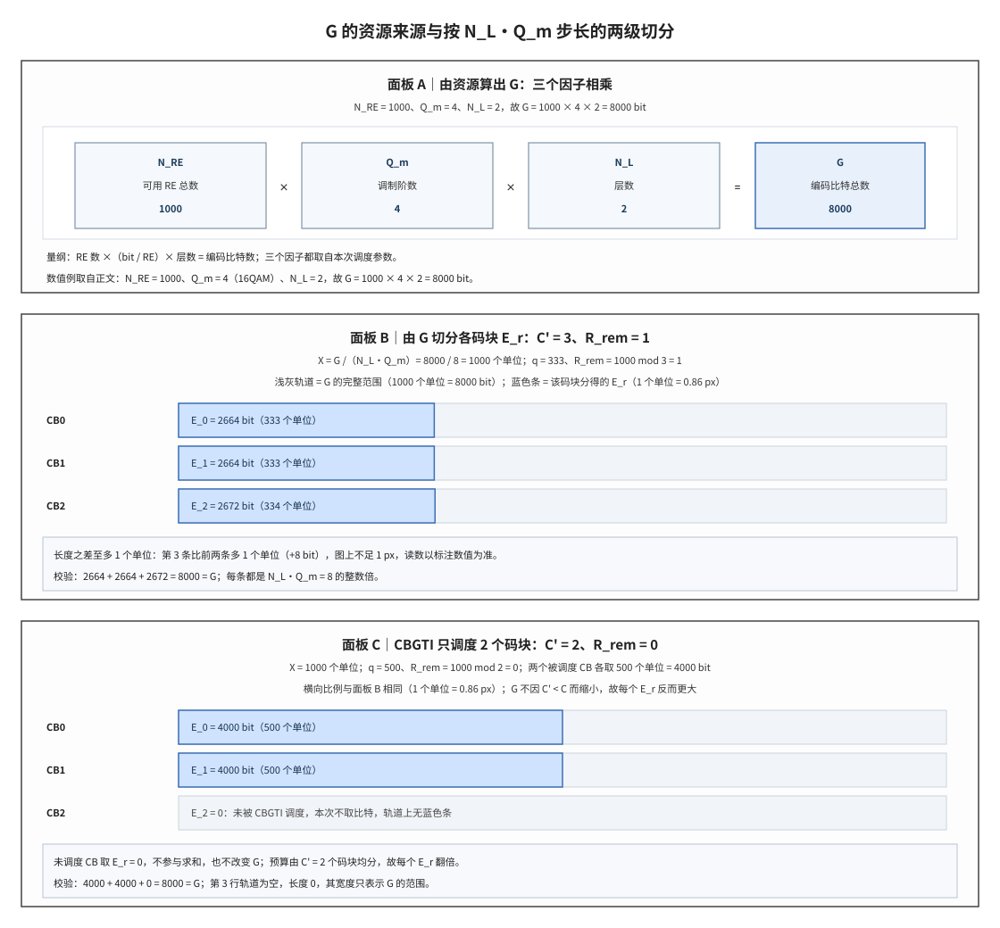

# E Value and G Value E 值与 G 值

## 符号与记号约定

本文使用的每一个数学符号都在此给出解释；下文出现这些符号时不再重复定义。表中用中文名指称协议对象，英文全称与缩写见「前置概念」的对应小节。

**表 1｜编码比特预算与长度**

| 符号                | 含义与取值                                                                             | 协议锚点 |
| :---------------- | :-------------------------------------------------------------------------------- | :--- |
| $G$               | 一个传输块本次可用的编码比特总数，是编码之后的比特预算；常规物理下行共享信道上 $G=N_{RE}\cdot Q_m\cdot N_L$，数值例 $N_{RE}=1000$、$Q_m=4$、$N_L=2$ 时为 8000；单位为 bit；定义见 TS 38.212 §5.4.2.1，三个因子来自 TS 38.214 §5.1.3.2 的资源参数。 | TS 38.212 §5.4.2.1 |
| $E_r$             | 第 r 个码块的速率匹配输出长度，即该码块本次从循环缓存取出的比特数；非负整数且是 $N_LQ_m$ 的整数倍，数值例为 2664、2664、2672，未被调度的码块取 0；单位为 bit；由 $G$、$C'$、$N_L$、$Q_m$ 按 TS 38.212 §5.4.2.1 的分配式算出。 | TS 38.212 §5.4.2.1 |
| $E$               | 单个码块的输出长度，是省略下标时的写法；$C'=1$ 时 $E=G$，否则等于对应的 $E_r$；单位为 bit；由 TS 38.212 §5.4.2.1 的分配式在 $C'=1$ 时退化得到。 | TS 38.212 §5.4.2.1 |
| $E_i$             | 求某一段起始下标时对前面各码块长度的遍历写法；$i<r$ 时取第 i 个码块的输出长度，数值例 $E_0=2664$、$E_1=2664$、$E_2=2672$；单位为 bit；把 $E_r$ 的下标换成求和变量即得，见 $B_r=\sum_{i<r}E_i$。 | 由 TS 38.212 §5.4.2.1 导出 |
| $E_{C-1}$         | 最后一个码块的输出长度；$r=C-1$ 时的 $E_r$，数值例为 2672；单位为 bit；$E_r$ 代入 $r=C-1$ 得到。 | 由 TS 38.212 §5.4.2.1 导出 |
| $E_0$、$E_1$、$E_2$ | 第 0、1、2 个码块的输出长度，是 $E_r$ 代入具体序号的结果，数值例中直接使用；2664、2664、2672，三者之和 8000 等于 $G$；单位为 bit；$E_r$ 代入 $r=0,1,2$ 并按 floor/ceil 规则分配。 | 由 TS 38.212 §5.4.2.1 导出 |
| $E_{UCI}$         | 上行控制信息速率匹配的输出比特数；正整数，由调度给出的 UCI 比特数与码率决定；单位为 bit；TS 38.212 §6.3.1.4 的 UCI 速率匹配。 | TS 38.212 §6.3.1.4 |
| $C_{UCI}$         | 上行控制信息的码块数，$E_{UCI}$ 在其上均分；正整数个，每块取 $\lfloor E_{UCI}/C_{UCI}\rfloor$；单位为个；TS 38.212 §6.3.1.4 的 UCI 速率匹配。 | TS 38.212 §6.3.1.4 |
| $C$               | 一个传输块的码块总数，由传输块大小与最大码块长度分段得到；不分段时为 1，否则为 $\lceil B/(K_{cb}-L)\rceil$，数值例为 3；单位为个；TS 38.212 §5.2.2 的分段规则。 | TS 38.212 §5.2.2 |
| $C'$              | 本次被调度的码块数；$1\le C'\le C$，无码块组传输信息时 $C'=C$，数值例为 3 或 2；单位为个；由 DCI 中的 CBGTI 给出（TS 38.214 §5.1.7），定义见 TS 38.212 §5.4.2.1。 | TS 38.212 §5.4.2.1 |
| $X$               | $G/(N_LQ_m)$，把比特预算换算成「所有层上各一个调制符号」的整数计数；非负整数，数值例 $8000/8=1000$；单位为分配单位（每单位 $N_LQ_m$ bit，数值例 8 bit）；由 $G$ 与 $N_LQ_m$ 相除得到。 | 由 TS 38.212 §5.4.2.1 导出 |
| $q$               | $\lfloor X/C'\rfloor$，每个被调度码块分得的基础单位数；非负整数，数值例为 333；单位为分配单位（每单位 $N_LQ_m$ bit）；由 $X$ 与 $C'$ 按向下取整算出。 | 由 TS 38.212 §5.4.2.1 导出 |
| $R_{rem}$         | $X\bmod C'$，均分后剩余的整单位数，等于取上取整的码块个数；$0\le R_{rem}\le C'-1$，数值例为 1；单位为分配单位（每单位 $N_LQ_m$ bit）；由 $X$ 对 $C'$ 取余得到。 | 由 TS 38.212 §5.4.2.1 导出 |

**表 2｜码块长度、母码、缓存与资源**

| 符号               | 含义与取值                                                         | 协议锚点 |
| :--------------- | :------------------------------------------------------------ | :--- |
| $N$              | 母码长度，即编码器输出并进入速率匹配的比特数；低密度奇偶校验码基图 1 为 $66Z_c$、基图 2 为 $50Z_c$；单位为 bit；TS 38.212 §5.3.2 的 LDPC 编码。 | TS 38.212 §5.3.2 |
| $N_r$            | 第 r 个码块的母码长度；按该码块所用基图取 $66Z_c$ 或 $50Z_c$；单位为 bit；由 $N$ 按码块序号 r 标号得到，定义见 TS 38.212 §5.3.2。 | TS 38.212 §5.3.2 |
| $N_{cb}$         | 循环缓存长度，是比特选择地址空间的上界；$I_{LBRM}=0$ 时 $N_{cb}=N$，否则 $\min(N,N_{ref})$；单位为 bit；TS 38.212 §5.4.2.1。 | TS 38.212 §5.4.2.1 |
| $N_{ref}$        | 有限缓存速率匹配给出的缓存上限；$\lfloor TBS_{LBRM}/(C\cdot R_{LBRM})\rfloor$，其中 $R_{LBRM}=2/3$、$TBS_{LBRM}$ 按 TS 38.214 §5.1.3.2 的假设算出；单位为 bit；TS 38.212 §5.4.2.1。 | TS 38.212 §5.4.2.1 |
| $N_{IR}$         | 软缓存总容量，LTE 中用它限制 $N_{cb}$；由 UE 类别给出的软信道比特总数 $N_{soft}$ 按码块数分摊；单位为 bit；TS 36.212 §5.1.4.1.2。 | TS 36.212 §5.1.4.1.2 |
| $K$              | 信息比特数，母码长度公式中的口径；BG1 为 $22Z_c$、BG2 为 $10Z_c$；单位为 bit；TS 38.212 §5.2.2 的分段与提升规则。 | TS 38.212 §5.2.2 |
| $K_r$            | 第 r 个码块的分段长度，含码块循环冗余校验；$K_r=K$，即 BG1 为 $22Z_c$、BG2 为 $10Z_c$；单位为 bit；TS 38.212 §5.2.2。 | TS 38.212 §5.2.2 |
| $K_w$            | LTE Turbo 码的循环缓存长度；$K_w=3K_\Pi$；单位为 bit；TS 36.212 §5.1.4.1.2 的三路码流拼接。 | TS 36.212 §5.1.4.1.2 |
| $K_\Pi$          | LTE 中含循环冗余校验的码块长度，也是子块交织的输出长度；恒为 32 的整数倍；单位为 bit；TS 36.212 §5.1.4.1.1 的 32 列子块交织。 | TS 36.212 §5.1.4.1.1 |
| $Z_c$            | 低密度奇偶校验码的提升因子，基图矩阵按它放大；Table 5.3.2-1 八个集合共 51 个离散值，范围 2 至 384；单位为 bit（每块含 $Z_c$ 行与 $Z_c$ 列比特）；TS 38.212 Table 5.3.2-1 与 §5.2.2 的选取规则。 | TS 38.212 Table 5.3.2-1 |
| $k_0$            | 比特选择的起始地址，由冗余版本决定；按 RV 与基图查表，BG1 的 RV0 为 0、RV3 为 $\lfloor 56N_{cb}/(66Z_c)\rfloor Z_c$；单位为循环缓存地址（bit 位置）；TS 38.212 Table 5.4.2.1-2。 | TS 38.212 Table 5.4.2.1-2 |
| $N_{RE}$         | 本次物理下行共享信道可用的资源元素总数，已去掉解调参考信号与其他开销；$\min(156,N_{RE}')\cdot n_{PRB}$；单位为个资源元素（每个承载一个调制符号）；TS 38.214 §5.1.3.2 第 1 步。 | TS 38.214 §5.1.3.2 |
| $N_{RE}'$        | 每物理资源块的净可用资源元素数；$12N_{symb}^{sh}-N_{DMRS}^{PRB}-N_{oh}^{PRB}$；单位为个资源元素/PRB；TS 38.214 §5.1.3.2 第 1 步。 | TS 38.214 §5.1.3.2 |
| $N_{symb}^{sh}$  | 本次分配用于数据传输的正交频分复用符号数；正整数，常规时隙最多 14；单位为符号/时隙；TS 38.214 §5.1.3.2 第 1 步的调度参数。 | TS 38.214 §5.1.3.2 |
| $N_{DMRS}^{PRB}$ | 每物理资源块内解调参考信号占用的资源元素数；非负整数，随 DMRS 图样与符号数变化；单位为个资源元素/PRB；TS 38.214 §5.1.3.2 第 1 步。 | TS 38.214 §5.1.3.2 |
| $N_{oh}^{PRB}$   | 每物理资源块内的其他开销资源元素数；非负整数，由高层配置的开销值给出；单位为个资源元素/PRB；TS 38.214 §5.1.3.2 第 1 步。 | TS 38.214 §5.1.3.2 |
| $n_{PRB}$        | 本次分配的物理资源块个数；正整数，不超过载波配置的 PRB 数；单位为个 PRB（每 PRB 12 个子载波）；TS 38.214 §5.1.3.2 第 1 步。 | TS 38.214 §5.1.3.2 |
| $Q_m$            | 调制阶数，每个调制符号承载的编码比特数；2、4、6、8，对应 QPSK、16QAM、64QAM、256QAM；单位为 bit/调制符号；由 MCS 索引按 TS 38.214 §5.1.3.1 的 MCS 表查得。 | TS 38.214 §5.1.3.1 |
| $N_L$            | 层数；正整数，数值例为 2；单位为层（无量纲计数）；TS 38.212 §5.4.2.1 记作 $N_L$，TS 38.214 写作 $\nu$。 | TS 38.212 §5.4.2.1 |
| $\nu$            | 层数，与 $N_L$ 是同一物理量的另一套记号；正整数，数值例为 2；单位为层（无量纲计数）；TS 38.214 §5.1.3.2 的调度参数。 | TS 38.214 §5.1.3.2 |
| $R$              | 目标码率，由调度给出；0 至 1 之间的实数，MCS 表最高为 948/1024 约 0.926；单位为无量纲比值（信息比特/编码比特）；由 MCS 索引按 TS 38.214 §5.1.3.1 查表；$TBS_{temp}=N_{RE}\cdot R\cdot Q_m\cdot\nu$。 | TS 38.214 §5.1.3.1 |
| $TBS_{temp}$     | 未量化的信息比特数；$N_{RE}\cdot R\cdot Q_m\cdot\nu$ 算出的正整数，量级从数十 bit 到近百万 bit（随 PRB 数与 MCS 变化），最终传输块大小取不小于它的最近合法值；单位为 bit；TS 38.214 §5.1.3.2 第 2 步。 | TS 38.214 §5.1.3.2 |
| $N_{info}$       | 量化前的候选信息比特数；由 $TBS_{temp}$ 与开销规则算出的整数；单位为 bit；TS 38.214 §5.1.3.2。 | TS 38.214 §5.1.3.2 |
| $H$              | 多时隙传输时上一时隙的编码比特数；非负整数，按上一时隙无 UCI 复用时算出；单位为 bit；TS 38.212 §5.4.2.1 的多时隙处理。 | TS 38.212 §5.4.2.1 |
| $\tau$           | 多时隙传输中跳过的填充（filler）比特数；非负整数，按上一时隙的填充位统计；单位为 bit；TS 38.212 §5.4.2.1 的多时隙处理。 | TS 38.212 §5.4.2.1 |

**表 3｜序号、下标与序列元素**

| 符号 | 含义与取值 | 协议锚点 |
|:---|:---|:---|
| $r$ | 码块序号，从 0 起；$0\le r\le C-1$，数值例为 0、1、2；单位为个（无量纲序号）；码块编号，见 TS 38.212 §5.2.2 与 §5.4.2.1；$E_r$ 的下标指「第 r 个码块」，不是乘以 r。 | TS 38.212 §5.4.2.1 |
| $i$ | 比特交织的行号，取 $0,\ldots,Q_m-1$；求和式中表示遍历；$0\le i\le Q_m-1$，$Q_m=4$ 时为 0 至 3；单位为行号（无量纲）；TS 38.212 §5.4.2.2 的列写行读交织。 | TS 38.212 §5.4.2.2 |
| $j$ | 比特交织的列号，取 $0,\ldots,E/Q_m-1$；比特选择中表示扫描地址的偏移；$0\le j\le E/Q_m-1$，扫描地址时无上界、按模 $N_{cb}$ 回绕；单位为列号或地址偏移（无量纲）；TS 38.212 §5.4.2.2 与 §5.4.2.1。 | TS 38.212 §5.4.2.2 |
| $k$ | 比特选择输出的比特计数，$e_0,\ldots,e_{E-1}$ 中的下标即它；$0\le k\le E-1$；单位为 bit 计数（无量纲）；TS 38.212 §5.4.2.1 的比特选择循环。 | TS 38.212 §5.4.2.1 |
| $n$ | Polar 码母码长度 $2^n$ 中的指数；$5\le n\le 10$，其中 $n_{\min}=5$、$n_{\max}$ 取 9（PBCH、DCI）或 10（UCI）；单位为层（无量纲计数）；TS 38.212 §5.3.1 的 Polar 编码。 | TS 38.212 §5.3.1 |
| $x$、$y$、$a$、$b$ | 运算符定义中的占位变量，本身不是物理量；任意实数或整数，无固定范围；单位为无（符号占位）；数学记法，不来自协议。 | 非 3GPP 标准 |
| $B_r$ | 第 r 段对数似然比在整条流中的起始下标；$B_r=\sum_{i<r}E_i$，$B_0=0$，数值例 $B_1=2664$、$B_2=5328$；单位为 bit 位置下标；由各码块 $E_r$ 累加得到。 | 由 TS 38.212 §5.4.2.1 导出 |
| $e_0,\ldots,e_{E-1}$ | 比特选择输出的序列；长度 $E$、元素取 0 或 1；单位为 bit；TS 38.212 §5.4.2.1 的比特选择输出。 | TS 38.212 §5.4.2.1 |
| $e_{i\cdot E/Q_m+j}$ | 交织读出时取用的比特选择输出元素，即第 i 行第 j 列；$i\le Q_m-1$、$j\le E/Q_m-1$，下标落在 0 至 $E-1$；单位为 bit 位置下标；TS 38.212 §5.4.2.2 的列写行读。 | TS 38.212 §5.4.2.2 |
| $f_{i+jQ_m}$ | 比特交织输出序列，满足 $f_{i+jQ_m}=e_{i\cdot E/Q_m+j}$；长度 $E$、元素取 0 或 1；单位为 bit；TS 38.212 §5.4.2.2。 | TS 38.212 §5.4.2.2 |
| $f_{0,0},\ldots,f_{0,E_0-1}$ | 第 0 个码块交织输出的首末元素；$f_{1,0},\ldots,f_{1,E_1-1}$ 与 $f_{C-1,0},\ldots,f_{C-1,E_{C-1}-1}$ 分别是第 1 个与最后一个码块的首末元素；各段长度依次为 $E_0$、$E_1$、$E_{C-1}$；单位为 bit；TS 38.212 §5.5 级联的输入。 | TS 38.212 §5.5 |
| $g_0,\ldots,g_{G-1}$ | 码块级联后的输出序列；总长 $G$，数值例为 8000；单位为 bit；TS 38.212 §5.5 的码块级联。 | TS 38.212 §5.5 |
| $y_0,\ldots,y_{G-1}$ | 接收端对数似然比流，长度 $G$；每个元素是实数 LLR，个数等于 $G$，数值例为 8000；单位为无量纲（LLR 值）；接收端解调与解层映射的实现输出，协议不定义该序列。 | 实现域 |
| $y_{B_r},\ldots,y_{B_r+E_r-1}$ | 第 r 个码块对应的对数似然比段；长度 $E_r$，起点 $B_r$；单位为无量纲（LLR 值）；接收端按 TS 38.212 §5.4.2.1 的 $E_r$ 切片，属实现域。 | 实现域 |

运算符与上下标约定：

- $\lfloor x\rfloor$ 表示向下取整，$\lceil x\rceil$ 表示向上取整，$x\bmod y$ 表示取余，$\min(a,b)$ 表示取两者中的较小值。
- 下标表示序号或限定词：$E_r$ 的 r 是码块序号，$N_L$ 的 L 指层（layer），$Q_m$ 的 m 是调制阶数的记号，不表示相乘。
- 上标表示限定条件而非乘方：$N_{symb}^{sh}$ 的 sh 指 scheduled（已分配），$N_{DMRS}^{PRB}$ 与 $N_{oh}^{PRB}$ 的 PRB 指「每物理资源块的」。
- 撇号表示扣减后的净量或本次调度口径：$N_{RE}'$ 是扣除导频与开销之后的每 PRB 可用 RE 数，与 $N_{RE}$ 不是同一个量；$C'$ 是本次被调度的码块数，与 $C$ 不是同一个量。
- 序列记法 $x_0,\ldots,x_{L-1}$ 表示长度 L、下标从 0 起的序列；$\sum_r E_r$ 表示对一个传输块内所有码块求和。
- 名字相近但不同的三个长度：母码长度 $N$、循环缓存长度 $N_{cb}$、缓存上限 $N_{ref}$，三者不可互换；$E_r$ 是本次发送的比特数，不等于其中任何一个。

一句话本质：**G 是一个传输块在本次调度资源上的编码比特总量，$E_r$ 是第 r 个码块从该总量中分得的编码比特数，二者满足 $\sum_r E_r=G$。**

这两个量之所以存在，是因为信道编码器输出的码字长度与空口能承载的比特数几乎从不相等。编码器按自身结构生成固定长度的码字，空口容量由本次调度的时频资源、调制方式和层数决定，二者之间需要一次长度调整，这一调整称为速率匹配。要完成调整，发送端必须先确定两个数：本次一共能发多少编码比特（G），每个码块各发多少编码比特（$E_r$）。接收端不接收这两个数，它只收到调度参数，必须按同一套规则自行算出，否则无法把接收到的比特流切回各个码块。

## 解释目标与范围

本节目标：解释 G 与 $E_r$ 分别是什么，G 如何由本次调度的空口资源算出，$E_r$ 如何从 G 切分得到，二者在发送端与接收端各起什么作用，并给出从调度参数到协议条款的完整因果链。

要完成这一解释，先把后文反复使用的七个对象一次交代清楚：它们分属数据侧与资源侧两端。

## 前置概念

传输块（Transport Block, TB）是 MAC 层在一次调度中交付给物理层的一个数据块，也是信道编码链路的整体处理对象，其比特规模称为传输块大小（Transport Block Size, TBS）。当 TB 过大时，低密度奇偶校验（Low-Density Parity-Check, LDPC）编码器无法一次处理，需要按其最大码块长度切分为若干码块（Code Block, CB），每个 CB 独立进行编码并附加码块级循环冗余校验（Cyclic Redundancy Check, CRC），CB 的数量记为 C，切分规则与两者的关系见 [[TB_传输块]]、[[CB_码块]]、[[Segmentation_码块分段]]。与切分同时发生的是比特属性的区分：信息比特位于信道编码的输入侧，承载原始数据；编码比特位于输出侧，包含编码器按校验关系生成的冗余比特。同一段数据在编码前后的比特数不同，比例由码率决定，因此必须先分清所指的是哪一类计数——G 与 $E_r$ 都是编码比特数，不是信息比特数，TBS 才是信息比特数，区分这两类计数是理解本笔记的前提。

以上两项给出的是数据对象与两类比特计数；把母码长度调整到与本次空口容量一致的动作为速率匹配。速率匹配（Rate Matching）是把编码器输出的固定长度码字调整为与本次空口容量一致的比特数的处理，手段有三种：截取码字中的一段、把同一段重复发送多次、以及不发送码字中的部分比特。最后一种按被省略比特的已知程度分为两类：被省略比特取值未知时称为打孔（puncturing），已知其为零时称为缩短（shortening）。速率匹配不改变码字集合，只改变本次实际发送的比特子集及其重复关系，详见 [[Rate_Matching_速率匹配]]。

速率匹配要调整到的目标长度由空口资源决定，下面四个对象描述这一侧的计数方式。调制符号是一个复数符号，承载若干编码比特，承载的数量称为调制阶数（Modulation Order）$Q_m$：正交相移键控（Quadrature Phase Shift Keying, QPSK）为 2，16 阶正交幅度调制（16-Quadrature Amplitude Modulation, 16QAM）为 4，64QAM 为 6，256QAM 为 8。层（Layer）是同一时频资源上并行传输的独立数据流，层数记为 $N_L$；同一时刻每个层各发出一个调制符号，因此所有层合计每单位时间承载 $N_LQ_m$ 个编码比特，这个乘积是本笔记的核心步长，后文反复出现。资源元素（Resource Element, RE）是一个正交频分复用（Orthogonal Frequency Division Multiplexing, OFDM）符号与一个子载波的交点，承载一个调制符号；物理资源块（Physical Resource Block, PRB）由 12 个子载波构成，是资源分配的基本单位，本次分配的 PRB 数记为 $n_{PRB}$。一个 PRB 内并非全部 RE 都可用于数据传输：解调参考信号（Demodulation Reference Signal, DMRS）占用一部分，其他开销再占一部分，剩余部分记为每 PRB 可用 RE 数 $N_{RE}'$。本次可用的 RE 总数 $N_{RE}$ 由 $N_{RE}'$ 与 $n_{PRB}$ 共同决定，它是 G 的资源来源。

以上已经从数据侧与资源侧把长度的两端确定下来，最后一组对象说明这次读取发生在哪个地址空间、哪些码块参与本次传输。循环缓存（Circular Buffer）是编码输出码字在速率匹配中使用的地址空间，其长度记为 $N_{cb}$，读取时地址按模 $N_{cb}$ 递增，到达上界后回到起点；冗余版本（Redundancy Version, RV）指示本次读取从循环缓存的哪个地址开始，该起始地址记为 $k_0$。软缓存（Soft Buffer）位于接收端，用于保存尚未译码成功的码块的比特置信度，比特置信度以对数似然比（Log-Likelihood Ratio, LLR）表示：每个编码比特对应一个 LLR，取值的符号表示该比特更可能是 0 还是 1，绝对值表示该判断的可靠程度，参见 [[Circular_Buffer_循环缓存]]、[[RV_冗余版本]]、[[Soft_Buffer_软缓存]]、[[LLR_对数似然比]]。本次实际参与传输的码块范围由码块组决定：码块组（Code Block Group, CBG）是把一个 TB 的若干 CB 划为一组后形成的重传粒度，下行控制信息（Downlink Control Information, DCI）携带码块组传输信息（Code Block Group Transmission Information, CBGTI），以比特图的形式指示本次传输包含哪些 CBG。本次实际参与传输的 CB 称为被调度码块，其数量记为 $C'$；没有 CBGTI 时全部 CB 都被调度，$C'=C$，参见 [[CBG_码块组]]。七个对象至此交代完毕，下面按演进顺序说明这两个数为何被引入、又如何从资源侧一路算到码块侧。

## 起源与演进

(1) **起点：母码长度与空口容量不相等。** 信道编码器按其结构直接生成的码字称为母码（mother code），其长度由编码族决定：LTE 的 Turbo 码母码长度约为 $3K+12$，NR 的 LDPC 码母码长度为 $66Z_c$（基图 1）或 $50Z_c$（基图 2），Polar 码母码长度为 $2^n$。此处 $K$ 为信息比特数，$Z_c$ 为提升因子（lifting size），即把基图矩阵按整数倍放大所用的缩放单位，基图（base graph）是 LDPC 编码所依据的稀疏校验矩阵模板。空口能承载的编码比特数由本次调度的 PRB 数、OFDM 符号数、DMRS 开销、调制阶数与层数共同决定。两者几乎总不相等，速率匹配即负责把母码调整到空口容量。要调整，先要知道总容量与每个码块分得多少，这就是 G 与 $E_r$ 的由来。

(2) **第一层：由资源得到总预算 G。** TS 38.214 §5.1.3.2 第 1 步先算每 PRB 的可用 RE 数 $N_{RE}'=12N_{symb}^{sh}-N_{DMRS}^{PRB}-N_{oh}^{PRB}$，其中 $12$ 为每 PRB 的子载波数，$N_{symb}^{sh}$ 为本次分配给数据传输的 OFDM 符号数，$N_{DMRS}^{PRB}$ 为每 PRB 内 DMRS 占用的 RE 数，$N_{oh}^{PRB}$ 为每 PRB 的其他开销 RE 数；再取 $N_{RE}=\min(156,N_{RE}')\cdot n_{PRB}$，常数 156 是单 PRB 单时隙可用 RE 数的上限，$n_{PRB}$ 为分配的 PRB 数。第 2 步计算未量化的信息比特数 $TBS_{temp}=N_{RE}\cdot R\cdot Q_m\cdot\nu$，其中 $R$ 为目标码率，$\nu$ 为层数（与 TS 38.212 的 $N_L$ 是同一量，两套规范用不同记号）。G 与 $TBS_{temp}$ 共用同一个 $N_{RE}\cdot Q_m\cdot\nu$ 乘积：G 是编码之后的预算，$TBS_{temp}$ 是编码之前的预算，二者相差目标码率 R。名义上 $G=TBS_{temp}/R$；实际 TBS 经过量化（取不小于 $N_{info}'$ 的最近合法值），所以有效码率 $TBS/G$ 会略高于目标 R。G 是 per-TB 的量，双码字传输时两个 TB 各自计算自己的 G 与 $N_L$。

(3) **第二层：由总预算切分出每码块长度 $E_r$。** CB 数 C 由 TS 38.212 §5.2.2 的分段规则得到；被调度码块数 $C'$ 由 DCI 中的 CBGTI 得到（无 CBGTI 时 $C'=C$）。令 $X=G/(N_LQ_m)$，即 G 换算成的基本分配单位数，一个单位是「所有层上各一个调制符号」所承载的比特数；再令 $q=\lfloor X/C'\rfloor$、$R_{rem}=X\bmod C'$，其中 $\lfloor\cdot\rfloor$ 表示向下取整，$\bmod$ 表示取余。前 $C'-R_{rem}$ 个被调度码块各取 $q$ 个单位，后 $R_{rem}$ 个被调度码块各取 $q+1$ 个单位；未被 CBGTI 调度的码块取 $E_r=0$。数值例：$N_{RE}=1000$、$Q_m=4$、$N_L=2$ 时 $G=N_{RE}\cdot Q_m\cdot N_L=8000$、$X=8000/8=1000$；C=3 且无 CBG 时 $C'=3$、$q=333$、$R_{rem}=1$，前 2 个 CB 各得 $8\times333=2664$ bit，最后 1 个得 $8\times334=2672$ bit，合计 8000。若 CBGTI 只调度 3 个中的 2 个，则 $C'=2$、$X/C'=500$、$R_{rem}=0$，两个被调度 CB 各得 4000 bit，未调度 CB 的 $E_r=0$，合计仍是 8000。

(4) **第三层：由切片生成空口比特流。** 每个 CB 按 $E_r$ 做比特选择（bit selection）：从循环缓存起点 $k_0$ 开始按地址递增扫描，跳过 NULL（filler）位置，取满 $E_r$ 个比特；随后按 $Q_m$ 做比特交织（bit interleaving），最后在 §5.5 级联（concatenation）成 $g_0,\ldots,g_{G-1}$。仍以上例：三个 CB 的输出长度分别是 2664、2664、2672，级联后总长 8000，正好等于 G；接收端解调后得到的 LLR 流长度也是 8000，每个编码比特对应一个 LLR。

(5) **接收端：逆序处理但不等价于发送端。** 接收端不直接收到 $E_r$，只收到 MCS、RV、PRB 数、CBGTI 等调度参数，其中 MCS 为调制与编码方案（Modulation and Coding Scheme），是码率与调制阶数的联合索引。它要用 TBS 得到 C、用 $N_{RE}/Q_m/\nu$ 得到 G、用 CBGTI 得到 $C'$，按同一条公式重算 $E_r$，再按 $E_r$ 把长度为 G 的 LLR 流切开，逐 CB 做速率恢复（rate recovery）：把每个 LLR 写回循环缓存地址 $(k_0+j)\bmod N_{cb}$。NULL 位置不写 LLR，接收端将该位置视为未知；重复位置把多次收到的 LLR 累加，该操作称为软合并（soft combining）。$E_r$ 错一位，第 r 个 CB 之后的所有 LLR 都会错位；LDPC 译码器可能照常迭代，但 CB 级 CRC 会全部失败。

(6) **两代对照：LTE Turbo 与 NR LDPC。** LTE 在 TS 36.212 §5.1.4.1.2 写的是同一套骨架：“Define by G the total number of bits available for the transmission of one transport block”，再按 r 给每个 CB 分配 E，floor/ceil 的余数同样分给最后几个 CB。差别有三处：LTE 没有 CBG，$C'$ 恒等于 C；LTE Turbo 母码的循环缓存长度为 $K_w=3K_\Pi$（$K_\Pi$ 为含 CRC 的码块长度），$N_{cb}$ 受软缓存 $N_{IR}$ 限制；NR LDPC 母码为 $66Z_c$ 或 $50Z_c$，并引入 CBG 带来的 $C'$ 与 $E_r=0$。骨架不变，变化的是编码族、母码长度与 CBG 这一新的调度粒度。

骨架既已明确，下一节把这条骨架写成可运算的公式与判据。

## 科学定义

本节把前述对象写成可运算的形式。运算符与上下标约定（向下取整、取余、求和、上下标语义，以及同一量的两套记号）见文首「符号与记号约定」，本节不再重复；符号的读法、含义与取值见表 1 至表 3，下表只补协议出处，说明每个量由哪一条款定义，便于逐项查证。

| 符号 | 定义出处 |
|:---|:---|
| $G$、$E_r$、$C'$、$N_{cb}$ | TS 38.212 §5.4.2.1 |
| $k_0$ | TS 38.212 Table 5.4.2.1-2 |
| $C$、$K_r$ | TS 38.212 §5.2.2 |
| $N$、$N_r$ | TS 38.212 §5.3.2 |
| $N_{RE}$、$N_{RE}'$、$N_{symb}^{sh}$、$N_{DMRS}^{PRB}$、$N_{oh}^{PRB}$、$n_{PRB}$、$Q_m$、$\nu$、$R$、$TBS_{temp}$、$N_{info}$ | TS 38.214 §5.1.3.2 |
| $N_{ref}$ | TS 38.212 §5.4.2.1（有限缓存速率匹配口径） |
| $K_w$、$K_\Pi$、$N_{IR}$ | TS 36.212 §5.1.4.1.2 |
| $E_{UCI}$、$C_{UCI}$ | TS 38.212 §6.3.1.4 |
| $H$、$\tau$ | TS 38.212 §5.4.2.1（多时隙传输） |
| $X$、$q$、$R_{rem}$ | 由 TS 38.212 §5.4.2.1 的分配式导出，协议未单独命名 |
| 比特选择输出、交织输出、级联输出与对数似然比流的序列记法 | 本笔记的记法，对应 TS 38.212 §5.4.2.1、§5.4.2.2、§5.5 |

### G 的定义与来源

TS 38.212 §5.4.2.1 的原话是 "G is the total number of coded bits available for transmission of the transport block"。三个限定词需要分开理解：它是**编码之后**的比特数，不是 TBS；它是**本次资源可用**的比特数，不是母码长度；它是**整个 TB** 的预算，不是单个 CB 的长度。对常规 PDSCH（Physical Downlink Shared Channel，物理下行共享信道），G 由三个因子相乘得到：

$$G=N_{RE}\cdot Q_m\cdot N_L$$

其中 $N_{RE}$ 来自 TS 38.214 §5.1.3.2 第 1 步，$Q_m$ 是调制阶数，$N_L$ 是层数。把第 2 步的 $TBS_{temp}=N_{RE}\cdot R\cdot Q_m\cdot\nu$ 与 G 对比，可以看到二者共用同一个 $N_{RE}\cdot Q_m\cdot\nu$ 乘积：G 是编码之后的预算，$TBS_{temp}$ 是编码之前的预算，R 是二者之间的比例因子。G 的用途可以归为四处：它决定码块级联输出 $g_0,\ldots,g_{G-1}$ 的长度（§5.5），决定本次 TB 占用的调制符号数 $G/(N_LQ_m)$，与 TBS 一起定义有效码率 $TBS/G$（调度选择 MCS 时的核心量），并决定接收端 LLR 流的总长度——每个编码比特对应一个 LLR，共 G 个。总预算确定之后，剩下的问题就是它如何在各个码块之间切开。

### $E_r$ 的分配与手算

TS 38.212 §5.4.2.1 的原话是 "Denoting by $E_r$ the rate matching output sequence length for the r-th coded block"。$E_r$ 是第 r 个 CB 本次输出的比特数，也就是该 CB 从循环缓存中取出多少个比特。分配按三步完成：

$$X=\frac{G}{N_LQ_m},\qquad q=\left\lfloor\frac{X}{C'}\right\rfloor,\qquad R_{rem}=X\bmod C'$$

三支取值由码块是否被调度决定：未被 CBGTI 调度的 CB 取 $E_r=0$；前 $C'-R_{rem}$ 个被调度 CB 取 $E_r=N_LQ_m\cdot q$；后 $R_{rem}$ 个被调度 CB 取 $E_r=N_LQ_m\cdot(q+1)$。求和恒等式由此直接得到：

$$\sum_r E_r=N_LQ_m\left[(C'-R_{rem})q+R_{rem}(q+1)\right]=N_LQ_m(C'q+R_{rem})=N_LQ_mX=G$$

由此可以直接读出「E 的最小值」。对**未被调度**的码块，$E_r=0$ 是协议规定的正常取值，含义是本次不传该码块；对**被调度**的码块，$E_r$ 的最小非零值是 $N_LQ_m$，即一个调制符号在全部层上承载的比特数——$q\ge1$ 时它必然不小于这个单位。数值上最小可到 2 bit（单层 QPSK，$N_L=1$、$Q_m=2$），最大单位则是 32 bit（四层 256QAM，$N_L=4$、$Q_m=8$）。

还有一种更极端的情形需要分清：若 $X<C'$，即 $G<N_LQ_mC'$，则 $q=0$，前 $C'-R_{rem}$ 个被调度码块分到 $0$ 比特。这些码块虽然「被调度」，实际一个编码比特也没传，接收端无法译码。协议没有禁止这种分配，但调度器会通过限制 $C'$（部分调度）或减小传输块来避免它；把 $q=0$ 与「未调度」混为一谈，会漏掉这类静默失败。

影响 $E_r$ 的全部因素可以沿这条链列出：$G$ 由可用资源元素数 $N_{RE}$、调制阶数 $Q_m$ 与层数 $N_L$ 相乘得到，而 $N_{RE}$ 又由分配的物理资源块数、本次占用符号数、解调参考信号占用的资源元素数与额外开销共同决定；$G$ 再与 $Q_m$、$N_L$ 一起换算成分配单位数 $X$，最后按被调度码块数 $C'$ 均分。因此改变带宽、符号数、调制方式、层数或码块数中的任何一个，都会改变每个码块分到的比特数。

协议没有单独写一行 "$G=\sum_r E_r$"，但分配规则与 §5.5 的级联定义共同保证了这个恒等式。该恒等式也是检查公式是否抄错的有效手段：任何分配式代入后，和必须等于 G。

分配规则有三条性质需要记住，它们分别约束总量、步长与余数的归属。第一，步长是 $N_LQ_m$，不是 1 bit：分配单位是「所有层上各一个调制符号」所承载的比特数，所以 $E_r/(N_LQ_m)$ 必定是整数；若直接对 G 做 floor/ceil，可能切出「不足一个调制符号」的长度，§5.4.2.2 的 $E_r/Q_m$ 行交织就会出现不完整的行，调制映射无法按符号对齐。第二，余数分给最后几个被调度 CB：前 $C'-R_{rem}$ 个取 floor，后 $R_{rem}$ 个取 ceil，各多一个单位；计数只对已调度 CB 递增，因此「最后几个」按调度顺序确定，不按绝对 CB 编号确定。第三，CBG 未调度的 CB 取 $E_r=0$，它不消耗预算，G 由其余 $C'$ 个 CB 分完；需要注意 G 并不因 $C'<C$ 而缩小，G 仍是整个 TB 在这块资源上的编码比特预算，所以每个被调度 CB 分到的 $E_r$ 反而更大、等效码率更低，这正是 CBG 重传能用相同资源获得更高冗余的原因。

把上面的三步代入一组具体参数，可以逐行核对每个 $E_r$。给定 $N_{RE}=1000$、$Q_m=4$、$N_L=2$、$C'=3$（$C=3$、无 CBGTI），资源侧总量为 $G=N_{RE}\cdot Q_m\cdot N_L=1000\times4\times2=8000$ bit；换算成分配单位是 $X=G/(N_LQ_m)=8000/8=1000$ 个单位，每个单位 $N_LQ_m=8$ bit；基础单位数为 $q=\lfloor X/C'\rfloor=\lfloor1000/3\rfloor=333$；取余得 $R_{rem}=X\bmod C'=1000\bmod3=1$，即有 1 个码块取上取整。于是前 $C'-R_{rem}=2$ 个码块各取 $E_0=E_1=N_LQ_m\cdot q=8\times333=2664$ bit，后 $R_{rem}=1$ 个码块取 $E_2=N_LQ_m\cdot(q+1)=8\times334=2672$ bit。求和校验为 $\sum_r E_r=2664+2664+2672=8000=G$，且 $E_r/(N_LQ_m)$ 依次为 333、333、334，都是整数。

余数大于 1 的情形按同一规则处理：$X=1001$、$C'=3$ 时 $q=333$、$R_{rem}=2$，三个 CB 分别得 $8\times333=2664$、$8\times334=2672$、$8\times334=2672$，合计 8008 $=8\times1001$，余数 2 个单位分别给了最后两个 CB。



**图 1｜从资源到 G、再从 G 到各码块 $E_r$ 的两级切分。** 面板 A 回答 G 由哪三个因子相乘得到，并把 $N_{RE}=1000$、$Q_m=4$、$N_L=2$ 算成 8000 bit；面板 B 回答同一个 G 在 $C'=3$ 时如何被切成 333、333、334 个单位（2664、2664、2672 bit）；面板 C 回答 CBGTI 只调度 2 个码块时 $C'$ 变为 2、每个 $E_r$ 变为 4000 bit，而未被调度的码块长度为 0。三块面板的数值与上面的逐行核对以及「起源与演进」第 (3) 步的数值例是同一组，图中三条长度条按比特数成比例绘制。

### 比特选择、交织与接收端反推

长度既已确定，比特选择还要回答从哪里取：$E_r$ 只决定取多少比特，不决定从哪里取。从哪里取由 RV 对应的 $k_0$ 决定，可用地址范围由 $N_{cb}$ 决定。三者分工如下：

| 参数 | 管什么 | 由谁决定 | 在接收端的作用 |
|:---|:---|:---|:---|
| $E_r$ | 每个 CB 取多少比特 | $G$、$C'$、$N_L$、$Q_m$（§5.4.2.1） | LLR 切片长度与 CB 边界 |
| $k_0$ | 从循环缓存哪个位置开始取 | RV 与 LDPC 基图（Table 5.4.2.1-2） | rate recovery 的写入起点 |
| $N_{cb}$ | 循环缓存有多大 | $N_{cb}=\min(N,N_{ref})$，$N_{ref}$ 由有限缓存速率匹配（Limited Buffer Rate Matching, LBRM）决定 | 地址空间上界；$E_r>N_{cb}$ 时回绕重复 |

分工中的起始地址 $k_0$ 由 RV 与基图共同给出，取值表如下（$N_{cb}$ 为循环缓存长度，$Z_c$ 为提升因子）：

| RV  | 基图 1 的 $k_0$                          | 基图 2 的 $k_0$                          |
| :-- | :------------------------------------ | :------------------------------------ |
| 0   | 0                                     | 0                                     |
| 1   | $\lfloor 17N_{cb}/(66Z_c)\rfloor Z_c$ | $\lfloor 13N_{cb}/(50Z_c)\rfloor Z_c$ |
| 2   | $\lfloor 33N_{cb}/(66Z_c)\rfloor Z_c$ | $\lfloor 25N_{cb}/(50Z_c)\rfloor Z_c$ |
| 3   | $\lfloor 56N_{cb}/(66Z_c)\rfloor Z_c$ | $\lfloor 43N_{cb}/(50Z_c)\rfloor Z_c$ |

比特选择的伪代码如下（等价于 §5.4.2.1 的 while 循环，其中 `d` 为循环缓存中的码字序列，`e` 为输出序列，`NULL` 表示填充比特位置）：

```
k = 0; j = 0
while k < E_r:
    if d[(k0 + j) mod N_cb] is not NULL:
        e_k = d[(k0 + j) mod N_cb]
        k = k + 1
    j = j + 1
```

需要注意 $E_r$ 是输出比特数，不是扫描地址数：NULL（filler）位置只让扫描地址 j 增加，不让输出计数 k 增加。因此 $E_r$ 与 $N_{cb}$ 的大小关系决定比特选择的行为：$E_r<N_{cb}$ 时只扫描一段地址，未取到的位置在接收端按未知处理，对应打孔或缩短语义；$E_r>N_{cb}$ 时扫描到缓存末尾后回绕到开头，产生重复，接收端在重复位置把 LLR 累加，即软合并；$E_r=N_{cb}$ 时正好扫描一轮，既不重复也不打孔。

比特选择只决定取哪一段，取出的比特还要按调制阶数重排，才能与后续的符号对齐。比特选择输出 $e_0,\ldots,e_{E-1}$ 后，§5.4.2.2 按 $Q_m$ 做列写行读交织，即把序列按行写入、按列读出：

$$f_{i+jQ_m}=e_{i\cdot E/Q_m+j},\qquad j=0,\ldots,E/Q_m-1,\quad i=0,\ldots,Q_m-1$$

该式要求 E 能被 $Q_m$ 整除，否则最后一行不完整。因为 $E_r$ 是 $N_LQ_m$ 的整数倍，它一定能被 $Q_m$ 整除——这是「切片步长必须是 $N_LQ_m$」的第二个理由（第一个理由是层映射需要按调制符号对齐）。

各 CB 的交织输出再按 r=0 到 C−1 的顺序级联：

$$g_0,\ldots,g_{G-1}=f_{0,0},\ldots,f_{0,E_0-1},\,f_{1,0},\ldots,f_{1,E_1-1},\,\ldots,\,f_{C-1,0},\ldots,f_{C-1,E_{C-1}-1}$$

G 就是这条级联序列的总长。未被 CBGTI 调度的 CB 贡献长度为 0 的空段，不占用 g 中的位置。级联给出的是发送端的比特流，接收端要从同一串比特把各码块切回来，用的仍是同一组长度，下面转入这一侧。

接收端解调、解层映射后得到长度为 G 的 LLR 流 $y_0,\ldots,y_{G-1}$。它按 $E_r$ 切出第 r 个 CB 的 LLR 段：

$$y_{B_r},\ldots,y_{B_r+E_r-1},\qquad B_r=\sum_{i<r}E_i$$

其中 $B_r$ 是第 r 段的起始下标，等于前 r 个码块长度之和。随后逐 CB 做速率恢复：按与发送端相同的 $(k_0+j)\bmod N_{cb}$ 轨迹，把 LLR 写回循环缓存；遇到 NULL 位置不写（视为未知），遇到重复位置累加。最后把循环缓存中的 LLR 送入 LDPC 译码器。

接收端必须自行计算 $E_r$，因为 DCI 不直接携带该值。它要用 TBS 得到 C、用 $N_{RE}/Q_m/\nu$ 得到 G、用 CBGTI 得到 $C'$，按同一条公式重算。$E_r$ 错一位，第 r 个 CB 之后的所有 LLR 都会错位：速率恢复会把它们写到错误的循环缓存地址，LDPC 译码器可能照常迭代，但 CB 级 CRC 会全部失败，且校验子没有稳定规律。这正是 T8.0 强调「$E_r$ 切分错」的根因，也是调度描述符中的 TBS、$Q_m$、$\nu$、CBGTI 必须与 DCI 严格一致的原因。

协议边界：TS 38.212 规定的是发送端比特选择；接收端的速率恢复没有独立的「逆公式」条款，它就是同一组 $E_r$、$k_0$、$N_{cb}$ 的反向寻址。协议不规定接收机算法，只规定发送端产生的比特流；接收端只要按相同参数反推，就能唯一恢复每个比特在母码中的坐标。

长度分配在几种边界情形下退化为特例，需要逐一说明。当 $C=1$ 或 $C'=1$ 时 $E=G$，退化为单个码块占用全部预算，不需要切分。当 $E_r=0$ 时意味着该 CBG 未被调度；若软缓存中没有该 CB 的旧 LLR，本轮无法译出它，TB 级 CRC 通常失败，因为 CBG 重传依赖此前至少收到过该 CBG 的传输。比特选择一侧的两条边界已在上文给出：$E_r>N_{cb}$ 时回绕重复，$E_r<N_{cb}$ 时只取一段，对应打孔或缩短。

另一类边界出现在预算本身不足的时候。$C'=C$ 但 $X<C'$（G 不足以给每个码块一个单位）时，$q=\lfloor X/C'\rfloor=0$、$R_{rem}=X$，前 $C'-X$ 个被调度码块得 $E_r=0$，后 $X$ 个各得 $N_LQ_m$，即只拿一个步长。此时三条要求仍须成立：$\sum_r E_r=G$；每个 $E_r$ 都是 $N_LQ_m$ 的整数倍（0 或 1 个单位）；收发两端按同一判据落到 $q=0$ 分支，否则第 r 段的 LLR 边界会整体错位。这里的 $E_r=0$ 与「CBG 未调度」不同：该码块本次被调度，只是没有可发的编码比特，接收端只能依赖软缓存中的历史 LLR 或等待重传。

多时隙与多码字又各带来一层变化。多时隙传输块处理（Transport Block processing over Multiple Slots, TBoMS）下，TS 38.212 §5.4.2.1 把 G 定义为该时隙内 TB 可用的编码比特数，$k_0$ 跨时隙推进（$k_0=(k_0'+H+\tau)\bmod N_{cb}$，$H$ 是上一时隙的编码比特数，$\tau$ 是跳过的 filler 数）。同一 TB 的预算被时隙切开后，每个时隙用自己的 G 与同一个 $C'$ 重算 $X$、$q$、$R_{rem}$，因此各时隙的 $E_r$ 可以不同；每个时隙内各 $E_r$ 之和仍等于该时隙的 G，而跨时隙的读取连续性由 $k_0$ 的递推（前进 $H+\tau$）保证，不由 $E_r$ 跨时隙累加保证。双码字时 G 与 $N_L$ 都是 per-TB 的量，两个 TB 各自计算自己的 G、C 与 $E_r$。LBRM 下 $N_{cb}=\min(N,N_{ref})$ 可能小于母码长度 N，此时判断重复或打孔的有效比较对象是 $N_{cb}$，不是 N。

至此，长度的代数、支路与边界都已给出。这些长度最终由接收端按同一组参数反推，而它们与地址空间的关系，下一节用结构化描述并置呈现。

## 直观模型

G 与 $E_r$ 构成一个两级长度结构：G 是 TB 级的单一标量，$E_r$ 是 CB 级的向量，二者由分配规则连接。这个结构受三条约束：总量约束要求 $\sum_r E_r=G$，任何分配式代入后必须成立，这是校验分配是否抄错的判据；步长约束要求每个 $E_r$ 都是 $N_LQ_m$ 的整数倍，原因是调制符号承载 $Q_m$ 个比特、层映射按符号对齐、交织要求 E 被 $Q_m$ 整除，三条要求共同把分配单位限定为 $N_LQ_m$；余数归属约束要求 $X$ 除以 $C'$ 的余数 $R_{rem}$ 按顺序加给最后 $R_{rem}$ 个被调度 CB，前 $C'-R_{rem}$ 个取 floor、后 $R_{rem}$ 个取 ceil，因此各码块长度最多相差一个单位。未被调度的 CB 取 $E_r=0$ 且不参与上述求和，但 G 不随之缩小，因此被调度 CB 的 $E_r$ 相应增大。

长度的两级约束确定之后，真正的读取发生在循环缓存上，三个参数各自对应地址空间的一个属性：$N_{cb}$ 是地址空间总量，$k_0$ 是本次读取的起始地址，$E_r$ 是本次读取的长度。读取沿地址 $(k_0+j)\bmod N_{cb}$ 依次推进，遇到 NULL 位置时地址继续推进但不产生输出比特。由此得到三种长度关系对应的语义：$E_r<N_{cb}$ 时只覆盖地址空间的一段，未覆盖位置在接收端视为未知；$E_r>N_{cb}$ 时地址回绕，同一地址被读取多次，接收端在重复地址上累加 LLR；$E_r=N_{cb}$ 时恰好覆盖一轮。接收端按相同的起始地址与相同的长度回写 LLR，因此只要 $E_r$、$k_0$、$N_{cb}$ 三者在两端一致，每个比特在母码中的坐标就能唯一恢复。结构既然已经清楚，几处容易混淆的口径就可以逐条对照了。

## 常见误解

| 误解 | 正确理解 |
|:---|:---|
| G 就是 TBS | G 是编码之后的比特数，TBS 是编码之前的信息比特数；名义上 $G=TBS_{temp}/R$，有效码率是 $TBS/G$。 |
| G 在 TS 38.214 定义 | G 的定义在 TS 38.212 §5.4.2.1；38.214 §5.1.3.2 只提供 $N_{RE}$、$Q_m$、$\nu$、R 与 TBS。 |
| $E_r$ 是把 G 平均分给 C 个 CB | 不是简单平均：分配在 $N_LQ_m$ 的粒度上做 floor/ceil，余数给最后 $R_{rem}$ 个被调度 CB。 |
| $E_r$ 与 CBG 无关 | CBGTI 会把 $C'$ 从 C 改成被调度 CB 数，并让未被调度 CB 的 $E_r=0$。 |
| $E_r$ 是母码长度 | $E_r$ 是本次发送的比特数；母码长度是 $N=66Z_c$ 或 $50Z_c$，$E_r$ 可大于它（重复）或小于它（打孔、缩短）。 |
| $E_r$ 由 RV 决定 | RV 决定 $k_0$（从哪里取），不决定 $E_r$（取多少）；$E_r$ 由 G、$C'$、$N_L$、$Q_m$ 决定。 |
| $G=\sum_r E_r$ 是协议写死的公式 | 协议写的是分配规则与级联定义；该恒等式是二者的推论，不是单独一条公式。 |
| CBG 只传部分 CB 时 G 按比例缩小 | G 仍是整个 TB 在这块资源上的编码比特预算；被调度 CB 分到更大的 $E_r$，等效码率更低。 |
| 接收端能从 DCI 直接读到 $E_r$ | DCI 不携带 $E_r$；接收端要用 TBS、MCS、PRB 数、CBGTI 按同一公式重算。 |
| 速率匹配等同于信道编码 | 速率匹配不改变码字集合，只改变本次发送的比特子集与重复关系，属编码之后的长度调整。 |
| G 与层数无关 | $G=N_{RE}\cdot Q_m\cdot N_L$，与层数成正比；双码字时两个 TB 的 $N_L$ 分别计算。 |

这些误解多半源于把不同规范的分工混在一起，下面按条款逐项给出锚点。

## 协议锚点

- **TS 38.212 Rel-19 §5.4.2.1**：G、$E_r$、$C'$ 的定义与 floor/ceil 分配；本地锚点 `3GPP_Rel19/processed/TS_38.212_38212-j30/full.md:1834-1870`。同节的 bit selection 与 $k_0$ 表在 `full.md:1872-1900`。
- **TS 38.212 Rel-19 §5.4.2.2**：比特交织（$Q_m$ 列写行读）；本地锚点 `full.md:1902-1914`。
- **TS 38.212 Rel-19 §5.5**：码块级联输出 $g_0,\ldots,g_{G-1}$，G 为 total coded bits for transmission；本地锚点 `full.md:5636`。DL-SCH 的每 CB 速率匹配与级联在 §7.2.5/§7.2.6，本地锚点 `full.md:5624-5636`。
- **TS 38.212 Rel-19 §5.2.2**：码块分段，C 与 $K_r$ 的来源。
- **TS 38.212 Rel-19 §5.3.2**：LDPC 编码，母码长度 $N=66Z_c$（基图 1）或 $50Z_c$（基图 2）。
- **TS 38.214 Rel-19 §5.1.3.2**：$N_{RE}$、$Q_m$、$\nu$、R 与 $TBS_{temp}=N_{RE}\cdot R\cdot Q_m\cdot\nu$；本地锚点 `TS_38.214_38214-j30/full.md:1766-1810`。
- **TS 38.214 Rel-19 §5.1.7**：CBG 分组与 CBGTI；本地锚点 `full.md:2863-2875`（§5.1.7.1/§5.1.7.2）。
- **TS 38.211 Rel-19 §7.3.1**：PDSCH 的加扰、调制（$Q_m$）、层映射（$N_L$）、RE 映射；本地锚点 `TS_38.211_38211-j30/full.md:4891` 起。
- **TS 36.212 Rel-19 §5.1.4.1.2**：LTE Turbo 的 G 与 E 分配；本地锚点 `TS_36.212_36212-j30/full.md:1037-1063`。
- **同族条款**：TS 38.212 §5.4.1（Polar 速率匹配的 E）、§7.1.5（PBCH E=864，`full.md:5582`）、§7.3.4（DCI 速率匹配，`full.md:12563`）、§6.3.1.4.1/.3（上行控制信息（Uplink Control Information, UCI）的 $E_{UCI}$ 与 $E_r=\lfloor E_{UCI}/C_{UCI}\rfloor$，`full.md:3538`、`full.md:3614`）、§5.4.3（小码块速率匹配的 E）。
- **非标准项**：接收端速率恢复没有独立的逆公式条款，按同一组 $E_r$、$k_0$、$N_{cb}$ 反向寻址，属于实现域。

> 转写校核：本地 `TS_38.212_38212-j30/full.md:1846` 的 OCR 把分配条件的不等号识别得不可靠（显示为 $\ge$）。判断标准不是符号本身，而是代入后必须满足 $\sum_r E_r=G$。正确分配是前 $C'-R_{rem}$ 个被调度 CB 取 floor、后 $R_{rem}$ 个取 ceil；MATLAB `nrRateMatchLDPC` 与 NVIDIA Aerial 的 derate matcher 实现均采用这一分配。

锚点列到条款一级之后，各层规范各自回答什么问题还需要单独交代。

## 协议族分布

速率匹配的长度参数横跨五层规范，每层回答不同问题——理解协议间联系的关键在于区分各层的职责：

| 协议层 | 回答的问题 | 代表 TS/条款 | 与 E/G 的关系 |
|:---|:---|:---|:---|
| 信道编码 | 每 CB 取多少、从哪取 | TS 38.212 §5.4.2.1/.2 | 定义 G、$E_r$、$C'$，执行 bit selection 与交织 |
| 物理层过程 | G 从哪来、TBS 多大 | TS 38.214 §5.1.3.2 | $N_{RE}$、$Q_m$、$\nu$、R → G 与 TBS |
| 物理层控制 | 调度参数由谁指示 | TS 38.212 §7.3；TS 38.213 §10 | MCS/RV/PRB/CBGTI |
| RRC 信令 | 哪些 RE 不映射 PDSCH | TS 38.331 RateMatchPattern | rateMatchPattern 打孔/避让，影响实际可用 RE 集合 |
| MAC | 调度决策与 HARQ | TS 38.321 §5.3.2.2 | TB 大小、重传 RV 选择 |
| CBG 例外 | 哪些 CB 本次传 | TS 38.214 §5.1.7 | CBGTI → $C'$ 与 $E_r=0$ |

**联系链**：MAC 决定 TB 大小与调度 → DCI 给出 MCS/RV/PRB/CBGTI → 38.214 §5.1.3.2 定出 $N_{RE}$、TBS 与 G → 38.212 §5.2.2 由 TBS 得到 C → §5.4.2.1 用 G、$C'$ 算出每个 $E_r$ 并按 RV 定 $k_0$ → §5.4.2.2 交织 → §5.5 级联成 $g_0,\ldots,g_{G-1}$ → 38.211 加扰/调制/层映射/RE 映射 → 接收端按 G 收 LLR、按 $E_r$ 切片、按 $k_0$ 与 $N_{cb}$ 放回母码坐标。

五层职责与这条联系链合起来，就是前面各节结论的收束。

## 关键要点

1. G 是一个 TB 本次可用的编码比特总数（TS 38.212 §5.4.2.1）；PDSCH 上 $G=N_{RE}\cdot Q_m\cdot N_L$，$N_{RE}$ 来自 TS 38.214 §5.1.3.2。
2. $E_r$ 是第 r 个 CB 的速率匹配输出长度；它是 G 的切片，不是母码长度，也不是 TBS。
3. $\sum_r E_r=G$；CBG 未调度的 CB 取 $E_r=0$，不消耗预算；G 不因 $C'<C$ 而缩小。
4. 切分步长是 $N_LQ_m$（所有层各一个调制符号），所以每个 $E_r$ 都是 $N_LQ_m$ 的整数倍；余数 $R_{rem}=X\bmod C'$ 给最后 $R_{rem}$ 个被调度 CB 各加一个步长（ceil），其余取 floor。
5. $E_r$ 管取多少，$k_0$（由 RV 决定）管从哪里取，$N_{cb}$ 管地址空间多大；$E_r>N_{cb}$ 回绕重复，$E_r<N_{cb}$ 只取一段。
6. 接收端不直接收 $E_r$，要用 TBS 得到 C、用 $N_{RE}/Q_m/\nu$ 得到 G、用 CBGTI 得到 $C'$ 后重算；$E_r$ 切错会让后续所有 CB 的 LLR 错位，表现为 CB 级 CRC 全部失败。
7. 协议锚点：核心是 TS 38.212 §5.4.2.1；级联在 §5.5/§7.2.5/§7.2.6；资源侧 G 在 TS 38.214 §5.1.3.2；CBG 在 §5.1.7；LTE 对照在 TS 36.212 §5.1.4.1.2。
8. LTE、NR 与 Polar 共享「总预算到切片」的同一骨架；剩余比特的记账方式可以不同——LDPC 把余数给最后几个 CB 各加一个 ceil，UCI 的 §6.3.1.4.3 则把余数留在级联末尾补零。

这些结论在知识库中的上下游位置如下。

## 图谱关联

- [[Rate_Matching_速率匹配]]
- [[Circular_Buffer_循环缓存]]
- [[RV_冗余版本]]
- [[Soft_Buffer_软缓存]]
- [[CBG_码块组]]
- [[CB_码块]]
- [[TB_传输块]]
- [[Segmentation_码块分段]]
- [[LDPC_低密度奇偶校验码]]
- [[Turbo_码]]
- [[Polar_码]]
- [[T8.0_TS38212_chapter5_decoder_side_map]]
- [[T9.0_TS38214_MCS_TBS_decoder_descriptor]]
- [[T9.1_NR_LDPC_rate_recovery_overview]]
- [[T2.6_from_resource_grid_to_decoder_LLR]]
- [[概念图谱入口]]
- 关系语义：G 是 TB 级总编码比特预算，$E_r$ 是 CB 级切片，二者由 TS 38.212 §5.4.2.1 的 floor/ceil 规则绑定为 $\sum E_r=G$；$k_0$、$N_{cb}$ 与 RV 决定切片在循环缓存中的位置与重复、打孔行为，接收端按同一组参数反推 LLR 边界。
