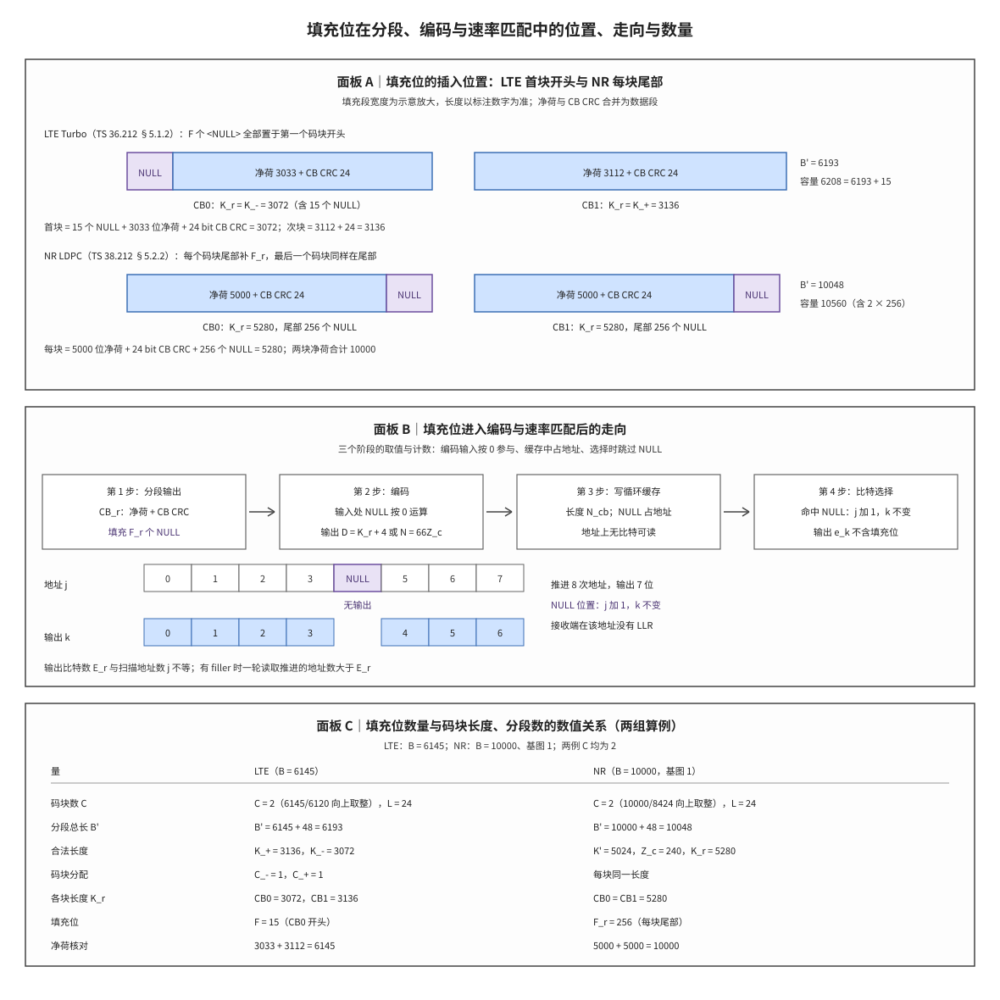

# Filler Bits 填充位

## 符号与记号约定
| 符号 | 含义与取值 | 协议锚点 |
|:---|:---|:---|
| $L$ | 每个码块附加的 CB CRC 长度；LTE 分段时为 24，NR 分段时为 24，不分段时为 0 | TS 36.212 §5.1.2（24 bit）；TS 38.212 §5.2.2 |
| $Z$ | LTE Turbo 的最大码块长度，固定为 6144 | TS 36.212 §5.1.2 |
| $K_{cb}$ | NR 单个 LDPC 码块的最大输入长度，基图 1 为 8448，基图 2 为 3840 | TS 38.212 §5.2.2 |
| $Z_c$ | NR LDPC 的提升因子，取自 Table 5.3.2-1 的合法集合 | TS 38.212 Table 5.3.2-1 |
| $N_{cb}$ | 循环缓存的可寻址长度，即缓存中地址的总数 | TS 36.212 §5.1.4.1.2；TS 38.212 §5.4.2.1 |
| $w$ | 循环缓存中的比特序列，NULL 位置也占一个地址 | TS 36.212 §5.1.4.1.2；TS 38.212 §5.4.2.1 |
| $k_0$ | 本次读取的起始地址，由冗余版本决定 | TS 36.212 §5.1.4.1.2；TS 38.212 Table 5.4.2.1-2 |
| $j$ | 扫描地址的序号，每推进一个地址加 1，遇到 NULL 也加 1 | TS 36.212 §5.1.4.1.2（比特选择的扫描计数） |
| $N$ | NR LDPC 母码长度，基图 1 为 $66Z_c$，基图 2 为 $50Z_c$ | TS 38.212 §5.3.2 |
| $B$ | 分段入口的输入比特数，含传输块 CRC；LTE 与 NR 都用它判断是否需要分段 | TS 36.212 §5.1.2；TS 38.212 §5.2.2 |
| $C$ | 一个传输块被切成的码块数，正整数 | 由 §5.1.2 与 §5.2.2 导出 |
| $K_b$ | NR 选择提升因子时使用的基准列数，基图 1 固定为 22，基图 2 按 $B$ 取 6、8、9、10 | TS 38.212 §5.2.2 |
| $K_+$ | LTE 的上侧合法码块长度，取合法长度表中满足 $C\cdot K\ge B'$ 的最小值 | 由 §5.1.2 导出 |
| $K_r$ | 第 $r$ 个码块进入编码器的长度，含填充位与 CB CRC；LTE 取 $K_-$ 或 $K_+$ | 由 §5.1.2 与 §5.2.2 导出 |
| $F$ | LTE 填充位总数，$F=C_+K_++C_-K_--B'$ | 由 §5.1.2 导出 |
| $F_r$ | 第 $r$ 个码块的填充位数；LTE 只有首个码块非零，NR 每块为 $K_r-K'$ | 由 §5.2.2 导出 |
| $D$ | LTE Turbo 每一路编码输出的长度，$D=K_r+4$ | TS 36.212 §5.1.3 |
| $N_r$ | 第 $r$ 个码块的净荷比特数，$N_r=K_r-F_r-L$；本笔记为写出长度恒等式而引入，非协议符号 | 非 3GPP 标准（本笔记记号） |
| $k$ | 输出比特序号，取值 $0,1,\dots,E_r-1$ | TS 36.212 §5.1.4.1.2（比特选择的输出计数） |
| $E_r$ | 第 $r$ 个码块的速率匹配输出比特数 | TS 38.212 §5.4.2.1；TS 36.212 §5.1.4.1.2 |
| $e_k$ | 速率匹配输出的第 $k$ 个比特，只取自缓存中非 NULL 的位置 | TS 36.212 §5.1.4.1.2；TS 38.212 §5.4.2.1 |
| $r$ | 码块编号，取值 $0,1,\dots,C-1$ | TS 36.212 §5.1.2 |
| `<NULL>` | 协议定义的占位取值，表示该位置不承载比特；编码与 CRC 计算按 0 参与 | TS 36.212 §5.1.2；TS 38.212 §5.2.2 |

运算符与记号惯例：

1. **取整记号**：$\lceil x\rceil$ 为向上取整，$\lfloor x\rfloor$ 为向下取整；码块数必须是整数，因此 $C$ 与 $C_-$ 的计算式都带取整，取整方向决定了容量宁可多出也不足。
2. **加减号是档位不是运算**：$K_+$ 与 $K_-$ 的加减号表示合法长度表内相邻的两档长度，不是对某个量做四则运算；$C_+$ 与 $C_-$ 同理。
3. **下标语义**：$K_r$、$F_r$、$E_r$ 的下标 r 是码块编号，不是乘法；$k_0$ 的下标 0 是起始地址的固定记法。
4. **撇号的统一含义**：$B'$ 与 $K'$ 的撇号都表示「已追加 CB CRC、尚未追加填充位」的中间量，两代协议在这一点上口径一致。
5. **两代记号不可互换**：LTE 用 $F$ 记一批填充位的总数、用 $K_+$ 与 $K_-$ 记两种码块长度；NR 用 $F_r$ 记逐块填充位数、用 $K'$ 与 $K_r$ 记填充前后的两个长度。混用会把位置和数量同时算错。
6. **`<NULL>` 的写法**：它是协议定义的占位取值，不是数值零，也不参与二进制运算；本笔记在正文与表格中一律用代码体 `<NULL>` 表示，避免与普通比特 0 混淆。

一句话本质：**填充位是把码块长度补齐到编码器合法输入长度的占位比特，取值语义为 `<NULL>`；发送端按协议规定的位置插入，接收端按同一位置排除，任何情况下都不作为业务比特交付上层。**

这句话里的三个要素——位置、数量、取值——分别由分段规则、容量差额与编码器输入约定确定。下文先补齐五个前置对象，再按两代协议的演进说明位置约定如何形成，然后把尺寸链写成公式并代入两组数值例，最后交代填充位在编码与速率匹配中的去向与接收端的处理边界。
## 解释目标与范围

本节目标：解释码块分段为什么会产生填充位，说明 LTE Turbo 与 NR LDPC 两种分段约定分别把填充位放在哪个码块的哪一端、数量如何由 $K_+$、$K_-$、$K'$ 与 $K_r$ 算出，并交代填充位在编码输入、循环缓存与比特选择三个环节中的取值语义与去向。

## 前置概念

本节先交代后文反复使用的五个对象：码块分段、母码、填充位、循环缓存与比特选择。它们分属三个层次——最上层是切分与补齐的尺寸规则，中间层是编码器接受的长度集合，最下层是补齐后的比特在缓存与输出端如何计数。若已熟悉这些对象，可直接跳到「起源与演进」；若后文某一节读不通，多半是这里的某个对象尚未建立。

码块分段（Code Block Segmentation）是把一个传输块（Transport Block, TB）切成若干码块（Code Block, CB）的过程，切分的硬约束是每个码块的长度必须落在编码器支持的合法长度集合内；由于传输块长度由调度决定、合法长度由编码器结构决定，两者几乎从不相等，分段之后必须有一次补齐，本笔记讨论的填充位就是这次补齐的产物。分段规则本身、码块编号顺序与 CB CRC 的挂接方式见 [[Segmentation_码块分段]] 与 [[CB_码块]]。

母码（mother code）指编码器按自身结构生成的基础码字，其长度由编码器参数决定，而不由本次调度直接给出；它决定了码块长度可以取哪些值。LTE Turbo 的母码围绕码块长度 $K_r$ 展开，内部交织器只接受 Table 5.1.3-3 列出的 188 个长度；NR LDPC 的母码长度由提升因子 $Z_c$ 缩放基图得到，$N$ 取 $66Z_c$ 或 $50Z_c$。填充位不改变母码结构，它只是把输入长度抬到母码允许的取值，母码与基图的关系见 [[LDPC_低密度奇偶校验码]] 与 [[Turbo_码]]。

填充位（Filler Bits）是分段与编码之间插入的占位比特，取值语义为 `<NULL>`，不承载任何业务信息。它与循环冗余校验（Cyclic Redundancy Check, CRC）的关系需要分清：计算 CB CRC 时填充位按 0 参与，但填充位本身不是 CRC 位，也不受 CRC 保护；接收端必须在检查 CRC 之前按插入位置把它排除。CRC 的计算口径见 [[CRC_循环冗余校验]]。

循环缓存（Circular Buffer, CircBuf）是速率匹配阶段的一段线性地址空间，长度为 $N_{cb}$，编码器输出的码字按系统位在前、校验位在后的顺序写入；填充位在缓存中只占地址、不承载比特，读取时被跳过。它与本笔记的交集在于：填充位从分段进入编码、再进入缓存，位置信息一路保留到比特选择，缓存侧的完整读取规则见 [[Circular_Buffer_循环缓存]]。

比特选择（Bit Selection）是按输出长度 $E_r$ 从循环缓存中连续取比特的过程，取到 NULL 位置时地址继续推进而输出计数不变，因此输出序列中不含任何填充位。这一步是「填充位不占空口资源」的实现位置，速率匹配的整体结构见 [[Rate_Matching_速率匹配]]。

## 起源与演进

(1) **起点：编码器只接受离散的合法长度。** LTE Turbo 的内部交织器由一对参数决定，可用的码块长度被固定为一张 188 项的表格，最小 40、最大 6144。传输块长度由调度器按资源与调制方式给出，是一个连续可变的整数，几乎不会正好落在表上。以刚超过最大码块长度的 $B=6145$ 为例，分段后必须切成两个码块，而两块的合法容量只有 3072 与 3136 这类离散值，容量之和与输入之差就是必须补上的位置。

(2) **LTE：一批填充位全部置于首块开头。** TS 36.212 §5.1.2 规定，按公式算出的填充位数 $F$ 不为零时，填充位加在第一个码块的开头，随后的业务比特整体后移；若 $B<40$，即使不分段也在码块开头补足到 40。这一约定让「填充位总数」成为一个标量 $F$，接收端只需记住首块开头有多少个位置需要排除。数量公式 $F=C_+K_++C_-K_--B'$ 同时说明填充位补的是容量差额，不是把 $B$ 补到某个固定值。

(3) **NR：每个码块尾部各补一份。** TS 38.212 §5.2.2 的分段先算出统一的码块净长 $K'$，再按基图与提升因子把每块抬到 $K_r$，每块从 $K'$ 到 $K-1$ 的位置都置为 `<NULL>`，因此填充位不再是一个总数，而是逐块的 $F_r=K_r-K'$。最后一个码块的尾部同样带这份填充，这正是两代协议最容易被混用的差异：LTE 的填充位在首块开头，NR 的填充位在每块尾部。

(4) **速率匹配：NULL 位置只推进地址。** 无论哪一代，填充位都不上空口。编码把 `<NULL>` 当作 0 参与运算，产生的校验位照常传输；系统位上属于填充位的位置在写入循环缓存时保持 `<NULL>`，比特选择遇到它时只把扫描地址 $j$ 加一，不产生输出比特 $k$。因此接收端从未收到填充位，却仍然能从校验关系中间接约束它，这也是填充位可以用已知值处理的原因。

## 科学定义

上一节按时间顺序说明了两代协议各自的选择，本节把它们写成可运算的尺寸链，并按三个层次展开：先给出 LTE Turbo 分段中填充位的位置与数量，再给出 NR LDPC 分段中逐块填充的位置与数量并用一组手算数值例核对，最后说明填充位在编码与速率匹配中的去向。三节之间是递进关系——先确定「补多少、补在哪」，才能谈它在缓存里如何被跳过，最后才谈接收端如何排除。

### LTE Turbo 分段：填充位总数与首块开头的位置

分段入口的比特数记为 $B$，它已经包含传输块 CRC。协议先按最大码块长度 $Z=6144$ 判断是否需要分段：$B\le Z$ 时不分段，$L=0$、$C=1$、$B'=B$；$B>Z$ 时每个码块追加 24 bit 的 CB CRC，码块数与分段总长由下式给出：

$$C=\left\lceil\frac{B}{Z-L}\right\rceil,\qquad B'=B+C\cdot L$$

码块长度从 Table 5.1.3-3 的合法集合中选取。先取容量足够的最小上侧长度，再取表内低一档长度作为备选：

$$K_+=\min\{K: C\cdot K\ge B'\},\qquad K_-=\max\{K: K<K_+\}$$

若 $C\cdot K_+=B'$，全部码块都用 $K_+$，此时 $C_+=C$、$C_-=0$。若容量有富余，协议用一部分短块吸收富余量，短块个数由富余量能容纳几个「档差」决定：

$$C_-=\left\lfloor\frac{C\cdot K_+-B'}{K_+-K_-}\right\rfloor,\qquad C_+=C-C_-$$

填充位总数就是容量与输入之差：

$$F=C_+K_++C_-K_--B'$$

每个码块的实际长度按码块编号分配，这里有一个容易写错的顺序：短块在前、长块在后，编号小的码块使用 $K_-$，

$$K_r=K_-\ \ (0\le r<C_-),\qquad K_r=K_+\ \ (C_-\le r<C)$$

填充位全部加在第一个码块的开头，其后的业务比特与 CB CRC 依次后移。因此首个码块的结构是「$F$ 个 `<NULL>` + 净荷 + 24 bit CB CRC」，其余码块是「净荷 + 24 bit CB CRC」；$F$ 只影响首个码块的分段起点，不改变任何码块的长度 $K_r$，也不改变 Turbo 编码的输出长度公式 $D=K_r+4$。当 $B<40$ 时，合法长度表的最小值是 40，即使 $B\le Z$ 且 $C=1$ 也要在码块开头补足差额，例如 $B=30$ 时 $K_+=40$、$F=10$。

### NR LDPC 分段：逐块尾部的填充位

LTE 用一张固定表把码块长度钉在离散值上，NR 换了编码家族，合法长度不再来自查表，而由提升因子缩放基图得到，填充位的位置也随之从首块开头移到每个码块的尾部。NR 的分段判据按基图给出的最大码块长度 $K_{cb}$ 划分：$B\le K_{cb}$ 时 $L=0$、$C=1$、$B'=B$；$B>K_{cb}$ 时每个码块追加 24 bit CB CRC，码块数为

$$C=\left\lceil\frac{B}{K_{cb}-L}\right\rceil,\qquad B'=B+C\cdot L$$

与 LTE 不同，NR 不在两档长度之间分配码块，而是先给每个码块一个统一的填充前长度，再按提升因子把每块抬到编码器输入长度：

$$K'=\frac{B'}{C},\qquad Z_c=\min\{Z: K_bZ\ge K'\}$$

式中的 $K_b$ 是选择提升因子时使用的基准列数，基图 1 固定为 22，基图 2 按 $B$ 取 6、8、9、10 之一；基图 1 的码块长度为 $K_r=22Z_c$，基图 2 的码块长度为 $K_r=10Z_c$。提升因子只能取 Table 5.3.2-1 的合法集合，因此 $K_r$ 也落在离散值上。每个码块在 $K'$ 之后到 $K_r-1$ 的位置全部置为 `<NULL>`，填充位数量为

$$F_r=K_r-K'$$

这个式子是两代协议差异的集中体现：NR 的填充位是「每块各自补齐到 $K_r$」的差额，最后一个码块也在尾部带填充；LTE 的填充位是「全部码块容量之和与输入之差」，只在首块开头出现。下表把两代的差异逐项对照，接收端按表实现时不应把两套逻辑混用。

| 对照项 | LTE Turbo（TS 36.212 §5.1.2） | NR LDPC（TS 38.212 §5.2.2） |
|:---|:---|:---|
| 分段判据 | $B>Z=6144$ | $B>K_{cb}$，基图 1 为 8448，基图 2 为 3840 |
| 码块长度选取 | 在 $K_+$ 与 $K_-$ 两档之间分配 | 统一 $K'$，再按 $Z_c$ 抬到 $K_r$ |
| 填充位位置 | 第一个码块的开头 | 每个码块的尾部，含最后一个码块 |
| 填充位数量 | 总数 $F$，首块承受全部 | 逐块 $F_r=K_r-K'$ |
| 接收端剥离 | 重组前删除首块开头 $F$ 个位置 | 每块译码后删除该块尾部 $F_r$ 个位置 |
| 混用后果 | 把尾部当填充会误删真实数据 | 把开头当填充会使位序整体偏移 |

把两组数值并排算一遍，可以核对上面的每个量。LTE 例取 $B=6145$，NR 例取 $B=10000$ 且基图 1；两例的码块数都为 2，但填充位的位置与数量完全不同。表中每一行都由上一行算出，最后一行把净荷相加回代到 $B$，用来确认没有多算或漏算。

| 步骤 | LTE（$B=6145$，Turbo） | NR（$B=10000$，基图 1） |
|:---|:---|:---|
| 是否需要分段 | $6145>6144$，需要 | $10000>8448$，需要 |
| 码块数与 CB CRC | $C=\lceil6145/6120\rceil=2$，$L=24$ | $C=\lceil10000/8424\rceil=2$，$L=24$ |
| 分段总长 | $B'=6145+2\times24=6193$ | $B'=10000+2\times24=10048$ |
| 合法长度 | $K_+=3136$（$2K\ge6193$ 的最小表值），$K_-=3072$ | $K'=5024$，$Z_c=240$，$K_r=22\times240=5280$ |
| 码块分配 | $C_-=\lfloor79/64\rfloor=1$，$C_+=1$ | 不适用（每块统一长度） |
| 各块长度 | CB0 为 3072（$K_-$），CB1 为 3136（$K_+$） | CB0 与 CB1 均为 5280 |
| 填充位 | 首块开头 $F=3136+3072-6193=15$ | 每块尾部 $F_r=5280-5024=256$ |
| 净荷核对 | $3033+3112=6145$ | $5000+5000=10000$ |

LTE 一行的净荷是这样来的：首个码块长度 3072，扣掉开头 15 个填充位与末尾 24 bit CB CRC，剩 3033 位净荷；第二个码块 3136，扣掉 24 bit CB CRC 后是 3112 位净荷，两者之和正好是 $B=6145$。NR 一行则是每块 5280 位中含 5000 位净荷、24 bit CB CRC 与 256 位尾部填充，两块净荷之和为 10000。可见「最后一个码块的填充数」在两代协议下的答案不同：LTE 的最后一个码块填充数为 0，全部 15 位集中在首块；NR 的最后一个码块同样带 256 位尾部填充。

### 填充位在编码与速率匹配中的走向

两代协议对填充位位置与数量的规定到此为止；下面沿发送链继续走，看这些位置在编码与速率匹配中被怎样写入、又怎样被跳过。填充位进入编码器时，协议只规定它在编码输入处取 `<NULL>`；编码器按二进制 0 参与运算，因此它产生的校验位是有效码字的一部分，会照常传输。LTE 把系统流中填充位所在的位置保留为 `<NULL>`，Turbo 编码器对每路输出 $D=K_r+4$ 位；NR 则把 $K'$ 到 $K_r-1$ 的 `<NULL>` 位置写入 LDPC 码字的系统位区间，母码长度为 $66Z_c$ 或 $50Z_c$。这一段说明了填充位并非凭空消失：它改变了编码器看到的输入，从而改变了校验位的取值。

编码之后是三段处理：写循环缓存、按 $E_r$ 做比特选择、送入调制。写缓存时，填充位所在的位置保留 `<NULL>` 标记，它占用一个地址但不承载比特；缓存长度 $N_{cb}$ 只决定地址的上界，不因填充位而缩短。比特选择的规则可以写成下面这段循环，其中 $j$ 计扫描过的地址、$k$ 计已输出的比特：

```text
k = 0; j = 0
while k < E_r:
    if w[(k_0 + j) mod N_cb] is not NULL:
        e_k = w[(k_0 + j) mod N_cb]
        k = k + 1
    j = j + 1
```

这段循环的关键在最后一行：无论当前地址是不是 NULL，$j$ 都加一；只有非 NULL 时才写出 $e_k$ 并让 $k$ 加一。于是填充位只让地址推进、不让输出增长，输出序列 $e_k$ 中没有任何填充位，空口上也就没有为它消耗资源。接收端在解速率匹配时按同一规则反向寻址，落在 `<NULL>` 地址上的输出比特没有对应的信道观测，因此不需要（也无法）为它取 LLR。

译码器对这些位置如何处理，3GPP 不作规定：填充位在编码前已知为 0，实现可以把该位置置成表示已知 0 的高可靠度 LLR，也可以置中性值让它不提供证据，或者在解速率匹配阶段直接跳过。三种做法只影响译码性能与实现复杂度，不改变协议规定的比特流，因此不能把其中任何一种写成 3GPP 的要求。这一点与 [[Circular_Buffer_循环缓存]] 对 NULL 位置的口径一致：缓存侧的规则是「占地址、不输出」，接收侧的具体软信息取值属于实现域。



**图 1｜填充位在分段、编码与速率匹配中的位置、走向与数量。** 面板 A 把同一个传输块按 LTE 与 NR 两种约定各画一遍：LTE 的 15 个 `<NULL>` 全部落在首块开头，NR 的 256 个 `<NULL>` 落在每个码块尾部，两者的码块长度 $K_r$ 与填充长度都标在条带下方；面板 B 沿编码、写缓存、比特选择三个阶段走一遍，说明 `<NULL>` 在编码输入处按 0 参与、在缓存中只占地址、在比特选择时只推进地址 $j$ 而不产生输出 $k$；面板 C 用取值表并列两组算例，给出 $K_+$、$K_-$、$K'$、$K_r$ 与 $F_r$ 的数值关系。三幅面板使用同一套符号，可对照读出「补多少」「补在哪」「跳过多少地址」三个问题。

## 直观模型

公式给出的是算术关系，结构上第一个要落实的量是补齐量。一个码块的长度由净荷、填充位与 CB CRC 三部分组成，净荷是真正来自传输块的比特，CB CRC 是保护该码块的 24 bit 校验，填充位是把两者之和抬到合法长度的余量；三者的关系写成恒等式即 $K_r=N_r+F_r+L$，其中 $N_r$ 是第 $r$ 个码块的净荷比特数。两代协议的差别只在于这条恒等式中的已知量不同：LTE 先在 $K_+$ 与 $K_-$ 之间选定每块的总长，再把所有码块的余量合并成 $F$ 放在第一个码块的开头；NR 先固定每块的 $K'$，再用提升因子把总长抬到 $K_r$，余量 $F_r$ 留在本块尾部。两种做法都满足同一条恒等式，但「余量记在哪个码块」不同，接收端剥离的位置也就不同，这正是两代协议的分段描述不能互换的原因。

补齐的位置决定接收端从何处剥离，补齐所占的地址则决定缓存怎样被读取。循环缓存是一段长度 $N_{cb}$ 的地址空间，每个地址对应一个比特位置；填充位写入时保留 `<NULL>` 标记，仍然占用地址，但该地址上没有可供读取的比特，因此 $N_{cb}$ 只由母码长度与缓存上限取小得到，与填充位数量无关。地址与比特既然是两个计数对象，比特选择就必须分别维护两个计数器：$k$ 数的是已经写出的输出比特，上界是 $E_r$；$j$ 数的是已经扫描过的地址，没有填充位时两者同步增长，每遇到一个 `<NULL>`，$j$ 就比 $k$ 多走一步，输出 $E_r$ 个比特所需的地址推进次数因此不小于 $E_r$，差额等于这段时间内越过的 `<NULL>` 个数。把这套关系写成可核对的约束，共有四条：每个码块的长度必须落在编码器合法长度集合内；填充位总数由容量与输入的差额唯一确定，$F$ 与 $F_r$ 都不是可调参数；插入位置由协议固定，LTE 在首块开头、NR 在每块尾部，实现不得自行选择；接收端剥离的位置必须与发送端插入的位置逐位对应，缓存中的 `<NULL>` 只推进地址、不产生输出，否则位序整体偏移或 LLR 整体错位。判断是否整轮读取时也要按这组约束看覆盖的地址集合，不能只看 $E_r$ 与 $N_{cb}$ 是否相等。

## 常见误解

| 误解 | 正确理解 |
|:---|:---|
| 填充位就是普通 0 比特 | 协议语义是 `<NULL>`；编码与 CRC 计算按 0 参与，但接收端必须剥离、不得作为业务比特交付。 |
| 只有大传输块分段时才有填充位 | $B<40$ 时即使 $C=1$ 也要在码块开头补到 40，因为 40 是合法长度表的最小值。 |
| 填充位随机分散在各码块中 | 位置由协议固定：LTE 全部在首块开头，NR 每块尾部各一份，均不随机。 |
| 两代协议的填充位置可以互换 | LTE 与 NR 的插入端相反，按另一代的规则剥离会导致误删真实数据或位序整体偏移。 |
| 填充位计入 $B$ 或 $B'$ | 两者都不含填充位；$F$ 或 $F_r$ 是容量差额，把它加进 $B'$ 会重复计数。 |
| $K_r$ 就是净荷长度 | $K_r$ 含填充位与 24 bit CB CRC，净荷只是其中一部分。 |
| 填充位会占用空口资源 | 比特选择遇到 `<NULL>` 只推进地址、不产生输出，填充位从不传输。 |
| 填充位数量由实现自行决定 | 数量由容量差额唯一确定，实现只能决定接收端如何利用「已知为 0」这一事实。 |
| 接收端必须把填充位的 LLR 置 0 | 协议不规定 LLR 取值；可置已知 0 的高可靠度值、置中性值或在解速率匹配中跳过。 |

## 协议锚点

- LTE 分段与填充位插入：TS 36.212 Rel-19 `36212-j30` §5.1.2 Code block segmentation and code block CRC attachment，规定 $Z=6144$、$L=24$、$K_+$ 与 $K_-$ 的选择、$C_-$ 与 $C_+$ 的分配、$F$ 的计算式，以及「填充位加在第一个码块开头」「$B<40$ 时加在码块开头」「编码输入处为 `<NULL>`」「CRC 计算按 0」四条口径。本地：`3GPP_Rel19/processed/TS_36.212_36212-j30/content.md` 行 600-700，填充位插入循环在行 651。
- LTE 合法长度表：TS 36.212 §5.1.3 与 Table 5.1.3-3，给出 188 个合法 $K$ 与内部交织参数。本地：`3GPP_Rel19/processed/TS_36.212_36212-j30/tables/table_0009.csv`。
- LTE 速率匹配：TS 36.212 §5.1.4.1.2 bit collection, selection and transmission，规定循环缓存长度与比特选择循环，`<NULL>` 位置只推进地址。本地：`3GPP_Rel19/processed/TS_36.212_36212-j30/content.md` 行 817-880。
- NR 分段与填充位插入：TS 38.212 Rel-19 `38212-j30` §5.2.2，规定 $K_{cb}$、$C$、$B'$、$K'$、$K_b$、$Z_c$、$K_r$ 的计算，以及从 $K'$ 到 $K_r-1$ 逐位置 `<NULL>` 的插入。本地：`3GPP_Rel19/processed/TS_38.212_38212-j30/full.md` 行 780-860，长度公式在行 801-827，填充位插入循环在行 855-859。
- NR 速率匹配：TS 38.212 §5.4.2.1，比特选择遇到 `<NULL>` 时只推进扫描地址。本地：`3GPP_Rel19/processed/TS_38.212_38212-j30/full.md` 行 1880。
- 讲义承接：`docs/L1_基础/T3.2_transport_code_block_filler_bits.md` 给出接收侧语义，`docs/L1_基础/T3.3_LTE_Turbo_segmentation_rules.md` 与 `docs/L1_基础/T3.4_NR_LDPC_segmentation_rules.md` 给出两代尺寸推导。
- 非标准项：接收端对填充位位置 LLR 的取值、软缓存的写回方式与解速率匹配的具体实现均属实现域，3GPP 只规定发送端比特流与位置约定。

## 关键要点

1. 填充位是把码块补齐到编码器合法长度的占位比特，取值语义为 `<NULL>`，编码与 CRC 计算按 0 参与，接收端必须剥离。
2. LTE 的填充位总数 $F=C_+K_++C_-K_--B'$，全部置于第一个码块的开头；$B<40$ 时即使不分段也要补到 40。
3. LTE 的码块按编号先短后长：编号小于 $C_-$ 的码块取 $K_-$，其余取 $K_+$；填充位不改变任何 $K_r$。
4. NR 的填充位是逐块差额 $F_r=K_r-K'$，位于每个码块尾部，最后一个码块同样带填充。
5. 两组算例：LTE $B=6145$ 得 $C=2$、$K_+=3136$、$K_-=3072$、$F=15$、首块 3072、次块 3136；NR $B=10000$ 得 $K'=5024$、$Z_c=240$、$K_r=5280$、每块 $F_r=256$。
6. 缓存中的 `<NULL>` 只占地址、不承载比特；比特选择中 $j$ 遇 NULL 加一、$k$ 不加，输出序列不含填充位。
7. 输出 $E_r$ 个比特所需推进的地址数不小于 $E_r$，差额是越过的 `<NULL>` 个数，判整轮要看覆盖的地址集合。
8. 接收端对填充位 LLR 的处理属实现域：可置已知 0 的高可靠度值、置中性值或跳过，均不改变协议比特流。

## 图谱关联

- [[Segmentation_码块分段]]
- [[CB_码块]]
- [[TB_传输块]]
- [[CRC_循环冗余校验]]
- [[Turbo_码]]
- [[LDPC_低密度奇偶校验码]]
- [[Rate_Matching_速率匹配]]
- [[Circular_Buffer_循环缓存]]
- [[RV_冗余版本]]
- [[概念图谱入口]]
- [[T3.2_transport_code_block_filler_bits]]
- [[T3.3_LTE_Turbo_segmentation_rules]]
- [[T3.4_NR_LDPC_segmentation_rules]]
- 关系语义：填充位是分段与编码之间的一次长度补齐，向上由 $B$、$K_+$、$K_-$、$K'$ 与 $K_r$ 唯一确定，向下在循环缓存中只占地址、在比特选择中被跳过，接收端按同一位置约定排除后才能真正交付传输块。
