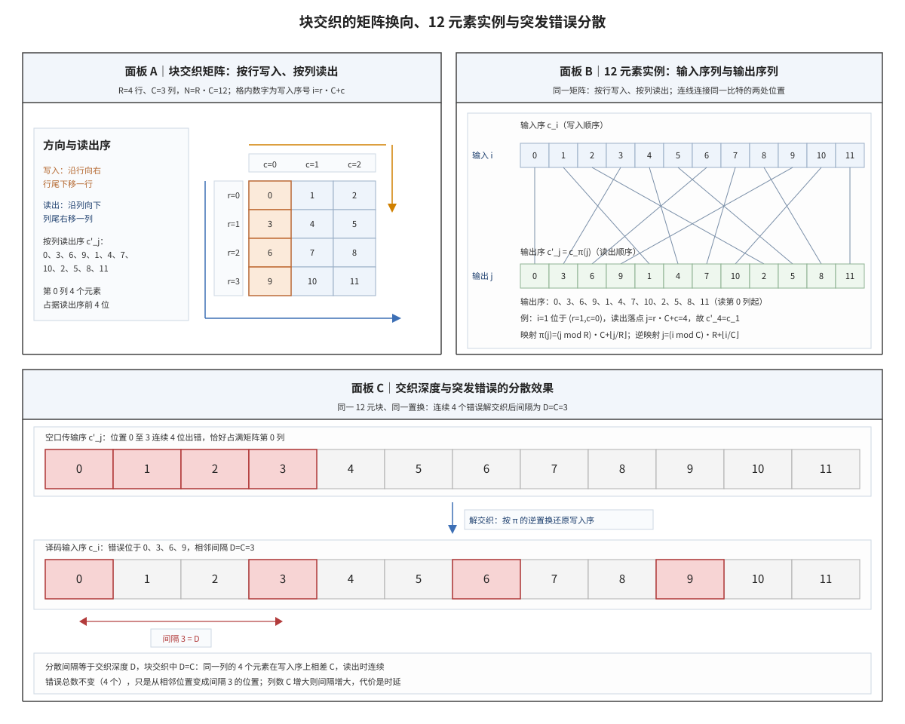

# Interleaver 交织器

## 符号与记号约定

本笔记的公式集中在两处：一是置换的定义，二是块交织的矩阵坐标换算。为了让后文的推导不夹带未定义记号，下表先把全文用到的每一个数学符号登记清楚，逐个给出读法、含义与取值范围；后文再次出现时不再重复定义。

| 符号 | 读法 | 含义与取值 | 协议锚点 |
|:---|:---|:---|:---|
| $\Pi$ | 大写 pi | LTE Turbo 内部交织器的置换函数，是二次置换多项式的专名；$\Pi(j)=(f_1j+f_2j^2)\bmod K$，输出落在 $0$ 至 $K-1$；单位为位置序号（无量纲）；参数 $f_1$、$f_2$ 由协议按 $K$ 逐行固定。 | TS 36.212 §5.1.3.2.3 |
| $\pi$ | pi | 一般交织置换（permutation），回答「读出位置 $j$ 取写入序的哪一个比特」；双射 $\pi:\{0,\ldots,N-1\}\to\{0,\ldots,N-1\}$，输出由 $c'_j=c_{\pi(j)}$ 给出；单位为位置序号（无量纲）；教材对置换的定义，协议不引入一般式。 | 非 3GPP 标准 |
| $\pi^{-1}$ | pi 逆 | $\pi$ 的逆置换，接收端用它把接收序还原为写入序；满足 $j=\pi^{-1}(i)$，与 $\pi$ 互为逆映射，块交织中为 $\pi^{-1}(i)=(i\bmod C)R+\lfloor i/C\rfloor$；单位为位置序号（无量纲）；由 $\pi$ 反解得到。 | 非 3GPP 标准 |
| $N$ | N | 一个交织块内的比特数，即输入序列长度；块交织中 $N=R\times C$，12 元素数值例取 12；单位为 bit；本笔记的块长记法；协议子块交织中对应块长 $K_{\Pi}$，见 TS 36.212 §5.1.4.1.1。 | 非 3GPP 标准 |
| $R$ | R | 块交织矩阵的行数，也是可分散的突发长度上限；正整数，数值例取 4；单位为行（无量纲）；块交织定义；协议子块交织的行数由块长与 32 列算出。 | 非 3GPP 标准 |
| $C$ | C | 块交织矩阵的列数，按行写按列读时它等于分散间距；正整数，数值例取 3；单位为列（无量纲）；块交织定义；协议子块交织固定取 $C=32$，见 TS 36.212 §5.1.4.1.1。 | 非 3GPP 标准 |
| $i$ | i | 写入序位置号（交织器输入、接收端译码序）；$0,\ldots,N-1$；单位为位置序号（无量纲）；本笔记的序列编号约定。 | 非 3GPP 标准 |
| $j$ | j | 读出序位置号（交织器输出、空口传输序）；$0,\ldots,N-1$；单位为位置序号（无量纲）；本笔记的序列编号约定。 | 非 3GPP 标准 |
| $r$ | r | 矩阵行号，由写入序位置按 $r=\lfloor i/C\rfloor$ 定位；$0,\ldots,R-1$；单位为行号（无量纲）；块交织的矩阵坐标定义。 | 非 3GPP 标准 |
| $c$ | c | 矩阵列号，由写入序位置按 $c=i\bmod C$ 定位；$0,\ldots,C-1$；单位为列号（无量纲）；块交织的矩阵坐标定义。 | 非 3GPP 标准 |
| $c_i$ | c 下标 i | 写入序第 $i$ 个比特（交织前的序列元素）；0 或 1；单位为 bit；块交织的输入序列记法。 | 非 3GPP 标准 |
| $c'_j$ | c 撇 下标 j | 读出序第 $j$ 个比特（交织后的序列元素），撇号专指交织后；0 或 1，与 $c_{\pi(j)}$ 是同一个比特；单位为 bit；块交织的输出序列记法。 | 非 3GPP 标准 |
| $c_{\pi(j)}$ | c 下标 pi(j) | 落在读出位置 $j$ 的那个输入比特，与 $c'_j$ 是同一个量；0 或 1；单位为 bit；由置换 $\pi$ 把读出位置映回写入位置得到。 | 非 3GPP 标准 |
| $D$ | D | 交织深度，即相邻两份错误在写入序上的间距；按行写按列读的块交织（block interleaver）中 $D=C$，数值例为 3；单位为位置间隔（bit）；由置换的列跨度算出。 | 非 3GPP 标准 |
| $K$ | K | QPP 交织的输入长度，也是参数表的行索引；40 至 6144 之间的 188 个合法值；单位为 bit；TS 36.212 Table 5.1.3-3。 | TS 36.212 Table 5.1.3-3 |
| $f_1$ | f 下标 1 | QPP 的一次项系数，决定位置的线性搬移；每个合法 $K$ 对应表中的一个整数，随 $K$ 变化；单位为无量纲；TS 36.212 Table 5.1.3-3。 | TS 36.212 Table 5.1.3-3 |
| $f_2$ | f 下标 2 | QPP 的二次项系数，决定位置的二次打散并保证并行译码无冲突；每个合法 $K$ 对应表中的一个整数，随 $K$ 变化；单位为无量纲；TS 36.212 Table 5.1.3-3。 | TS 36.212 Table 5.1.3-3 |
| $G$ | G | 三角交织的输入比特数，即上行控制信息（Uplink Control Information, UCI）在速率匹配前的比特长度；正整数，$G=10$ 为本笔记手算例；单位为 bit；协议在 TS 38.212 §5.4.1.3 以 $E$ 记该输入长度，本笔记记作 $G$。 | 由 TS 38.212 §5.4.1.3 导出 |
| $L$ | L | 三角交织器（triangular interleaver）的行数；满足 $L(L+1)/2\ge G$ 的最小整数，$G=10$ 时 $L=4$（各列长度 4、3、2、1）；单位为行（无量纲）；由 $G$ 解不等式得到，协议在 §5.4.1.3 记作 $T$。 | 由 TS 38.212 §5.4.1.3 导出 |
| $K_{\Pi}$ | K 下标大写 pi | LTE 子块交织的输出长度；恒为 32 的整数倍，不足处补 NULL；单位为 bit；由 32 列矩阵与块长共同决定，见 TS 36.212 §5.1.4.1.1。 | TS 36.212 §5.1.4.1.1 |
| $Q_m$ | Q 下标 m | 调制阶数，即每符号承载的比特数；2（QPSK）、4（16QAM）、6（64QAM）、8（256QAM）；单位为 bit/调制符号；TS 38.212 §5.4.2.2 的比特交织按它分行。 | TS 38.212 §5.4.2.2 |
| $I_{BIL}$ | I 下标 BIL | 上行比特交织指示，取 1 时对 Polar 速率匹配后的比特启用三角交织；0 或 1；单位为无（1 个指示位）；TS 38.212 §5.4.1.3 的门控条件。 | TS 38.212 §5.4.1.3 |

符号之外还有六条记法约定，它们与符号同等重要，混用会造成实质错误：

1. 撇号表示交织后的序列：不带撇的 $c_i$ 属于写入序，带撇的 $c'_j$ 属于读出序；同一个比特在两个序里各占一个位置，两个位置由 $\pi$ 与 $\pi^{-1}$ 互相换算。
2. 下标是名字不是乘法：$f_1$ 的下标 1 表示一次项，$K_{\Pi}$ 的下标表示该长度由子块交织（sub-block interleaver）产生；$j^2$ 才是乘方。
3. 取整与取余：$\lfloor x\rfloor$ 为向下取整，$\lceil x\rceil$ 为向上取整，$x\bmod y$ 为 $x$ 除以 $y$ 的余数；矩阵坐标换算三种运算都会用到。
4. 取小：$\min(a,b)$ 取两者中的较小者，用于说明参数表取值与块长下限。
5. 两套同类记号不可混用：$\Pi$ 只指 LTE 的二次置换多项式，$\pi$ 只指一般置换；$\Pi$ 不是 $\pi$ 的大写形式，二者的定义域与计算方法都不同。
6. 方向约定：本笔记的块交织一律按行写入、按列读出，除非明写"写读方向对调"；对调后分散间距由 $C$ 变为 $R$，公式中两个坐标的次序互换。

交织器（interleaver）是把比特或符号序列按确定性规则重排顺序的部件：写入序为 $c_0,c_1,\ldots,c_{N-1}$，读出序按置换 $\pi$ 重排为 $c'_0,c'_1,\ldots,c'_{N-1}$，其中 $c'_j=c_{\pi(j)}$。它不改变比特数量，也不改变码率（code rate，信息比特数与编码比特数之比），只改变顺序。工程目的是把一段连续出错的比特在接收端的译码序上拉开间距：纠错码（error-correcting code）的纠错能力以错误彼此孤立为前提，一段连续错误会集中落在同一个约束长度内，使校验关系同时失效；间距足够大的孤立错误才可以逐个纠正。

一句话本质：**交织是一个可逆置换，在比特数量与码率不变的前提下改写错误在序列上的位置分布，把连续的一段改为分散的多点，分散间距由置换的结构参数决定——块交织取列数 $C$，三角交织取行数 $L$，QPP 取多项式系数 $f_1$ 与 $f_2$。**

3GPP 没有单一的交织器，而是按用途分化出一族结构：LTE Turbo 内部用代数置换 QPP（Quadratic Permutation Polynomial，二次置换多项式），NR 的上行控制信息用三角交织器，速率匹配用矩形子块交织，下行资源映射用虚拟资源块（Virtual Resource Block, VRB）的伪随机置换，概率整形的扩展再用整形比特位置映射（Shaped Bit Position Mapping, SBPM）做位组织。理解这一族结构的共同点与差异点，是本笔记的任务。

## 独立解释任务

任务目标：把 3GPP 协议中的交织器家族梳理成一张全景图——块交织、三角交织、QPP、子块交织、SBPM、VRB 映射各自解决什么问题、协议锚点在哪、按什么维度区分，并给出块交织的行列换向映射公式与一组可以逐项核算的 12 元素数值例，使读者遇到任意一种交织器都能定位到它的结构、参数与讲义落点。

## 前置概念

本笔记的对象分布在三个层次：信道上为什么会出现成串的错误、用什么数学对象描述重排、以及 3GPP 用了哪几类具体结构。下面按这三个层次依次交代，每个对象给出定义与它在本笔记中承担的角色；已熟悉的读者可以跳过本节，直接从「起源与演进」读起。

第一个对象是突发错误（burst error）与它的成因信道记忆（channel memory）。突发错误指序列中连续一段位置同时出错，用比特计的这段长度称为突发长度；与之相对的是随机错误，后者的出错位置彼此独立。突发错误的来源是信道记忆：深衰落、遮挡与脉冲干扰让相邻时刻的信道状态彼此相关，于是错误成串出现而不是均匀散布。信道是否有记忆决定了错误的分布形态，也决定了交织是否有用——在无记忆的加性白高斯噪声信道上，错误本来就彼此独立，交织不会带来增益；在带记忆的衰落信道上，交织把错误在译码序上重新排布，才使纠错码面对它设计时假设的孤立错误。衰落信道的时间相关性与相干时间见 [[Fading_Channel_衰落信道]]。

第二个对象是置换（permutation），它是交织的数学载体。置换是集合到自身的一一映射；对长度为 $N$ 的序列，置换 $\pi$ 回答"读出位置 $j$ 取写入序的哪一个比特"，写作 $c'_j=c_{\pi(j)}$，而逆置换 $\pi^{-1}$ 回答相反的问题"写入序的第 $i$ 个比特被搬到哪一个读出位置"，写作 $j=\pi^{-1}(i)$。交织与解交织是同一个置换的两个方向，发送端执行 $\pi$、接收端执行 $\pi^{-1}$，两端必须使用同一组参数，任一侧算错参数都会使整段序列错位。置换由两个性质刻画：一一对应（无重复、无遗漏）与可逆性，这两条性质也正是"交织不改变比特数量"的数学表述。

第三个对象是块交织与卷积交织（convolutional interleaver）的区别，它决定交织以什么为单位进行。块交织把一段定长数据整体写入一个 $R\times C$ 的矩阵，再按另一方向读出，交织以块为单位，块边界清楚，处理时延等于一个块的长度；卷积交织用一组长度递增的移位寄存器连续处理数据流，没有块边界，时延更小但对存储的连续性要求更高。3GPP 的速率匹配与上行控制信息处理都以定长块为单位，所以标准里的交织器全部属于块交织一类，差别只在矩阵形状（矩形、行数递减的三角形、按调制阶数分行）与读出规则（列间置换、行递减、位分组）。子块交织在速率匹配中的位置与前后级联见 [[Rate_Matching_速率匹配]]。

第四个对象是 QPP 交织，它是 LTE Turbo 码内部使用的交织器。QPP 不写矩阵，而是用一个二次多项式直接给出位置映射 $\Pi(j)=(f_1j+f_2j^2)\bmod K$，参数 $f_1$、$f_2$ 由协议对每个合法 $K$ 逐行固定。选二次式的理由是可并行：把长度为 $K$ 的序列切成若干段同时译码时，二次式保证不同段读到的位置互不相同，这一性质称为无冲突（contention-free）。QPP 与块交织解决的是同一个问题，但一个用代数式、一个用矩阵下标，因此在讨论"家族"时必须把两类结构分开看。参见 [[QPP_Interleaver_QPP交织器]]、[[Turbo_码]]。

四个对象建立之后，交织器的家族轮廓就清楚了：所有成员都是可逆置换，区别在于置换用什么结构表达、参数由谁固定、服务于哪个处理环节。下面先看这一族结构为什么会出现，再逐一给出定义与数值例。

## 起源与演进

(1) **起点：突发错误超出纠错码的设计前提。** 纠错码的纠错能力以错误彼此孤立为前提，卷积码与 Turbo 码的译码器尤其如此：一段连续错误落在同一个约束长度内时，校验关系被同时破坏，译码器无法分辨错误位置。深衰落、遮挡与脉冲干扰造成的错误恰恰成串出现，于是"让错误在译码序上不再连续"成为一个独立于编码的设计需求，这就是交织器存在的理由。

(2) **原理：用置换改写错误的位置分布。** 把比特按确定性置换重排，接收端按同一置换的逆还原。发送端改变的是比特进入信道的先后，接收端改变的是比特进入译码器的先后，两次重排互为逆运算，因此信息内容不受影响；受影响的是错误在译码序上的位置——原本相邻的错误被拉开，间距等于置换的结构参数。这一性质可以概括为"交织不减少错误数，只改变错误分布"。

(3) **为什么是一个家族。** 不同处理环节的错误模式与约束不同：Turbo 迭代译码要求内部交织器支持并行且无冲突，速率匹配要求交织在定长块上完成并与打孔（puncturing）配合，上行控制信息的长度逐次变化要求交织器适应任意长度，资源映射要求交织体现频率分集。约束不同，结构必然分化，协议因此按用途给出了一族交织器而不是一个通用件。

(4) **家族速览。** QPP 用代数式给出映射，参数表共 188 组；子块交织用 32 列的矩形矩阵，按行写、按列读并做列间置换；三角交织把矩阵做成行数递减的三角形，任意长度最多浪费 $L-1$ 个空位；VRB 映射以 2 个或 4 个物理资源块（Physical Resource Block, PRB）为一束做伪随机置换；SBPM 是概率整形的位位置语义，不属于标准交织。

(5) **边界：交织只改顺序。** 交织不改变码率、不改变比特数量、不增加冗余，因此它不能提高纠错码在随机错误下的性能；它的收益完全来自错误分布与译码器假设的匹配程度。收发两端必须使用同一置换，参数表取错一行，解交织就整体错位，表现为码块 CRC 全部失败。

家族分化的线索是用途，而所有成员共享同一件事：一个可逆置换。因此下一节先给出置换的形式定义，再把它落到块交织的矩阵结构上，用一组可以手算的数值例把公式与图示对齐。

## 科学定义

### 置换的定义与三条性质

交织是一个确定性置换：$\pi:\{0,\ldots,N-1\}\to\{0,\ldots,N-1\}$ 是一一映射，读出序由写入序按下式生成：

$$c'_j=c_{\pi(j)},\qquad j=0,1,\ldots,N-1$$

这个定义只有一行，但它的三个性质决定了交织器的全部工程约束。第一是一一对应：$\pi$ 是双射，每个读出位置恰好取一个输入比特，既不重复也不遗漏，因此输出序列与输入序列长度相同、含有的比特相同。第二是数量与码率不变：交织不插入冗余、不删除比特，码率因此不变，接收端做逆置换后得到与发送端完全相同的序列。第三是收发一致：接收端必须用 $\pi^{-1}$ 还原，两端参数必须逐位相同，任一侧取错参数都会使整段序列错位，而错位在译码器看来是一段毫无结构的错误。

三条性质说明置换是"无损可逆"的，也说明它的作用范围仅限位置。要在工程上获得收益，还需要让置换的结构与信道的错误形态匹配，这就引出块交织的矩阵结构：矩阵的行列换向提供了一种参数化置换的方式，参数只有 $R$ 与 $C$ 两个整数。

### 块交织的行列换向、交织深度与数值例

块交织把 $N$ 个比特排成 $R$ 行 $C$ 列的矩阵，$N=R\times C$；不足一整块时补 NULL 位，读出时跳过。写入按行进行：写入序第 $i$ 个比特落在第 $r$ 行第 $c$ 列，其中

$$r=\left\lfloor\frac{i}{C}\right\rfloor,\qquad c=i\bmod C$$

读出按列进行：先读第 0 列自上而下，再读第 1 列，依此类推，于是读出位置与矩阵坐标的关系是

$$j=cR+r$$

把两个式子中的坐标消去，就得到从读出位置到写入位置的映射，它正是图 1 面板 A 与面板 B 所用的公式：

$$\pi(j)=\left(j\bmod R\right)C+\left\lfloor\frac{j}{R}\right\rfloor,\qquad j=0,1,\ldots,N-1$$

反解同一组式子得到逆置换，接收端按它把接收序还原：

$$\pi^{-1}(i)=\left(i\bmod C\right)R+\left\lfloor\frac{i}{C}\right\rfloor,\qquad i=0,1,\ldots,N-1$$

两个式子都是双射：行优先编号与列优先编号各自给出矩阵坐标与序号之间的一一对应，二者的复合仍是双射，因此 $\pi$ 满足上一小节的三条性质。分散间距可以直接从公式读出：只要 $j\bmod R$ 没有走到行末，$j$ 加 1 只使 $\pi(j)$ 增加 $C$，即

$$\pi(j+1)-\pi(j)=C,\qquad j\bmod R\le R-2$$

这个间距就是交织深度 $D$，块交织中 $D=C$。反过来，读出位置推进 $R$ 位恰好跨过一列，此时 $\left\lfloor j/R\right\rfloor$ 加 1，于是 $\pi(j+R)=\pi(j)+1$，两个错误在写入序上重新相邻——所以块交织能分散的突发长度上限是行数 $R$，突发长度超过 $R$ 时必然跨列，跨列的两个错误在写入序上相邻，交织对该突发失效。

取 $R=4$、$C=3$、$N=12$ 的实例把上述公式逐项算一遍。写入序 $0,\ldots,11$ 按行写入得到下面的矩阵，格内数字为写入序号：

| | $c=0$ | $c=1$ | $c=2$ |
|:---|:---:|:---:|:---:|
| $r=0$ | 0 | 1 | 2 |
| $r=1$ | 3 | 4 | 5 |
| $r=2$ | 6 | 7 | 8 |
| $r=3$ | 9 | 10 | 11 |

按列读出，第 0 列给出 $0,3,6,9$，第 1 列给出 $1,4,7,10$，第 2 列给出 $2,5,8,11$，拼起来即读出序 $0,3,6,9,1,4,7,10,2,5,8,11$。用公式核对其中几项：$j=4$ 时 $(4\bmod 4)\times3+\lfloor4/4\rfloor=0+1=1$，故 $c'_4=c_1$；$j=7$ 时 $3\times3+1=10$；$j=8$ 时 $0\times3+2=2$。反向核对一个比特的落点：写入序号 $i=1$ 位于 $r=\lfloor1/3\rfloor=0$ 行、$c=1\bmod3=1$ 列，读出位置为 $j=1\times4+0=4$，与 $\pi^{-1}(1)=4$ 一致。

以上四个式子的推导与 12 元素实例的对应关系见图 1。图中三块面板使用同一组参数，可以逐项对照：面板 A 的矩阵、面板 B 的两条序列、面板 C 的空口序位置与译码序位置来自同一个置换。

**图 1｜块交织的矩阵换向、12 元素写入序与读出序的对应关系，以及连续错误的分散效果。** 面板 A 把 12 个比特排成 $R=4$ 行、$C=3$ 列的矩阵，格内数字为写入序号 $i=rC+c$：写入沿行自左向右、写到行尾下移一行（橙色箭头），读出沿列自上向下、读到列尾右移一列（蓝色箭头），第 0 列的 4 个元素因此在读出序上连续占据前 4 位。面板 B 把同一组数据排成两条序列，直线连接同一个比特在输入序与输出序中的两处位置，输出序为 $0,3,6,9,1,4,7,10,2,5,8,11$，与 $\pi(j)=(j\bmod R)C+\lfloor j/R\rfloor$ 逐项对应。面板 C 对照错误位置：空口序中位置 0 至 3 连续 4 位出错时，解交织后错误落在写入序的 0、3、6、9，相邻两份相隔 $D=C=3$，错误总数仍为 4，改变的是间距。

图 1 的三块面板可以按"矩阵坐标—读出序—译码序"三段依次读：面板 A 给出坐标与方向，面板 B 给出两个序列之间的逐位对应，面板 C 给出这种对应在错误位置上的后果。把 $R$ 与 $C$ 的取值互换，得到的是写读方向对调后的对偶结构，此时分散间距由 $C$ 变为 $R$，映射公式只需交换两个坐标的次序，这一对偶性解释了协议中"按行写按列读"与"按列写按行读"两种写法为何都能见到。面板 C 的 4 个错误恰好占满一列，这也是块交织可分散的突发长度上限：突发长度超过行数时必然跨列，跨列的两个错误在写入序上重新相邻。

把这一节的结论用于协议中的具体结构，就得到家族全景。LTE 子块交织取 $C=32$，因此分散间距为 32，行数由块长决定；三角交织把行数做成逐行递减的三角形以适应任意长度；NR Polar 的子块交织在同样的 32 列框架上叠加一个 32 项的列间置换。下面按用途与结构列出家族成员，再逐类说明其要点。

### 家族全景与成员要点

各交织器的结构、协议位置与用途如下表。同一行中的"结构"一列说明置换用什么方式表达，"用途"一列说明它服务于哪个处理环节。

| 交织器 | 结构 | 协议位置 | 用途 |
|:---|:---|:---|:---|
| QPP 交织器 | 代数置换 $\Pi(j)=(f_1j+f_2j^2)\bmod K$ | TS 36.212 §5.1.3.2.3 与 Table 5.1.3-3 | LTE Turbo 内部交织器（位于两个递归系统卷积码（Recursive Systematic Convolutional, RSC）编码器之间），无冲突支持并行译码 |
| 三角交织器 | 三角形阵列（行数递减），按行写、按列读 | TS 38.212 §5.4.1.3（$I_{BIL}=1$ 门控） | NR 上行控制信息在物理上行共享信道与物理上行控制信道（PUSCH/PUCCH）上的散布，变长输入友好 |
| 子块交织器 | 矩形 $R\times32$ 块交织，按行写、按列读并做列间置换 | TS 36.212 §5.1.4.1.1（LTE）；TS 38.212 Table 5.4.1.1-1（Polar）；§5.4.2.2（LDPC bit interleaving） | 速率匹配前的比特散布 |
| 块交织器 | 矩形 $R\times C$，按行写、按列读 | 上述子块交织的通用原型；LTE 比特交织 | 固定列数场景，分散间距等于列数 $C$ |
| SBPM | 矩形转置交织（$4^k$ 块组织） | 非 3GPP 标准（概率整形扩展，叠加在 §5.4.2.2 之后） | 概率整形：把整形后的比特（shaped bits）放到正交幅度调制（Quadrature Amplitude Modulation, QAM）符号标签的幅度位 |
| VRB 交织映射 | 伪随机置换，粒度 2 个或 4 个 PRB 一束 | TS 38.211 §7.3.1.5；TS 38.214 §5.1.2.3 | 下行 VRB 到 PRB 的频率分集 |

表中的结构一列值得展开。QPP 以二次式给出映射，$\Pi(j)=(f_1j+f_2j^2)\bmod K$，$f_1$ 与 $f_2$ 由协议对 188 个合法 $K$（40 至 6144）逐行固定；二次项在打散位置的同时保证并行译码无冲突，所以 LTE Turbo 选它而不选块交织。三角交织器取行数 $L$ 为满足 $L(L+1)/2\ge G$ 的最小整数，按行写入、按列读出，间距随位置渐变（$G=10$ 时各列长度依次为 4、3、2、1），对任意长度 $G$ 最多浪费 $L-1$ 个空位，因此适合逐次变化的上行控制信息长度。子块交织是块交织在协议中的具体化：LTE 三路编码流各自过同一个 32 列矩阵并做列间置换，输出 $K_{\Pi}$ 恒为 32 的倍数，不足处补 NULL；NR Polar 把列间置换换成 Table 5.4.1.1-1 的 32 项 pattern；NR LDPC 的比特交织按调制阶数 $Q_m$ 分行。SBPM 与上述结构不同，它解决的是"shaped bits 必须落在幅度位"的位置语义问题，叠加在标准交织之后，不属于标准规定的交织。

家族全景说明同一职责可以有多少种实现，但它们的收益都归结到同一个量：错误在译码序上的间距。下一节把这层关系用属性与约束的形式重述，不再引入新的结构。

## 直观模型

本节的写法是结构化描述，分三层：位置层、坐标层与约束层。

第一层是位置层，即置换本身。交织器只定义位置之间的对应：读出位置 $j$ 取写入位置 $\pi(j)$ 的比特，写入位置 $i$ 的比特落到读出位置 $\pi^{-1}(i)$。这一层不含任何物理量，两个序列的长度同为 $N$，元素一一对应；交织与解交织在这一层是同一个映射的两个方向。

第二层是坐标层，它把一维位置编号展开成二维地址。块交织给每个位置一个坐标 $(r,c)$，写入按行遍历坐标（$r$ 慢变、$c$ 快变），读出按列遍历坐标（$c$ 慢变、$r$ 快变）。两种遍历的差别就是交织：同一列内的比特（$r$ 不同）在读出序上连续，同一行内的比特（$c$ 不同）在读出序上相隔 $R$；反过来看，读出序中相邻的两个比特在写入序上相隔 $C$。把遍历方式写成公式，就得到上一节的 $\pi(j)$ 与 $\pi^{-1}(i)$；把遍历方式画出来，就是图 1 面板 A 的两个箭头。

第三层是约束层，它说明参数能取什么值、代价落在哪里。第一条约束是一一对应：$\pi$ 必须是双射，任何重排只要漏掉或多出一个位置就不再是置换，接收端也就无法还原。第二条约束是块长：块交织要求 $N=R\times C$，不足一块时补 NULL 位并在读出时跳过，补位数量决定了浪费的比特数。第三条约束是分散能力与容量互斥：分散间距等于 $C$，可分散的突发长度上限等于 $R$，而矩阵容量与时延同为 $R\times C$，增大间距必然同时增大容量与时延，工程上只能在给定块长下分配行数与列数。第四条约束是方向配对：间距由"写读方向的配对"决定，按行写按列读时间距为 $C$，把写读方向对调则间距为 $R$，协议文本中的两种写法因此都能见到。

把三层合起来看，交织器的设计空间只有三个自由度：分不分块、块内用什么坐标遍历、遍历的次序如何置换。QPP 取消了坐标层，直接用代数式生成位置层；三角交织改造坐标层的形状，让行数随列递减；子块交织在坐标层上再加一层列间置换。三种做法对应三种代价：QPP 需要 188 组参数表，三角交织最多浪费 $L-1$ 个位置，子块交织要求块长是列数的整数倍并补 NULL。

以上描述给出的是"参数如何决定间距"，而工程上更常问的是"哪些直觉是错的"。下表列出八条最常见的误解与本笔记的更正。

## 常见误解

| 误解 | 正确理解 |
|:---|:---|
| 交织会改变码率 | 交织只改变比特顺序，不改变比特数量与码率；它不插入冗余，也不删除比特。 |
| 交织能消除突发错误 | 交织不改变错误的数量与取值，只改变错误在译码序上的间距；纠正仍由纠错码完成。 |
| 块交织的分散间距等于行数 | 间距由写读方向的配对决定：按行写、按列读时间距等于列数 $C$；写读方向对调后才是行数 $R$。 |
| 交织深度越大越好 | 间距增大使可分散的突发更长，但矩阵容量 $R\times C$ 与交织时延同比增大；且突发长度超过行数时会跨列，跨列的两个错误在写入序上重新相邻，间距带来的收益被抵消。 |
| 三角交织器的"三角"与多输入多输出（Multiple-Input Multiple-Output, MIMO）球面检测有关 | 三角是写入阵列的形状（行数逐列递减），MIMO 球面检测的球是搜索空间的形状，两者无关。 |
| 三角交织和矩形块交织可以互换 | 三角交织的间距随列渐变、适应任意长度 $G$；块交织的间距固定等于列数、要求块长是列数的整数倍或补大量 NULL，上行控制信息长度逐次变化，因此选三角。 |
| QPP 参数可以自行调优 | $f_1$ 与 $f_2$ 由 TS 36.212 Table 5.1.3-3 对 188 个 $K$ 逐行固定，取错行地址即错。 |
| SBPM 就是标准交织 | 标准交织是 TS 38.212 §5.4.2.2 的 LDPC bit interleaving；SBPM 是非标准扩展，叠加其后，对象与目的都不同。 |

这些误解的共同来源是把位置与内容混为一谈：交织改变位置，纠错改变内容，两者的分工不能互换。也正因为分工明确，交织的收益才只能在有记忆的信道上兑现——无记忆信道里错误本就孤立，位置重排没有可兑现的收益。至于哪些性质由标准条文规定、哪些留给实现选择，则由协议锚点划出边界，下面逐条列出。

## 协议锚点

- **QPP（LTE Turbo 内部）**：TS 36.212 Rel-19 `36212-j30` §5.1.3.2.3 与 Table 5.1.3-3（188 组 $K$ 与 $f_1$、$f_2$），本地 `tables/table_0009.csv/html`。
- **LTE 子块交织**：TS 36.212 §5.1.4.1.1（32 列矩阵、$K_{\Pi}$、NULL 填充、列间置换），本地 `content.md:791-819`、`table_0010.csv/html`。
- **三角交织器（NR 上行控制信息）**：TS 38.212 §5.4.1.3（$I_{BIL}=1$ 门控，位于 Polar 速率匹配内部），本地抽取件 `full.md §5.4.1.3` 已核对。
- **NR Polar 子块交织**：TS 38.212 Table 5.4.1.1-1（32 项 pattern，对应本地 `table_0019.csv/html`）。
- **NR LDPC bit interleaving**：TS 38.212 §5.4.2.2（按 $Q_m$ 排列）。
- **VRB 交织映射**：TS 38.211 §7.3.1.5；TS 38.214 §5.1.2.3（`vrb-to-prb-mapping` 字段）。
- **SBPM**：非 3GPP 标准（概率整形扩展），无标准小节；仿真器实现见 `+ProbShaping/`。
- **块交织行列换向公式**：$\pi(j)=(j\bmod R)C+\lfloor j/R\rfloor$ 属通用教材结论，不是协议条款；3GPP 文本只给出具体矩阵的写读步骤与列间置换表，不给出一般式。

前六条是协议规定的内容，最后两条划定了边界：一般式与 SBPM 都不在标准文本之内，前者用于解释、后者属于实现域。

## 关键要点

1. 交织是确定性置换：$c'_j=c_{\pi(j)}$，一一对应、可逆、不改变比特数量与码率，接收端用 $\pi^{-1}$ 还原。
2. 交织的收益只在有记忆的信道上成立——无记忆信道的错误本来就独立，位置重排不带来增益。
3. 块交织按行写入、按列读出时，映射为 $\pi(j)=(j\bmod R)C+\lfloor j/R\rfloor$，逆映射为 $\pi^{-1}(i)=(i\bmod C)R+\lfloor i/C\rfloor$，两者都是双射。
4. 分散间距等于列数 $C$，也就是交织深度 $D$；可分散的突发长度上限等于行数 $R$，突发长度超过 $R$ 时跨列的两个错误在写入序上重新相邻。
5. 12 元素实例：$R=4$、$C=3$ 时读出序为 $0,3,6,9,1,4,7,10,2,5,8,11$，写入序号 1 的比特落在读出位置 4，即 $c'_4=c_1$。
6. 3GPP 没有通用交织器，按用途分化为一族：QPP、子块、三角、块、SBPM、VRB；三角与块的区别在间距是否渐变、能否适应任意长度。
7. QPP 的参数由协议对 188 个 $K$ 逐行固定，取错行地址即错；其二次项保证并行译码无冲突。
8. 收发两端必须使用同一置换与同一组参数，任一侧错位都表现为码块 CRC 全部失败。

上述要点分别落在信道编码、速率匹配、资源映射与概率整形四类上下游概念上，各节点的位置见下节图谱。

## 图谱关联

- [[概念图谱入口]]
- [[QPP_Interleaver_QPP交织器]]（LTE Turbo 内部交织器，代数式一类的代表）
- [[SBPM_整形比特位置映射]]（概率整形的位组织层）
- [[PUCCH_上行控制信道与UCI]]（上行控制信息的承载语境，三角交织器的使用场景）
- [[Fading_Channel_衰落信道]]（突发错误的成因：信道记忆）
- [[Turbo_码]]（QPP 的服务对象）
- [[Rate_Matching_速率匹配]]（子块交织所在的处理环节）
- [[T10.9_NR_UCI_interleaving_triangular|T10.9]]（三角交织主阵地，含 $G=10$ 手算与协议锚点核对）
- [[T7.2_LTE_subblock_deinterleaver_circular_buffer|T7.2]]（LTE 子块交织与循环缓存）
- [[T10.7_NR_Polar_rate_recovery|T10.7]]（NR Polar 子块交织 pattern）
- [[T9.4_NR_LDPC_bit_deinterleaving|T9.4]]（NR LDPC bit deinterleaving 与 LLR 放置）
- [[TX2_scrambling_interleaving|TX2]]（块交织教学例）
- 关系语义：交织器家族是"顺序重排"这一单一职责按用途分化的结果——QPP 服务 Turbo 迭代译码的无冲突并行，子块交织服务速率匹配的定长块，三角交织服务上行控制信息的变长散布，SBPM 服务概率整形的位置语义，VRB 映射服务资源分集；它们共同保证同一件事：突发错误在译码序上被拉开到纠错码可以逐个处理的间距。
