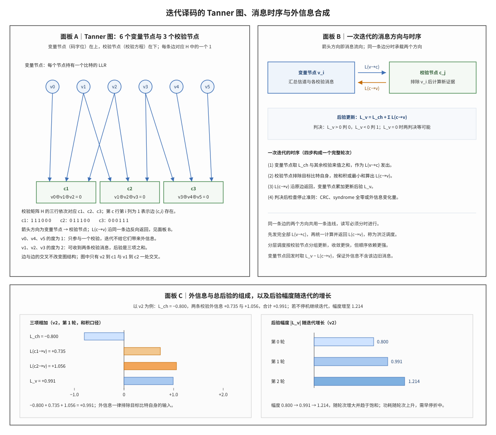

# Iterative Decoding 迭代译码与外信息

## 符号与记号约定

本笔记的全部数学符号在第一次出现之前由本节定义，下文再次出现时不再重复解释。三张表依次给出码与图的结构量、软信息与消息、迭代与控制量；表后列出运算符与记号惯例，其中方向的写法与集合剔除记号是理解外信息的关键。

**表 1｜码与图的结构量**

| 符号 | 含义与取值 | 协议锚点 |
|:---|:---|:---|
| $N$ | 码字比特数，也等于 Tanner 图中变量节点的个数；本文手算例取 $N=6$ | TS 38.212 §5.3.2（码块长度由基图列数与提升尺寸决定）；LTE 侧见 TS 36.212 §5.1.2 |
| $M$ | 校验方程数，也等于 Tanner 图中校验节点的个数；本文手算例取 $M=3$ | 由 TS 38.212 §5.3.2 的基图行数与提升尺寸导出 |
| $\mathbf{H}$ | $M\times N$ 校验矩阵，元素取 0 或 1；第 $c$ 行第 $i$ 列为 1 表示比特 $i$ 参与校验 $c$ | NR 侧由 TS 38.212 §5.3.2 的基图与移位系数展开；LTE Turbo 侧由 TS 36.212 §5.1.3.2 的 RSC 与交织器结构导出 |
| $h_{c,i}$ | 校验矩阵的单个元素，即 $\mathbf{H}$ 的第 $c$ 行第 $i$ 列，取值 0 或 1 | 由 $\mathbf{H}$ 导出（TS 38.212 §5.3.2） |
| $\mathcal{N}(c)$ | 校验节点 $c$ 的邻居比特集合，即第 $c$ 行中取值为 1 的列下标集合 | 非 3GPP 标准（图论记号，由 $\mathbf{H}$ 导出） |
| $\mathcal{N}(i)$ | 比特 $i$ 参与的校验集合，即第 $i$ 列中取值为 1 的行下标集合 | 非 3GPP 标准（图论记号，由 $\mathbf{H}$ 导出） |
| $i$ | 比特（变量节点）下标，取 $0,1,\dots,N-1$ | 非 3GPP 标准（教科书下标） |
| $j$ | 邻居比特下标，遍历 $\mathcal{N}(c)\setminus\{i\}$ 时使用 | 非 3GPP 标准（教科书下标） |
| $c$ | 校验节点下标，取 $1,2,\dots,M$ | 非 3GPP 标准（教科书下标） |

**表 2｜软信息与消息**

| 符号 | 含义与取值 | 协议锚点 |
|:---|:---|:---|
| $L$ | 泛指一条消息的 LLR 数值，取值 $(-\infty,+\infty)$；$L>0$ 倾向判 0，$L<0$ 倾向判 1，绝对值表示可靠度 | 非 3GPP 标准（LLR 的定义与符号约定属教科书） |
| $L_{\mathrm{ch}}(i)$ | 解调器给出的比特 $i$ 的信道 LLR，由接收采样与噪声方差算出，与迭代轮次无关 | 非 3GPP 标准（解调器软输出，量化标度属实现域） |
| $L_{i\to c}$ | 变量节点 $i$ 发给校验节点 $c$ 的消息，第 $k$ 轮由信道 LLR 与除 $c$ 外其余校验的消息合成 | 实现域（BP 消息，TS 不规定更新公式） |
| $L_{c\to i}$ | 校验节点 $c$ 发给比特 $i$ 的外信息，由本方程中除 $i$ 外其余比特的消息算出 | 实现域（BP 消息，TS 不规定更新公式） |
| $L_{v\to c}$ | 变量节点 $v$ 发给校验节点 $c$ 的消息，与 $L_{i\to c}$ 同义；$v$ 强调节点角色，$i$ 强调比特下标 | 非 3GPP 标准（图注记号，同 $L_{i\to c}$） |
| $L_{c\to v}$ | 校验节点 $c$ 发给变量节点 $v$ 的外信息，与 $L_{c\to i}$ 同义；图注与讲义多用这一写法 | 非 3GPP 标准（图注记号，同 $L_{c\to i}$） |
| $L_{c'\to i}$ | 同一记号加撇号表示另一个校验节点 $c'$ 发给 $i$ 的消息，用于"其余校验"的求和 | 实现域（BP 消息，TS 不规定更新公式） |
| $L_{j\to c}$ | 比特 $j$ 发给校验 $c$ 的消息，$j$ 取遍 $\mathcal{N}(c)\setminus\{i\}$，是校验节点更新式的输入 | 实现域（BP 消息，TS 不规定更新公式） |
| $L_{\mathrm{apr}}(i)$ | 进入当前处理单元之前已经持有的证据；Turbo 中来自另一译码器的外信息，LDPC 中等于除当前边外其余校验消息的合计，两者首轮都为 0 | 非 3GPP 标准（教科书定义） |
| $L_{\mathrm{ext}}(i)$ | 当前单元利用自身约束新产生的证据，等于后验扣除信道与先验 | 非 3GPP 标准（教科书定义） |
| $L_{\mathrm{post}}(i)$ | 综合信道与全部约束消息后的总置信度，与 $L_v(i)$ 同义 | 非 3GPP 标准（教科书定义） |
| $L_v(i)$ | 后验的简写，下标 v 表示变量节点；判决取它的符号，可靠度取它的绝对值 | 非 3GPP 标准（教科书定义） |

**表 3｜迭代与控制**

| 符号 | 含义与取值 | 协议锚点 |
|:---|:---|:---|
| $k$ | 迭代轮次序号，$k=0$ 表示只用信道 LLR 的初始状态，$k=1$ 表示完成一轮消息交换之后 | 实现域（轮次由接收机决定） |
| $I_{\max}$ | 最大迭代次数，接收机实现参数，3GPP 不规定具体取值 | 实现域（TS 不规定最大迭代次数） |
| $\mathrm{sign}(\cdot)$ | 正数取 $+1$、负数取 $-1$、零按 $+1$ 处理 | 教科书（符号函数定义） |
| $\tanh$ | 和积更新式对半 LLR 逐项取值的函数，值域 $(-1,1)$ | 教科书（双曲函数） |
| $\operatorname{artanh}$ | $\tanh$ 的反函数，定义域 $(-1,1)$，用于把连乘结果换回 LLR | 教科书（反双曲函数） |

第四列的判据：能落到协议条款的写条款号；由条款结构导出的写「由 §… 导出」；协议不规定的写「非 3GPP 标准」或「实现域」。协议只规定编码结构与发送比特流，译码消息的数值口径不在其内，因此表 2、表 3 的多数符号标注为实现域，这不等于这些量没有工程约束，只表示约束来自接收机设计而非 TS 条款。

运算符与记号惯例：

1. **方向**：$L_{i\to c}$ 与 $L_{c\to i}$ 描述同一对节点之间相反方向的两条消息，箭头右侧是接收方；二者数值一般不相等，也不能互相替代。图注与讲义常把同一对消息写作 $L_{v\to c}$ 与 $L_{c\to v}$，用节点角色代替比特下标，两套写法同义。
2. **集合与剔除**：$\mathcal{N}(c)\setminus\{i\}$ 表示从校验 $c$ 的邻居集合中删除目标比特 $i$，这是「外信息不含接收方自身输入」的记号来源；$\sum_{c'\in\mathcal{N}(i)\setminus\{c\}}$ 表示在该集合上求和。
3. **符号与幅度**：$\operatorname{sign}(L)$ 只决定建议的判决方向，$|L|$ 决定建议的强度；最小和式把两者分开处理，符号连乘、幅度取最小。
4. **连乘与取小**：$\prod$ 与 $\min$ 都作用在下标说明的集合上；下标写成 $j\in\mathcal{N}(c)\setminus\{i\}$ 时，两者都排除目标比特。
5. **数值口径**：手算例中的双曲函数值保留四位小数并按四舍五入处理，表内相加可能出现 $0.0001$ 量级的舍入差；这是呈现约定，不是算法差异。
6. **两套记号**：$L_v$ 与 $L_{\mathrm{post}}$ 同义，前者在迭代式中更短，后者在分解式中更明确；$L$ 单独出现时指任意一条消息，不指后验。
7. **矩阵与元素**：$\mathbf{H}$ 的粗体表示矩阵整体，$h_{c,i}$ 的普通体加双下标表示其中一个元素；$N$ 与 $M$ 是码的参数，不是节点编号。

一句话本质：**迭代译码把码字的全局约束拆成若干局部校验方程，各方程轮流输出只含自身新增证据的消息，比特侧把这些消息与信道观测在对数域相加；每轮传递都扣除接收方已有的输入，置信度因此可以跨轮累积而不重复计数。**

接收端进入译码时只有一份含噪观测，单个校验方程能提供的判决依据有限。迭代译码利用码字约束之间的重叠关系：一个比特受多个方程约束，一个方程又约束多个比特，同一份观测于是可以从不同约束角度被反复使用。下文先补齐六个前置对象，再给出四类软信息的代数关系与两种消息更新口径，然后用一个三行六列的校验矩阵完整走一轮消息传递，最后讨论迭代的不动点、早停与边界情形。

## 解释目标与范围

本节目标：解释迭代译码（Iterative Decoding）如何让多个软输入软输出（Soft-Input Soft-Output, SISO）处理单元通过外信息（Extrinsic Information）在信道观测与编码约束之间反复校正比特置信度，说明校验节点的和积（Sum-Product）与最小和（Min-Sum）两种更新口径在数值上的差别，并用一个 $3\times6$ 校验矩阵的手算例给出两种口径下的一轮消息与后验，同时划清停止准则、度为 1 的比特与 syndrome 检查三者的边界。

## 前置概念

本节把后文反复使用的六个对象一次交代清楚，它们分属三层：最底层是码的代数描述（校验矩阵），中间层是同一部码的图描述（Tanner 图），最上层是消息与概率语义（先验信息、后验信息、外信息、置信传播）。若已熟悉这三层，可直接跳到「科学定义」。

校验矩阵（parity-check matrix）是码的代数描述，写作 $M\times N$ 的 0/1 矩阵 $\mathbf{H}$，行对应校验方程、列对应码字比特，$h_{c,i}=1$ 表示比特 $i$ 出现在第 $c$ 个方程中。矩阵决定码字集合，也决定译码器可以采用哪种图结构；工程上接收机并不持有生成矩阵，只按 $\mathbf{H}$ 做校验与消息调度，因此同一部码的译码算法几乎都由校验矩阵的稀疏程度与行列结构决定。本文手算例的三行非零位置分别是 $\{0,1,2\}$、$\{1,2,3\}$、$\{3,4,5\}$，是最小规模的稀疏校验矩阵之一。LTE 的 Turbo 码把校验关系藏在递归系统卷积码的网格里，NR 的 LDPC 码则把校验矩阵写成基图加循环移位系数，两者的共同点是把全局约束拆成局部方程，见 [[LDPC_低密度奇偶校验码]] 与 [[QC_LDPC_准循环LDPC]]。

Tanner 图（Tanner graph）是校验矩阵的二分图（bipartite graph）表示：变量节点（variable node）对应码字比特，校验节点（check node）对应校验方程，第 $c$ 个校验节点与第 $i$ 个变量节点之间有边，当且仅当 $h_{c,i}=1$。节点的度（degree）是它连接的边数，比特的度等于它参与的校验数，校验的度等于方程约束的比特数；图上从某节点出发回到自身的边序列称为环（cycle），长度为 4 的环意味着两个比特同时出现在两个方程中。本文的九条边对应九个 1，v1 与 v2 同时参与 c1 与 c2，因此图中存在环 v1—c1—v2—c2—v1。图结构决定消息能否独立、迭代能否收敛，相关的工程调度见 [[Layered_LDPC_Schedule_分层LDPC调度]] 与讲义 [[T8.4_LDPC_Tanner_graph_message_passing]]。

先验信息（a priori information）是进入某个处理单元之前已经持有的关于该比特的证据，记作 $L_{\mathrm{apr}}$。对 Turbo 的两个 SISO 译码器，先验是另一个译码器上一轮交出的外信息，首轮没有这份外信息，故取 0；对 LDPC 的变量节点，先验是除当前边以外其余校验消息的合计，首轮其余校验尚未发出消息，先验也为 0，变量节点发出的就是信道 LLR。先验与后验描述的是同一个比特，区别只在于是否已经把本单元的新证据算进去，量化与饱和口径见 [[LLR_Prior_LLR先验]]。

后验信息（a posteriori information）是综合信道观测与本轮全部校验消息之后的总置信度，记作 $L_{\mathrm{post}}$ 或 $L_v$。它的符号给出硬判决，绝对值给出可靠度；它本身不是消息，不能在图上直接传递。原因在于一旦把后验原样发给邻居，邻居就会看到自己刚贡献过的那部分证据，同一条证据被计入两次，置信度虚高。后验与先验之差，就是本单元本轮新增的证据。

外信息（extrinsic information）是某个约束单元贡献的、不含接收方自身输入的那部分证据，记作 $L_{\mathrm{ext}}$。在校验节点上它就是返回给比特的消息 $L_{c\to i}$，在变量节点回发时它等于总后验减去该边此前的来值。外信息的核心纪律是非回声：同一条证据只能被计入一次，否则迭代会表现出与实际不符的自信。和积与最小和两种算法给出的都是外信息而不是后验，二者只在幅度口径上不同，见 [[Sum_Product_Algorithm_和积算法]] 与 [[Min_Sum_Algorithm_最小和算法]]。

置信传播（belief propagation, BP）是在二分图上按边交换消息、每轮用邻居来值更新本地信念的算法族。它把贝叶斯推断的乘法规则搬到对数域变成加法，再用局部消息近似全局后验；图上的环使 BP 不再等价于精确推断，但在稀疏长码上仍给出接近最大似然的结果。工程上的洪泛调度与分层调度决定消息更新的先后顺序，前者按轮同步、后者按校验分组，见 [[Layered_LDPC_Schedule_分层LDPC调度]]。

以上六个对象分别提供码的代数描述、同一部码的图描述与消息的概率语义；有了这套语言，下一节先交代它的来源与两代拓扑，再进入可运算的定义。

## 起源与演进

(1) **单次译码的局限。** 早期卷积码用维特比（Viterbi）算法做最大似然序列估计，一次遍历网格即给出判决；它的输出是硬判决或单一路径的度量，无法把「某个比特还剩多少不确定」传给另一层约束。级联码（concatenated code）把两个码串联，接收端先解外码再解内码，内码的判决错误会原样传给外码，两级之间没有置信度交换，性能受制于最弱的一级。

(2) **Turbo 码的交换结构。** 1993 年提出的 Turbo 码用两个递归系统卷积码（Recursive Systematic Convolutional Code, RSC）并行级联，中间隔一个交织器；接收端让两个软输入软输出译码器轮流工作，前一个译码器只把扣除自身输入后的外信息交给后一个，另一侧经解交织后同样处理。这一交换把两个码的约束耦合起来，误码率随信噪比陡降的区域（瀑布区）开始向低信噪比移动，并且随迭代次数增加继续移动。

(3) **LDPC 码的图解释。** 1962 年 Gallager 提出的低密度奇偶校验码在 1990 年代被重新发现，其校验矩阵稀疏，可以直接用 Tanner 图表示；置信传播在图上按边传递 LLR，变量节点做加法、校验节点做非线性的和积运算。环的存在使消息之间不再独立，但稀疏性保证环足够长，BP 仍能收敛到接近最大似然的结果，这一解释把「码的代数结构」和「译码算法的迭代行为」放到同一张图上讨论。

(4) **3GPP 的两代拓扑。** LTE 的共享信道采用 Turbo 码（TS 36.212），NR 的共享信道采用 LDPC 码（TS 38.212）；两者的译码器结构不同，Turbo 是两个 SISO 译码器经交织器互交外信息，LDPC 是变量节点与校验节点沿二分图互交外信息，但「扣除自身输入、只传新增证据」的纪律完全相同。控制信道另用 Polar 码，其列表译码的路径度量不属于外信息交换，不在本笔记范围内。

(5) **工程折中。** 迭代增益随轮次递减，而每轮的功耗与延迟近似线性增加；接收机用 CRC 通过、syndrome 全零、外信息变化量低于阈值三类早停准则截断迭代。3GPP 只规定编码结构与比特流，迭代次数、LLR 位宽、归一化最小和因子与早停门限都属实现域，本文手算例中的数值也只用于说明算法，不代表任何厂商实现。

## 科学定义

上一节说明迭代译码为什么必须交换外信息，本节把它写成可运算的形式。三个小节依次处理：四类软信息的加法分解与防回声纪律；校验节点的和积与最小和两种更新口径；一个三行六列校验矩阵上的一轮完整手算。三节之间是递进关系——先有分解，才有可算的消息，最后才能把消息代进具体数值。

### 四类软信息的加法分解

译码器内部的软信息分四类，满足加法分解：

$$
L_{\mathrm{post}}(i)=L_{\mathrm{ch}}(i)+L_{\mathrm{apr}}(i)+L_{\mathrm{ext}}(i)
$$

其中 $L_{\mathrm{ch}}$ 来自解调器，$L_{\mathrm{apr}}$ 是当前单元更新前已有的线索，$L_{\mathrm{ext}}$ 是当前单元利用自身约束新产生的增量证据，$L_{\mathrm{post}}$ 是总置信度。分解式成立的前提是三者都以对数似然比为单位：概率域的乘法在对数域变成加法，独立观测的证据才能逐项累加。符号约定为 $L>0$ 倾向判 0、$L<0$ 倾向判 1，绝对值表示可靠度，后文一律按此约定。

外信息的关键要求是「非回声」：传给下一个单元之前必须扣除信道与先验，只留新增证据，

$$
L_{\mathrm{ext}}(i)=L_{\mathrm{post}}(i)-L_{\mathrm{ch}}(i)-L_{\mathrm{apr}}(i)
$$

若把后验原样反馈，同一条证据会被重复计数，置信度虚高。把这一要求放到变量节点上，就得到变量节点回发消息的写法：总后验减去该边此前的来值，等价于「信道 LLR 加上除该边以外其余校验的来值」，

$$
L_{i\to c}=L_{\mathrm{ch}}(i)+\sum_{c'\in\mathcal{N}(i)\setminus\{c\}}L_{c'\to i}
$$

式中的求和集合排除了接收方 $c$ 自己，因此这条消息里不含 $c$ 上一轮贡献过的证据。首轮迭代时没有任何校验消息，变量节点发出的消息就等于信道 LLR，这是后文手算的起点。

### 校验节点的和积与最小和

校验节点要回答的问题是：在本方程约束成立的前提下，若其余比特的消息已知，目标比特应该得到多少新证据。和积（Sum-Product）算法给出精确答案：把各输入消息的半个 LLR 取双曲正切、连乘、再取反函数还原，

$$
L_{c\to i}=2\operatorname{artanh}\left(\prod_{j\in\mathcal{N}(c)\setminus\{i\}}\tanh\frac{L_{j\to c}}{2}\right)
$$

$\tanh$ 把任意实数压到 $(-1,1)$，连乘的符号表示各邻居建议方向的一致程度，幅度表示一致程度有多强；$\operatorname{artanh}$ 再把结果换回 LLR 域。计算时必须排除目标比特 $i$ 自身，否则它的旧消息会绕一圈回到自己身上，形成自证。

最小和（Min-Sum）算法用最小幅度代替和积的软幅度，只保留符号乘积：

$$
L_{c\to i}=\left(\prod_{j\in\mathcal{N}(c)\setminus\{i\}}\operatorname{sign}(L_{j\to c})\right)\cdot\min_{j\in\mathcal{N}(c)\setminus\{i\}}|L_{j\to c}|
$$

它的计算量只有比较与符号运算，适合硬件实现，代价是系统性高估：最小和给出的幅度不小于和积的结果，判决符号则一般相同。工程上用归一化因子（乘一个小于 1 的常数）或偏移量补偿这一高估，补偿参数属于实现域，3GPP 不作规定。

变量节点收到本轮全部校验消息后合成后验：

$$
L_v(i)=L_{\mathrm{ch}}(i)+\sum_{c\in\mathcal{N}(i)}L_{c\to i}
$$

判决取 $L_v(i)$ 的符号，可靠度取它的绝对值；若某个比特的度为 1，求和里只有一项，它回发给该边的消息恒等于信道 LLR，无法把校验侧的证据再反馈回图上，这一点在「边界情形」中展开。

### 一轮消息传递的手算实例

取三行六列的校验矩阵

| | v0 | v1 | v2 | v3 | v4 | v5 |
|:---|:---:|:---:|:---:|:---:|:---:|:---:|
| c1 | 1 | 1 | 1 | 0 | 0 | 0 |
| c2 | 0 | 1 | 1 | 1 | 0 | 0 |
| c3 | 0 | 0 | 0 | 1 | 1 | 1 |

三个方程依次是 v0⊕v1⊕v2=0、v1⊕v2⊕v3=0、v3⊕v4⊕v5=0。信道 LLR 初值取 v0=+1.00、v1=+2.00、v2=−0.80、v3=+1.50、v4=+2.50、v5=+1.80；按符号约定，只有 v2 倾向于判 1，硬判决为 0,0,1,0,0,0，代入 c1 与 c2 都得 1，两条方程同时失败。

第一轮的第一个半迭代只做变量节点到校验节点的发送。此时还没有任何校验消息，每个比特发出的消息就等于自己的信道 LLR：v2 发给 c1 的消息是 $L_{\mathrm{ch}}(2)=-0.80$，v1 发给 c1 的消息是 $L_{\mathrm{ch}}(1)=+2.00$。

第二个半迭代在校验节点上计算外信息。以目标比特 v2 为例，c1 的其余输入是 v0 与 v1，和积给出的外信息为

$$
2\operatorname{artanh}\left(\tanh\frac{1.00}{2}\cdot\tanh\frac{2.00}{2}\right)
=2\operatorname{artanh}(0.4621\times0.7616)
\approx2\operatorname{artanh}(0.3519)\approx+0.7353
$$

c2 的其余输入是 v1 与 v3，同样算得

$$
2\operatorname{artanh}\left(\tanh\frac{2.00}{2}\cdot\tanh\frac{1.50}{2}\right)
=2\operatorname{artanh}(0.7616\times0.6351)
\approx2\operatorname{artanh}(0.4838)\approx+1.0557
$$

同样口径下其余七条消息为：c1 发给 v0 的 −0.5958、发给 v1 的 −0.3548，c2 发给 v1 的 −0.4924、发给 v3 的 −0.5958，c3 发给 v3 的 +1.4103、发给 v4 的 +0.9819、发给 v5 的 +1.2049。以 v3 为例复核一次：c2 的其余输入是 v1=+2.00 与 v2=−0.80，半 LLR 的正切为 0.7616 与 −0.3799，连乘得 −0.2894，反函数还原后约为 −0.5958；c3 的其余输入是 v4=+2.50 与 v5=+1.80，连乘得 0.8483×0.7163≈0.6076，还原后约为 +1.4103。

把两种口径并列，第一轮的校验消息与后验整理成下表。表中「c1→v」等三列是校验节点发出的外信息，最后两列分别是两种口径下的后验；没有对应边的格子记「—」。

| 比特 | $L_{\mathrm{ch}}$ | c1→v | c2→v | c3→v | $L_v$（和积） | $L_v$（最小和） |
|:---|:---:|:---:|:---:|:---:|:---:|:---:|
| v0 | +1.00 | −0.5958 | — | — | +0.4042 | +0.2000 |
| v1 | +2.00 | −0.3548 | −0.4924 | — | +1.1528 | +0.4000 |
| v2 | −0.80 | +0.7353 | +1.0557 | — | +0.9910 | +1.7000 |
| v3 | +1.50 | — | −0.5958 | +1.4103 | +2.3145 | +2.5000 |
| v4 | +2.50 | — | — | +0.9819 | +3.4819 | +4.0000 |
| v5 | +1.80 | — | — | +1.2049 | +3.0049 | +3.3000 |

最小和的口算过程更短：c1 给 v2 的符号由 v0 与 v1 同为正决定，幅度取 $\min(1.00,2.00)=1.00$；c2 给 v2 的幅度取 $\min(2.00,1.50)=1.50$，于是后验为 $-0.80+1.00+1.50=+1.70$。两种口径都把 v2 从 −0.80 推到正值，判决翻转；差别在幅度，和积给出 +0.9910，最小和给出 +1.7000，前者只有后者的约 58%。

第一轮的判决结果是 0,0,0,0,0,0，代入三个方程全部满足，syndrome 为零。按早停准则此时应当停止，CRC 若同时通过即可交付；若不停机继续计算，第二轮中 v2 发给 c1 的消息变成总后验减去 c1 的来值，即 $+0.9910-0.7353=+0.2557$；发给 c2 的消息变成 $+0.9910-1.0557=-0.0647$，两条校验消息更新为约 +0.6071 与 +1.4070，后验升至 +1.2141。继续迭代时后验幅度还会增大并逐渐逼近不动点（第三轮约 1.67，第六轮约 1.88），但每轮增量并不单调，这是环使 BP 只能近似推断的直接表现；工程上用早停截断，而不是等它完全稳定。

**图 1｜Tanner 图、一次迭代的消息时序与外信息合成。** 面板 A 的九条边对应校验矩阵中的九个 1，箭头为变量节点到校验节点的消息方向，度为 1 的比特与一处边交叉都已在图内标注；面板 B 把同一条边的两个方向拆成先后两拍，并给出后验合成式；面板 C 以比特 v2 为例，把后验拆成信道项与两条校验外信息。图中的数值与本节手算例一致；面板 C 右半部分的幅度按不停机继续迭代计算，用于说明幅度随轮次增大并趋于饱和。

## 直观模型

把译码器看成一幅二分图与两组实数向量的组合：节点集合分成变量节点与校验节点，边集由校验矩阵的 1 决定；每条边上存两个方向的实数消息，第 $k$ 轮先用变量节点的加法把信道 LLR 与其余校验消息合成 $L_{i\to c}$，再用校验节点的非线性映射把邻居消息合成 $L_{c\to i}$，最后在变量节点上把所有来值相加得到后验。一个完整轮次就是这两次映射的复合，迭代则在重复同一个复合映射；映射的不动点满足「回发的消息等于总后验减去该边来值」，这正是防回声纪律在代数上的表述。

结构上还有三条可直接读出的性质。第一，规模由 $N$ 与 $M$ 决定，稀疏性由每条边的度决定：度越小的图每轮计算越省，但消息能覆盖的约束也越少。第二，环决定消息的相关性：树上的 BP 在有限轮内给出精确后验，环上的消息会重复利用同一批观测，收敛点与精确后验存在偏差，环越长偏差越小。第三，迭代表现为证据累积与幅度饱和的竞争：判决符号通常在少数几轮内稳定，幅度先增大后逼近不动点，因此停止准则盯住的是「证据是否还在变化」，而不是「幅度是否还在增大」。

## 边界情形

度为 1 的比特是迭代译码的第一类边界。它只参与一个校验方程，变量节点求和里只有一项，回发消息扣除该项后只剩信道 LLR，因此无论迭代多少轮，它的后验都等于 $L_{\mathrm{ch}}$ 加上那条唯一的校验消息，不会获得第二条独立证据。本文例子中的 v0、v4、v5 属于这一类：图中三个节点各只有一条边，它们的判决只被一个方程约束，可靠性提升有限。工程上这类比特的比例由码结构决定，LDPC 基图的列重设计会刻意避免大量列重为 1 的比特。

环上的置信传播是第二类边界。BP 在树上的精确性来自消息沿不同分支独立，环使同一条观测沿两条路径回到同一节点，消息不再独立，迭代可能收敛到精确后验之外的固定点，也可能出现周期振荡。环越短、消息越强，偏差越明显；最小和的幅度高估会放大这种偏差，工程上常用归一化或偏移补偿抑制高估，长码因环长较大，偏差相对更小。判断是否收敛不能只看幅度，还要看判决是否稳定、外信息变化量是否低于阈值。

停止准则与验收边界是第三类。CRC 通过是最可靠的停止条件，因为它检查的是整个传输块；syndrome 全零只说明当前硬判决满足全部校验方程，仍可能是码字集合中的另一个码字，即误码但校验通过的情形；最大迭代次数是硬上限，防止不收敛时无限循环；外信息变化量阈值是折中手段，在幅度不再明显变化时提前退出。四条准则可以组合使用，具体门限与组合方式都由接收机实现决定，协议只规定编码结构与比特流，不规定迭代次数、位宽与早停参数。

## 常见误解

| 误解 | 正确理解 |
|:---|:---|
| 迭代译码就是把同一算法多跑几遍 | 迭代的本质是不同约束之间交换外信息，每轮都在改变比特置信度的分布；同一算法在相同输入上重复运行不会带来新证据。 |
| 外信息就是后验 LLR | 外信息必须扣除信道与先验，等于后验减去接收方已有的输入；把后验原样反馈会让同一条证据被重复计数。 |
| 和积与最小和给出相同的数值 | 两者判决符号通常相同，幅度不同：最小和用最小幅度代替和积的软幅度，系统性高估，需要归一化或偏移补偿。 |
| 最小和的幅度更小所以更保守 | 最小和的幅度不小于和积结果，是偏大而非偏小；它牺牲的是幅度精度，换来的是比较与符号运算的硬件友好性。 |
| 迭代次数越多越好 | 增益随轮次递减而功耗与延迟线性上升，收敛后继续迭代不再改变判决；早停准则的作用就是在这两者之间取折中。 |
| 3GPP 规定固定迭代次数 | 迭代次数、LLR 位宽、归一化因子与早停门限都是接收机实现策略，协议不强制；协议只规定编码结构与输出比特流。 |
| syndrome 为零等于传输块交付通过 | syndrome 只检查当前硬判决是否满足校验方程，仍可能是另一个合法码字；交付还要看 CRC 与码块重组边界。 |
| 度为 1 的比特也能通过迭代提升可靠度 | 度为 1 的比特只有一条边，回发消息恒等于信道 LLR，它不能向图反馈校验侧证据；它只能被动接收唯一方程的结果，独立证据始终只有一份。 |

## 协议锚点

- LTE Turbo 编码、分段与速率匹配：TS 36.212 Rel-19 `36212-j30` §5.1.3.2（Turbo 编码器、网格终止与内部交织器，Figure 5.1.3-2 文字锚点）、§5.1.2 与 §5.2.2.2（码块分段与码块 CRC 附着）、§5.1.4.1（Turbo 码速率匹配的子块交织与比特选择），本地 `3GPP_Rel19/processed/TS_36.212_36212-j30/content.md`。这些条款决定进入 Turbo 译码器的码块长度、打孔图样与交织关系，对应两个 SISO 译码器互交外信息的拓扑。
- NR LDPC 编码结构：TS 38.212 Rel-19 `38212-j30` §5.3.2（Tables 5.3.2-1/2/3），规定基图、循环移位系数与提升尺寸，对应 LDPC 译码器所用的 Tanner 图结构。
- NR UL-SCH 与 DL-SCH 链路：TS 38.212 Rel-19 `38212-j30` §6.2、§7.2，规定码块分割、CRC 附着与速率匹配，决定译码器的输入 LLR 排布。
- 标注：具体 MAP（最大后验概率，Maximum A Posteriori）与 Max-Log-MAP、BP 与 Min-Sum 的内部消息更新公式属接收机实现算法，3GPP 不规定厂商迭代次数、LLR 位宽、归一化 Min-Sum 参数或早停门限。
- 本地讲义锚点：`docs/L1_基础/T4.1_iterative_decoding_extrinsic_information.md`、`docs/L2_协议算法/T8.4_LDPC_Tanner_graph_message_passing.md`。

## 关键要点

1. 迭代的本质是不同约束之间交换外信息，不是同一算法多跑几遍；每轮的消息必须只含新增证据。
2. 四类软信息满足 $L_{\mathrm{post}}=L_{\mathrm{ch}}+L_{\mathrm{apr}}+L_{\mathrm{ext}}$，外信息等于后验扣除信道与先验，这是防回声的代数形式。
3. 校验节点有两种口径：和积用双曲正切的连乘与反函数还原，最小和用符号连乘与最小幅度，后者幅度系统性偏大、硬件更省。
4. 手算例（$3\times6$ 校验矩阵、六比特信道 LLR）第一轮就把 v2 从 −0.80 推到 +0.9910（和积）或 +1.7000（最小和），判决翻转、syndrome 归零。
5. 变量节点回发消息等于总后验减去该边来值，等价于信道 LLR 加其余校验来值；这是外信息在变量侧的写法。
6. 停止准则有 CRC 通过、syndrome 全零、外信息变化量阈值与最大迭代次数四类，syndrome 全零不等于交付通过。
7. 度为 1 的比特只有一条边，回发消息恒等于信道 LLR，不能向图反馈证据，独立证据始终只有一份；环使消息相关，BP 只能近似推断。
8. 迭代次数、LLR 位宽、归一化因子与早停门限都属接收机实现域，3GPP 不作规定。

## 图谱关联

- [[概念图谱入口]]
- [[Turbo_码]]
- [[LDPC_低密度奇偶校验码]]
- [[QC_LDPC_准循环LDPC]]
- [[Early_Stopping_早停控制]]
- [[CRC_循环冗余校验]]
- [[Sum_Product_Algorithm_和积算法]]
- [[Min_Sum_Algorithm_最小和算法]]
- [[LLR_对数似然比]]
- [[LLR_Prior_LLR先验]]
- [[Layered_LDPC_Schedule_分层LDPC调度]]
- [[RSC_Code_递归系统卷积码]]
- [[QPP_Interleaver_QPP交织器]]
- [[T4.1_iterative_decoding_extrinsic_information]]
- [[T4.2_graphs_trellises_trees_for_decoding]]
- [[T6.7_Turbo_iteration_extrinsic_stopping]]
- [[T8.4_LDPC_Tanner_graph_message_passing]]
- 关系语义：迭代译码定义了 Turbo 与 LDPC 两类译码器的收敛动力学，外信息交换是译码增益的来源；和积与最小和提供两种消息映射，早停与 CRC 决定迭代在何时终止，Tanner 图则给出这一切过程的共同几何。
