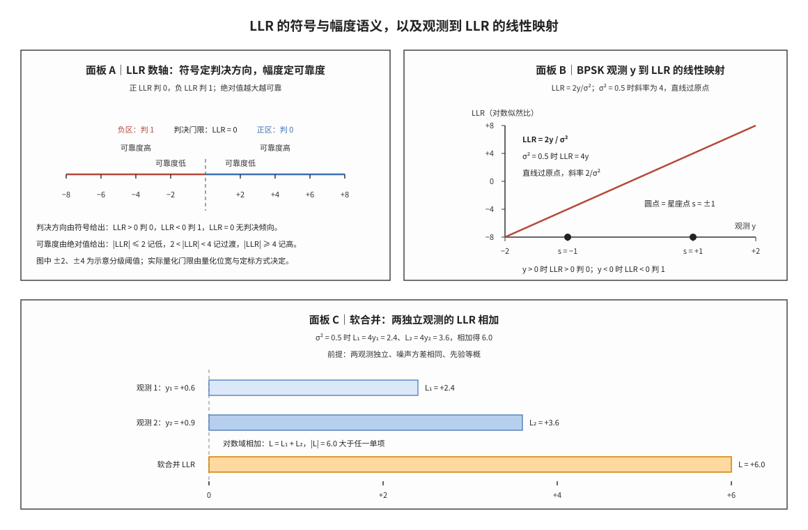

# LLR 对数似然比

一句话本质：**对数似然比（Log-Likelihood Ratio, LLR）是以对数比值表示的带方向置信度——符号给出硬判决方向，绝对值给出该判决的可靠程度；取对数之后，独立观测的证据可以用加法合并。**

接收端在解调与译码之间的接口上并不传递比特 0 或 1，而是传递一组带符号的实数：每个编码比特对应一个数，数的符号表示该比特更可能是 0 还是 1，数的绝对值表示这个判断有多可靠。硬判决把每个比特压成一个二进制符号，压缩过程丢掉了"这个判断有多可信"的信息；软判决保留这一程度，代价是每个比特要占用若干比特的存储与接口带宽。LLR 是软判决最常用的数值形式，也是软缓存、混合自动重传请求（Hybrid Automatic Repeat Request, HARQ）合并与迭代译码共同的输入语言。

本笔记按四步展开：先约定全文符号，再给出 LLR 的概率定义与两种等价写法；随后推导二进制相移键控（Binary Phase Shift Keying, BPSK）下观测到 LLR 的闭式映射，并给出一个可手算的数值例；接着说明独立观测的 LLR 为何可以直接相加，最后划清精确 LLR 与最大对数近似（max-log approximation）、协议规定与实现自由之间的边界。

## 独立解释任务

任务目标：解释 LLR 如何把一个比特的概率判断压缩成一个可累加、可量化的实数，说明它由观测与先验之比得到的过程，给出 BPSK 与加性白高斯噪声（Additive White Gaussian Noise, AWGN）下的闭式表达、一个可手算的数值例，并把精确式、max-log 近似、协议锚点与实现域边界分开陈述。

## 符号与记号约定

本节先于全文任何公式给出符号表与运算符约定。后续章节遇到陌生符号时，回到本节查表，不再重复解释。

| 符号 | 读法 | 含义与取值 |
|:---|:---|:---|
| $L$ | 对数似然比 | 一个比特的软信息，无量纲实数，取值 $(-\infty,+\infty)$；符号定判决方向，绝对值定可靠度 |
| $\lambda$ | lambda | $L$ 的另一种常见记号，与 $L$ 完全同义；本笔记正文统一写 $L$，仅在对照其他文献时按等价处理 |
| $b$ | b | 发送比特，取 0 或 1 |
| $y$ | y | 接收端解调后的观测值；BPSK 下为实数，高阶调制下为复数的实部或虚部投影 |
| $i$ | i | 观测序号，取正整数；仅作遍历下标 |
| $L_i$ | L 下标 i | 第 $i$ 个观测给出的 LLR |
| $L_1$ | L 下标 1 | 第 1 个观测的 LLR |
| $L_2$ | L 下标 2 | 第 2 个观测的 LLR |
| $y_i$ | y 下标 i | 第 $i$ 个观测的取值 |
| $y_1$ | y 下标 1 | 第 1 个观测的取值 |
| $y_2$ | y 下标 2 | 第 2 个观测的取值 |
| $k$ | k | 参与合并的独立观测个数，正整数 |
| $s$ | s | 发送端星座符号；BPSK 下取 $+1$ 或 $-1$，高阶调制下取星座点复数坐标 |
| $n$ | n | 噪声样点，零均值、方差 $\sigma^2$ 的高斯随机变量 |
| $P$ | P | 概率，取值 $[0,1]$；条件写法 $P(b=0\mid y)$ 表示已知观测 $y$ 后比特取 0 的概率 |
| $\sigma^2$ | sigma 方 | 噪声方差（每实维），与观测同量纲的平方；与单边功率谱密度 $N_0$ 的关系为 $\sigma^2=N_0/2$ |
| $N_0$ | N 零 | 噪声的单边功率谱密度，用于把噪声方差换算到带宽口径 |
| $S_0$ | S 下标 0 | 在给定比特假设下、该比特取 0 时所有可能的星座点集合 |
| $S_1$ | S 下标 1 | 该比特取 1 时所有可能的星座点集合 |
| $D_s$ | D 下标 s | 观测到星座点 $s$ 的归一化欧氏距离，$D_s=\frac{(y-s)^2}{2\sigma^2}$ |
| $\alpha$ | alpha | 最小和（min-sum）译码中校验节点更新的尺度因子，无量纲；$\alpha=1$ 为原始 min-sum，$0.75$ 至 $0.8$ 为归一化 min-sum 的典型取值 |
| $Q_m$ | Q 下标 m | 调制阶数，即一个调制符号承载的编码比特数；正交相移键控（Quadrature Phase Shift Keying, QPSK）为 2，16 阶正交幅度调制（16-Quadrature Amplitude Modulation, 16QAM）为 4，64 阶正交幅度调制（64QAM）为 6 |
| $N_{cb}$ | N 下标 cb | 循环缓存长度，即速率匹配地址空间的上界 |
| $N_{IR}$ | N 下标 IR | 软缓存的总大小（LTE 记法），用于确定每个码块可用的软缓存长度 |
| $N_{RE}$ | N 下标 RE | 一次传输可用的资源元素数，由调度参数算出 |
| $L_a$ | L 下标 a | 先验信息（a priori information），进入当前分量译码器的外部证据 |
| $L_e$ | L 下标 e | 外信息（extrinsic information），当前分量译码器新产生、不含自身输入的那部分证据 |

运算符与书写约定：

1. **对数的底**：本笔记的 $\log$ 一律取自然对数（底为 e），与多数译码器文献和定点实现口径一致。换底只改变 LLR 的绝对尺度，不改变符号与判决：若改用底 2，同一比值给出的数值是自然对数结果的 $\frac{1}{\ln 2}$ 倍，约 1.4427 倍。跨文献比较 LLR 数值前必须先确认底。
2. **求和与取最小**：$\sum_i L_i$ 表示对各观测的 LLR 求和，$\min_{s\in S_0}D_s$ 表示在集合 $S_0$ 内取 $D_s$ 的最小值。下标只表示遍历范围，不进入被求和或被取最小的量本身。
3. **上下标语义**：下标表示序号或归属（$L_1$ 是第 1 个观测，$S_0$ 是比特取 0 的星座子集），上标表示乘方（$\sigma^2$ 是方差，不是 $\sigma$ 的第 2 次观测）。
4. **记号选择**：同一物理量在不同文献里有 $L$ 与 $\lambda$ 两套记号，本笔记统一用 $L$；两者完全等价，不代表不同量级，也不代表不同单位。
5. **量纲与范围**：LLR 无量纲，可为任意实数。$L=0$ 表示两个假设的后验概率相等，$|L|\to\infty$ 表示其中一个假设的概率趋于 1。硬件实现通常把它量化为定点整数（见 [[LLR_Quantization_LLR量化]]），量化后的数值不再严格满足对数关系，只保留符号与单调性。
6. **公式编号**：全文用 LaTeX 的 `\tag{n}` 形式给公式编号（n 为公式序号），编号从 (1) 起连续；`\tag` 只是排版命令，不是符号、不表示物理量，正文中的"式 (n)"均指该编号。

## 前置概念

本节列出后文反复使用的基本对象。若已熟悉，可直接跳到「科学定义」；若某一节读不通，多半是本节的某个对象尚未建立。

### 先验概率（prior probability）

先验概率是在观测到 $y$ 之前对发送比特所持的概率判断，记为 $P(b=0)$ 与 $P(b=1)$，二者之和为 1。在本笔记中，等概先验使公式 (2) 的先验项取 0，是最常用的简化假设；先验不等概时，先验比会作为一个常数偏置加在 LLR 上。参见 [[Probability_Bayes_概率与贝叶斯]]。

### 条件概率与似然（conditional probability and likelihood）

条件概率 $P(b=0\mid y)$ 是已知观测 $y$ 之后比特取 0 的概率，也称后验概率；反过来的条件概率 $P(y\mid b=0)$ 把观测当作已知量、把比特假设当作变量，称为似然。LLR 的分子分母就是两个后验概率之比，按贝叶斯公式展开后变成两个似然之比再乘先验比——这是本笔记全部公式的出发点。

### 对数域（log domain）

对数域指用对数值代替原值做运算的表示方式。概率相乘在对数域变成相加，概率比在对数域变成相减，因此 LLR 适合承担两件事：多个独立观测的证据合并，以及迭代译码中校验节点与变量节点之间的消息传递。

### 判决门限（decision threshold）

判决门限是把实数判决成 0 或 1 的分界值。LLR 的门限取 0：大于 0 判 0，小于 0 判 1，恰好等于 0 时两个假设证据相当、判决任取。门限的位置由符号约定决定，不由数值大小决定；换一套符号约定，门限仍取 0，但两侧对应的比特互换。

### 软判决与硬判决（soft decision and hard decision）

硬判决只输出 0 或 1，软判决输出一个带符号的实数或它的量化值，同时携带方向与可靠度。LLR 是软判决最常用的数值形式。硬判决可以看作对 LLR 取符号后的一步压缩，压缩过程丢弃幅度信息，因此同一组硬判决结果可能来自可靠度完全不同的两种接收状态。参见 [[Soft_Demodulation_软解调]]。

### 噪声方差与信噪比（noise variance）

噪声方差 $\sigma^2$ 描述接收样点围绕发送符号的离散程度，是观测到 LLR 映射中唯一的链路参数。同一观测值在噪声方差小的链路上给出的 LLR 幅度大，在噪声方差大的链路上给出的幅度小；方差估计错误会让软信息系统性过强或过弱。详见 [[AWGN_信道模型]]。

## 科学定义

本节沿用文首「符号与记号约定」的记号：$L$ 为对数似然比，$b$ 为发送比特，$y$ 为观测，$\sigma^2$ 为噪声方差，$S_0$ 与 $S_1$ 为两个比特假设对应的星座点集合；符号含义不再重复。

### 定义与两种等价写法

LLR 的两个竞争假设是"该比特取 0"与"该比特取 1"。把它定义为两个后验概率之比的对数：

$$L(b)=\log\frac{P(b=0\mid y)}{P(b=1\mid y)} \tag{1}$$

按贝叶斯公式 $P(b\mid y)=\frac{P(y\mid b)P(b)}{P(y)}$ 展开，分母 $P(y)$ 在比值中抵消，得到似然比与先验比的乘积形式：

$$L(b)=\log\frac{P(b=0)}{P(b=1)}+\log\frac{P(y\mid b=0)}{P(y\mid b=1)} \tag{2}$$

先验等概时 $P(b=0)=P(b=1)$，第一项为 0，LLR 退化为纯对数似然比：

$$L(b)=\log\frac{P(y\mid b=0)}{P(y\mid b=1)} \tag{3}$$

由式 (1) 可以直接反解后验概率。记 $L$ 为式 (1) 的取值，则

$$P(b=0\mid y)=\frac{1}{1+\exp(-L)} \tag{4}$$

式 (4) 说明 LLR 与后验概率是一一对应的：$L=0$ 给出 0.5，$L$ 越大后验概率越接近 1，$L$ 为负时后验概率小于 0.5。工程实现里它用于把 LLR 换算成后验概率、计算外信息，或把不同来源的软信息折算到同一概率口径。

由式 (1) 至 (3) 可以直接读出三个性质：

1. **符号定方向**：$L>0$ 表示比特取 0 的证据更强，$L<0$ 表示取 1 的证据更强。硬判决就是取 $L$ 的符号。
2. **幅度定可靠度**：$|L|$ 越大，两个假设的后验概率相差越悬殊。$|L|$ 没有上界，因此 LLR 不是概率，也不能直接当作概率使用。
3. **尺度可换算**：改变对数的底、或把噪声方差按比例缩放，都会整体改变 LLR 的绝对数值；只要两端使用同一套换算，判决与合并结果不变。

### BPSK 与 AWGN 下的闭式表达

BPSK 把比特映射为两个实符号：比特 0 映射为 $s=+1$，比特 1 映射为 $s=-1$。接收观测为发送符号加噪声：

$$y=s+n \tag{5}$$

其中 $n$ 为零均值、方差 $\sigma^2$ 的高斯噪声。等概先验下把两个假设的似然代入式 (3)，指数相除后取对数：

$$L=\log\frac{\exp\left(-\frac{(y-1)^2}{2\sigma^2}\right)}{\exp\left(-\frac{(y+1)^2}{2\sigma^2}\right)}=\frac{2y}{\sigma^2} \tag{6}$$

式 (6) 是 BPSK 软解调最常用的结果：观测到 LLR 是过原点的线性映射，斜率为 $2/\sigma^2$，符号与观测同号。需要注意的是，这一形式依赖三个条件——调制为 BPSK、先验等概、噪声为方差已知的高斯噪声；三个条件任一改变，斜率或偏置就要相应修改。

手算数值例。取 $y=+1.2$、$\sigma^2=0.5$、先验等概：

$$L=\frac{2\times 1.2}{0.5}=4.8 \tag{7}$$

- **判决**：$L=4.8>0$，判比特 0。
- **可靠度**：$|L|=4.8$，按「直观模型」的分级（$|L|\le 2$ 为低、$2<|L|<4$ 为过渡、$|L|\ge 4$ 为高）属高可靠度。
- **概率换算**：由式 (4)，$P(b=0\mid y)=\frac{1}{1+\exp(-4.8)}=0.9918$，即该比特判错的概率约 0.82%。

作为对照，若同一观测 $y=+1.2$ 落在 $\sigma^2=2$ 的链路上，则 $L=\frac{2\times1.2}{2}=1.2$，判决仍是 0，但后验概率降到 0.769，判错概率约 23.1%。同一观测值、方差放大 4 倍，LLR 幅度缩小到四分之一——这说明 LLR 的绝对值只在给定的噪声标度下才有意义。

### 软合并：独立观测的 LLR 相加

若同一个比特被独立地观测两次，两次观测的噪声互不相关、方差相同、先验等概，则联合似然等于两个似然之积，取对数后变成相加：

$$L=L_1+L_2=\frac{2y_1}{\sigma^2}+\frac{2y_2}{\sigma^2} \tag{8}$$

更一般地，$k$ 个独立同方差观测的合并结果为 $L=\sum_{i=1}^{k}L_i$。加法成立的前提是条件独立：两个观测在给定比特下互不影响。若两个观测共享同一份噪声（例如同一次传输被重复读取），相加会把同一份证据计入两次，得到的幅度偏大、可靠度被高估。

数值例。取 $\sigma^2=0.5$、$y_1=+0.6$、$y_2=+0.9$，则 $L_1=2.4$、$L_2=3.6$、$L=6.0$。合并后 $|L|$ 由 2.4 与 3.6 增大到 6.0，后验概率由 0.917 与 0.973 提高到 0.9975，判错概率由 8.3% 与 2.7% 降到 0.25%。若第二个观测反向，取 $y_2=-0.9$，则 $L=2.4-3.6=-1.2$，判决翻转为比特 1——反向证据在加法中相互抵消，符号由净证据决定。

**图 1｜LLR 的符号、幅度与观测映射。** 面板 A 在 LLR 数轴上标出判决门限 0、正负两侧对应的判决结果，以及按绝对值划分的可靠度分级；面板 B 以 $\sigma^2=0.5$ 的 BPSK 为例，画出观测 $y$ 到 LLR 的过原点直线 $L=2y/\sigma^2$，并在观测轴 $+1$ 与 $-1$ 处标出两个星座点；面板 C 展示两个独立观测的 LLR 相加：$L_1=2.4$ 与 $L_2=3.6$ 合并为 $L=6.0$，合并后的绝对值大于任一单项。三块面板对应本节的三个结论——符号定方向、幅度定可靠度、对数域相加即软合并。

### max-log 近似与精确 LLR 的差异

高阶调制下每个比特对应多个星座点，精确 LLR 要对两个星座子集分别求和。定义 $D_s=\frac{(y-s)^2}{2\sigma^2}$ 为观测到星座点 $s$ 的归一化距离，则

$$L=\log\frac{\sum_{s\in S_0}\exp(-D_s)}{\sum_{s\in S_1}\exp(-D_s)} \tag{9}$$

max-log 近似用每侧的最小距离项代替整侧求和，把对数求和化为两次取最小：

$$L\approx\min_{s\in S_1}D_s-\min_{s\in S_0}D_s \tag{10}$$

被丢掉的是对数求和指数（log-sum-exp）修正项：每侧除最小值以外的其他星座点贡献了一个对数增量，max-log 令其为 0。误差的量级取决于每侧星座点的数目与信噪比——BPSK 下 $S_0$ 与 $S_1$ 各只有一个点，式 (9) 与式 (10) 完全相等，故式 (6) 本身没有近似误差；QPSK 及以上每侧有多个点，max-log 在低信噪比下使 $|L|$ 系统性偏大，典型 16QAM 与 64QAM 链路在误块率 $10^{-2}$ 附近约带来 0.2 至 0.5 dB 的等效信噪比损失。由于偏差表现为幅度整体偏大，低密度奇偶校验（Low-Density Parity-Check, LDPC）译码器常以尺度因子 $\alpha$ 乘在 min-sum 的校验节点输出上补偿，$\alpha\approx0.75$ 至 $0.8$ 时译码性能接近精确 LLR（见 [[Min_Sum_Algorithm_最小和算法]]）。

### 译码器内部的先验、外信息与后验

LLR 在迭代译码中有三种角色。进入某个分量译码器的外部证据称为先验信息 $L_a$；译码器根据校验关系新产生、且不包含自身输入的那部分证据称为外信息 $L_e$；二者相加得到该比特的后验 LLR：

$$L=L_a+L_e \tag{11}$$

外信息的定义要害在"不包含自身输入"：若把输入先验原样再算进输出，同一份证据会在两个分量译码器之间被反复累加，迭代增益虚高、校验子不收敛。接收端第一次进入 LDPC 译码器时，先验来自解调器输出的信道 LLR；后续迭代中，先验来自上一层校验节点的输出。这一结构在 Turbo 码与 LDPC 码中相同，差别只在分量码与交织方式。参见 [[Iterative_Decoding_迭代译码]]、[[Sum_Product_Algorithm_和积算法]]、[[LDPC_低密度奇偶校验码]]。

## 直观模型

本节以结构化方式给出 LLR 的数值结构，不使用生活化比喻。LLR 的全部语义由四个对象确定：一条实数轴、轴上的符号、轴上的幅度、以及若干分级阈值。

### 一维刻度结构

LLR 定义在实数轴上，原点 $L=0$ 是判决门限，也是两个假设后验概率相等的唯一位置。轴被原点分成两段：正半段对应比特 0，负半段对应比特 1。轴上每个点的位置由两个坐标读数确定——符号读出判决方向，绝对值读出该点到原点的距离。距离本身没有上界，因此 LLR 的取值区间是整条实轴，而不是 $[0,1]$。

### 可靠度分级

幅度按区间分级：$|L|\le 2$ 为低可靠度，$2<|L|<4$ 为过渡区，$|L|\ge 4$ 为高可靠度。阈值 2 与 4 只是本笔记为叙述方便选定的示意值，不是协议常量；实际分级由量化位宽、定标方式与译码器输入范围决定。分级的意义在于把连续幅度映射到有限个状态，便于描述与实现；它不改变 LLR 的定义。

### 单调映射结构

固定调制方式、先验与噪声方差后，观测到 LLR 是单调映射。BPSK 与等概先验下该映射是过原点的直线，斜率为 $2/\sigma^2$，于是有三个可直接读出的性质：观测符号与 LLR 符号相同；观测为 0 时 LLR 为 0；噪声方差增大时斜率减小、同样的观测给出的幅度变小。三点合起来说明，LLR 的幅度不是观测的固有属性，而是观测相对于噪声标度的相对量。

### 加法结构

多个独立观测的 LLR 在同一实数轴上相加。相加有两种结果：同向证据使合成点远离原点，绝对值增大、可靠度提高；反向证据使合成点向原点移动，绝对值减小，越过原点时判决翻转。加法不改变轴本身，也不改变门限位置，它只改变代表当前证据的那个点的位置。这就是软合并的全部机制——合并发生在数值层，不发生在判决层。

### 约束清单

1. **门限约束**：判决门限恒为 0；符号约定改变时，两侧对应的比特互换，门限不变。
2. **独立性约束**：相加只对条件独立的观测成立；相关观测相加会重复计入同一份证据。
3. **标度约束**：跨来源相加前必须统一对数底、噪声标度与量化定标，否则相加的是不同单位的数。
4. **无界约束**：$|L|$ 无上界，实现中必须裁剪或量化，裁剪后的幅度不再对应真实后验概率。

## 常见误解

| 误解 | 正确理解 |
|:---|:---|
| LLR 是概率 | LLR 可以为负、可以大于 1、可以无界，它不是概率；概率由式 (4) 换算得到。 |
| LLR 符号天然固定 | 不同实现的符号约定可能相反，接口必须声明；门限始终为 0，但两侧对应的比特可能互换。 |
| 只要硬判决对就够了 | 译码器需要可靠度幅度；只给 0/1 会丢掉软合并与迭代译码的全部增益。 |
| LLR 越大，判错概率一定越小 | 只在噪声方差、先验、星座模型都匹配时成立；模型失配时幅度系统性偏大，绝对值不再对应真实后验。 |
| max-log 近似与精确 LLR 相等 | 只在每侧星座子集仅含一个点时相等（BPSK）；高阶调制下丢掉了 log-sum-exp 修正项。 |
| LLR 可以直接相加，不必管观测是否独立 | 加法来自似然相乘，前提是条件独立；相关观测相加会重复计入同一份证据。 |
| 不同实现的 LLR 数值可以直接比较 | 对数底、符号约定、量化定标都可能不同，比较前必须换算到同一口径。 |
| LLR 为 0 表示没有收到观测 | 表示两个假设的证据相当；既可能来自无信息，也可能来自两个方向相反的证据恰好抵消。 |
| 噪声方差不影响判决方向 | 方差只改变幅度，不改变符号；判决方向由观测与星座的几何关系决定。 |
| LLR 是 3GPP 规定的接口数值 | 3GPP 规定软信息的存放与合并行为，不规定 LLR 的数值定义、定标与位宽，后者属实现域。 |
| 软合并就是取平均 | 平均只在观测等方差时与相加等价；方差不同时应按 $1/\sigma^2$ 加权，直接平均会低估可靠观测的权重。 |

## 协议锚点

- **调制与软解调来源**：TS 38.211 Rel-19 §7.3.1.2 给出物理下行共享信道（Physical Downlink Shared Channel, PDSCH）的调制映射（$Q_m$ 阶调制、星座点定义），是解调器产生 LLR 的发送侧依据；LTE 侧对应 TS 36.211 Rel-19 §6.3.2（下行调制）与 §5.3.2（上行调制）。
- **译码链路上下文**：TS 38.212 Rel-19 §5.2.2（码块分段）、§5.3.2（LDPC 编码）、§5.4.2.1（比特选择与循环缓存长度 $N_{cb}$）、§5.4.2.2（比特交织）、§5.5（码块级联）；TS 36.212 Rel-19 §5.1.4.1.2 给出 LTE Turbo 的速率匹配与软缓存长度。LLR 流在这些环节被切片、写回与累加。
- **软缓存与合并行为**：TS 38.212 §5.4.2.1 的比特选择定义了接收端软缓存地址空间的上界；TS 36.212 §5.1.4.1.2 显式给出软缓存大小 $N_{IR}$ 与 $N_{cb}$。同一地址被重复读取时，接收端把多次 LLR 累加，即本笔记的软合并。
- **调度参数**：TS 38.214 Rel-19 §5.1.3.2 给出 $N_{RE}$、调制阶数 $Q_m$、目标码率与层数，决定一次传输的 LLR 流总长与每比特的标度口径；TS 38.321 §5.3.2 的 HARQ 实体决定重传版本，重传的 LLR 在软缓存中合并。
- **非 3GPP 标准**：LLR 的数值定义（对数的底、符号约定）、量化位宽与定标、裁剪门限、max-log 近似与尺度因子 $\alpha$ 均不在 3GPP 规范范围内，属接收机实现域；协议只规定发送端比特流与接收端软信息的存放、合并行为。
- **本地锚点示例**：`docs/L1_基础/T1.5_LLR_soft_decision.md`；`docs/L1_基础/T2.13_BPSK_QPSK_soft_demapping.md`；`docs/L1_基础/T2.14_QAM_Max_Log_MAP_demapping.md`；`docs/L2_协议算法/T9.4_NR_LDPC_bit_deinterleaving.md`。

## 关键要点

1. LLR 是后验概率之比的对数，式 (1) 为其定义；先验等概时退化为对数似然比，式 (3)。
2. 符号定判决方向、幅度定可靠度；$L=0$ 是判决门限，绝对值无上界，LLR 不是概率。
3. BPSK、等概先验、方差已知的高斯噪声下 $L=2y/\sigma^2$；本例 $y=+1.2$、$\sigma^2=0.5$ 得 $L=4.8$，判 0，后验概率 0.9918。
4. 独立观测的 LLR 相加即软合并，式 (8)；同向证据使绝对值增大，反向证据相互抵消并可能翻转判决。
5. 精确 LLR 是对星座子集的 log-sum-exp，式 (9)；max-log 只保留最小距离项，式 (10)，BPSK 下两者严格相等，高阶调制下引入 0.2 至 0.5 dB 量级的损失。
6. 迭代译码区分先验 $L_a$、外信息 $L_e$ 与后验 $L$，$L=L_a+L_e$；外信息不得重复计入自身输入。
7. 对数底、符号约定、量化定标三者构成 LLR 的标度口径，跨实现比较或合并前必须统一。
8. 3GPP 规定软信息的存放与合并行为，不规定 LLR 的数值定义与位宽；后者是实现域。
9. LLR 是解调器输出与译码器输入之间的软信息载体，进入软缓存、速率恢复与译码核心。

## 图谱关联

- [[AWGN_信道模型]]
- [[Modulation_Constellations_调制星座]]
- [[Soft_Demodulation_软解调]]
- [[LLR_Quantization_LLR量化]]
- [[LLR_Prior_LLR先验]]
- [[Probability_Bayes_概率与贝叶斯]]
- [[概念图谱入口]]
- [[Soft_Buffer_软缓存]]
- [[Rate_Matching_速率匹配]]
- [[LDPC_低密度奇偶校验码]]
- [[Turbo_码]]
- [[Polar_码]]
- [[Min_Sum_Algorithm_最小和算法]]
- [[Sum_Product_Algorithm_和积算法]]
- [[BCJR_Algorithm_BCJR算法]]
- [[Iterative_Decoding_迭代译码]]
- [[Chase_Combining_Chase合并]]
- [[T1.5_LLR_soft_decision]]
- [[T2.13_BPSK_QPSK_soft_demapping]]
- [[T2.14_QAM_Max_Log_MAP_demapping]]
- [[T9.4_NR_LDPC_bit_deinterleaving]]
- 关系语义：LLR 是解映射器（demapper）输出与译码器输入之间的软信息载体；它按 $L=2y/\sigma^2$ 由观测与噪声方差生成，在软缓存与速率恢复中按地址累加，在迭代译码中分解为先验、外信息与后验三种角色。
