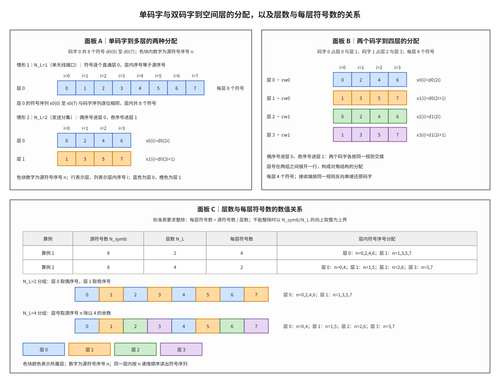

# Layer Mapping 层映射

## 符号与记号约定

本笔记用到的每个数学符号都在本节给出读法、含义、取值与协议出处，下文再次出现时不再重复定义。第三列说明该量的物理意义与取值范围，第四列说明它在协议中的位置：能追到条款的写条款号，由条款公式派生的写「由 §x.x 导出」，不属于 3GPP 标准定义的内容写「非 3GPP 标准」或「实现域」。

**表 1｜层、码字与序号**

| 符号 | 读法 | 含义与取值 | 协议锚点 |
|:---|:---|:---|:---|
| $N_L$ | N 下标 L | 层数（number of layers），即并行空间数据流的条数；下行取 1 至 8，上行取 1 至 4 | TS 38.211 §7.3.1.3 |
| $\nu$ | nu | 层数在 38.211 原文中的记号，$\nu=N_L$；引用协议公式时保留原写法 | TS 38.211 §7.3.1.3 |
| $N_{cw}$ | N 下标 cw | 码字数（number of codewords），取 1 或 2；由传输方案与层数共同决定 | TS 38.211 表 7.3.1.3-1；TS 38.214 §5.1 |
| $q$ | q | 码字编号，$q=0,1$；上标 $(q)$ 标记该量属于哪一个码字 | 由 §7.3.1.3 导出 |
| $\lambda$ | lambda | 层编号，$\lambda=0,1,\ldots,N_L-1$；上标 $(\lambda)$ 标记层号 | 由 §7.3.1.3 导出 |
| $i$ | i | 层内符号序号，$i=0,1,\ldots,M_{symb}^{layer}-1$；同一层内按时间先后递增 | TS 38.211 §7.3.1.3 |
| $n$ | n | 码字内源符号序号，$n=0,1,\ldots,N_{symb}-1$；层映射之前的位置 | 由 §7.3.1.3 导出 |
| $N_{port}$ | N 下标 port | 天线端口数；一条传输所用的端口数与层数相等 | TS 38.211 §7.3.1.4 |

**表 2｜符号序列与长度**

| 符号 | 读法 | 含义与取值 | 协议锚点 |
|:---|:---|:---|:---|
| $d^{(q)}(n)$ | d 上标 q 括号 n | 码字 $q$ 的第 $n$ 个复调制符号，是层映射的输入序列 | TS 38.211 §7.3.1.3 |
| $x^{(\lambda)}(i)$ | x 上标 lambda 括号 i | 第 $\lambda$ 层的第 $i$ 个符号，是层映射的输出序列 | TS 38.211 §7.3.1.3 |
| $x(i)$ | x 括号 i | 同一时刻各层符号按层号排成的列向量，分量为 $x^{(0)}(i)$ 至 $x^{(\nu-1)}(i)$ | TS 38.211 §7.3.1.3 |
| $x^{(0)}$、$x^{(1)}$、$x^{(2)}$、$x^{(3)}$ | x 上标括号层号 | 四层以内各层的具体写法，括号内数字就是层号 $\lambda$ | 由 §7.3.1.3 导出 |
| $d^{(0)}$、$d^{(1)}$ | d 上标括号码字号 | 两个码字的具体写法，括号内数字就是码字号 $q$ | 由 §7.3.1.3 导出 |
| $N_{symb}$ | N 下标 symb | 一个码字的复调制符号总数；单码字情形就是输入序列的长度 | TS 38.211 §7.3.1.3 |
| $M_{symb}^{(q)}$ | M 上标 q 下标 symb | 码字 $q$ 的复调制符号数，即层映射的输入长度 | TS 38.211 §7.3.1.3 |
| $M_{symb}^{layer}$ | M 上标 layer 下标 symb | 每层符号数，即层映射的输出长度 | TS 38.211 §7.3.1.3 |

运算符与记号惯例：

1. **上标的语义**：$x^{(\lambda)}(i)$ 的上标括号内是层号，$d^{(q)}(n)$ 的上标括号内是码字号，两者都不是幂次；$M_{symb}^{layer}$ 的上标是量名 layer，表示「按层计」，不是层号。
2. **同一量的两套记号**：$N_L$ 与 $\nu$ 同义，叙述用前者、引用协议原文用后者；$N_{symb}$ 与 $M_{symb}^{(q)}$ 同义，前者说「一个码字总共多少符号」，后者强调「属于码字 $q$ 的符号数」。
3. **序号的分工**：$n$ 是层映射之前的位置，$i$ 是层映射之后的位置；单层配置下二者数值相同，多层配置下必须分开计数，混用会把交错顺序读错。
4. **除法与整除**：$M_{symb}^{layer}=M_{symb}^{(q)}/N_L$ 是整数除法，前提是该码字的符号数能被层数整除；两码字配置还要求两个码字算出的每层符号数相等。
5. **取整记号**：$\lceil\cdot\rceil$ 为向上取整，$\lfloor\cdot\rfloor$ 为向下取整；本文只用它们描述不能整除时的上界与「源序号到层号」的换算，协议表本身只列整除的组合。

一句话本质：**层映射是按源符号序号把码字（codeword，独立编码的数据块）的符号序列确定性地分派到各层（layer，并行空间数据流）的一次重排，规则由协议表逐组合写死，发送端与接收端必须按同一张表、同一套序号读出。**

层映射（layer mapping）在发射链中位于调制之后、预编码之前。它的输入是一个或两个码字的复调制符号序列，输出是若干条并行的层符号序列；层数决定空间复用的维度，码字数决定链路自适应与重传的粒度。接收端完成检测之后，必须按相反方向、同一次序把各层符号拼回码字，因此这套分配规则同时约束发射与接收两侧。

## 独立解释任务

任务目标：解释层（layer）与天线端口（antenna port）为什么不是同一个对象，说明单码字到多层、双码字到四层的两种分配规则为何必须收发一致，并用 $N_{symb}=8$、$N_L=2$ 的逐符号表列出每个源符号落入哪一层，最后给出层数与每层符号数的数值关系及其约束边界。

## 前置概念

码字（codeword）是一次传输中被独立编码、独立加循环冗余校验（Cyclic Redundancy Check, CRC）保护的数据块，经调制后变成一条复调制符号序列，一个下行传输可以带 1 个或 2 个码字，重传与链路自适应都以码字为单位。层（layer）是并行传输的空间数据流，每条层拥有独立的符号序列，多条层在同一时频资源上叠加发送；本笔记处理的就是从码字到层的这一次分配。码字的编码与校验见 [[CRC_循环冗余校验]] 与 [[LDPC_低密度奇偶校验码]]，层在接收端的分离见 [[T2.12_MIMO_OFDM_layer_detection]]。

空间复用（spatial multiplexing）指在同一资源上并行发送多条层以提高吞吐，层数等于复用的空间维度；发送分集（transmit diversity）则把同一个码字的符号分散到多条层上，用空间冗余换取可靠性，两层单码字的奇偶交替分配正是这一用途依赖的映射。两种用途在调度层数与码字数时作出不同选择，但层映射表对二者使用同一套公式，区别只体现在选了哪一行。分集的合并与增益见 [[Diversity_Combining_分集与合并]]。

预编码（precoding）把同一时刻的层符号向量乘一个预编码矩阵，变成天线端口上的发射向量，负责按信道状态把各层指向不同的空间方向；天线端口（antenna port）是由参考信号定义的发射通道抽象，接收端对每个端口单独做信道估计，端口与解调参考信号一一对应。层映射之后每层对应一个天线端口，所以层数不能超过可用的端口数。预编码的取值与码本见 [[Precoding_预编码]]，端口与导频的对应见 [[DMRS_解调参考信号]]，多天线的整体框架见 [[MIMO_多天线系统]]。

## 起源与演进

层映射的形式不是一次定稿的：需求先从单条数据流扩展到多条并行流，码字与层随后解耦，分配规则才被收进一张固定的表。以下五步按时间顺序说明它的成形过程，最后一步交代它在发射链中的位置。

(1) **单层传输到多层并行。** 早期下行只有一条数据流，空间维度没有被利用；多天线引入之后，同一份时频资源上可以并行发送多条层，吞吐随层数近似线性增长，码字到层的分配因此成为发射链中必须固定下来的一步。

(2) **码字与层解耦。** 码字数与层数并不一一对应：一个码字可以占多条层，两个码字也可以各占多条层。解耦之后，重传与调制编码方案的选择以码字为单位，空间并行以层为单位，两者分别调度再在层映射处汇合。

(3) **规则形式化为一张表。** 3GPP 把每一种（层数，码字数）组合的分配写成闭式公式，收进 TS 38.211 表 7.3.1.3-1：单码字多层按余数分层，双码字多层先在码字之间分组、再在组内按余数分层。发送端照表分配，接收端照表反向串接，规则不随实现变化。

(4) **两代差异。** LTE 下行最多 4 层、2 个码字，3 层允许配 2 个码字（码字 0 占 1 层、码字 1 占 2 层）；NR 下行扩到 8 层，3 层只允许 1 个码字，5 至 8 层固定用 2 个码字。上行两代都限制在 4 层以内，NR 复用同一张表。

(5) **链路定位。** 层映射之后依次是预编码、天线端口映射与资源元素（Resource Element, RE）映射；每层配一个解调参考信号（Demodulation Reference Signal, DM-RS）端口，接收端按端口估计有效信道后做检测，再把各层符号按同一张表拼回码字。三连步的分工见 [[TX3_layer_mapping_precoding|TX3 层映射与预编码讲义]]。

## 科学定义

上一节说明的是层映射在链路中的位置与两代演进，本节把它写成可运算的形式；符号的读法与取值沿用文首「符号与记号约定」，下文不再重复定义。三个小节依次处理三件事：输入输出与协议表的结构，单码字到多层的分配规则与逐符号数值例，双码字到四层以及层数与每层符号数的换算。三节是递进关系——先有表，才有每一行的闭式写法，最后才能算出每种配置下每层分到多少符号。

### 层映射的输入、输出与协议表

层映射的输入是每个码字的一条复调制符号序列 $d^{(q)}(0),\ldots,d^{(q)}(M_{symb}^{(q)}-1)$，输出是 $N_L$ 条层序列，在时刻 $i$ 堆成列向量

$$x(i)=\left[x^{(0)}(i)\ \cdots\ x^{(\nu-1)}(i)\right],\qquad i=0,1,\ldots,M_{symb}^{layer}-1$$

TS 38.211 §7.3.1.3 用一张表把（层数，码字数）的每一种组合对应的闭式映射全部列出，每个组合占一行，行内写明每一层取输入序列的哪些位置。表 7.3.1.3-1 的关键行如下，其中每层符号数一列按本笔记的记号 $N_{symb}$ 写出。

**表 3｜TS 38.211 表 7.3.1.3-1 的关键行**

| 层数 $N_L$ | 码字数 $N_{cw}$ | 码字到层的映射 | 每层符号数 |
|:---|:---|:---|:---|
| 1 | 1 | $x^{(0)}(i)=d^{(0)}(i)$ | $M_{symb}^{layer}=N_{symb}$ |
| 2 | 1 | $x^{(0)}(i)=d^{(0)}(2i)$；$x^{(1)}(i)=d^{(0)}(2i+1)$ | $M_{symb}^{layer}=N_{symb}/2$ |
| 2 | 2 | $x^{(0)}(i)=d^{(0)}(i)$；$x^{(1)}(i)=d^{(1)}(i)$ | $M_{symb}^{layer}=N_{symb}$ |
| 3 | 1 | $x^{(0)}(i)=d^{(0)}(3i)$；$x^{(1)}(i)=d^{(0)}(3i+1)$；$x^{(2)}(i)=d^{(0)}(3i+2)$ | $M_{symb}^{layer}=N_{symb}/3$ |
| 4 | 1 | $x^{(0)}(i)=d^{(0)}(4i)$；$x^{(1)}(i)=d^{(0)}(4i+1)$；$x^{(2)}(i)=d^{(0)}(4i+2)$；$x^{(3)}(i)=d^{(0)}(4i+3)$ | $M_{symb}^{layer}=N_{symb}/4$ |
| 4 | 2 | $x^{(0)}(i)=d^{(0)}(2i)$；$x^{(1)}(i)=d^{(0)}(2i+1)$；$x^{(2)}(i)=d^{(1)}(2i)$；$x^{(3)}(i)=d^{(1)}(2i+1)$ | $M_{symb}^{layer}=N_{symb}/2$ |
| 5 至 8 | 2 | 每个码字占 2 至 4 层，组内按 3 个或 4 个一组交错 | 按行给出的除法，两个码字的商须相等 |

这张表的组合集合本身就携带约束。协议表只列出满足 $N_{cw}\le N_L\le 4N_{cw}$ 且除法结果取整数的那些行，该不等式是必要条件而非充分条件：3 层配 2 个码字满足不等式，却不在表中。另一条约束来自下一环节，天线端口映射（§7.3.1.4）要求端口集合的大小等于 $\nu$ 且端口序列与层序列等长，因此一条传输所用的端口数等于层数 $N_{port}=N_L$，层数不能超过配置可用的端口数。

### 单码字到多层的分配规则

单层是最简单的一行：所有符号原地进入层 0，$x^{(0)}(i)=d^{(0)}(i)$，层内序号 $i$ 与源序号 $n$ 完全重合，每层符号数等于输入长度。这一行对应单天线端口传输，也是后面两层规则在 $N_L=1$ 时的退化形式。

两层单码字是发送分集使用的行：偶序号符号进层 0，奇序号符号进层 1，

$$x^{(0)}(i)=d^{(0)}(2i),\qquad x^{(1)}(i)=d^{(0)}(2i+1),\qquad i=0,1,\ldots,\frac{N_{symb}}{2}-1$$

把 $N_{symb}=8$ 代进去，逐符号的分配结果如下表。表中最右一列同时给出输出符号的写法，可以直接核对「源序号、层号、层内序号」三者的对应。

**表 4｜$N_{symb}=8$、$N_L=2$ 的逐符号分配**

| 源序号 $n$ | 源符号 | 落入层 $\lambda$ | 层内序号 $i$ | 层符号 |
|:---|:---|:---|:---|:---|
| 0 | $d^{(0)}(0)$ | 0 | 0 | $x^{(0)}(0)=d^{(0)}(0)$ |
| 1 | $d^{(0)}(1)$ | 1 | 0 | $x^{(1)}(0)=d^{(0)}(1)$ |
| 2 | $d^{(0)}(2)$ | 0 | 1 | $x^{(0)}(1)=d^{(0)}(2)$ |
| 3 | $d^{(0)}(3)$ | 1 | 1 | $x^{(1)}(1)=d^{(0)}(3)$ |
| 4 | $d^{(0)}(4)$ | 0 | 2 | $x^{(0)}(2)=d^{(0)}(4)$ |
| 5 | $d^{(0)}(5)$ | 1 | 2 | $x^{(1)}(2)=d^{(0)}(5)$ |
| 6 | $d^{(0)}(6)$ | 0 | 3 | $x^{(0)}(3)=d^{(0)}(6)$ |
| 7 | $d^{(0)}(7)$ | 1 | 3 | $x^{(1)}(3)=d^{(0)}(7)$ |

按层读出这张表，层 0 的符号序列是 $d^{(0)}(0),d^{(0)}(2),d^{(0)}(4),d^{(0)}(6)$，层 1 的符号序列是 $d^{(0)}(1),d^{(0)}(3),d^{(0)}(5),d^{(0)}(7)$，两条序列各 4 个符号，合计 8 个，与输入长度相等。接收端要做的是反向操作：把层 0 的 4 个符号放回偶数位置、层 1 的 4 个符号放回奇数位置，交错拼回一条 8 符号的码字序列。

层数继续增加时规则保持同一形状，只是余数的周期变长。三层单码字按 $x^{(\lambda)}(i)=d^{(0)}(3i+\lambda)$ 分配，四层单码字按 $x^{(\lambda)}(i)=d^{(0)}(4i+\lambda)$ 分配，层号取源序号除以层数的余数，层内序号取商。两种配置的每层符号数分别为 $N_{symb}/3$ 与 $N_{symb}/4$，都要求输入长度能被层数整除。

### 双码字到四层与每层符号数

双码字四层是空间复用的典型配置：码字 0 占层 0 与层 1，码字 1 占层 2 与层 3，每个码字内部再按偶序号与奇序号交替，

$$x^{(0)}(i)=d^{(0)}(2i),\quad x^{(1)}(i)=d^{(0)}(2i+1),\quad x^{(2)}(i)=d^{(1)}(2i),\quad x^{(3)}(i)=d^{(1)}(2i+1)$$

把这条规则写成序号映射更便于核对：层号由码字号抬高一个偏移再叠加奇偶，层内序号只与商有关，

$$\lambda=2q+(n\bmod 2),\qquad i=\left\lfloor\frac{n}{2}\right\rfloor$$

第一项 $2q$ 把码字 0 的符号限制在层 0 与层 1、把码字 1 的符号限制在层 2 与层 3，第二项决定该码字的符号落在这一组的第一层还是第二层。两组交错在层号上错开一行，四个层的符号来源因此呈对角分布，而不是按层连续切块。

每层符号数由层数与源符号数共同决定。给定每个码字 $N_{symb}=8$ 个符号，五种配置的数值关系如下表；表中最后一列给出层内符号的源序号，可以直接与图 1 的色块对照。

**表 5｜$N_{symb}=8$ 时层数与每层符号数的对应**

| 配置 | 层数 $N_L$ | 码字数 $N_{cw}$ | 每层符号数 | 层内符号的源序号 |
|:---|:---|:---|:---|:---|
| 单码字 | 1 | 1 | 8 | 层 0：0 至 7 |
| 单码字 | 2 | 1 | 4 | 层 0：0,2,4,6；层 1：1,3,5,7 |
| 单码字 | 4 | 1 | 2 | 层 0：0,4；层 1：1,5；层 2：2,6；层 3：3,7 |
| 双码字 | 4 | 2 | 4 | 码字 0 的 0,2,4,6 与 1,3,5,7 分入层 0、层 1；码字 1 同理分入层 2、层 3 |
| 双码字 | 8 | 2 | 2 | 每个码字占 4 层，按 4 个一组交错 |

表 5 的前三行说明层数与每层符号数的关系：源符号总数固定时，层数翻倍则每层符号数减半，乘积 $N_L M_{symb}^{layer}=N_{symb}$ 保持不变。协议表以整数除法给出每层符号数，因此只有能整除的组合才有对应的行；若给定的符号数不能被层数整除，工程上只能用 $\lceil N_{symb}/N_L\rceil$ 估计每层符号数的上界，真正发送时必须由调度让符号数整除，否则协议表没有可用的分配式。

**图 1｜单码字与双码字到空间层的符号分配，以及层数与每层符号数的对应。** 面板 A 给出单码字的两种配置：$N_L=1$ 时符号逐个直通层 0，$N_L=2$（发送分集）时偶序号进层 0、奇序号进层 1。面板 B 给出两个码字到四层的分配，码字 0 占层 0 与层 1、码字 1 占层 2 与层 3，每个码字内部再按偶序号与奇序号交替。面板 C 以 $N_{symb}=8$ 为例列出 $N_L=2$ 与 $N_L=4$ 两种分组，每层分别得到 4 个与 2 个符号。面板 A 与面板 B 中色块所在的行表示层、列表示层内序号 $i$，块内数字是源符号序号 $n$，同一行从左到右读出的就是该层的符号序列；面板 C 中色块颜色表示层，横向位置表示源序号 $n$。读图时先定位层，再按 $n$ 递增读出该层序列；面板 C 的两条分组条说明层数增加时每层符号数按除法下降，而源符号总数不变。

## 直观模型

图 1 与表 3 至表 5 给出的是逐组合的表格形式，写实现时还需要一个统一的读法：层映射可以读成两个一维地址空间之间的一次重排。输入地址是源序号 $n$，取值 0 至 $N_{symb}-1$；输出地址是二元组 $(\lambda,i)$，层号取 0 至 $N_L-1$，层内序号取 0 至 $M_{symb}^{layer}-1$。规则给出的就是把源序号 $n$ 对应到二元组 $(\lambda,i)$ 的地址映射，$n\to(\lambda,i)$，接收端按同一条映射反向还原，除此之外没有别的自由度。

单码字配置下的映射可以写成两个闭式：$\lambda=n\bmod N_L$、$i=\lfloor n/N_L\rfloor$。层数取 2 时，余数为 0 的偶序号全部进入层 0、余数为 1 的奇序号全部进入层 1；层数取 4 时四个余数各占一层；$N_L=1$ 时所有符号的余数都是 0，映射退化为恒等。双码字四层配置下的映射写成 $\lambda=2q+(n\bmod 2)$、$i=\lfloor n/2\rfloor$，码字号先把层号抬到 0/1 或 2/3，余数再在码字内部区分偶与奇。

这套地址描述给出四条必须同时满足的约束，任何一条不成立都说明参数取错或实现写错：

1. 地址空间必须配平，$N_L M_{symb}^{layer}=N_{symb}$；两端不等意味着层数或符号数被改动过，接收端按表拼回时会多出或缺少符号。
2. 层号的取值上界是 $N_L-1$，与码字数无关；码字数只决定哪几层归哪个码字，不改变层号的总数。
3. 层内序号必须从 0 连续编号，不能沿用源序号；两层配置下源序号 2 与 3 分别成为两个层的第 2 个符号，它们的层内序号都是 1。
4. 层数的合法取值由协议表与可用端口共同限定，表给出（层数，码字数）的组合，天线端口映射要求端口数与层数相等，两者都不满足的配置无法发送。

## 常见误解

| 误解 | 正确理解 |
|:---|:---|
| 层就是天线 | 层是空间数据流，天线端口是参考信号与物理通道的抽象；一条传输的端口数等于层数，但端口与物理天线数不必相等，预编码负责把层加权到端口。 |
| 层数越多吞吐越高 | 层数受信道秩限制，秩不足时多出来的层无法在接收端分离，弱层信干噪比下降；协议表只保证组合合法，不保证该组合在当前信道上可用。 |
| 层数可以超过码字数的四倍 | 每个码字最多映射 4 层，$N_L\le 4N_{cw}$；同时码字数不超过层数，$N_{cw}\le N_L$，所以 2 个码字最多 8 层。 |
| 层数可以超过天线端口数 | 天线端口映射要求端口序列与层序列等长，一条传输的端口数等于层数；层数不能超过配置可用的端口数，否则多出的层没有端口承载。 |
| 层映射就是把符号平均分给各层 | 分配按源序号逐位进行，规则随（层数，码字数）组合改变；2 层单码字是奇偶交替、每层 4 个符号，2 层 2 码字是直通、每层 8 个符号。 |
| 接收端可以按任意顺序把层拼回码字 | 反向串接必须与发送端同表同序；层号或奇偶顺序读错，拼出的码字比特顺序整体错位，译码必然失败。 |

## 协议锚点

上一节的约束与边界都能在条款里找到出处，以下按协议逐条核对规则、长度关系与估算口径。

- **层映射规则与组合表**：TS 38.211 Rel-19 §7.3.1.3 与表 7.3.1.3-1 规定下行物理共享信道（Physical Downlink Shared Channel, PDSCH）的码字到层映射；上行的对应条款是 §6.3.1.3，复用同一张表但最多 4 层。
- **天线端口映射**：TS 38.211 Rel-19 §7.3.1.4 规定层符号到天线端口的恒等映射与等长约束，端口集合由 TS 38.212 的下行控制信息（Downlink Control Information, DCI）过程确定。
- **层数与码字数的调度**：TS 38.214 Rel-19 §5.1 规定 PDSCH 的传输方案与层数选择，层数与调制阶数一起参与传输块大小的计算；DCI 中相关字段的定义见 TS 38.212 §7.3.1。
- **本地锚点**：`3GPP_Rel19/processed/TS_38.211_38211-j30/content.md`（§7.3.1.3 与 §7.3.1.4）、`3GPP_Rel19/processed/TS_38.214_38214-j30/`、`3GPP_Rel19/processed/TS_38.212_38212-j30/`。
- **非 3GPP 标准项**：层数不超过信道秩、每层符号数按 $\lceil N_{symb}/N_L\rceil$ 估计上界，属于接收机设计与工程估算口径；协议只规定发送端的分配表与长度关系，不规定接收端用哪种检测器恢复层符号。

## 关键要点

1. 层映射的输入是码字符号序列 $d^{(q)}(n)$，输出是 $N_L$ 条层序列 $x^{(\lambda)}(i)$，规则由 TS 38.211 表 7.3.1.3-1 逐组合给出。
2. 单码字两层配置为偶序号进层 0、奇序号进层 1，每层符号数是源符号数的一半；$N_{symb}=8$ 时层 0 得 0,2,4,6，层 1 得 1,3,5,7。
3. 双码字四层配置为码字 0 占层 0/1、码字 1 占层 2/3，每个码字内部再按奇偶交替，层号与层内序号满足 $\lambda=2q+(n\bmod 2)$、$i=\lfloor n/2\rfloor$。
4. 组合合法性由两条约束刻画：$N_{cw}\le N_L\le 4N_{cw}$，且层数不超过可用天线端口数；满足不等式不保证表中有该行，3 层配 2 个码字即为一例。
5. 每层符号数由 $M_{symb}^{layer}=N_{symb}/N_L$ 给出，整除是组合成立的前提；不能整除时只能用 $\lceil N_{symb}/N_L\rceil$ 估算上界。
6. 接收端必须按同一张表反向串接：先取层 0 的符号还原偶序号位置，再取层 1 的符号还原奇序号位置，顺序错位等价于码字比特整体错位。
7. 层与天线端口是两个层次：层是数据流，端口是参考信号与物理通道的抽象，一条传输的端口数等于层数，预编码负责把层加权到端口。

## 图谱关联

- [[概念图谱入口]]
- [[MIMO_多天线系统]]
- [[Precoding_预编码]]
- [[DMRS_解调参考信号]]
- [[TX3_layer_mapping_precoding|TX3 层映射与预编码讲义]]
- [[T2.12_MIMO_OFDM_layer_detection|T2.12 MIMO-OFDM 层检测]]
- [[Diversity_Combining_分集与合并]]
- [[HARQ_混合自动重传请求]]
- 关系语义：层映射把码字符号序列分派到空间层，预编码把层加权到天线端口，RE 映射把端口符号放到资源元素；接收端按同一张层映射表反向拼回码字，再交给解调与译码，三者构成 MIMO 发射链的三连步。
