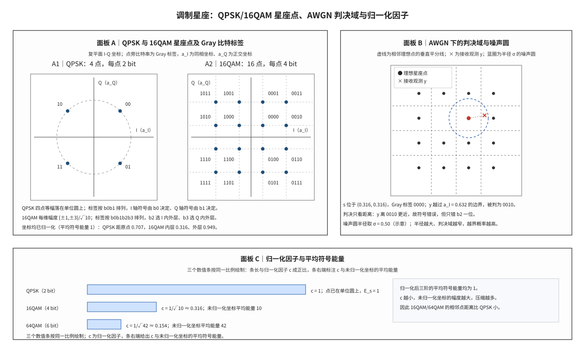

# Modulation Constellations 调制星座

## 符号与记号约定
| 符号 | 含义与取值 | 协议锚点 |
|:---|:---|:---|
| $a_I$ | 符号的同相（in-phase, I）坐标，取实数值 | 非 3GPP 标准（复坐标分量，I 路） |
| $a_Q$ | 符号的正交（quadrature, Q）坐标，取实数值 | 非 3GPP 标准（复坐标分量，Q 路） |
| $j$ | 虚数单位，其平方为 $-1$ | 非 3GPP 标准（虚数单位） |
| $d(i)$ | 3GPP 映射式的输出符号，即归一化后的复坐标；$i$ 为符号序号 | TS 38.211 §5.1.3–§5.1.6（QPSK/16QAM/64QAM/256QAM 的映射式） |
| $M$ | 星座点数，即调制阶数，常用取值 4、16、64、256 | TS 38.211 §5.1.3–§5.1.6（各阶星座点数 4/16/64/256） |
| $k$ | 符号内比特的序号，从 0 编起，也用作遍历下标 | 非 3GPP 标准（符号内比特序号） |
| $b_0,b_1,b_2,b_3,b_4,b_5$ | 一个符号内按映射式顺序排列的比特，取 0 或 1；QPSK 只用前两位，16QAM 用前四位，64QAM 用六位 | TS 38.211 §5.1.3（QPSK 用 $b_0,b_1$）/§5.1.4（16QAM 用 $b_0$ 至 $b_3$）/§5.1.5（64QAM 用 $b_0$ 至 $b_5$） |
| $d_{\min}$ | 星座的最小欧氏距离，即任意两个不同星座点之间的最小距离 | 非 3GPP 标准（最小欧氏距离，几何量） |
| $c$ | 归一化因子，把未归一化坐标压缩到平均符号能量 1 的乘数 | 非 3GPP 标准（归一化因子，由平均能量导出） |
| $s$ | 一个调制符号的复基带取值，$s=a_I+j a_Q$；归一化后平均能量为 1 | 由 TS 38.211 §5.1.3–§5.1.6 的映射式 $d(i)$ 导出 |
| $m$ | 每符号承载的比特数，$m=\log_2 M$；部分文献把这个量记作 $k$，本笔记用 $m$ 表示它，$k$ 专指比特序号 | 非 3GPP 标准（$m=\log_2 M$，由 $M$ 导出的教科书量） |
| $b_k$ | 第 $k$ 个比特，取 0 或 1 | TS 38.211 §5.1.3–§5.1.5（映射输入比特，协议写作 $b(i)$） |
| $E_s$ | 平均符号能量，即全部 $M$ 个点能量的算术平均；归一日标为 1 | 非 3GPP 标准（平均符号能量，归一化约定） |
| $y$ | 接收端解调前的复观测值，$y=s+n$ | 非 3GPP 标准（接收端复观测值） |
| $n$ | 复基带噪声样点，零均值，每实维方差为 $\sigma^2$ | 非 3GPP 标准（复基带噪声样点） |
| $N_0$ | 单边噪声功率谱密度；复基带每实维噪声方差取 $\sigma^2=N_0/2$ | 非 3GPP 标准（噪声单边功率谱密度） |
| $\sigma^2$ | 每实维噪声方差，与 $N_0$ 的关系为 $\sigma^2=N_0/2$ | 非 3GPP 标准（每实维噪声方差） |
| $\sigma$ | 每实维噪声标准差，$\sigma=\sqrt{\sigma^2}$ | 非 3GPP 标准（每实维噪声标准差） |
| $L(b_k)$ | 第 $k$ 个比特的对数似然比（Log-Likelihood Ratio, LLR），取 $\Pr(b_k=0\mid y)/\Pr(b_k=1\mid y)$ 的对数；$L>0$ 判 0 | 非 3GPP 标准（LLR，接收机实现域） |

运算符与记号约定：$\min$ 与 $\max$ 表示取最小、最大值，$\sqrt{\cdot}$ 表示平方根，$\pm$ 表示正负两种取值，$|\cdot|$ 表示复数的模，$\approx$ 表示近似相等。下标只用于区分量的种类（$E_s$ 的 s 表示符号），上标在本文中只以具体数字出现，不对符号取幂。复平面的横轴为 $a_I$、纵轴为 $a_Q$，一个符号写成坐标对 $(a_I,a_Q)$；本文的距离一律指欧氏距离，归一化后 $d_{\min}$ 与 $\sigma$ 可以直接比较。

调制星座（modulation constellation）是比特组到复基带符号的映射表。一句话本质：**星座是复平面上一张由 $M$ 个坐标点组成的映射表——每 $m$ 个比特唯一对应一个点 $(a_I,a_Q)$，格雷映射使相邻点只差 1 个比特；平均符号能量归一为 $E_s=1$ 之后，接收端只需比较观测到各点的欧氏距离即可完成判决。**

发送端按表选点并经信道发出，接收端看到的是 $y=s+n$。围绕这张表有两个相互独立的性质：点的排布决定相邻点的距离与格雷邻接关系，归一化决定这个距离与噪声标准差 $\sigma$ 是否在同一尺度上。本笔记先约定符号，再给出映射式与能量手算，随后用判决域把“观测偏离理想点”与“被判成相邻点”联系起来，最后划清 QPSK 与高阶 QAM 在软解调上的差别。
## 解释目标与范围

本节目标：解释各阶调制星座的坐标结构与能量归一化，说明格雷映射如何把一次符号越界折算成 1 个比特错误，并用判决域与最小距离给出 $E_s/N_0$ 与噪声标准差之间的定量关系；在此基础上说明软解调 LLR 为什么必须按星座子集计算，而不能沿用 BPSK 的闭式。

## 前置概念

要完成上述任务，先交代六个反复使用的先修对象。本笔记的讨论都在复数基带（complex baseband）上完成：把一个符号的两个实分量合写成 $s=a_I+j a_Q$，其中 $a_I$ 称为同相（in-phase, I）分量，$a_Q$ 称为正交（quadrature, Q）分量，二者分别是两条实值基带波形在同一符号时刻的采样。这样写的直接后果是调制与解调都可以在二维实平面内完成——横轴为 $a_I$、纵轴为 $a_Q$，一个符号就是平面上的一个点；噪声也相应地写成二维向量。复基带噪声的方差约定见 [[AWGN_信道模型]]，本笔记沿用其中的每实维方差定义。

格雷映射（Gray mapping）是比特组到星座点的一种排布规则：平面上沿 I 或 Q 方向相隔一个最小步长的两个点，其比特串只相差 1 位。它改变的是“哪个比特组落在哪个点”，不改变点的位置，因此它不降低符号错误概率，只把一次符号越界折算成 1 个比特错误。映射式的写法（哪个比特控制符号、哪个比特控制层级）直接决定这一性质能否成立，逐阶的比特—坐标对照见 [[Modulation_Mapping_调制映射]]。

平均符号能量（average symbol energy）$E_s$ 是全部 $M$ 个点能量的算术平均，点能量指两个坐标的平方和。协议把各阶调制的 $E_s$ 统一归一为 1，目的有两个：发射功率不随调制阶数跳变；接收端可以把星座距离与噪声标准差放在同一尺度上比较。归一化只约束平均值，不约束单个点——16QAM 的内层点能量低于 1，外层点高于 1，这一点在后文的手算中逐点列出。

最小欧氏距离（minimum Euclidean distance）$d_{\min}$ 是星座中任意两个不同点之间的最小距离。对矩形 QAM，它等于相邻两个幅度层级之差；归一化后 $d_{\min}$ 随阶数升高而减小，这是高阶调制需要更高信噪比的几何根源。判决边界位于相邻点的中点，因此从理想点到最近边界的距离是 $d_{\min}$ 的一半，后文用它与 $\sigma$ 比较。

加性白高斯噪声（Additive White Gaussian Noise, AWGN）信道在复基带上把接收样点写成 $y=s+n$，$n$ 是零均值复高斯变量，每实维方差为 $\sigma^2=N_0/2$，$N_0$ 为单边功率谱密度。$E_s/N_0$ 是每符号能量与噪声谱密度之比；在 $E_s=1$ 的约定下，10 dB 对应 $N_0=0.1$、$\sigma\approx0.224$。AWGN 下最近点判决等价于最大似然判决，这一等价性是下文判决域讨论的前提；LLR 的概率定义见 [[LLR_对数似然比]]，软解调的完整推导见 [[Soft_Demodulation_软解调]]。

以上六个对象分别承担表示、排布、尺度、距离与信道五个层面的职责。把它们放回协议演进的时间轴上，星座的设计可以分成五步，每一步都在前一步的约束上增加一条。

## 起源与演进

(1) **起点：比特组到复坐标的确定性映射。** LTE Rel-8 的 TS 36.211 §7.1 为每个调制阶数给出一条闭式映射式，把 $m$ 个比特写成一对实数坐标；NR 在 TS 38.211 §5.1 沿用同一结构，只按帧结构重新编排章节号。映射式是查表运算，不含概率成分，接收端的全部不确定性都来自信道。

(2) **格雷排布。** 若按自然二进制顺序把连续整数赋给相邻点，一次越界可能同时翻转多位。3GPP 的映射式让每个比特只控制一个维度上的一件事：符号或层级。QPSK 中 $b_0$ 定 I 的符号、$b_1$ 定 Q 的符号；16QAM 追加 $b_2,b_3$ 定两维取内层还是外层；64QAM 再追加 $b_4,b_5$ 细分层级。按这种写法，相邻点的比特串恰好只差一位。

(3) **能量归一化。** 每个映射式自带一个归一化常数：QPSK 为 $1/\sqrt{2}$，16QAM 为 $1/\sqrt{10}$，64QAM 为 $1/\sqrt{42}$，256QAM 为 $1/\sqrt{170}$。常数的来源是未归一化整数坐标的平均能量，下一节给出 16QAM 的逐点手算。归一化之后，切换调制阶数不改变发射功率，接收端的噪声方差也不必随阶数调整。

(4) **阶数提高与信噪比代价。** LTE 从 QPSK、16QAM、64QAM 扩展到 Rel-12 的 256QAM，NR 在 Rel-17 进一步引入 1024QAM。每提高一阶，$d_{\min}$ 约减半，在相同 $E_s/N_0$ 下判决裕量相应缩小；这就是高阶调制只在信道条件良好时被调度的原因，[[Link_Adaptation_链路自适应与CQI]] 的 CQI 到 MCS 映射把这一约束写成了表。

(5) **接收端：从硬判决到软信息。** 星座几何不仅决定误码率，也决定 LLR 的计算量。BPSK 下 LLR 有闭式 $2y/\sigma^2$；16QAM 及以上必须在“该比特为 0”与“该比特为 1”的两个星座子集上各求一次最小距离，这正是最大对数近似（Max-Log-MAP）的内容，也是 [[T2.14_QAM_Max_Log_MAP_demapping]] 的主题。

下面把五步写成可计算的表达式，并给出两个手算例。

## 科学定义

$M$-QAM 用 $m=\log_2 M$ 个比特选择一个复符号。对矩形 QAM，I 与 Q 各自是一路 $\sqrt{M}$ 电平的脉冲幅度调制（Pulse Amplitude Modulation, PAM），两路取值的笛卡尔积构成全部 $M$ 个点；星座点写进复平面后，比特到坐标的对应关系完全由映射式确定。

### 星座点与比特标签

3GPP 的映射式（TS 38.211 §5.1.3 至 §5.1.6）把比特按固定顺序代入，得到归一化坐标。QPSK 的映射式为

$$d(i)=\frac{1}{\sqrt{2}}\left[(1-2b_0)+j(1-2b_1)\right]$$

它把两个比特分别送到 I 与 Q 的符号上，四个点因此落在半径 1 的圆上，坐标各为 $\pm1/\sqrt{2}$。16QAM 在符号位之外增加层级位：

$$d(i)=\frac{1}{\sqrt{10}}\left\{(1-2b_0)\left[2-(1-2b_2)\right]+j(1-2b_1)\left[2-(1-2b_3)\right]\right\}$$

方括号内的 $2-(1-2b_2)$ 在 $b_2=0$ 时给 1、在 $b_2=1$ 时给 3，于是每一维有 $\{\pm1,\pm3\}$ 四个幅度，整体再除以 $\sqrt{10}$。64QAM 再嵌一层，每一维有 $\{\pm1,\pm3,\pm5,\pm7\}$ 八个幅度：

$$d(i)=\frac{1}{\sqrt{42}}\left\{(1-2b_0)\left[4-(1-2b_2)\left[2-(1-2b_4)\right]\right]+j(1-2b_1)\left[4-(1-2b_3)\left[2-(1-2b_5)\right]\right]\right\}$$

三式的共同结构是：$b_0,b_1$ 管符号，其余比特管层级，每多一个层级比特就把幅度选项翻一倍。归一化后的坐标与每点比特数汇总如下。

| 调制 | 每维坐标（归一化后） | 每点比特数 | 归一化常数 |
|:---|:---|:---|:---|
| QPSK | $\pm1/\sqrt{2}$ | 2 | $1/\sqrt{2}$ |
| 16QAM | $\pm1/\sqrt{10}$、$\pm3/\sqrt{10}$ | 4 | $1/\sqrt{10}$ |
| 64QAM | $\pm1/\sqrt{42}$、$\pm3/\sqrt{42}$、$\pm5/\sqrt{42}$、$\pm7/\sqrt{42}$ | 6 | $1/\sqrt{42}$ |

格雷性质可以直接从这张表读出。以 16QAM 为例，$(1,1)/\sqrt{10}$ 的比特串是 0000；沿 I 方向走到 $(3,1)/\sqrt{10}$，只有 $b_2$ 从 0 变 1，标签成为 0010；沿 Q 方向走到 $(1,3)/\sqrt{10}$，只有 $b_3$ 变化，标签成为 0001。一次符号越界若落在相邻点，只翻转 1 个比特；若越到对角点 $(3,3)/\sqrt{10}$，则 $b_2$ 与 $b_3$ 同时翻转，相差 2 位——格雷映射只对相邻点成立，这一点在后文的常见误解中单列。

### 归一化与平均符号能量

归一化常数不是任意取的，它由未归一化整数坐标的平均能量决定。16QAM 的未归一化坐标取 $\{\pm1,\pm3\}$，按三个能量组统计如下。

| 坐标组（每维） | 点数 | 未归一化能量 | 归一化后每点能量 |
|:---|:---|:---|:---|
| $(\pm1,\pm1)$ | 4 | $1+1=2$ | $2/10=0.2$ |
| $(\pm1,\pm3)$ 与 $(\pm3,\pm1)$ | 8 | $1+9=10$ | $10/10=1.0$ |
| $(\pm3,\pm3)$ | 4 | $9+9=18$ | $18/10=1.8$ |

把三组按点数加权，未归一化平均能量为

$$\frac{4\times2+8\times10+4\times18}{16}=\frac{160}{16}=10$$

因此归一化因子取 $c=1/\sqrt{10}\approx0.316$，归一化后坐标为 $\{\pm1,\pm3\}/\sqrt{10}$。再按同一权重核对归一化后的平均能量：

$$\frac{4\times0.2+8\times1.0+4\times1.8}{16}=\frac{16}{16}=1$$

这组数字说明两件事。其一，$E_s=1$ 是加权平均，单个点的能量并不都等于 1：内层四点各 0.2，外层四点各 1.8，中间八点为 1.0。其二，归一化因子同时压缩了星座的整体尺度，$d_{\min}$ 也随之从整数坐标下的 2 变成 $2/\sqrt{10}\approx0.632$。

64QAM 可以用同样的方法核对。每一维的八个电平 $\pm1,\pm3,\pm5,\pm7$ 的平方和为 $2(1+9+25+49)=168$，平均到 8 个电平得 21，两维合计 $E_s=42$，故 $c=1/\sqrt{42}\approx0.154$。QPSK 是特例：3GPP 的映射式已经把 $1/\sqrt{2}$ 写进坐标，四点位于单位圆上、每点能量为 1，因此相对该式不再另乘因子，记 $c=1$；若改用整数坐标 $\pm1$ 表达同一星座，未归一化平均能量为 2，因子为 $1/\sqrt{2}$，两种写法给出同一组点。

### 判决域与软解调

给定观测 $y$，最近点判决把复平面划分成 $M$ 个判决域，每个判决域是“到某个星座点比到其他任何点都近”的坐标集合；两个相邻判决域的分界线是这两点连线的垂直平分线。矩形 QAM 的星座点排成方格，垂直平分线因此只有水平与竖直两族，分别位于相邻幅度层级的中点，判决域是边长 $d_{\min}$ 的正方形（最外层向外无界）。从理想点到最近边界的距离为 $d_{\min}/2$，它决定了噪声要多大才能把符号推出本判决域。

用 $E_s/N_0=10$ dB 做一次手算。10 dB 对应线性比值 10，$E_s=1$ 故 $N_0=0.1$；每实维方差 $\sigma^2=N_0/2=0.05$，标准差 $\sigma=\sqrt{0.05}\approx0.2236$。16QAM 的 $d_{\min}=2/\sqrt{10}\approx0.632$，边界距理想点 $d_{\min}/2=1/\sqrt{10}\approx0.316$，二者之比为 $0.316/0.224=1.414$。作为对照，同一 $E_s/N_0$ 下 QPSK 的 $d_{\min}=\sqrt{2}\approx1.414$、边界距离 0.707，是 $\sigma$ 的 3.16 倍；64QAM 的 $d_{\min}=2/\sqrt{42}\approx0.309$、边界距离 0.154，只有 $\sigma$ 的 0.69 倍。也就是说，10 dB 时 16QAM 的判决边界距理想点仅 1.41 倍标准差，单侧越界的高斯尾概率约 7.9%；到 64QAM 边界距离已小于一个标准差，符号错误在同样的信噪比下成为常态。这组比值解释了为什么同一 $E_s/N_0$ 下阶数越高误码越重，也解释了链路自适应为何按信道质量选择阶数。

判决域的几何给出硬判决，软解调则要把“有多接近边界”保留下来。逐比特 LLR 的 Max-Log-MAP 近似为

$$L(b_k)\approx\frac{1}{2\sigma^2}\left(\min_{s:\,b_k=1}|y-s|^2-\min_{s:\,b_k=0}|y-s|^2\right)$$

其中第一个最小值在“第 $k$ 个比特为 1”的星座子集上取，第二个在“为 0”的子集上取；后者的最小平方距离减去前者，再除以两倍噪声方差，得到的就是该比特的对数似然比，正值表示证据偏向 0。BPSK 只有一个维度、两个点，两个子集各含一点，上式退化为 $L=2y/\sigma^2$ 的闭式。QPSK 的两路比特分别只影响 I 与 Q，也可以各按一路 BPSK 计算；16QAM 的 I 与 Q 同样可以分离成两路 PAM，但每一维有 4 个电平，一个比特的 LLR 要在该维 4 个电平上对两个子集各取一次最小距离，不再是线性闭式。QPSK 与 16QAM 在软解调上的差别就来自这里：前者每一维是 1 个比特的 BPSK，后者每一维是 2 个比特的 PAM-4，子集的最小距离要在一维的 4 个电平上取。

**图 1｜QPSK 与 16QAM 的星座点、16QAM 的 AWGN 判决域，以及三阶调制的归一化因子对照。**

面板 A 在归一化复平面 $(a_I,a_Q)$ 上给出 QPSK 与 16QAM 的全部星座点及其 Gray 比特标签，QPSK 四点位于单位圆上，16QAM 每维幅度为 $\{\pm1,\pm3\}/\sqrt{10}$，点旁比特串按 $b_0b_1b_2b_3$ 排列。面板 B 以虚线画出相邻点的垂直平分线，以 $s$ 为圆心、$\sigma$ 为半径画出噪声圆，观测 $y$ 越过边界后被判给相邻点，而格雷标签只差 1 位。面板 C 按同一比例对照 $1$、$1/\sqrt{10}$、$1/\sqrt{42}$ 三个归一化因子，条长越短表示未归一化坐标的能量越大、压缩越多。

## 直观模型

把上面的映射式与判决规则落到复平面上，可以分坐标、划分与观测三步来看。先看坐标。把复平面横轴取为 $a_I$、纵轴取为 $a_Q$，归一化后的星座就是这张平面上的有限点集：QPSK 有 4 个点，坐标各为 $\pm0.707$；16QAM 有 16 个点，每个坐标取 $\pm0.316$ 或 $\pm0.949$，相邻层级之差为 0.632；64QAM 有 64 个点，每个坐标取 $\pm0.154$、$\pm0.463$、$\pm0.772$、$\pm1.080$，相邻层级之差为 0.309。阶数每翻两番，点阵从 $2\times2$ 变成 $4\times4$ 再变成 $8\times8$，同一坐标范围内的点密度随之上升。

再看划分。给定点集，最近点判决把平面分成 $M$ 个判决域，判决域由“到本点比到其他点都近”这一组不等式定义，边界是相邻点连线的垂直平分线。矩形 QAM 的边界只有水平与竖直两族，落在相邻层级的中点；最外层的判决域向外无限延伸，因此星座边缘的点对“向外”方向的噪声不敏感，只对“向内”方向的噪声敏感。这一不对称在分析误码率时需要单独处理，也是高阶 QAM 平均误码率近似式里内外层系数不同的原因。

最后看一次观测的走向。发端选点 $s$，信道叠加噪声 $n$，接收端得到 $y=s+n$；判决取离 $y$ 最近的点，等价于看 $n$ 是否把 $y$ 推过了某条边界。以 QPSK 为例，$y=0.9+0.8j$ 到 $(1+j)/\sqrt{2}\approx0.707+0.707j$ 的距离约 0.214，到其余三点的距离分别为 1.52、1.61、2.20，最近点判决给出 00，次近距离 1.52 远大于最近距离 0.214，判决余量充足。以 16QAM 为例，同一点 $y=0.9+0.8j$ 到 $(3,3)/\sqrt{10}\approx0.949+0.949j$ 的距离约 0.157，到 $(3,1)/\sqrt{10}$ 约 0.485，判决落在 0011，与次近点相差 1 位。噪声幅度一旦超过边界距离，判决就跳到相邻点；由于格雷排布，这一步跳跃在比特层只记 1 个错误。整个过程可以概括为三句话：点集由映射式决定，判决域由点集的垂直平分线决定，错误由噪声与边界距离的相对大小决定。

## 常见误解

上述几何与归一化结论会与几种常见说法冲突，下面逐条区分。

| 误解 | 正确理解 |
|:---|:---|
| 星座阶数越高越好 | 阶数只提高每符号比特数；在 $E_s$ 固定时 $d_{\min}$ 随阶数减小，相同信噪比下误码升高，高阶调制要用在信道条件好的场景。 |
| 格雷映射消除误码 | 格雷映射只保证越界到相邻点时仅错 1 位；越到对角点仍可错 2 位，符号错误本身也依然存在。 |
| 16QAM 可以拆成两路独立 BPSK | 矩形 QAM 的 I 与 Q 可按 PAM 分离，但 16QAM 每维有 4 个电平而不是 2 个；QPSK 的两路才是 BPSK。 |
| $L=2y/\sigma^2$ 对所有调制通用 | 该式只对 BPSK（以及按维分离后的 BPSK 分量）成立；QAM 的每个比特要在星座子集上取两个最小距离。 |
| 平均符号能量为 1 意味着每个点能量都是 1 | 只有加权平均值为 1；16QAM 内层点能量为 0.2、外层为 1.8，中间八点为 1.0。 |
| 16QAM 是十字形星座 | 16QAM 是 $4\times4$ 方形栅格；十字形排布属于 32QAM，3GPP 的 LTE/NR 数据调制不使用十字形星座。 |
| 归一化因子对 QPSK 一定是 1，故 $1/\sqrt{2}$ 是错的 | 两种写法等价：3GPP 把 $1/\sqrt{2}$ 写进坐标，故对映射式不再另乘因子；若用整数坐标 $\pm1$，因子就是 $1/\sqrt{2}$。 |

## 边界情形

上述结论在四类极限上需要单独说明。第一类边界是低阶极限。BPSK 每符号 1 个比特，两点取 $\pm1$，LLR 有精确闭式 $L=2y/\sigma^2$，此时“判决边界距离”就是 1，噪声只需超过 1 就能翻转比特；QPSK 在此基础上把两路 BPSK 正交放置，每路仍是独立的一维问题，因此 QPSK 的软解调可以完全复用 BPSK 的闭式。

第二类边界是高阶极限。256QAM 的 $d_{\min}=2/\sqrt{170}\approx0.153$，边界距离 0.077，在 10 dB 下只有 $\sigma$ 的 0.34 倍；1024QAM 进一步降到 $2/\sqrt{682}\approx0.077$。这些阶数只有在信道质量极好、且接收端噪声方差估计准确时才有意义，因为 LLR 的尺度直接由 $\sigma^2$ 决定，方差估计偏差会整体缩放软信息。

第三类边界是归一化约定不一致。若接收端把 $\sigma^2$ 当成复噪声总方差（等于 $N_0$）而不是每实维方差（$N_0/2$），LLR 会整体差 2 倍；若发送端没有按 $E_s=1$ 归一化，接收端按 1 计算的 LLR 尺度同样会偏。3GPP 的映射式自带归一化常数，接收端据此假定 $E_s=1$，实现中必须把这一假定与噪声方差估计的口径对齐。

第四类边界是非格雷排布。若星座的比特排布不满足格雷邻接（自定义映射或部分广播标准），相邻点错误可能翻转多位，此时星座几何与 LLR 公式都不变，变的是比特错误率与符号错误率之间的换算系数。

## 协议锚点

本文引用的映射式与各阶定义在 LTE 与 NR 中分别落在以下章节。

- LTE：TS 36.211 Rel-19 `36211-j30_s06-s08` §7.1.1 BPSK、§7.1.2 QPSK、§7.1.3 16QAM、§7.1.4 64QAM、§7.1.5 256QAM。
- NR：TS 38.211 Rel-19 `38211-j30` §5.1.2 BPSK、§5.1.3 QPSK、§5.1.4 16QAM、§5.1.5 64QAM、§5.1.6 256QAM；NR Rel-17 的 1024QAM 见 §5.1.7。
- 本地锚点：`3GPP_Rel19/processed/TS_36.211_36211-j30_s06-s08/sections.jsonl`、`content.md`；`3GPP_Rel19/processed/TS_38.211_38211-j30/sections.jsonl`、`content.md`。

## 关键要点

以下七条是全文可直接复用的结论。

1. 星座是比特组到复坐标的映射表，每 $m=\log_2 M$ 个比特对应一个点，点的位置由协议映射式唯一确定。
2. 格雷映射让相邻点只差 1 位，把一次相邻越界折算成 1 个比特错误，但不消除符号错误。
3. 归一化因子由未归一化坐标的平均能量决定：QPSK 的映射式已含 $1/\sqrt{2}$，16QAM 为 $1/\sqrt{10}$，64QAM 为 $1/\sqrt{42}$。
4. $E_s=1$ 是加权平均：16QAM 内层点 0.2、中间 1.0、外层 1.8，平均恰为 1。
5. 判决边界是相邻点的垂直平分线，理想点到边界的距离是 $d_{\min}/2$；$E_s/N_0=10$ dB 时 16QAM 的该距离仅为 $\sigma$ 的 1.41 倍。
6. 矩形 QAM 的 I/Q 可按 PAM 分离，但每维电平数随阶数增加，LLR 要在该维的子集上取两个最小距离；只有 BPSK 分量才有 $2y/\sigma^2$ 的闭式。
7. 归一化约定与噪声方差口径必须收发一致，否则 LLR 的整体尺度会偏移。

## 图谱关联

本概念与以下笔记构成上下游关系。

- [[AWGN_信道模型]]
- [[LLR_对数似然比]]
- [[Soft_Demodulation_软解调]]
- [[MCS_Table_Effective_Code_Rate_MCS表与有效码率]]
- [[Modulation_Mapping_调制映射]]
- [[Link_Adaptation_链路自适应与CQI]]
- [[概念图谱入口]]
- [[T2.13_BPSK_QPSK_soft_demapping]]
- [[T2.14_QAM_Max_Log_MAP_demapping]]
- 关系语义：调制星座的几何决定软解调的判决域与 LLR 计算方式，并通过最小距离把调制阶数与链路自适应选择的信噪比门槛联系起来。
