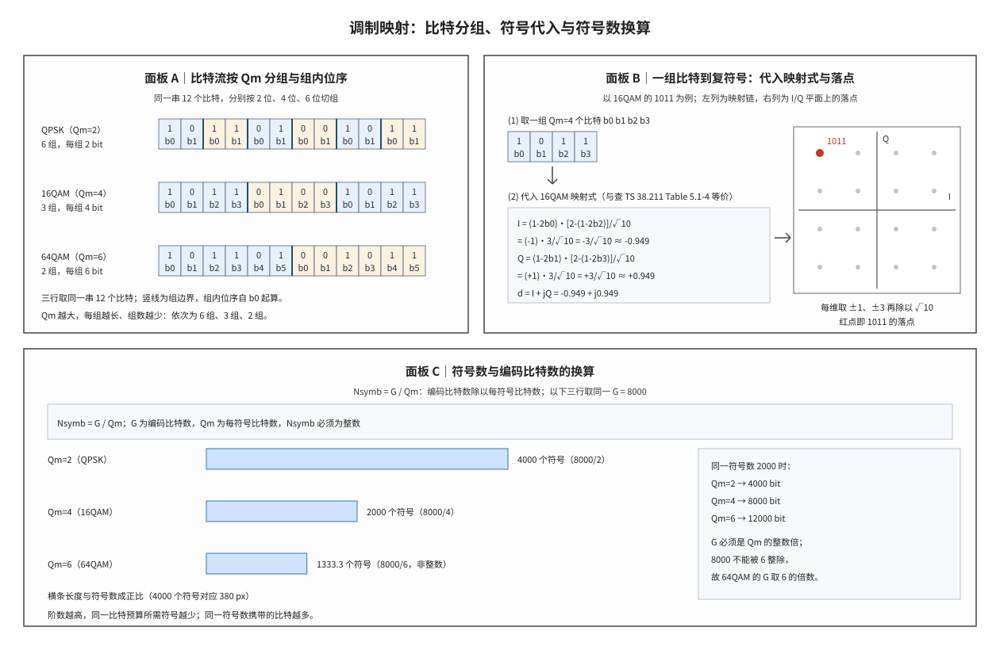

# Modulation Mapping 调制映射

## 符号与记号约定
| 符号 | 含义与取值 | 协议锚点 |
|:---|:---|:---|
| $b$ | 组内任一比特的通用写法；取 0 或 1，无量纲；具体位序由 $b_0$ 起编号 | TS 38.211 §5.1 |
| $Q_m$ | 调制阶数（modulation order），一个调制符号承载的编码比特数；QPSK 为 2、16QAM 为 4、64QAM 为 6、256QAM 为 8、1024QAM 为 10 | TS 38.211 §5.1（各阶定义）；取值由 TS 38.214 §5.1.3.1 的 MCS 表给出 |
| $b_i$ | 比特组内第 i 个比特，取 0 或 1；i 从 0 编起，只表示组内位序，不表示该比特在整条比特流中的绝对序号 | TS 38.211 §5.1（映射式中的比特位序） |
| $b_0$、$b_1$、$b_2$、$b_3$、$b_4$、$b_5$ | 组内各位置的具体写法；QPSK 用 $b_0$、$b_1$，16QAM 用至 $b_3$，64QAM 用至 $b_5$ | TS 38.211 §5.1 |
| $I$ | 复符号的同相（in-phase, I）分量，取实数 | 非 3GPP 标准（复基带坐标约定；协议映射式直接给出实部与虚部） |
| $j$ | 虚数单位，$j^2=-1$ | 非 3GPP 标准（复数记法） |
| $N_{RE}$ | 本次传输可用的资源元素（Resource Element, RE）总数 | TS 38.214 §5.1.3.2 |
| $N_L$ | 传输层数 | TS 38.212 §5.4.2.1 |
| $E_s$ | 平均符号能量，协议归一化后为 1 | 非 3GPP 标准（归一化约定；具体因子由 TS 38.211 §5.1 给出） |
| $M$ | 星座点数，与调制阶数满足 $M=2^{Q_m}$，即 QPSK 4、16QAM 16、64QAM 64 | 由 TS 38.211 §5.1 的映射式导出 |
| $Q$ | 复符号的正交（quadrature, Q）分量，取实数；与调制阶数 $Q_m$ 共用首字母，靠下标区分二者 | 非 3GPP 标准（同上） |
| $G$ | 本次传输可用的编码比特总数，即进入调制映射的比特流长度；物理下行共享信道上 $G=N_{RE}\cdot Q_m\cdot N_L$ | TS 38.212 §5.4.2.1 |
| $d$ | 映射输出的复符号，$d=I+jQ$ | TS 38.211 §5.1（映射式的输出 $d(i)$） |
| $N_{symb}$ | 调制符号数，即比特流分组后的组数，$N_{symb}=G/Q_m$ | 由 TS 38.212 §5.4.2.1 的 $G$ 导出；符号块的记法见 TS 38.211 §7.3.1.2 |
| 比特组 | 编码比特流中连续切出的 $Q_m$ 个比特，整组映射为一个符号 | TS 38.211 §5.1（16QAM 按四元组、64QAM 按六元组分组） |

运算符与记号约定：$2^{Q_m}$ 表示 2 的 $Q_m$ 次幂，$\sqrt{\cdot}$ 表示平方根，$\pm$ 表示正负两种取值，$\lfloor\cdot\rfloor$ 表示向下取整；方括号在映射式中只起分组作用，不表示取整。上标只以具体数字或 $Q_m$ 出现，不对符号取一般幂；$b_i$ 的下标 i 是组内位序。复平面横轴为 $I$、纵轴为 $Q$，一个复符号写作坐标对 $(I,Q)$。

调制映射（Modulation Mapping）是发送端把编码比特流切成定长比特组、再按协议表把每组换成一个复基带符号的处理步骤。一句话本质：**调制映射是一张收发共用的分组查表规则——比特流每 $Q_m$ 位切一组，每组按固定位序换得一个复坐标 $d=I+jQ$，因此比特数除以 $Q_m$ 就是符号数。** 这条规则在 NR 中由 TS 38.211 §5.1 逐阶给出，发送端按表出符号，接收端的软解调按同一张表反算每个比特的似然比。

围绕它有四个可以分别核对的量：分组长度 $Q_m$、组内位序（从 $b_0$ 起算）、映射得到的坐标 $(I,Q)$、以及由 $G$ 换算出的符号数 $N_{symb}$。本笔记先约定符号与出处，再给出分组与映射的定义，用 16QAM 的比特组 1011 做一次完整手算，最后讨论符号数换算与几个边界情形。
## 解释目标与范围

本节目标：讲清调制映射的协议定义（比特分组、组内位序、映射表与映射式），一组比特经代入或查表得到复符号的完整过程，符号数与编码比特数的换算关系 $N_{symb}=G/Q_m$，以及 $Q_m$ 与 MCS 的对应；并给出 16QAM 比特组 1011 的手算与落点核对方法。

## 前置概念

调制（modulation）把比特信息加载到载波的幅度与相位上，使信息能随射频信号发出；在复基带表示下，幅度与相位合成一个复数，调制因此可以看成把比特换成复数的工作。本笔记讨论的是其中离散的一步：按协议表把定长比特组换成复坐标，不涉及载波频率的选择与脉冲成形。键控调制家族的完整谱系见 [[ASK_FSK_PSK_键控调制]]。

星座（constellation）是复平面上可供发送端选用的 $M$ 个坐标点的集合，点数与每符号比特数满足 $M=2^{Q_m}$。星座决定"有哪些点可选"，属于几何层面的对象；它不决定"哪个比特组对应哪个点"，后者由映射表规定。星座的几何、最小距离与归一化因子的定量关系见 [[Modulation_Constellations_调制星座]]，本笔记只在核对落点时引用其结论。

比特映射（bit mapping）是给每个星座点分配一个 $Q_m$ 位比特串的规则。分配必须是一一对应：$M$ 个点配 $M$ 个不同的比特串，接收端才能由落点反推比特。协议把这张对照表逐行写死，因此映射不是实现可以自由发挥的部分；换一套分配，星座几何不变而比特错误率改变。

格雷映射（Gray mapping）是比特分配的一种排布约定：沿 $I$ 或 $Q$ 方向相隔一个最小步长的两个点，其比特串只相差 1 位。它改变的是"哪个比特串落在哪个点"，不改变点的位置，因此不降低符号错误概率，只把一次相邻越界折算成 1 个比特错误。3GPP 在数据信道上采用这一约定，接收端逐比特计算似然比时直接用到它的邻接性质，见 [[Soft_Demodulation_软解调]]。

复符号（complex symbol）是映射的输出 $d=I+jQ$，$I$ 与 $Q$ 分别是同相与正交分量。一个复符号在资源网格上占一个资源元素，因此符号数直接决定本次传输占用多少个 RE；RE 的坐标结构见 [[RE_Mapping_资源元素映射]]。

调制阶数（modulation order）$Q_m$ 是一个符号承载的比特数，取 1、2、4、6、8、10 等值，同时决定星座规模与分组长度。它在调度侧不是独立参数：DCI（下行控制信息，Downlink Control Information）只传 MCS 索引，$Q_m$ 与目标码率一起由 MCS 表查出，见 [[MCS_Table_Effective_Code_Rate_MCS表与有效码率]]。

这六个对象分别承担波形承载、点集、比特分配、邻接约定、输出形式与分组长度六件事，缺其中任何一个都无法把"比特组"与"复坐标"连起来。它们被协议固定的先后顺序，构成了下一节的演进线索。

## 起源与演进

(1) **起点：比特必须换成复数值才能进信道。** 编码与速率匹配之后得到的仍是一串 0 与 1，而无线信道传输的是复基带波形。发送端必须在每个符号时刻决定幅度与相位，调制映射就是这一决定；它把比特流变成复数序列，后续的层映射、预编码与 RE 映射都在复数域上操作。

(2) **协议把对照表固定下来。** LTE 在 TS 36.211 §7.1 为每个调制阶数给出一条闭式映射式，NR 在 TS 38.211 §5.1 沿用同一结构，按帧结构重新编排章节号。以 16QAM 为例，映射式把四个比特分成两组：$b_0$ 与 $b_2$ 决定 $I$ 的符号与层级，$b_1$ 与 $b_3$ 决定 $Q$ 的符号与层级。表与式给出同一结果，实现可以查表也可以直接代入。

(3) **位序成为映射式的一部分。** 同一组四个比特若改变先后次序，落点随之改变。NR 规定组内位序就是比特在流中的先后次序：从比特流连续取出的第 1 个比特是 $b_0$，第 2 个是 $b_1$，依此类推。位序固定之后，1011 与 1101 是两个不同组的取值，落点不同，这一点在核对实现时最容易被忽略。

(4) **能量归一化随映射式一起给出。** 每阶映射式自带归一化常数：QPSK 为 $1/\sqrt{2}$，16QAM 为 $1/\sqrt{10}$，64QAM 为 $1/\sqrt{42}$，256QAM 为 $1/\sqrt{170}$，1024QAM 为 $1/\sqrt{682}$。常数使平均符号能量归一到 1，发射功率因此不随调制阶数跳变，接收端也可以把星座距离与噪声标准差放在同一尺度上比较。

(5) **阶数随信道质量扩展。** LTE 从 QPSK、16QAM、64QAM 扩展到 Rel-12 的 256QAM，NR 在 Rel-17 引入 1024QAM（$Q_m=10$）。阶数越高，同一符号数携带的比特越多，但对噪声越敏感；调度器按信道质量选择 MCS，也就同时选定了 $Q_m$，选择链的入口是 [[Link_Adaptation_链路自适应与CQI]] 中的 CQI 到 MCS 映射。

五步之后，规则已经完整：分组长度、组内位序、对照表与归一化常数都由协议给出。下面把它们写成可计算的形式。

## 科学定义

调制映射可以拆成三个可以分别核对的环节：把比特流切成比特组、把一组比特换成复符号、把比特总数换算成符号数。三个环节串起来，就是发送端从速率匹配输出到星座点的一条直线。

### 比特流的分组规则

设速率匹配输出的编码比特序列长度为 $G$，调制阶数为 $Q_m$。映射从序列第一个比特开始，每 $Q_m$ 个连续比特切为一组：第 1 组取前 $Q_m$ 个比特，第 2 组取接下来的 $Q_m$ 个，直到序列结束。分组只依赖两个量——起点与 $Q_m$，与比特取值无关；因此同一段比特流在 QPSK、16QAM、64QAM 下的组边界落在不同位置，组数也不同。

组内位置按先后次序记为 $b_0,b_1,\ldots$，最后一个位置是第 $Q_m$ 个比特。这个序号只在本组内有意义：$b_0$ 是"本组的第 1 个比特"，不是"整条流的第 1 个比特"。映射式只认组内序号，所以同一条流中不同组的 $b_0$ 各取各值。

分组得到的组数就是调制符号数 $N_{symb}=G/Q_m$。比特总数 $G$ 与 $Q_m$ 的整除关系由调度侧保证：物理下行共享信道上 $G=N_{RE}\cdot Q_m\cdot N_L$，其中 $N_{RE}$ 为可用资源元素数、$N_L$ 为层数，因此 $G$ 天然是 $Q_m$ 的整数倍，最后一组不会出现不足 $Q_m$ 位的情况。若实现自行构造一个不能被 $Q_m$ 整除的 $G$，最后一组的映射没有定义，这不属于协议允许的输入。

位序不是无关紧要的细节。以 16QAM 为例，比特串 1011 的 $b_0=1$、$b_1=0$、$b_2=1$、$b_3=1$，落在第二象限的外层角点；把同样四位重排成 1101，则 $b_1$ 与 $b_2$ 互换，落点变成第三象限的一条边上。两串比特的取值集合相同，落点却不同，原因只是位序变了。核对实现时，先核对位序，再核对映射式，可以避免把两类错误混在一起。分组确定之后，每一组都是一个有序的元组，接下来要问的是这个元组如何换成坐标。

### 比特组到复符号的映射

协议给同一件事两种等价写法。第一种是逐点对照表，横列是比特串、纵列是对应的坐标；第二种是闭式映射式，把比特直接代入代数式。表便于人工核对，式便于硬件实现，二者给出的是同一组点。

16QAM 的映射式为

$$d=\frac{1}{\sqrt{10}}\left\{(1-2b_0)\left[2-(1-2b_2)\right]+j(1-2b_1)\left[2-(1-2b_3)\right]\right\}$$

式子可以按因子拆读。$1-2b$ 把 0 映射为 $+1$、把 1 映射为 $-1$，承担符号位的角色；方括号内的 $2-(1-2b)$ 把 0 映射为 1、把 1 映射为 3，承担幅度层级的角色。于是 $b_0$ 定 $I$ 的正负、$b_2$ 定 $I$ 取内层还是外层，$b_1$ 与 $b_3$ 以同样方式定 $Q$。四位比特各管一件事，互不重叠，这正是格雷邻接能够成立的原因。

手算一次可以直接检验上式。取比特组 1011，四位依次为 $b_0=1$、$b_1=0$、$b_2=1$、$b_3=1$。代入四个因子：$1-2b_0=-1$，$1-2b_1=+1$，$2-(1-2b_2)=2-(-1)=3$，$2-(1-2b_3)=3$。于是

$$I=\frac{(-1)\times3}{\sqrt{10}}=-\frac{3}{\sqrt{10}}\approx-0.949,\qquad Q=\frac{(+1)\times3}{\sqrt{10}}=+\frac{3}{\sqrt{10}}\approx+0.949$$

复符号为 $d\approx-0.949+j0.949$，落点是复平面第二象限的外层角点。用相邻点核对格雷性质：把 $b_3$ 从 1 改成 0 得到 1010，$Q$ 的层级由 3 降为 1，落点沿 $Q$ 方向下移一格；把 $b_0$ 从 1 改成 0 得到 0011，$I$ 由 $-3/\sqrt{10}$ 变为 $+3/\sqrt{10}$，落点沿 $I$ 方向跳到另一侧。两次改动都只翻 1 位：前者落到相邻点，后者落到同轴另一侧、相隔三格。由此可以看出格雷性质的方向——相邻点的比特串只差 1 位，而翻 1 位未必落到相邻点。

64QAM 把同一结构再嵌一层，每维八个电平：

$$d=\frac{1}{\sqrt{42}}\left\{(1-2b_0)\left[4-(1-2b_2)\left[2-(1-2b_4)\right]\right]+j(1-2b_1)\left[4-(1-2b_3)\left[2-(1-2b_5)\right]\right]\right\}$$

$b_0$ 仍定符号，$b_2$ 定外层还是内层，$b_4$ 在内层或外层内部再分两级，得到 $\{\pm1,\pm3,\pm5,\pm7\}$ 八个幅度。阶数提高一档，每一维就多一个层级比特，层级比特的排列顺序由映射式固定，改变顺序会破坏格雷邻接。

映射式与对照表的一致性可以这样核对：把全部 $M$ 个比特组逐一代入，得到 $M$ 个坐标，与星座点集合比对，应当无重复、无遗漏。这个检查同时验证了映射是双射，也是实现自检中最省事的一项。

### 符号数与编码比特数的换算

符号数是比特总数除以每符号比特数：

$$N_{symb}=\frac{G}{Q_m}$$

把 $G=N_{RE}\cdot Q_m\cdot N_L$ 代入，得到 $N_{symb}=N_{RE}\cdot N_L$。这个化简说明一件容易被忽略的事：符号数只由可用资源元素数与层数决定，与调制阶数无关；$Q_m$ 改变的是每个符号装多少比特，不改变这次传输占用多少个符号。提高阶数之所以能提高吞吐，是因为同一批符号装了更多比特，而不是因为占用了更多资源。

用具体数字核对。取 $G=8000$：$Q_m=4$ 时 $N_{symb}=8000/4=2000$，即 2000 个 16QAM 符号；$Q_m=2$ 时 $N_{symb}=4000$，符号数翻倍，因为每个符号只装 2 位；$Q_m=6$ 时 $N_{symb}=8000/6\approx1333.3$，不是整数，说明 8000 比特不能恰好填满 64QAM 的整符号——协议侧通过 $G$ 的构造避免这种输入，例如取 $G=7998$ 得 1333 个符号，或让 2000 个符号在 $Q_m=6$ 下承载 $2000\times6=12000$ 比特。

反过来算同样有用：已知符号数与阶数，比特数就是两者之积。这条反向关系是接收端按符号数估算吞吐、以及核对 LLR（对数似然比，Log-Likelihood Ratio）流长度是否正确的依据。

**图 1｜比特流按 $Q_m$ 分组、一组比特代入映射式后落在 I/Q 平面，以及同一 $G$ 下符号数随 $Q_m$ 的变化。**

面板 A 取同一串 12 个比特，分别按 2 位、4 位、6 位切组，格内上行为比特值、下行为组内位序，竖线标出组边界；三行的组数依次为 6、3、2，组边界随阶数升高而变稀。面板 B 取 16QAM 的比特组 1011，按映射式逐位代入得到 $I=-3/\sqrt{10}$、$Q=+3/\sqrt{10}$，并在右侧 I/Q 平面的第二象限角点标出落点。面板 C 固定 $G=8000$，按 $N_{symb}=G/Q_m$ 给出三种阶数下的符号数，横条长度与符号数成正比；$Q_m=6$ 一行的小数正是整除条件不满足的直接表现。

把三个环节合起来看，调制映射就是三个动作的串联：在比特流上切分、在映射表上查取、在复平面上落点。

## 直观模型

分组这一步可以从序列上读出。把编码比特流看成按发送先后排列的一串位置，分组就是在这串位置上每隔 $Q_m$ 个位置划一条界：第一条界在起点之后第 $Q_m$ 个位置，第二条界再往后 $Q_m$ 个，依此类推。界的位置只由起点与 $Q_m$ 决定，与比特取 0 还是 1 无关；组内位置自左向右编号，$b_0$ 在每组最左，末位在每组最右。图 1 面板 A 的三行是同一串 12 个比特在三种 $Q_m$ 下的切法，组数分别为 6、3、2，组边界逐行变稀。

查取这一步可以按"键与值"的结构理解。每组是一个长度为 $Q_m$ 的有序元组，映射表以这个元组为键、以坐标对为值，表的行数是 $M$。查表运算不含随机性，也不依赖前后组：第几组用第几组自己的比特，前面的组不改变后面的结果。映射式与表等价，只是把"按键取值"写成了代数式；实现选哪一种，输出必须逐位相同，否则收发两端对不上。

落点这一步落在复平面上。横轴是同相分量 $I$、纵轴是正交分量 $Q$，一个复符号对应平面上唯一的一个点，坐标由查取结果给出。归一化之后，QPSK 的点在半径 1 的圆上，16QAM 的点在四乘四的栅格上，64QAM 在八乘八的栅格上；阶数越高，同一范围内的点越密，相邻点的间距越小，判决边界离理想点越近。落点之间的距离决定噪声容限，这是同一信噪比下高阶调制误码更重的几何原因。

换算这一步把三个量放在一起看。给定 $G$，符号数 $N_{symb}=G/Q_m$ 与 $Q_m$ 成反比；给定资源，$N_{symb}=N_{RE}\cdot N_L$ 固定，比特总数 $G$ 与 $Q_m$ 成正比。图 1 面板 C 取前一种视角：$G$ 固定为 8000，横条长度按符号数等比缩短，$Q_m$ 从 2 增到 6，符号数从 4000 降到约 1333。

## 常见误解

| 误解 | 正确理解 |
|:---|:---|
| 调制映射就是画星座图 | 星座图只给出可选坐标的集合；调制映射规定哪个比特串落到哪个点。同一星座换一套比特分配就是另一张映射表，协议固定的是后者。 |
| 一组比特的位序可以任意调换 | 位序是映射式的一部分：1011 落在 $(-3,+3)/\sqrt{10}$，同样四位重排成 1101 就落在 $(-1,-3)/\sqrt{10}$，两者不是同一个点。 |
| 每个符号固定携带 4 个比特 | 每符号比特数就是 $Q_m$：QPSK 为 2、16QAM 为 4、64QAM 为 6，由 MCS 决定。16QAM 这个名称里的 16 指点数，不是比特数。 |
| $Q_m$ 越大，占用的资源越多 | 资源由 $N_{symb}=N_{RE}\cdot N_L$ 决定，与 $Q_m$ 无关；$Q_m$ 只决定每个符号装多少比特。 |
| 归一化因子可以省略 | 省略会改变符号能量，功率口径与 LLR 尺度同时失准，接收端的噪声方差估计也随之错位。 |
| 映射只影响发送端 | 接收端软解调按同一张表计算每个比特的似然比；表不一致时判决整体偏移，且偏移量随比特位置不同。 |
| $Q_m$ 由 DCI 直接传 | DCI 只传 MCS 索引，$Q_m$ 与目标码率由 MCS 表查出。 |

上述结论在四类边界上需要单独说明，它们的共同点是：协议要么把条件写进参数构造，要么根本不使用该情形。

## 边界情形

最低阶的情形是 $Q_m=1$。BPSK 与 π/2-BPSK 每符号只承载 1 个比特，映射式退化为一个实数坐标，$N_{symb}=G$，分组与符号一一对应；此时没有组内第二位，格雷邻接也无从谈起。

整除条件是最容易被忽略的边界。$N_{symb}=G/Q_m$ 要求 $G$ 是 $Q_m$ 的整数倍；协议通过 $G=N_{RE}\cdot Q_m\cdot N_L$ 的构造保证这一点，因此 8000 比特配 64QAM 这种组合不会作为合法输入出现。实现若自行拼接比特流而不检查整除，最后一组的长度会小于 $Q_m$，映射式缺项，输出无定义。

最高阶的情形是 1024QAM（$Q_m=10$，$M=1024$），归一化因子为 $1/\sqrt{682}$。此时每维 32 个电平，相邻电平间距约为 16QAM 的八分之一，映射表有 1024 行；查表实现需要 10 位地址，代入实现需要四层嵌套的层级选择。阶数越高，映射式越长，但结构仍是"符号位加多级层级位"。

映射约定本身也有边界。3GPP 数据信道使用格雷排布，但这不是所有系统的必然选择；若换成自然二进制排布，星座几何与归一化都不变，变的只是比特错误率与符号错误率之间的换算系数。阅读其他标准的映射表时，需要先确认它的位序与排布约定，再与 3GPP 的表对照。

## 协议锚点

- 调制映射的逐阶定义：TS 38.211（Rel-19 j30）§5.1，其中 π/2-BPSK 见 §5.1.1、BPSK 见 §5.1.2、QPSK 见 §5.1.3、16QAM 见 §5.1.4、64QAM 见 §5.1.5、256QAM 见 §5.1.6、1024QAM 见 §5.1.7；本地 `3GPP_Rel19/processed/TS_38.211_38211-j30`。
- 编码比特总数 $G$ 与码块级联：TS 38.212（Rel-19 j30）§5.4.2.1 与 §5.5；本地 `3GPP_Rel19/processed/TS_38.212_38212-j30`。
- 资源元素数与层数：TS 38.214 §5.1.3.2（$N_{RE}$ 的计算）与 TS 38.212 §5.4.2.1（$N_L$）。
- MCS 与 $Q_m$ 的对应：TS 38.214 §5.1.3.1（MCS 表）。
- 接收端软解调的对照：T2.13（BPSK/QPSK）与 T2.14（QAM Max-Log-MAP），`docs/L1_基础/`。

## 关键要点

1. 调制映射把比特流按 $Q_m$ 切成比特组，每组按固定位序换成一个复符号 $d=I+jQ$。
2. 组内位序是映射式的一部分，1011 与 1101 的落点不同，核对实现时先核位序。
3. 16QAM 的映射式中 $b_0$、$b_1$ 定符号，$b_2$、$b_3$ 定层级；64QAM 在此之上再嵌一层，得到八个电平。
4. 符号数 $N_{symb}=G/Q_m$，物理下行共享信道上进一步化简为 $N_{RE}\cdot N_L$，与 $Q_m$ 无关。
5. $G$ 必须是 $Q_m$ 的整数倍；协议由 $G=N_{RE}\cdot Q_m\cdot N_L$ 的构造保证整除。
6. 归一化因子使平均符号能量为 1，功率口径与 LLR 尺度都依赖这一约定。
7. $Q_m$ 由 MCS 索引查表得到，DCI 不直接传 $Q_m$。

## 图谱关联

- [[概念图谱入口]]
- [[Modulation_Constellations_调制星座]]
- [[ASK_FSK_PSK_键控调制]]
- [[MCS_Table_Effective_Code_Rate_MCS表与有效码率]]
- [[TX1_modulation_mapping|TX1 调制映射讲义]]
- [[RE_Mapping_资源元素映射]]
- [[Soft_Demodulation_软解调]]
- 关系语义：调制映射是发送端物理信道处理的第二环（加扰之后）——比特变符号，映射表是收发一致的契约；$Q_m$ 由 MCS 决定（调度），符号能量归一化保证功率口径，接收端软解调按同一张表反算比特证据。
