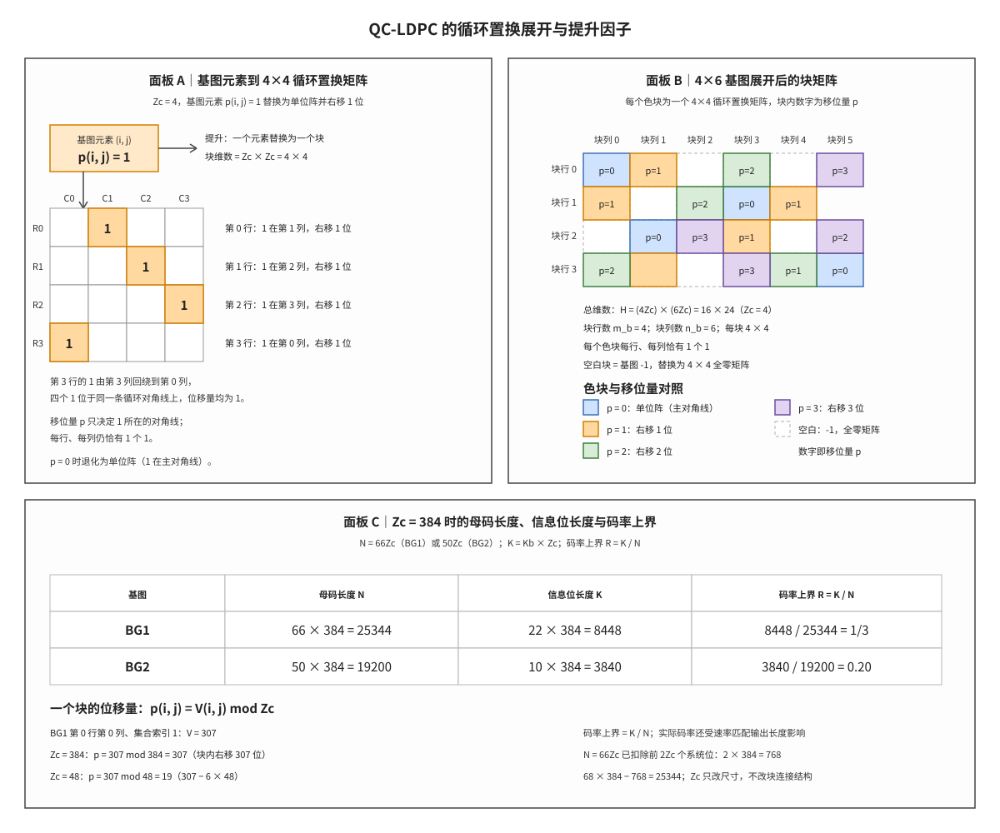

# QC-LDPC 与提升大小 Zc

## 符号与记号约定
| 符号 | 含义与取值 | 协议锚点 |
|:---|:---|:---|
| $Z_c$ | 提升因子（lifting size），基图每个元素展开为 $Z_c\times Z_c$ 子矩阵时的块边长，同时是编码器移位寄存器级数与译码并行粒度；Table 5.3.2-1 的八个集合共 51 个离散值，范围 2 至 384；单位为 bit（每个块含 $Z_c$ 行、$Z_c$ 列比特）；协议表格固定，选取规则见 TS 38.212 §5.2.2。 | TS 38.212 Table 5.3.2-1 |
| $V_{i,j}$ | 移位表中查出的原始值，尚未对 $Z_c$ 取模；0 至 383 的整数；单位为无（表内原始移位计数）；按提升大小集合索引 $i_{LS}$ 在 Table 5.3.2-2（BG1）与 Table 5.3.2-3（BG2）中查得。 | TS 38.212 Table 5.3.2-2 |
| $N$ | 母码（mother code）长度，即编码器输出并进入速率匹配的比特数；基图 1 为 $66Z_c$、基图 2 为 $50Z_c$，$Z_c=384$ 时分别为 25344 与 19200；单位为 bit；基图列数扣除前 $2Z_c$ 个打孔系统位。 | TS 38.212 §5.3.2 |
| $k$ | 块内行索引，用于描述循环置换矩阵中 1 的位置；$0$ 至 $Z_c-1$；单位为块内行号（无量纲序号）；本笔记为写清块内坐标引入的记法，协议只给基图块级坐标。 | 非 3GPP 标准 |
| $H$ | 完整比特级校验矩阵（parity-check matrix），元素取自 $\{0,1\}$，由基图逐块提升得到；维数 $m_bZ_c\times n_bZ_c$，BG1 在 $Z_c=384$ 时为 $17664\times26112$；单位为无（比特行×比特列）；由基图与 $Z_c$、$p_{i,j}$ 展开。 | TS 38.212 §5.3.2 |
| $p_{i,j}$ | 基图第 $i$ 块行、第 $j$ 块列元素的块内循环右移量；非零元素取 $0\le p_{i,j}\le Z_c-1$，表内空白记 $-1$ 且 $-1$ 不是移位量；单位为移位次数（等价于块内列偏移，无量纲）；由 $p_{i,j}=V_{i,j}\bmod Z_c$ 从移位表折算。 | 由 TS 38.212 §5.3.2 导出 |
| $m_b$ | 基图块行数，也就是完整 $H$ 的行数除以 $Z_c$，每块行对应 $Z_c$ 个校验方程；基图 1 为 46，基图 2 为 42；单位为块行（乘 $Z_c$ 得比特行数）；协议基图尺寸。 | TS 38.212 §5.3.2 |
| $n_b$ | 基图块列数，也就是完整 $H$ 的列数除以 $Z_c$；基图 1 为 68，基图 2 为 52（其中前 2 个系统列打孔）；单位为块列（乘 $Z_c$ 得比特列数）；协议基图尺寸。 | TS 38.212 §5.3.2 |
| $K_b$ | 基图信息块列数，决定信息位长度 $K=K_bZ_c$；基图 1 为 22，基图 2 为 10（列分区口径）；单位为块列；TS 38.212 §5.2.2 的分段规则。 | TS 38.212 §5.2.2 |
| $K$ | 信息位长度，即送入 LDPC 编码器的比特数（码块分段时含码块 CRC）；按 $K=K_bZ_c$ 计算，$Z_c=384$ 时 BG1 为 8448、BG2 为 3840；单位为 bit；由 $K_b$ 与 $Z_c$ 算出。 | 由 TS 38.212 §5.2.2 导出 |
| $R$ | 码率（code rate），对应母码全部比特都参与时的码率，数值例中记作码率上界；按 $R=K/N$ 计算，BG1 为 $1/3$、BG2 为 0.20；单位为无量纲比值（bit/bit）；由 $K$ 与 $N$ 相除得到。 | 由 TS 38.212 §5.3.2 导出 |
| $i$ | 块行索引，定位基图的一个块行与 $H$ 的连续 $Z_c$ 行；$0$ 至 $m_b-1$，BG1 为 0 至 45、BG2 为 0 至 41；单位为块行号（无量纲序号）；协议基图行号约定。 | 由 TS 38.212 §5.3.2 导出 |
| $j$ | 块列索引，定位基图的一个块列与 $H$ 的连续 $Z_c$ 列；$0$ 至 $n_b-1$，BG1 为 0 至 67、BG2 为 0 至 51；单位为块列号（无量纲序号）；协议基图列号约定。 | 由 TS 38.212 §5.3.2 导出 |

运算符与记号约定如下。$\lfloor\cdot\rfloor$ 表示向下取整，$\bmod$ 表示取余数，$\min$ 表示取较小值；下标 $i$、$j$ 是块坐标，$p_{i,j}$ 与 $V_{i,j}$ 的下标不表示相乘；$Z_c\times Z_c$ 表示子矩阵的行数与列数均为 $Z_c$；表内空白记 $-1$，它是一个标记而不是移位量，实际移位量的取值范围不含负值。

准循环低密度奇偶校验码（Quasi-Cyclic Low-Density Parity-Check Code, QC-LDPC）是 NR（New Radio）译码器直接消费的校验矩阵形态。编码器不直接存储完整的比特级校验矩阵 $H$，而是存储一张块级的基图（Base Graph, BG）与每格的移位值；译码器按提升因子（lifting size）$Z_c$ 与位移量 $p_{i,j}$ 在运行时生成 $H$ 的每个循环置换矩阵（Circulant Permutation Matrix）块。一句话本质：**QC-LDPC 用「基图定块级连接、$Z_c$ 定块维数、$p_{i,j}$ 定块内 1 的循环对角线位置」的两级结构表示完整的 $H$。**
## 解释目标与范围

本节目标：把 TS 38.212 基图中的一个非零元素解释为一个 $Z_c\times Z_c$ 循环置换矩阵，说明该展开如何组成完整的 $H$，并给出 $Z_c$ 与母码长度 $N$、信息位长度 $K$ 的定量关系。展开过程同时回答三个问题：基图的块行列如何对应 $H$ 的行列区间；位移量 $p_{i,j}$ 如何决定块内 1 的位置；$Z_c$ 如何把基图规模换算成比特级码长与硬件并行度。

在 LTE/NR 译码链路中，这一步位于基图选择与码块分段之后、LDPC 译码之前。译码器读取的层循环边界、消息地址与桶形移位器的并行宽度都由 $Z_c$ 决定，因此 $Z_c$ 不只是矩阵尺寸参数，也是软信息存储与交换网络的地址粒度。下面先补齐这些对象与符号，再进入定义。

## 前置概念

低密度奇偶校验码（Low-Density Parity-Check Code, LDPC）是一类由稀疏校验矩阵定义的线性分组码，其译码器在 $H$ 的变量节点与校验节点之间迭代传递消息，参见 [[LDPC_低密度奇偶校验码]]。所谓稀疏校验矩阵（sparse parity-check matrix），指 $H$ 中 1 的个数远少于元素总数，每行与每列的 1 的个数远小于行数与列数；稀疏性使迭代译码的边数与每轮计算量都随码长线性增长，而不随矩阵元素总数平方增长。

循环置换矩阵（Circulant Permutation Matrix）是每行、每列恰有一个 1 的方阵；把单位阵的每一行向右循环移动相同位数，就得到它的一个实例。若移动位数为 $p_{i,j}$，则第 0 行的 1 位于第 $p_{i,j}$ 列，第 1 行位于第 $p_{i,j}+1$ 列，末行越过第 $Z_c-1$ 列后回到第 0 列。提升因子（lifting size）$Z_c$ 则是这类方阵的边长，也是基图每个元素展开后的块维数，参见 [[Base_Graph_基图]]。

基图（Base Graph, BG）是 $H$ 的块级模板：它的每个元素给出一个块的存在性与移位量，块行数 $m_b$ 与块列数 $n_b$ 分别乘 $Z_c$ 后得到 $H$ 的总行数与总列数。码率（code rate）是信息位长度与母码长度之比 $R=K/N$，它给出该码块在母码层面的冗余比例；速率匹配可以在此之上继续改变实际发送长度，参见 [[Rate_Matching_速率匹配]] 与 [[CB_码块]]。这六个对象的关系是本笔记的主线：基图给出块结构，$Z_c$ 把块结构扩展为比特级矩阵，$p_{i,j}$ 决定块内连接，$K_b$ 与 $Z_c$ 共同决定 $K$，$N$ 与 $K$ 决定 $R$。这些对象不是同时出现的，它们是在 LDPC 码的工程演进中逐步固定下来的。

## 起源与演进

(1) **起点：随机 LDPC 的存储代价。** Gallager 式随机 LDPC 的 $H$ 没有块结构，译码器必须保存整张矩阵或整张边表。NR 的基图 1 提升到 $Z_c=384$ 时，$H$ 的规模为 $17664\times26112$，约 4.6 亿个元素；若逐元素存储，仅矩阵本身就会超出译码器的片上存储预算，地址生成也会失去规律。

(2) **结构化：块矩阵与循环移位。** 把 $H$ 约束为「基图 + 循环置换块」的两级结构后，编码器只需保存基图的 46×68 = 3128 个元素与每格的移位值，译码器按 $Z_c$ 与 $p_{i,j}$ 即时生成块内连接。存储量从约 4.6 亿个元素降到基图与移位表的量级，地址生成也从查整表变为按块坐标与位移量计算。

(3) **三态替换规则。** 基图元素取三种状态：表内空白记 $-1$，替换为 $Z_c\times Z_c$ 全零矩阵；取 0 时替换为单位阵；取正整数 $p_{i,j}$ 时替换为单位阵循环右移 $p_{i,j}$ 位。实际移位量由表中原始值按 $p_{i,j}=V_{i,j}\bmod Z_c$ 折算，因此同一张移位表可服务同一集合内的多个 $Z_c$。

(4) **硬件收益。** 循环右移在硬件上对应桶形移位器的一次选择操作；同一块行内的多个块共享相同的输入向量宽度 $Z_c$，层调度可以按块行推进，变量节点与校验节点的消息地址均按 $Z_c$ 对齐。并行度、存储字宽与交换网络规模都由 $Z_c$ 决定，这是 QC-LDPC 能被 NR 高吞吐译码器采用的主要原因。

(5) **边界。** $Z_c$ 只改变矩阵尺寸、码长与并行粒度，不改变基图的块连接结构；纠错能力主要由基图结构、码长与迭代次数共同决定。$Z_c$ 的取值也不是连续整数，而是由 Table 5.3.2-1 的八个集合限定，码块长度必须落在允许的离散集合上。

## 科学定义

上述演进最终收敛为一套可计算的定义，它由三个层次组成：基图元素到循环置换矩阵的替换、块矩阵到完整 $H$ 的拼接、以及 $Z_c$ 到码长与信息位长度的换算。以下依次给出这三个层次，并在最后一节给出 $Z_c=384$ 的手算实例与图示。

### 提升操作：从基图元素到循环置换矩阵

提升（lifting）是把基图的每个元素替换为 $Z_c\times Z_c$ 子矩阵的操作，替换完成后得到比特级校验矩阵

$$
H\in\{0,1\}^{m_bZ_c\times n_bZ_c}.
$$

替换规则由基图元素 $p_{i,j}$ 的取值决定。表内空白记 $p_{i,j}=-1$，替换为全零矩阵，表示该块行与块列之间没有边；$p_{i,j}=0$ 时替换为单位阵，块内第 0 行的 1 位于第 0 列，其余行依次对齐主对角线；$p_{i,j}>0$ 时替换为单位阵循环右移 $p_{i,j}$ 位得到的循环置换矩阵。三种状态覆盖了基图的全部取值，不存在第四种块类型。

循环右移的位序需要与实现口径对齐。按本文约定，位移量为 $p_{i,j}$ 的块中，第 0 行的 1 位于第 $p_{i,j}$ 列，第 1 行位于第 $p_{i,j}+1$ 列，依此类推，末行越过第 $Z_c-1$ 列后回到第 0 列；等价地，第 $k$ 行的 1 位于第 $(k+p_{i,j})\bmod Z_c$ 列。$p_{i,j}=0$ 时该式退化为 $k$，即主对角线；$p_{i,j}=1$ 时每条行向量比上一行右移一列。表中原始值 $V_{i,j}$ 可能大于当前 $Z_c$，必须先按 $p_{i,j}=V_{i,j}\bmod Z_c$ 折算，不能直接当作移位量使用。

### 块矩阵结构：整体校验矩阵的组成

把 $H$ 按 $Z_c\times Z_c$ 分块后，得到一个 $m_b\times n_b$ 的块矩阵：第 $i$ 块行覆盖连续的 $Z_c$ 行，起始行号为 $i$ 与 $Z_c$ 的乘积；第 $j$ 块列覆盖连续的 $Z_c$ 列，起始列号同理。块矩阵的每个位置要么是全零块，要么是一个循环置换矩阵；非零块在块矩阵中的位置由基图给出，块内 1 的位置由 $p_{i,j}$ 给出，两者共同确定 $H$ 中每一条边。

以基图 1 为例，$m_b=46$、$n_b=68$，在 $Z_c=384$ 时完整 $H$ 的维数为 $46Z_c\times68Z_c=17664\times26112$；基图 2 的 $m_b=42$、$n_b=52$，同一 $Z_c$ 下为 $42Z_c\times52Z_c=16128\times19968$。块矩阵的每个非零块含 $Z_c$ 个 1，对应 $Z_c$ 条边，每条边连接一个行节点与一个列节点；所以块级稀疏性直接决定比特级矩阵的稀疏性：基图中为空白的位置在 $H$ 中整块为零，基图中非零的位置在 $H$ 中只有 $Z_c$ 个 1，块内其余位置均为 0。

### 码长、信息位长度与码率

块矩阵的列数一旦确定，母码长度与信息位长度就可以直接换算，其中还要扣除协议规定不发送的前 $2Z_c$ 个系统位。母码长度由基图列数与穿孔规则共同决定。基图 1 有 68 个块列，但前 2 个块列对应的 $2Z_c$ 个系统位在编码后不发送，也不进入速率匹配的循环缓存，因此进入缓存的母码长度为 $N=68Z_c-2Z_c=66Z_c$；基图 2 同理，$N=52Z_c-2Z_c=50Z_c$。这两个式子解释了协议中 66 与 50 的来源，也说明 $N$ 不是基图列数乘 $Z_c$ 的未扣除值。

信息位长度只取基图前 $K_b$ 个块列：$K=K_bZ_c$，基图 1 的 $K_b=22$，基图 2 的 $K_b=10$。按母码长度计的码率上界为 $R=K/N$；它对应母码全部 $N$ 位都进入后续处理的情形，实际发送码率还取决于速率匹配的输出长度：输出长度小于 $N$ 时实际码率高于 $K/N$，大于 $N$ 时因重复发送而低于 $K/N$，因此 $K/N$ 只是母码层面的基准，不是实际发送码率的绝对上界。取 $Z_c=384$，两种基图的数值如下表。

| 量 | 计算式 | 结果 |
|:---|:---|:---|
| 基图 1 母码长度 | $N=66Z_c=66\times384$ | 25344 |
| 基图 1 信息位长度 | $K=K_bZ_c=22\times384$ | 8448 |
| 基图 1 码率上界 | $R=K/N=8448/25344$ | $1/3$ |
| 基图 2 母码长度 | $N=50Z_c=50\times384$ | 19200 |
| 基图 2 信息位长度 | $K=K_bZ_c=10\times384$ | 3840 |
| 基图 2 码率上界 | $R=K/N=3840/19200$ | 0.20 |
| 基图 1 完整 $H$ 维数 | $m_bZ_c\times n_bZ_c=46Z_c\times68Z_c$ | $17664\times26112$ |

单个块的位移量按 $p_{i,j}=V_{i,j}\bmod Z_c$ 计算。以基图 1 第 0 块行第 0 块列、集合索引 1 的取值 $V_{i,j}=307$ 为例：$Z_c=384$ 时 $p_{i,j}=307\bmod384=307$，块内右移 307 位；同一原始值用于 $Z_c=48$ 时，$p_{i,j}=307\bmod48=19$，因为 $307=6\times48+19$。同一个 $V_{i,j}$ 在不同 $Z_c$ 下得到不同位移量，这正是移位表要按集合索引组织、并在使用时取模的原因。

**图 1｜基图元素到循环置换矩阵的映射、4×6 基图展开后的块矩阵，以及 $Z_c=384$ 时的码长关系。** 面板 A 取 $Z_c=4$、$p_{i,j}=1$，给出一个基图元素替换为 4×4 循环置换矩阵的过程，并逐行标出 1 所在列与位移量。面板 B 把 4×6 基图的每个非零元素替换为一个 4×4 色块，色相区分位移量、空白块表示基图中的 $-1$，并标出块行数、块列数与总维数 $16\times24$。面板 C 给出 $Z_c=384$ 时基图 1 与基图 2 的 $N$、$K$、$R$，以及一个块的位移量按 $p_{i,j}=V_{i,j}\bmod Z_c$ 的折算结果。

## 直观模型

定义给出的是计算规则，理解这些规则还需要一套可以逐级核对的读法。完整矩阵 $H$ 可以按三级结构读出。第一级是块级：基图是一个 $m_b\times n_b$ 的整数矩阵，每个位置给出该块是否存在以及块内移位量，空白位置在 $H$ 中对应整块为零。第二级是块内：每个非零位置替换为一个 $Z_c\times Z_c$ 循环置换矩阵，$p_{i,j}=0$ 时块内 1 落在主对角线，$p_{i,j}>0$ 时每条行的 1 相对上一行右移一列，越过右边界后回绕到第 0 列。第三级是尺寸：块行数乘 $Z_c$ 得到 $H$ 的行数，块列数乘 $Z_c$ 得到 $H$ 的列数，母码长度再按扣除前 $2Z_c$ 个系统位计算。

取 $Z_c=4$、$p_{i,j}=1$，块矩阵中的一个非零元素展开为下面的 $4\times4$ 矩阵：

$$
\begin{pmatrix}
0&1&0&0\\
0&0&1&0\\
0&0&0&1\\
1&0&0&0
\end{pmatrix}
$$

该矩阵每一行只有一个 1、每一列也只有一个 1，第 0 行的 1 在第 1 列，第 1 行在第 2 列，第 2 行在第 3 列，第 3 行越过右边界回到第 0 列。把位移量改为 0，四个 1 回到主对角线，矩阵退化为单位阵；把该位置改为 $-1$，整个 $4\times4$ 块全为零，$H$ 中对应的 $Z_c$ 行与 $Z_c$ 列之间没有边。

三级结构的换算关系是精确的：块坐标乘 $Z_c$ 后定位到 $H$ 的子块，块内坐标由位移量决定，不存在近似或插值。同一基图更换 $Z_c$ 时，块级连接保持不变，块维数与位移量按新的 $Z_c$ 重算；因此 $Z_c$ 改变的是矩阵尺寸、码长与并行粒度，而基图改变的是块级连接本身。面板 B 的 4×6 示意把这一关系压缩到可逐格核对的规模：4 个块行、6 个块列、每块 4×4，总维数 $16\times24$，空白块与色块的分布可以直接与基图逐格对照。

## 常见误解

三级结构在简化叙述中容易被压缩成几条错误结论，下面把常见偏差与正确理解逐条对照。

| 误解 | 正确理解 |
|:---|:---|
| 基图就是完整校验矩阵 $H$ | 基图是块级模板；完整 $H$ 要把每个非零元素替换为 $Z_c\times Z_c$ 循环置换矩阵，维数为 $m_bZ_c\times n_bZ_c$。 |
| 基图元素 0 表示发送比特 0 | 基图元素是块替换指令：0 表示单位阵，$-1$ 表示全零块，正整数表示循环右移对应位数。 |
| $Z_c$ 越大纠错能力一定越强 | $Z_c$ 决定码长、矩阵尺寸与并行粒度；纠错能力由基图结构、码长与迭代次数共同决定，不能仅凭 $Z_c$ 判定。 |
| 循环移位值越大校验越强 | 位移量只决定块内 1 的循环对角线位置，不同位移量对应不同边连接，不直接对应可靠性高低。 |
| 表中原始值可以直接当位移量 | 实际位移量是 $p_{i,j}=V_{i,j}\bmod Z_c$；同一原始值在小 $Z_c$ 下会被取模。 |
| $Z_c$ 可在 2 到 384 之间任意取值 | $Z_c$ 只能取 Table 5.3.2-1 八个集合中的离散值；码块长度必须落在允许集合上。 |
| 穿孔的前 $2Z_c$ 位可以填 0 | 穿孔位置的语义是未知，填 0 会把「没有观测」记为「观测到 0」，污染译码器对系统位的推断。 |

## 边界情形

除上述常见偏差外，还有三类边界需要单独交代。第一类边界是 $Z_c$ 的离散取值。协议用八个集合组织 2 至 384 的提升因子，码块分段只能从这些集合中选值；把 $Z_c$ 当作连续整数会让 $N=66Z_c$ 算出协议不存在的码长，随后基图选择、速率匹配起点与软缓存地址都会偏离。选择 $Z_c$ 时先由码块长度落在哪个集合确定候选，再按 Table 5.3.2-1 取满足条件的最小值。

第二类边界是基图与码长公式的配套关系。基图 1 对应 $N=66Z_c$、$K_b=22$，基图 2 对应 $N=50Z_c$、$K_b=10$；用基图 2 的列数去套基图 1 的公式会同时算错 $N$、$K$ 与 $R$。公式中的 66 与 50 已经扣除前 $2Z_c$ 个系统位，而 $H$ 的列数仍是 $68Z_c$ 或 $52Z_c$，两套数字不能混用。

第三类边界是位移量的取模与 $-1$ 标记。$V_{i,j}$ 是移位表中的原始值，必须先按 $p_{i,j}=V_{i,j}\bmod Z_c$ 折算；直接使用原始值会在小 $Z_c$ 下越界。$-1$ 只表示表内空白，不能参与取模，也不表示「左移一位」；把它当作位移量会生成一个不存在的循环置换块。

## 协议锚点

上述定义、参数与边界在协议中都有对应的条款与表项。

- TS 38.212 Rel-19 `38212-j30` §5.2.2（lifting size 选择入口）：`3GPP_Rel19/processed/TS_38.212_38212-j30/content.md` 行 747-775。
- TS 38.212 §5.3.2（基图与 QC 展开、替换规则）：`content.md` 行 948-989。
- Table 5.3.2-1（lifting size set）：`tables/table_0013.csv/html`；Table 5.3.2-2（BG1 移位表）：`tables/table_0014.csv/html`；Table 5.3.2-3（BG2 移位表）：`tables/table_0015.csv/html`。

## 关键要点

把全文压缩为以下七条可复核的结论。

1. 提升是把基图每个元素替换为 $Z_c\times Z_c$ 子矩阵的操作，完整矩阵满足 $H\in\{0,1\}^{m_bZ_c\times n_bZ_c}$。
2. 三态替换规则：表内空白 $-1$ 替换为全零块，0 替换为单位阵，正整数替换为单位阵循环右移对应位数。
3. 实际位移量按 $p_{i,j}=V_{i,j}\bmod Z_c$ 计算，同一原始值在不同 $Z_c$ 下得到不同位移量。
4. 基图 1 的 $N=66Z_c$、$K_b=22$，基图 2 的 $N=50Z_c$、$K_b=10$；$Z_c=384$ 时分别为 $N=25344$、$K=8448$ 与 $N=19200$、$K=3840$。
5. 按母码长度计的码率上界为 $R=K/N$，$Z_c=384$ 时基图 1 为 $8448/25344=1/3$，基图 2 为 $3840/19200=0.20$。
6. $Z_c$ 只改变矩阵尺寸、码长与并行粒度，不改变基图的块连接结构；$Z_c$ 的取值受 Table 5.3.2-1 的八个集合约束。
7. 前 $2Z_c$ 个系统位被穿孔，其语义为未知，不能填 0；$N=66Z_c$ 与 $50Z_c$ 已经扣除这 $2Z_c$ 位。

## 图谱关联

本笔记与以下条目构成上下游关系，阅读顺序可按基图、提升、速率匹配、硬件实现展开。

- [[Base_Graph_基图]]
- [[LDPC_低密度奇偶校验码]]
- [[Rate_Matching_速率匹配]]
- [[CB_码块]]
- [[Segmentation_码块分段]]
- [[T8.3_NR_LDPC_lifting_QC_matrix]]
- [[T8.2_NR_LDPC_base_graph_selection]]
- [[T19.2_NR_LDPC_RTL_microarchitecture]]
- [[概念图谱入口]]
- 关系语义：$Z_c$ 把基图的块级连接展开为比特级校验矩阵，并决定码长、信息位长度与硬件并行粒度。
