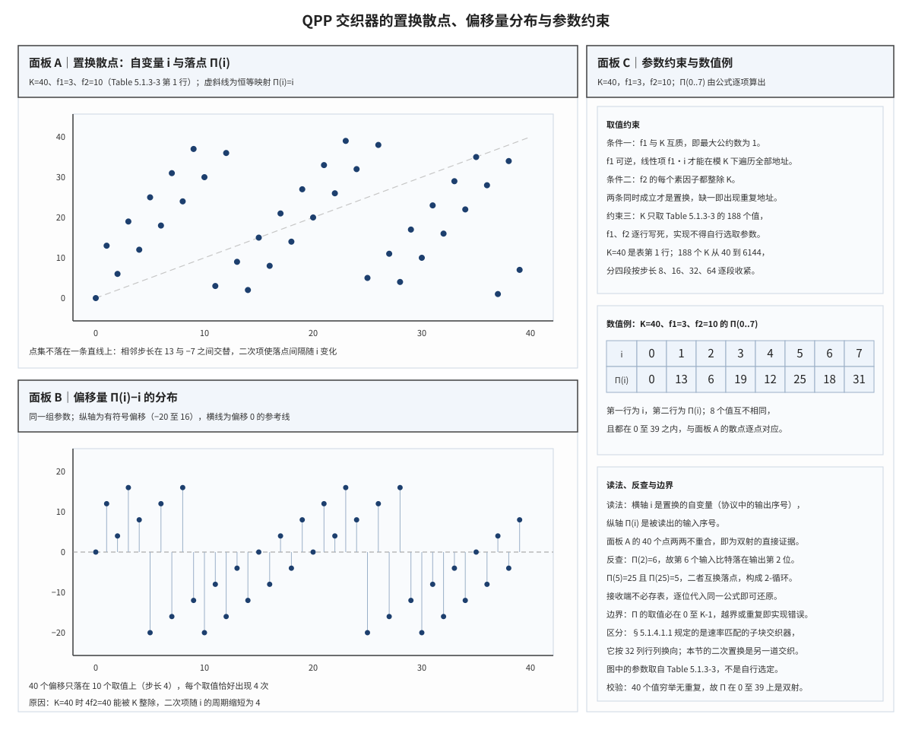

# QPP Interleaver QPP 交织器

## 符号与记号约定
| 符号 | 含义与取值 | 协议锚点 |
|:---|:---|:---|
| $K$ | 码块长度，同时是置换定义域与值域的大小；只取 188 个合法整数之一，从 40 到 6144 | TS 36.212 §5.1.3.2.3；TS 36.212 Table 5.1.3-3 |
| $i$ | 输出比特的序号，$0\le i\le K-1$；是协议公式的自变量 | TS 36.212 §5.1.3.2.3 |
| $f_1$ | 一次项系数，与 $K$ 互质；逐 $K$ 由参数表给出 | TS 36.212 Table 5.1.3-3 |
| $f_2$ | 二次项系数，每个素因子都整除 $K$；逐 $K$ 由参数表给出 | TS 36.212 Table 5.1.3-3 |
| $\Pi(i)$ | 第 $i$ 个输出比特所取用的输入比特序号，取值 $0\le\Pi(i)\le K-1$ | TS 36.212 §5.1.3.2.3 |
| $c$ | 交织前的输入比特序列，从 $c_0$ 到 $c_{K-1}$；输出序列的第 $i$ 位取自 $c_{\Pi(i)}$ | TS 36.212 §5.1.3.2.3 |
| $\Pi^{-1}$ | $\Pi$ 的反函数，由 $\Pi$ 唯一确定；把一个输入序号映射回它所在的输出位置 | 由 TS 36.212 §5.1.3.2.3 导出 |
| $d(i)$ | 偏移量，$\Pi(i)-i$ 对 $K$ 取模后落在 $(-K/2,K/2]$ 的代表值；衡量输出位与它取用的输入位之间的距离 | 由 TS 36.212 §5.1.3.2.3 导出（本笔记记号） |

**表 2｜对照记号（块交织与并行译码）**

| 符号 | 含义与取值 | 协议锚点 |
|:---|:---|:---|
| $R$ | 块交织矩阵的行数 | 非 3GPP 标准 |
| $C$ | 块交织矩阵的列数 | 非 3GPP 标准 |
| $N$ | 块交织器的元素总数，$N=R\cdot C$ | 非 3GPP 标准（块交织的一般记号） |
| $D$ | 交织深度，块交织中等于列数：$D=C$ | 非 3GPP 标准 |
| $\pi$ | 一般置换的记号，用于与 QPP 的 $\Pi$ 对照 | 非 3GPP 标准 |
| $M$ | 并行译码的窗口长度，即每个处理器一次处理的连续地址数 | 实现域 |
| $P$ | 并行译码的处理器数目 | 实现域 |
| $x$ | 窗口内的局部序号，$0\le x<M$ | 非 3GPP 标准 |

运算符与记号惯例：

1. **取模**：$\bmod K$ 表示落在 0 至 K−1 的余数；$\Pi(i)$ 与 $d(i)$ 都由该运算闭合在有限区间内。
2. **平方与上标**：上标写法 $i^{2}$ 表示 i 的平方，$f_2 i^{2}$ 是二次项；它是幂次，不是序号。
3. **两套置换记号**：$\Pi$ 专指 QPP 的二次置换，$\pi$ 指任意置换；两者都是双射，但 $\Pi$ 由公式给定，$\pi$ 由矩阵换向给定。
4. **方向**：协议写的是输出取输入，即 $c'_{i}=c_{\Pi(i)}$；$\Pi$ 的自变量是输出序号，取值是输入序号。方向写反等价于改用 $\Pi^{-1}$，两者数值不同。
5. **逆记号**：上标 −1 表示逆映射 $\Pi^{-1}$，不是倒数，也不能与 $1/\Pi$ 互换。
6. **有符号偏移**：$d(i)$ 取 $(-K/2,K/2]$ 的代表值；正数表示该输出位取自更靠后的输入位，负数表示取自更靠前的输入位。

一句话本质：**QPP 交织器用一个二次多项式在模 $K$ 下生成地址，把"逐 $K$ 存一张置换表"换成"逐 $K$ 存三个整数"，同时保证收发两端算出的置换逐比特相同。**

QPP 交织器（Quadratic Permutation Polynomial interleaver）是 LTE Turbo 编码器中两个递归系统卷积（Recursive Systematic Convolutional, RSC）编码器之间的地址置换，也是译码侧两个软输入软输出（Soft-Input Soft-Output, SISO）译码器交换外信息（extrinsic information）时使用的地址映射。它的置换不是查表得到的，而是由 $f_1$、$f_2$、$K$ 三个整数按公式现算；三个整数逐 $K$ 固定在一张协议表里，因此实现两端不需要传输置换表，也不能自行改参数。
## 解释目标与范围

本节目标：把 LTE Turbo 内部交织器解释为一个由二次置换多项式（Quadratic Permutation Polynomial, QPP）定义的确定性地址置换，说明它成为双射的充要条件、参数为什么必须查表而不能自选，并用 $K=40$、$f_1=3$、$f_2=10$ 逐项手算 $\Pi(0)$ 至 $\Pi(7)$、给出若干点的反函数值，最后读出置换散点图与偏移量分布图。链路位置：发射侧位于 Turbo 编码器的两个组成编码器之间，接收侧位于两个 SISO 译码器的外信息交换处。

## 前置概念

交织（interleaving）是按序号重排一条比特序列、不改变比特数量与取值的操作，接收端必须用同一排列的逆排列还原，因此交织器在数学上必须是一个双射；交织不改变码率，只改变比特在序列中的位置，它在 Turbo 码中的作用见 [[Turbo_码]]，一般交织器的分类与矩阵实例见 [[Interleaver_交织器]]。

置换（permutation）是集合到自身的一一映射，本文用 $\pi$ 表示任意置换、用 $\Pi$ 表示 QPP 给出的那一个置换；双射有一个直接的图形判据，把自变量画在横轴、把落点画在纵轴，若每行每列恰有一个点，则该映射是置换。

二次置换多项式（Quadratic Permutation Polynomial, QPP）是形如 $f_1 i+f_2 i^{2}$ 的多项式在模 $K$ 下定义的映射，"二次"指的是系数次数而不是计算复杂度；二次项的作用是让相邻自变量的落点间隔随 $i$ 变化，从而在不查表的条件下获得接近随机置换的分散效果。

互质条件（coprimality condition）指 $f_1$ 与 $K$ 的最大公约数为 1，它与"$f_2$ 的每个素因子都整除 $K$"一起构成 QPP 成为置换的充要条件；这条条件只约束参数与 $K$ 的整除关系，不约束 $K$ 本身取多大。

块交织（block interleaver）与 QPP 的差异在于规则的来源：块交织把 $N=R\cdot C$ 个元素按行写入、按列读出，参数是行列数，地址由行列换向算出，规则与元素位置无关；QPP 没有矩阵，参数是 $K$、$f_1$、$f_2$，地址逐位由二次式算出，相邻下标的落点间隔不恒定。两种交织都能分散突发错误，但块交织的分散间隔是常数 $D=C$，QPP 的间隔随 $i$ 变化。

码块分段（code block segmentation）是把传输块切成不超过最大码块长度的若干码块、并给每块加校验的步骤，它决定了 Turbo 编码器看到的 $K$ 取哪一个值；因为 $K$ 只能取参数表列出的 188 个整数，分段器必须把码块长度调整到表内的值，详见 [[Segmentation_码块分段]]。

## 起源与演进

(1) **随机交织器的存储代价。** Turbo 码要求两个组成编码器看到的输入近似无关，中间必须有一次重排；若用随机置换，每个码块长度都要在收发两端各存一张置换表，188 种码块长度意味着 188 张长度从 40 到 6144 的表，存储与一致性校验都不划算。

(2) **代数交织器的提出。** 用多项式在模 $K$ 下生成置换的思路在 2005 年前后被系统化，Sun 与 Takeshita 给出了二次多项式成为置换的充要条件，并分析了这类置换在并行译码下的地址无冲突性质；参数从"表"退化为"三个整数"，标准化成本随之下降。

(3) **LTE 采纳并冻结为参数表。** LTE 把二次置换多项式选为 Turbo 码的内部交织器，把 188 组 $(K,f_1,f_2)$ 逐行写入 TS 36.212 表 5.1.3-3；选表而不是给公式，使不同厂商的实现必须产生逐比特相同的置换，这一条构成 LTE 比特精确（bit-exact）测试的基础。交织器在编码器中的位置见 [[T6.4_LTE_Turbo_internal_interleaver|T6.4 LTE Turbo 内部交织器]]，编码器整体结构见 [[T6.3_LTE_Turbo_encoder_trellis_termination|T6.3 LTE Turbo 编码器]]。

(4) **两代差异与现状。** LTE 的数据信道用 Turbo 码加 QPP 内交织器，窄带物联网与增强机器通信沿用同一套参数；NR 的数据信道改用低密度奇偶校验码（Low-Density Parity-Check, LDPC）、控制信道改用极化码（Polar code），不再使用 Turbo 码，QPP 随之退出 NR 的数据链路。两代差异的根源是码型更换，而不是 QPP 本身的缺陷：在 Turbo 码被采用的地方，它的参数表仍在服役。

(5) **对本笔记的定位。** 上面四步说明参数表为什么长这样，接下来把地址公式写成可运算的形式，并逐项核对 $K=40$ 这一行的数值。

## 科学定义

上一节交代了这套参数的历史来源，本节把它写成可运算的形式；符号的读法与取值沿用文首「符号与记号约定」，下文不再重复定义。三个小节依次处理三件事：地址公式与参数表的结构、成为置换的充要条件、以及 $K=40$ 的逐项数值例。三节是递进关系，先有公式与表格，才能讨论参数取值的合法性，最后才能用手算结果核对图形。

### 二次多项式与参数表

QPP 交织器的地址公式为

$$
\Pi(i)=\left(f_1 i+f_2 i^{2}\right)\bmod K,\qquad 0\le i\le K-1
$$

协议把它写成输入与输出的关系 $c'_{i}=c_{\Pi(i)}$：输出序列的第 $i$ 个比特，取输入序列的第 $\Pi(i)$ 个比特。这个方向必须记牢，$\Pi$ 的自变量是输出序号、取值是输入序号，与"第 $i$ 个输入比特去往哪个输出位置"恰好相反；后者由逆映射 $\Pi^{-1}$ 给出，编码器两个组成编码器之间用的是 $\Pi$，译码器把外信息送回时用的是 $\Pi^{-1}$。

参数不是连续函数，而是一张表。TS 36.212 表 5.1.3-3 共 188 行，每行给出一个 $K$ 与配套的 $f_1$、$f_2$；$K$ 的取值集合不是从 40 到 6144 的连续整数，而是由 40 这个单点与四段等差数列拼成，段内步长逐段放大。

**表 3｜表 5.1.3-3 的取值结构与代表行**

| $K$ 所在段 | 步长 | 该段个数 | 代表行 $(K,f_1,f_2)$ |
|:---|:---|:---|:---|
| 40 | — | 1 | $(40,3,10)$ |
| 48 至 512 | 8 | 59 | $(512,31,64)$ |
| 528 至 1024 | 16 | 32 | $(528,17,66)$ |
| 1056 至 2048 | 32 | 32 | $(1120,67,140)$ |
| 2112 至 6144 | 64 | 64 | $(6144,263,480)$ |

表内五行的个数相加为 $1+59+32+32+64=188$，与协议声明的 188 行一致，这条加法同时可以当作抄表时的自检：任何一段的边界数错一位，总数就对不上。表里没有 $K=520$ 这样的整数，也没有 $K=1000$，码块长度落在这类数值上时必须由分段步骤调整，不能就近取一个未列出的 $K$ 硬算。

### 成为置换的充要条件

公式本身不保证是双射，需要两条整除条件同时成立：$f_1$ 与 $K$ 互质，且 $f_2$ 的每个素因子都整除 $K$。这两条是充要条件，属于 QPP 的数学性质，不是 3GPP 的规定；协议的做法是只把满足条件的 188 组参数写进表，实现照表取值即可，不必逐次验证。

$K=40$、$f_1=3$、$f_2=10$ 正好满足两条：3 与 40 的最大公约数为 1，$10=2\cdot 5$ 的两个素因子 2 与 5 都整除 40。把参数改成 $f_2=9$ 就不满足第二条，$9=3^{2}$ 的素因子 3 不整除 40，此时 40 个自变量只落到 12 个地址上，其中 $\Pi(6)$ 与 $\Pi(7)$ 都等于 22，同一地址被写两次、另一些地址永远不出现，接收端无法还原。把 $f_1$ 改成 4 则破坏第一条，$f_1$ 与 $K$ 的最大公约数为 4，40 个自变量只落到 10 个地址上。两种破坏方式都说明参数不能自行调优。

条件成立之后，地址的计算代价与 $K$ 无关：每一个 $\Pi(i)$ 只需一次乘法、一次加法和一次取模，不需要存储置换表，也不需要存储逆表，逆映射由同一公式反查得到。并行译码还要求更细的性质，即同一窗口内各处理器的地址落在不同存储分块上；QPP 满足这一点的判定与窗口长度 $M$、处理器数 $P$ 有关，同一窗口内地址差随窗口内序号每步增加 $2f_2 M$，这个增量对 $P$ 取模后能否覆盖全部余数，决定了该参数在给定并行度下是否可用。这条判定属于实现域结论，协议不写判定式，只通过选表保证常见并行度下可用。

### 数值例：K=40、f1=3、f2=10

取表 5.1.3-3 的第 1 行，把 $f_1=3$、$f_2=10$、$K=40$ 代入公式，前三个值手算如下。$\Pi(0)$ 的两项都为 0，取模后仍是 0；$\Pi(1)$ 的一次项为 3、二次项为 10，和为 13，小于 40 不必取模；$\Pi(2)$ 的一次项为 6、二次项为 40，和为 46，减 40 得 6。三项分别是 0、13、6，第三项小于第二项，说明落点不随自变量单调递增。

**表 4｜$K=40$、$f_1=3$、$f_2=10$ 的逐项计算**

| $i$ | $f_1 i$ | $f_2 i^{2}$ | 两项之和 | $\Pi(i)$ |
|:---|:---|:---|:---|:---|
| 0 | 0 | 0 | 0 | 0 |
| 1 | 3 | 10 | 13 | 13 |
| 2 | 6 | 40 | 46 | 6 |
| 3 | 9 | 90 | 99 | 19 |
| 4 | 12 | 160 | 172 | 12 |
| 5 | 15 | 250 | 265 | 25 |
| 6 | 18 | 360 | 378 | 18 |
| 7 | 21 | 490 | 511 | 31 |

八个数 0、13、6、19、12、25、18、31 互不相同，且都在 0 至 39 之内，这是双射的必要外观；把它算到 $i=39$，40 个值恰好覆盖 0 至 39 各一次，没有重复也没有缺口，因此 $\Pi$ 在 0 至 39 上是置换。反函数可以按需反查：地址 6 由 $i=2$ 产生，故 $\Pi^{-1}(6)=2$；同理 $\Pi^{-1}(13)=1$、$\Pi^{-1}(19)=3$、$\Pi^{-1}(31)=7$、$\Pi^{-1}(2)=14$、$\Pi^{-1}(3)=11$。还有一处值得注意的对称：$\Pi(5)=25$ 且 $\Pi(25)=5$，两者互换落点，构成一个 2-循环，这类循环在解交织时表现为同一对地址互相读取，实现中若把方向写反，这一对恰好仍能对上，其他地址却会错位，因此不能靠个别点验证方向。

**图 1｜$K=40$、$f_1=3$、$f_2=10$ 的置换散点、偏移量分布与参数约束。** 面板 A 的横轴是置换的自变量 $i$、纵轴是落点 $\Pi(i)$，40 个圆点按公式逐点算出（其中前 8 个与表 4 一致），虚斜线是恒等映射 $\Pi(i)=i$ 作参照；点集不落在一条直线上，相邻两点的纵坐标差在 13 与 −7 之间交替，这就是二次项造成的非线性。面板 B 把同一组参数画成有符号偏移量 $\Pi(i)-i$，40 个偏移只取 −20、−16 至 16 共 10 个值且每个恰好出现 4 次，说明偏移量落在步长为 4 的稀疏子格上而不是铺满整个区间。面板 C 列出三条参数约束与 $\Pi(0)$ 至 $\Pi(7)$ 的八个数，可与表 4 逐格核对；三块面板共用同一组参数，散点、偏移与数值例因此互为验证。

## 直观模型

把置换读成两条一维地址空间之间的一次对射：输入地址空间是 0 至 $K-1$，输出地址空间也是 0 至 $K-1$，公式给出的就是把输出地址 $i$ 对应到输入地址 $\Pi(i)$ 的规则。在这个坐标描述下，双射有一个可检验的判据——散点图的每一行、每一列都恰好有一个点；面板 A 的 40 个点满足这一条，因此这张散点图本身就是置换的图形表示。二次项在这张图上留下的痕迹是间隔不恒定：若只有一次项，落点会排成一条斜率固定的直线；加上二次项之后，相邻落点的纵坐标差随 $i$ 变化，本例中它在 13 与 −7 之间交替。

换一个坐标看同一件事，把偏移量 $d(i)=\Pi(i)-i$ 当作纵轴，得到的是"每个输出位向前或向后移动了多远"的分布。这个分布的密度不是均匀的：$K=40$ 时 40 个偏移只落在步长 4 的 10 个取值上，原因是 $K=40$ 能被 $4f_2=40$ 整除，二次项随 $i$ 的周期缩短为 4，只剩奇偶两个分量。密度随参数变化——取 $K=64$、$f_1=7$、$f_2=16$ 时同样的算法给出 32 个偏移取值、步长 2——所以"偏移铺得开不开"是参数与 $K$ 的函数，不能当作 QPP 的固定属性。读这两张图时要同时守住三条约束：落点必须落在 0 至 $K-1$ 之内且不重复，参数必须来自表 5.1.3-3 的对应行，以及置换的方向必须按 $c'_{i}=c_{\Pi(i)}$ 理解。三条之中任何一条读错，图上的点看上去仍然合理，实现却已经与协议不一致。

## 常见误解

| 误解 | 正确理解 |
|:---|:---|
| QPP 是随机交织器 | 地址由二次多项式确定性生成，同一组 $(K,f_1,f_2)$ 在任何实现上都必须产生逐比特相同的置换；"随机"只是散点的统计外观。 |
| $f_1$、$f_2$ 可以按信道条件调优 | 188 组参数逐行写死在表 5.1.3-3 中，实现只查表不选参；自选参数会破坏互质条件或素因子条件，产生重复地址。 |
| 交织会改变码率 | 交织只改变比特顺序，不改变比特数量与码率；改变码率的是速率匹配，两者是译码链路中相邻但不同的两步。 |
| 正反向记法可以混用 | 协议方向是 $c'_{i}=c_{\Pi(i)}$，$\Pi$ 把输出序号映到输入序号；方向写反等价于改用逆映射，除 2-循环点以外全部错位。 |
| $\Pi(i)$ 越大表示越晚发送 | $\Pi(i)$ 是输入地址，不是输出时刻；它大只说明该输出位取用了更靠后的输入比特，与发送先后无关。 |
| 小 $K$ 的散点很有规律，说明 QPP 分散能力弱 | $K=40$ 时 $4f_2$ 被 $K$ 整除，二次项塌缩为奇偶两个偏移分量；参数与 $K$ 的整除关系改变后，偏移取值随之铺开，$K=64$、$f_1=7$、$f_2=16$ 即为一例。 |
| 地址越界或重复由译码器兜底 | 置换性由参数保证，实现仍须显式校验；越界或重复一旦发生，输出序列长度与比特内容都会错，属于必须报错的实现缺陷。 |
| 本文讲的交织器就是 §5.1.4.1.1 的那个交织器 | 不是同一个对象：§5.1.3.2.3 规定 Turbo 内部交织器（本节，二次置换），§5.1.4.1.1 规定速率匹配的子块交织器（32 列行列换向），两者在链路上先后出现，规则与参数都不同。 |

边界情形集中在两端。$K=40$ 是表内最小的码块长度，参数量级小，二次项与一次项凑成整除关系，图形规律性强，不能据此推断大 $K$ 的行为；$K=6144$ 是最大码块长度，参数为 $(263,480)$，偏移取值的密度与 $K=40$ 完全不同。中间还有 186 个离散取值，相邻两个合法 $K$ 之间没有可用参数，因此链路上游必须先把码块长度调整到表内，再由交织器按对应行取参。

## 协议锚点

上一节的约束与边界都能在条款里找到出处，以下按协议逐条核对公式、表格与参数来源。

- **地址公式与参数表**：TS 36.212 Rel-19 §5.1.3.2.3 规定 Turbo 码内部交织器的输入输出关系与二次式地址公式；同节的表 5.1.3-3 逐行给出 188 组 $(K,f_1,f_2)$，本文的 $K=40$、$f_1=3$、$f_2=10$ 取自该表第 1 行。
- **$K$ 的来源**：§5.1.2 的码块分段按表 5.1.3-3 的最小与最大 $K$ 选择分段尺寸，因此交织器的定义域由分段步骤决定，分段实现见 [[Segmentation_码块分段]]。
- **交织器在编码器中的位置**：§5.1.3.2.1 给出 Turbo 编码器结构与三路输出的组织，两个 8 状态组成编码器之间串接本节讨论的内部交织器；网格终止与尾比特在 §5.1.3.2.2 规定。
- **易混条款**：§5.1.4.1.1 规定的是速率匹配使用的子块交织器，按 32 列行列换向，与二次置换无关；把两者混为一谈会导致参数与公式一并取错。
- **本地锚点**：`3GPP_Rel19/processed/TS_36.212_36212-j30/content.md` 行 761 至 773（§5.1.3.2.3 与表 5.1.3-3），参数表抽取件 `tables/table_0009.csv`，同目录 `full.md` 行 821 起。
- **非 3GPP 标准项**：互质与素因子条件、无冲突判定、偏移量子格密度，均属 QPP 的数学性质或实现域结论；协议只规定公式与参数表，不规定接收端如何并行、也不规定实现如何验证置换性。

## 关键要点

1. QPP 交织器用 $\Pi(i)=\left(f_1 i+f_2 i^{2}\right)\bmod K$ 生成地址，参数 $(K,f_1,f_2)$ 逐行取自 TS 36.212 表 5.1.3-3 的 188 行，实现只查表不选参。
2. 协议方向是 $c'_{i}=c_{\Pi(i)}$，$\Pi$ 的自变量是输出序号、取值是输入序号；反方向由 $\Pi^{-1}$ 承担，两者不能混用。
3. 成为置换的充要条件是 $f_1$ 与 $K$ 互质且 $f_2$ 的每个素因子整除 $K$；$K=40$、$f_1=3$、$f_2=10$ 满足两条，$f_2$ 改成 9 立刻出现重复地址。
4. $K=40$ 时 $\Pi(0)$、$\Pi(1)$、$\Pi(2)$ 分别为 0、13、6，前八项为 0、13、6、19、12、25、18、31，八个数互不相同且都在 0 至 39 之内。
5. 40 个值穷举无重复，故 $\Pi$ 是双射；$\Pi(5)=25$ 与 $\Pi(25)=5$ 构成 2-循环，方向写反时这类点仍能对上，不能靠个别点验证方向。
6. 偏移量 $d(i)=\Pi(i)-i$ 在 $K=40$ 时只取 10 个值（步长 4，各出现 4 次），根源是 $4f_2=40$ 被 $K$ 整除；换参数后取值密度随之改变。
7. 地址逐位现算，存储代价与 $K$ 无关；并行译码的无冲突性质由参数与并行度共同决定，属实现域结论，不由协议保证。

## 图谱关联

- [[概念图谱入口]]
- [[Turbo_码]]
- [[RSC_Code_递归系统卷积码]]
- [[Iterative_Decoding_迭代译码]]
- [[BCJR_Algorithm_BCJR算法]]
- [[Interleaver_交织器]]
- [[Segmentation_码块分段]]
- [[Rate_Matching_速率匹配]]
- [[Circular_Buffer_循环缓存]]
- [[T6.4_LTE_Turbo_internal_interleaver|T6.4 LTE Turbo 内部交织器]]
- [[T6.3_LTE_Turbo_encoder_trellis_termination|T6.3 LTE Turbo 编码器与网格终止]]
- 关系语义：QPP 交织器把码块比特在进入第二个组成编码器之前重排，接收端按同一置换与逆置换在迭代译码中交换外信息；它上接码块分段确定的 $K$，下接速率匹配与循环缓存，是 Turbo 链路里唯一由参数表逐 $K$ 固定的置换环节。
