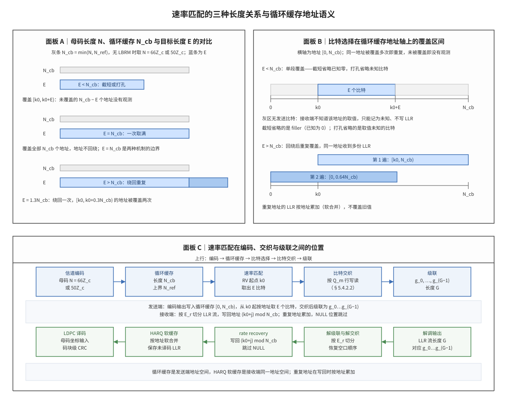

# Rate Matching 速率匹配

## 符号与记号约定
| 符号 | 含义与取值 | 协议锚点 |
|:---|:---|:---|
| $N_{symb}^{sh}$ | 本次数据传输占用的 OFDM 符号数；取 1 至 14，单位为符号；由调度时域分配确定，TS 38.214 §5.1.3.2 使用 | TS 38.214 §5.1.3.2 |
| $N_{DMRS}^{PRB}$ | 一个 PRB 内 DM-RS 占用的资源元素数；取类型 1 每符号每 CDM 组 6、类型 2 为 4 再乘 DM-RS 符号数，单位为 RE/PRB；由 TS 38.214 §5.1.3.2 定义 | TS 38.214 §5.1.3.2 |
| $N_{oh}^{PRB}$ | 每 PRB 由高层配置的开销资源元素数；取 0、6、12、18，单位为 RE/PRB；由高层参数 xOverhead 配置、TS 38.214 §5.1.3.2 规定 | TS 38.214 §5.1.3.2 |
| $n_{PRB}$ | 调度分配的物理资源块个数，决定 G 的频域宽度；取正整数，单位为 PRB；由 TS 38.214 §5.1.3.2 的资源分配给出 | TS 38.214 §5.1.3.2 |
| $Q_m$ | 一个调制符号承载的编码比特数；取 2、4、6、8（QPSK/16QAM/64QAM/256QAM），单位为 bit/符号；由 MCS 与 TS 38.214 §5.1.3.2 给出 | TS 38.214 §5.1.3.2 |
| $R$ | 调度给出的编码速率，用于传输块大小与 G 的换算；取 0 至 1 的实数（MCS 表以乘以 1024 的整数给出），单位为无量纲；由 TS 38.214 §5.1.3.2 的 MCS 与 TBS 换算给出 | TS 38.214 §5.1.3.2 |
| $K$ | 一个码块在编码前的信息比特数；取正整数，单位为 bit；由 TS 38.212 §5.2.2 的分段给出（LTE 为不含 CRC 的码块长度） | TS 38.212 §5.2.2 |
| $g_0,\ldots,g_{G-1}$ | 全部码块速率匹配与交织输出按码块序号拼接后的编码比特序列，是调制前的最终比特流；长度恰为 G，单位为 bit；由 TS 38.212 §5.5 定义 | TS 38.212 §5.5 |
| $N_{RE}$ | 本次调度可用于数据的资源元素总数，是 G 的资源侧来源；取 $\min(156,N_{RE}')\cdot n_{PRB}$（上限 $156n_{PRB}$），单位为 RE；由 TS 38.214 §5.1.3.2 导出 | 由 TS 38.214 §5.1.3.2 导出 |
| $K_w$ | LTE Turbo 的母码长度，即三路拼接后的缓存长度；取 $3K_\Pi$，单位为 bit；由 TS 36.212 §5.1.4.1.2 导出 | 由 TS 36.212 §5.1.4.1.2 导出 |
| $N$ | 编码器直接输出的码字比特数，是比特选择取址的原始序列长度；LTE Turbo 取 $3K+12$、NR 低密度奇偶校验码（Low-Density Parity-Check, LDPC）取 $66Z_c$（基图 1）或 $50Z_c$（基图 2）、NR Polar 取 $2^n$，单位为 bit；由 TS 38.212 §5.3.2（LDPC）与 §5.3.1（Polar）、TS 36.212 §5.1.4（Turbo）给出 | TS 38.212 §5.3.2 |
| $Z_c$ | LDPC 基图矩阵的放大倍数，同时是 $k_0$ 的对齐粒度；取协议 lifting size 表允许值（如 384），单位为无量纲；由 TS 38.212 §5.2.2 的基图与 lifting size 选择给出 | TS 38.212 §5.2.2 |
| $N_{cb}$ | 比特选择可寻址的上界，决定回绕点；取 $\min(N,N_{ref})$，单位为 bit；由 TS 38.212 §5.4.2.1 定义 | TS 38.212 §5.4.2.1 |
| $N_{ref}$ | 有限缓存速率匹配给出的每码块缓存上限；取值为参考传输块大小除以「码块数 × 参考码率」后向下取整，单位为 bit；由 TS 38.212 §5.4.2.1 导出（参考传输块大小、码块数与参考码率三个量各自的定义见表内对应条目），关闭该功能时 $N_{cb}=N$ | 由 TS 38.212 §5.4.2.1 导出 |
| $E$ | 本次为某个码块输出的编码比特数，即该码块在空口占用的比特位置数；取正整数，单位为 bit；由 $G$ 与 $C'$ 按 TS 38.212 §5.4.2.1 分配得到 | 由 TS 38.212 §5.4.2.1 导出 |
| $E_r$ | 总预算 G 切给第 r 个码块的份额；取 $N_LQ_mq$ 或 $N_LQ_m(q+1)$、未调度时取 0，单位为 bit；由 TS 38.212 §5.4.2.1 导出，满足 $\sum_r E_r=G$ | TS 38.212 §5.4.2.1 |
| $G$ | 一个传输块本次全部码块合计可发送的编码比特数；取 $N_{RE}Q_mN_L$，单位为 bit；由 TS 38.212 §5.4.2.1 定义 | TS 38.212 §5.4.2.1 |
| $N_L$ | 同一时频资源上并行传输的层（数据流）个数；取 1 至 8，单位为层；由调度给出，TS 38.214 §5.1.3.2 用 $\nu$ 表示同一量 | TS 38.214 §5.1.3.2 |
| $\nu$ | 与 $N_L$ 是同一物理量的另一套记号；取 1 至 8，单位为层；由 TS 38.214 §5.1.3.2 给出 | TS 38.214 §5.1.3.2 |
| $R_{LBRM}$ | 计算 $N_{ref}$ 时使用的码率；协议取 2/3，单位为无量纲；由 TS 38.212 §5.4.2.1 规定 | TS 38.212 §5.4.2.1 |
| $TBS_{LBRM}$ | 按最大 PRB 数与最低码率算出的参考传输块比特数，用于确定 $N_{ref}$；取正整数，单位为 bit；由 TS 38.212 §5.4.2.1 定义 | TS 38.212 §5.4.2.1 |
| $TBS_{temp}$ | 量化前的信息比特数，是编码前与编码后预算的对照量；取 $N_{RE}RQ_m\nu$，单位为 bit；由 TS 38.214 §5.1.3.2 导出 | 由 TS 38.214 §5.1.3.2 导出 |
| $C$ | 一个传输块分段后的码块个数；取正整数，单位为个；由 TS 38.212 §5.2.2 的分段给出 | TS 38.212 §5.2.2 |
| $r$ | 码块在传输块内的编号；取 0 至 $C-1$，单位为无量纲；由 TS 38.212 §5.4.2.1 以 r 标记码块 | TS 38.212 §5.4.2.1 |
| $q$ | 每个地址至少被覆盖的次数，用于换算重复因子；取 $\lfloor E/N_{cb}\rfloor$，单位为次；由 $E$ 与 $N_{cb}$ 的比值算出，是本笔记对重复轮次的记法 | 非 3GPP 标准 |
| $X$ | 整层调制符号的个数，是 $E_r$ 分配的单位；取 $G/(N_LQ_m)$，单位为调制符号/层；由 TS 38.212 §5.4.2.1 导出 | 由 TS 38.212 §5.4.2.1 导出 |
| $R_{rem}$ | 多出的调制符号数，分给最后 $R_{rem}$ 个被调度码块；取 $X\bmod C'$，单位为调制符号/层；由 TS 38.212 §5.4.2.1 导出 | 由 TS 38.212 §5.4.2.1 导出 |
| $k_0$ | 冗余版本（RV）决定的循环缓存起始地址；取 0 至 $N_{cb}-1$ 且按 $Z_c$ 对齐，单位为缓存地址（bit）；由 TS 38.212 Table 5.4.2.1-2 给出 | TS 38.212 Table 5.4.2.1-2 |
| $j$ | 比特选择扫描中自 $k_0$ 起的地址偏移；取 $0,1,2,\dots$，单位为无量纲；由 TS 38.212 §5.4.2.1 的比特选择循环导出 | 由 TS 38.212 §5.4.2.1 导出 |
| $a_j$ | 比特选择第 j 步访问的循环缓存地址；取 $a_j=(k_0+j)\bmod N_{cb}$，单位为缓存地址（bit）；由 TS 38.212 §5.4.2.1 导出 | 由 TS 38.212 §5.4.2.1 导出 |
| $w$ | 以地址为下标存放的编码比特（可为 NULL，即填充位）；长度 $N_{cb}$ 个位置，单位为 bit；由 TS 38.212 §5.4.2.1 的循环缓存内容导出 | 由 TS 38.212 §5.4.2.1 导出 |
| $k$ | 速率匹配输出序列的下标；取 0 至 $E-1$，单位为无量纲；由 TS 38.212 §5.4.2.1 的比特选择导出 | 由 TS 38.212 §5.4.2.1 导出 |
| $e_k$ | 本次实际发送的第 k 个编码比特；取 0 或 1，单位为 bit；由 TS 38.212 §5.4.2.1 定义（$k=0,\ldots,E-1$） | TS 38.212 §5.4.2.1 |
| $N_{IR}$ | 用户设备（UE）可用的 HARQ 软缓存总比特数；取 UE 类别决定的整数，单位为 bit；由 TS 36.212 §5.1.4.1.2 定义，下行共享信道 $N_{cb}=\min(\lfloor N_{IR}/C\rfloor,K_w)$ | TS 36.212 §5.1.4.1.2 |

运算符与记号约定：

- $\lfloor x\rfloor$ 表示向下取整，$\lceil x\rceil$ 表示向上取整，$x\bmod y$ 表示 x 除以 y 的余数，$\min(a,b)$ 表示取较小值，$\sum_r$ 表示对一个传输块内所有码块求和。
- 下标表示限定对象：$E_r$ 中的 r 指第 r 个码块，不是乘以 r；上标表示限定条件或序号，不是乘方。
- $N$、$N_{cb}$、$N_{ref}$ 是三个不同的长度：$N$ 由编码族与提升因子决定，$N_{ref}$ 由有限缓存配置决定，$N_{cb}$ 取二者较小值，是比特选择真正使用的地址上界。
- 判断打孔还是重复的比较对象是 $N_{cb}$ 而不是 $N$：$E<N_{cb}$ 时一次扫描不绕回，$E>N_{cb}$ 时绕回并重复覆盖同一批地址。

速率匹配（Rate Matching）是发送端把编码器输出的母码调整为本次空口资源能够承载的编码比特数的处理；接收端的速率恢复（Rate Recovery，de-rate matching）执行同一套地址规则的逆操作，把空口顺序的对数似然比（Log-Likelihood Ratio, LLR）写回循环缓存地址。它位于信道编码与比特交织（bit interleaving）之间，连接 HARQ 的冗余版本与译码器输入坐标。

一句话本质：**速率匹配是按本次输出长度 E 在循环缓存上取址的映射——发送端自冗余版本起点 $k_0$ 起按地址递增、跳过 NULL、取满 E 个比特发送；接收端按同一地址规则把 LLR 写回，未被取到的地址没有观测，被重复覆盖的地址累加多份证据。**
## 解释目标与范围

本节目标：解释速率匹配如何连接无线资源数量、冗余版本与译码器输入坐标——调度参数如何算出每个码块的输出长度 E，E 与循环缓存长度 $N_{cb}$ 的大小关系如何决定截短（shortening）、打孔（puncturing）与重复（repetition）三种行为，以及接收端如何用同一套参数把 LLR 放回正确地址。

## 前置概念

本节列出后文反复使用的对象与术语。若已熟悉可跳过本节直接阅读「起源与演进」；若某一节读不通，多半是本节中的某个对象尚未建立。

**母码（mother code）**：信道编码器按其结构直接生成的码字，长度记为 $N$，是速率匹配取址的原始序列。LTE Turbo 的母码长度为 $3K+12$；NR LDPC 由基图（Base Graph, BG）与提升因子决定，基图 1 为 $66Z_c$，基图 2 为 $50Z_c$。参见 [[LDPC_低密度奇偶校验码]]、[[Base_Graph_基图]]。

**打孔（puncturing）**：母码中某些位置不发送、接收端也不知道其取值，这些位置的 LLR 只能记为未知。$E<N_{cb}$ 且只覆盖部分地址时即产生这类位置；NR LDPC 另有固定打孔，前 $2Z_c$ 位在任何冗余版本下都不发送。参见 [[Circular_Buffer_循环缓存]]。

**缩短（shortening）**：母码中某些位置不发送，但接收端知道它们被固定为 0，因此可按已知值处理而不占用软信息。缩短与打孔在地址轴上都表现为「没有观测」，接收端的处理却相反。

**重复（repetition）**：同一批母码位置被发送多次。$E>N_{cb}$ 时地址绕回，接收端在同一地址收到多份 LLR，必须按地址累加（软合并），不能用新值覆盖旧值。参见 [[Incremental_Redundancy_增量冗余]]。

**填充位与空位（filler, NULL）**：分段与编码为对齐码块长度插入的非载荷位置，在循环缓存中标记为 NULL。比特选择遇到 NULL 只推进地址、不输出比特，因此 E 个输出比特对应的地址跨度可能大于 E。参见 [[Filler_Bits_填充位]]。

**循环缓存（Circular Buffer）**：长度为 $N_{cb}$ 的地址空间，母码按固定顺序写入，读取地址按模 $N_{cb}$ 递增，到达上界后回到 0。参见 [[Circular_Buffer_循环缓存]]。

**HARQ 软缓存（soft buffer）**：接收端保存未译码成功码块 LLR 的存储区，与发送端循环缓存使用同一套地址编号；重传到达时按地址把新 LLR 与已存值合并。参见 [[Soft_Buffer_软缓存]]。

**级联（concatenation）**：把各码块速率匹配与比特交织后的输出按码块序号首尾拼接为一个序列 $g_0,\ldots,g_{G-1}$，总长等于 G（TS 38.212 §5.5）。接收端的解级联是它的逆过程。参见 [[T9.1_NR_LDPC_rate_recovery_overview|T9.1]]。

## 起源与演进

(1) **起点：母码长度与资源容量不相等。** 信道编码器输出的母码长度（LTE Turbo 为 $3K+12$、NR LDPC 依基图取 $66Z_c$ 或 $50Z_c$、Polar 为 $2^n$）与本次资源能装的比特数几乎总不相等，需要一个按资源裁剪或扩展的环节，这就是速率匹配。选择「裁剪」还是「扩展」不需要新机制：把母码排成环形地址空间、按长度读取，读得短即裁剪、读得长即回绕。

(2) **链条：从资源算到每码块输出。** 总可用比特 G 由 PRB 数、可用资源元素数、调制阶数与层数相乘得到（传输块大小查表源头见 TS 36.213 §7.1.7 / TS 38.214 §5.1.3）。G 再按调制符号粒度切给各码块，得每码块输出 $E_r$（NR LDPC 见 TS 38.212 §5.4.2.1，LTE Turbo 见 TS 36.212 §5.1.4.1.2）。

(3) **机制：起点加比特选择。** 从循环缓存按起点 $k_0$ 连续取址，地址每步加一、到上界回零，遇到 NULL 只推进地址不输出，取满 E 个比特即停，输出序列记作 $e_k$（$k=0,\ldots,E-1$）。冗余版本换起点，重传就换一段母码地址。

(4) **与分段的边界。** $K^+$、$K^-$ 是编码前的码块长度（受交织器合法表约束，最多差 24），e 与 E 是编码后的输出长度（受本次调度资源约束），两者隔着一整个编码器与一个循环缓存。

(5) **接收端与三制式。** 速率恢复把空口顺序的 LLR 按地址放回母码坐标，punctured、filler、unknown 三种位置的 LLR 语义必须用掩码区分，这是译码前的最后一道地址映射。三制式各有独立条款：LTE Turbo（TS 36.212 §5.1.4）、NR Polar（TS 38.212 §5.4.1）、NR LDPC（TS 38.212 §5.4.2）。

(6) **两代对照：LTE 与 NR。** LTE 的循环缓存长度为 $K_w=3K_\Pi$，下行共享信道受软缓存总量约束取 $N_{cb}=\min(\lfloor N_{IR}/C\rfloor,K_w)$；NR LDPC 的循环缓存长度取 $N_{cb}=\min(N,N_{ref})$，并新增码块组带来的 $C'$ 与 $E_r=0$ 情形。两代的地址规则相同，差别在母码结构、缓存上界的来源与新的调度粒度。

## 科学定义

### 记号约定

全文符号、读法与运算符约定统一列在文首「符号与记号约定」一节，此处只重复四个易混量的区别：$N$ 是母码长度，$N_{ref}$ 是有限缓存给每个码块的上限，$N_{cb}=\min(N,N_{ref})$ 是循环缓存可取址的长度；判断打孔还是重复时比较的是 $E$ 与 $N_{cb}$，不是 $E$ 与 $N$；$G$ 是整传输块的预算，$k_0$ 是单码块的起点，两者分属总量层与地址层。

### G 值与 E 值的定量关系

G 是整张传输块本次可用的编码比特总预算，$E_r$ 是其中分给第 r 个码块的切片。TS 38.212 §5.4.2.1 把两者定义在同一条款：G 是 "the total number of coded bits available for transmission of the transport block"，$E_r$ 是 "the rate matching output sequence length for the r-th coded block"。

对下行共享信道，G 由资源侧相乘得到：

$$G=N_{RE}\cdot Q_m\cdot N_L$$

其中 $N_{RE}$ 来自 TS 38.214 §5.1.3.2 第 1 步（每 PRB 的 $12N_{symb}^{sh}-N_{DMRS}^{PRB}-N_{oh}^{PRB}$ 个资源元素，上限 156，再乘 PRB 数），$Q_m$ 是调制阶数，$N_L$ 是层数。38.214 第 2 步的 $TBS_{temp}=N_{RE}\cdot R\cdot Q_m\cdot\nu$ 与 G 共用同一个 $N_{RE}\cdot Q_m\cdot\nu$ 乘积：G 是编码后的数量，$TBS_{temp}$ 是编码前的数量，两者相差目标码率 R。

$E_r$ 的分配规则：令 $X=G/(N_LQ_m)$（以「每层一个调制符号」为单位的符号组数），$C'$ 为本次调度的码块数（无码块组传输指示时 $C'=C$），$R_{rem}=X\bmod C'$。若码块组传输指示第 r 个码块未调度，$E_r=0$；否则前 $C'-R_{rem}$ 个被调度码块取

$$E_r=N_LQ_m\left\lfloor\frac{X}{C'}\right\rfloor$$

后 $R_{rem}$ 个被调度码块取

$$E_r=N_LQ_m\left\lceil\frac{X}{C'}\right\rceil$$

由此得到三条不变量：$\sum_r E_r=G$；每个 $E_r$ 都是 $N_LQ_m$ 的整数倍（调制符号对齐，保证 §5.4.2.2 的 $E_r/Q_m$ 行交织不出现半行）；$E_r$ 只由 G、$C'$、$N_L$、$Q_m$ 决定，与 $N_{cb}$、冗余版本无关。

数值例：$N_{RE}=1000$、$Q_m=4$、$N_L=2$ 时 $G=8000$、$X=1000$。C=3 且无码块组传输指示：$R_{rem}=1$，前 2 个码块各得 $8\times333=2664$ 比特，最后 1 个得 $8\times334=2672$ 比特，合计 8000。若码块组传输指示只调度 3 个码块中的 2 个：$C'=2$、$R_{rem}=0$，两个被调度码块各得 4000 比特，未调度码块的 $E_r=0$，合计仍是 8000。

接收端拿到的 LLR 流长度就是 G；它必须用同一组参数（传输块大小定 C、$N_{RE}/Q_m/N_L$ 定 G、码块组传输指示定 $C'$）重算 $E_r$，再按 $E_r$ 切片。切片错一位，第 r 个码块之后的所有 LLR 都会错位——这正是「$E_r$ 切分错，后续译码可能照常运行但 CRC 全部失败」的根因。

### 三种调整方式与循环缓存地址语义

设循环缓存内容为 $w[0],\ldots,w[N_{cb}-1]$，本次起点为 $k_0$、输出长度为 E。比特选择的动作可以写成三条规则：地址按 $a_j=(k_0+j)\bmod N_{cb}$ 递增；若 $w[a_j]$ 为 NULL 则只推进地址、不输出；每输出一个非 NULL 比特令输出计数加一，计满 E 即停。于是三种调整方式不是三套机制，而是同一条地址规则在 $E$ 与 $N_{cb}$ 不同大小关系下的三种结果：

1. **截短或打孔（$E\le N_{cb}$ 且 $k_0+E\le N_{cb}$）**：地址只覆盖区间 $[k_0,k_0+E)$ 一段，未覆盖的 $N_{cb}-E$ 个地址没有发送比特，接收端没有观测。若被省略位置的取值未知（信息比特或校验比特），这一步是打孔；若被省略位置是已知为 0 的 filler，则是缩短。两者的地址覆盖相同，接收端处理不同：打孔位置置中性 LLR 并把未知掩码置一，缩短位置按已知 0 处理。
2. **单次绕回（$E<N_{cb}$ 但 $k_0+E>N_{cb}$）**：地址越过上界后回到 0，覆盖 $[k_0,N_{cb})$ 与 $[0,k_0+E-N_{cb})$ 两段。此时 E 仍小于 $N_{cb}$，但已经有地址被覆盖两次，重复发生在绕回的那一段。
3. **重复（$E>N_{cb}$）**：令 $q=\lfloor E/N_{cb}\rfloor$、$r=E\bmod N_{cb}$，则每个地址至少被覆盖 q 次，其中 r 个地址被覆盖 q+1 次；重复因子为 $\lceil E/N_{cb}\rceil$。接收端在这些地址上收到多份 LLR，按地址累加。

接收端执行同一规则的反向操作：对扫描的第 j 步，把收到的 LLR 写入地址 $a_j$；若该地址此前已有观测则累加，若 $w[a_j]$ 为 NULL 则跳过。三种地址状态的区分是速率恢复的核心——未覆盖是「没有证据」，缩短位置是「已知约束」，重复地址是「多份证据」，三者的 LLR 处理互不相同。

**图 1｜母码长度与目标长度的三种关系，以及比特选择在循环缓存地址轴上的覆盖区间。** 面板 A 以同一比例尺对比循环缓存长度 $N_{cb}$（灰条）与本次输出长度 E（蓝条）在 $E<N_{cb}$、$E=N_{cb}$、$E>N_{cb}$ 三种情形下的长度关系。面板 B 把同一关系画到地址轴 $[0,N_{cb})$ 上：$E<N_{cb}$ 时只覆盖一段连续地址，未覆盖地址在接收端没有观测；$E>N_{cb}$ 时地址绕回，同一批地址被覆盖两次以上。面板 C 给出速率匹配在信道编码、循环缓存、比特交织与级联之间的位置，以及接收端把 LLR 写回软缓存的逆过程。

### 手算实例：$Z_c=384$、$N_{ref}=8000$、$E=20000$

取基图 1、提升因子 $Z_c=384$，有限缓存上限给定为 $N_{ref}=8000$（由参考传输块大小、码块数与参考码率算出，本例不展开这三个参数，只使用其结果），冗余版本取 2。逐步计算如下：

| 步骤 | 计算式 | 结果 |
|:---|:---|:---|
| 母码长度 | $N=66Z_c=66\times384$ | 25344 |
| 循环缓存长度 | $N_{cb}=\min(N,N_{ref})=\min(25344,8000)$ | 8000 |
| 冗余版本 2 的起点 | $k_0=\left\lfloor 33N_{cb}/(66Z_c)\right\rfloor Z_c=\lfloor 33\times8000/25344\rfloor\times384$ | $10\times384=3840$ |
| 输出长度 | 调度给定 $E$ | 20000 |
| 商与余数 | $q=\lfloor E/N_{cb}\rfloor=2$，$r=E\bmod N_{cb}$ | $q=2$，$r=4000$ |
| 重复因子 | $\lceil E/N_{cb}\rceil=\lceil 2.5\rceil$ | 3 |
| 覆盖次数 | 每个地址至少 q 次，其中 r 个地址 q+1 次 | 2 至 3 次 |
| 覆盖三段 | $[3840,8000)$、$[0,8000)$、$[0,7840)$ | $4160+8000+7840=20000$ |

结论有三条。第一，$E=20000$ 小于母码长度 $N=25344$，若以 $N$ 为比较对象会判定为「只取一段、不重复」，实际比较对象是 $N_{cb}=8000$，因此本次是重复：地址绕回两次，重复因子为 3。第二，恰好被覆盖 3 次的地址区间是 $[3840,7840)$，长度 4000 等于 r；该区间的起点正是 $k_0$，因此「被多覆盖一次的地址数」与「余数 r」是同一个量。第三，$k_0=3840$ 与 $Z_c=384$ 的整数倍关系必须成立：$3840=10\times384$，若漏掉乘 $Z_c$ 的步骤得到 $k_0=10$，地址起点就落在提升列内部，收发两端的地址编号不再一致。

## 直观模型

速率匹配的结构可以用一个地址空间与四条约束完整描述，不需要借助外部场景。

**地址空间。** 循环缓存的地址集合是 $[0,N_{cb})$，上界 $N_{cb}$ 由母码长度与有限缓存上限的较小值决定；起点 $k_0$ 由冗余版本给出并已按 $Z_c$ 对齐；本次在地址轴上的读取长度由 E 给出。三个量确定后，覆盖的地址区间即唯一确定，覆盖次数也随之确定。

**两层结构。** 第一层是总量层，回答「整个传输块共有多少编码比特、每个码块分得多少」，变量是 G、C、$C'$、$E_r$，关系是 $\sum_r E_r=G$；第二层是地址层，回答「某个码块从循环缓存的哪些地址取比特」，变量是 $k_0$、E、$N_{cb}$，关系是 $a_j=(k_0+j)\bmod N_{cb}$。总量层决定地址层每轮的读取长度，地址层决定 LLR 最终写回哪里。

**约束清单。** (1) 地址按模 $N_{cb}$ 递增，越过上界即回零；(2) 遇到 NULL 只推进地址、不输出比特，因此地址跨度不小于 E；(3) 未被覆盖的地址没有观测，接收端不得补成业务 0；(4) 被覆盖多次的地址按地址累加 LLR，不得用后到的值覆盖已存值。

## 常见误解

| 误解 | 正确理解 |
|:---|:---|
| 速率恢复只是补零 | 它是带地址与掩码的反向映射；补零会把「没有证据」伪造成「已知为 0」。 |
| 冗余版本只影响 HARQ 重传组合 | 冗余版本直接决定 rate recovery 的写回起点 $k_0$。 |
| punctured（打孔位置）、filler（填充位）、unknown（未知位置）都一样 | 三者地址状态不同，LLR 处理互不相同，必须用掩码区分。 |
| $E<N$ 就一定只取一段 | 比较对象是 $N_{cb}$ 而非 $N$；且 $k_0+E>N_{cb}$ 时 $E<N_{cb}$ 也会绕回。 |
| 重复发送就是把同一段再发一次 | 重复由地址取模自然产生，绕回后覆盖的起点是 0 而不是 $k_0$。 |

## 边界情形

**$E<N_{cb}$ 仍可能绕回。** 沿用上例参数 $N_{cb}=8000$、$k_0=3840$，若调度给出的 E=6000，则 $k_0+E=9840>8000$，地址覆盖 $[3840,8000)$ 与 $[0,1840)$ 两段，共 $4160+1840=6000$ 个比特。此时 E 小于 $N_{cb}$，但已经有 1840 个地址被覆盖两次。判据是 $k_0+E\le N_{cb}$ 是否成立，而不是只看 $E<N_{cb}$。

**打孔与重复的判据以 $N_{cb}$ 为准。** 同上例 N=25344、$N_{cb}=8000$、E=20000：以母码长度比较得到「打孔」，以循环缓存长度比较得到「重复」，后者才是协议口径。有限缓存把地址空间压到母码长度以下时，这两个结论会同时出现，必须以 $N_{cb}$ 为准。

**NULL 位置不占输出但占地址。** 比特选择的输出计数只对非 NULL 比特加一，因此 E 个输出比特走过的地址跨度是 E 加上途中跳过的 NULL 个数。以地址跨度反推 E 会低估输出长度；反过来用 E 直接推算末地址，会低估实际覆盖到的地址范围。

## 协议锚点

- LTE：TS 36.212 Rel-19 §5.1.4 Turbo 速率匹配（G/E 分配见 §5.1.4.1.2），循环缓存长度 $K_w=3K_\Pi$，下行共享信道的 $N_{cb}=\min(\lfloor N_{IR}/C\rfloor,K_w)$。
- NR Polar：TS 38.212 Rel-19 §5.4.1（子块交织、比特选择与交织在 §5.4.1.1 至 §5.4.1.3）。
- NR LDPC：TS 38.212 Rel-19 §5.4.2；G、$E_r$、$C'$ 的定量关系在 §5.4.2.1，$N_{cb}=\min(N,N_{ref})$ 与 $N_{ref}=\lfloor TBS_{LBRM}/(C\,R_{LBRM})\rfloor$ 同在该节（$R_{LBRM}=2/3$，$TBS_{LBRM}$ 按 TS 38.214 §5.1.3.2 确定），比特交织在 §5.4.2.2，级联输出 $g_0,\ldots,g_{G-1}$ 在 §5.5。
- 资源侧 G 来源：TS 38.214 Rel-19 §5.1.3.2（$N_{RE}$、$Q_m$、$\nu$、传输块大小）；码块组调度：§5.1.7。

## 速率匹配在协议族中的分布（五层职责）

速率匹配横跨五层规范，每层回答不同问题——理解协议间联系的关键是「分层职责」：

| 协议层 | 回答的问题 | 代表 TS（本地 Rel-19 资料） |
|:---|:---|:---|
| 信道编码 | **算法本体**：母码按冗余版本起点截出每码块的 E 比特（比特选择） | TS 36.212 §5.1.4（Turbo）/TS 38.212 §5.4.1（Polar）/§5.4.2（LDPC） |
| 物理层过程 | **可用资源总数 G 从哪来**（调制与编码方案（Modulation and Coding Scheme, MCS）与 PRB 数 → 传输块大小 → G → 每码块输出 E） | TS 38.214 §5.1.3（NR 下行共享信道传输块大小）/TS 36.213 §7.1.7（LTE 传输块大小） |
| 物理层控制 | **MCS/冗余版本/资源分配由谁指示** | TS 38.212 §7.3（下行控制信息（Downlink Control Information, DCI）字段） |
| 无线资源控制（Radio Resource Control, RRC）信令 | **哪些 RE 不能用**（rateMatchPattern 打孔/避让） | TS 38.331（RateMatchPattern 信息元素（Information Element, IE）） |
| 媒体接入控制（Medium Access Control, MAC） | **调度决策与 HARQ 信息**（传输块大小、重传冗余版本选择） | TS 38.321 §5.3.2.2 |

**联系链**：MAC 决定传输块大小与调度 → 213/214 定出总资源 G 与传输块大小 → 212 把母码按冗余版本起点截出每码块的 E 比特 → 331 挖掉 rateMatchPattern 覆盖的 RE → 接收端速率恢复把 LLR 放回母码坐标（本笔记职责）。

## 关键要点

1. 速率匹配 = 按本次资源把母码截成 E 比特；$E_r$ 由总预算 G、调度码块数 $C'$ 与调制符号粒度 $N_LQ_m$ 分配，$\sum_r E_r=G$。
2. 判断打孔还是重复的比较对象是 $N_{cb}=\min(N,N_{ref})$，不是母码长度 $N$；$E<N_{cb}$ 也可能因 $k_0+E>N_{cb}$ 而绕回。
3. 三种调整方式共用一条地址规则 $a_j=(k_0+j)\bmod N_{cb}$，区别只在 E 与 $N_{cb}$ 的大小关系以及绕回后的起点为 0。
4. 冗余版本决定起点 $k_0$ 并按 $Z_c$ 对齐；漏乘 $Z_c$ 会让收发两端地址编号不一致。
5. 速率恢复是带地址与掩码的反向映射，不是简单补零；未覆盖、缩短、重复三种地址的 LLR 处理不同。
6. 三制式各有独立条款：36.212 §5.1.4 / 38.212 §5.4.1 / §5.4.2；级联在 §5.5。

## 图谱关联

- [[Circular_Buffer_循环缓存]]
- [[概念图谱入口]]
- [[LLR_对数似然比]]
- [[RV_冗余版本]]
- [[Soft_Buffer_软缓存]]
- [[CBG_码块组]]
- [[CB_码块]]
- [[TB_传输块]]
- [[Segmentation_码块分段]]
- [[Filler_Bits_填充位]]
- [[Incremental_Redundancy_增量冗余]]
- [[Interleaver_交织器]]
- [[LDPC_低密度奇偶校验码]]
- [[Turbo_码]]
- [[Polar_码]]
- [[E_Value_G_Value_E值与G值]]
- [[T7.1_LTE_Turbo_de_rate_matching_overview]]
- [[T8.0_TS38212_chapter5_decoder_side_map]]
- [[T9.1_NR_LDPC_rate_recovery_overview]]
- [[T9.2_NR_LDPC_circular_buffer_states]]
- [[T9.3_NR_LDPC_HARQ_soft_buffer_RV_k0]]
- [[T10.7_NR_Polar_rate_recovery]]
- 关系语义：rate matching/recovery 决定 LLR 从空口顺序到译码核心坐标的映射；G 是整传输块的总编码比特预算，$E_r$ 是切给第 r 个码块的份额，$\sum E_r=G$，码块组未调度的码块取 $E_r=0$；$N_{cb}$ 决定地址上界，$k_0$ 决定起点，两者共同确定覆盖区间与重复次数。
