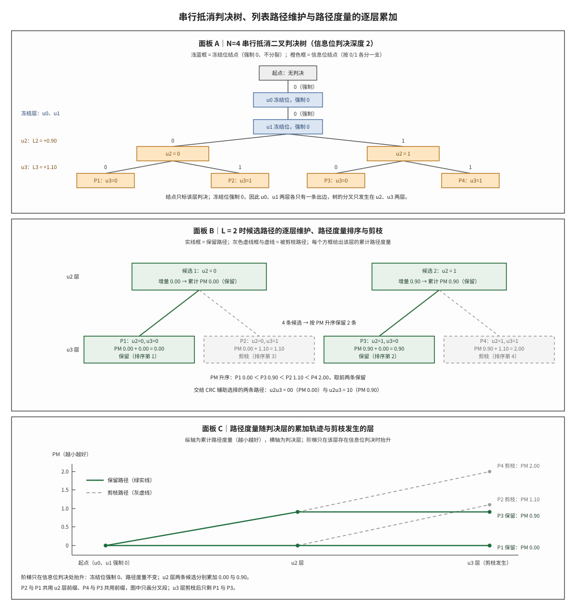

# SCL Decoding SCL 列表译码

## 符号与记号约定
| 符号 | 含义与取值 | 协议锚点 |
|:---|:---|:---|
| $N$ | 母码码长，取 2 的整数次幂；本文手算例取 $N=4$。NR 的极化码（Polar code）由协议码表限定在最大码长 1024 以内 | TS 38.212 §5.3.1 |
| $L$ | 列表大小（list size），即同时保留的候选路径条数，$L\ge1$；$L=1$ 退化为串行抵消，NR 工程常用 $L=8$ | 非 3GPP 标准（列表大小属接收机实现参数） |
| $n$ | 极化层数，$n=\log_2 N$；$N=4$ 时 $n=2$。判决树的层数并不等于 $n$，它等于位数 $N$ | TS 38.212 §5.3.1 |
| $i$ | 位序号，取 $0$ 到 $N-1$，按编码器输入比特的顺序编号 | TS 38.212 §5.3.1.2 |
| $\mathcal{A}$ | 信息位集合（information set），由子信道可靠性排序选出；本文手算例取 $\mathcal{A}$ 为集合 $\{2,3\}$ | TS 38.212 §5.3.1.2 |
| $W$ | 单个比特级子信道，把 0 或 1 映射为一个软输出；$W_N$ 为 $N$ 个子信道经极化变换合成的信道 | 非 3GPP 标准（信道模型） |
| $l$ | 候选路径编号，取 $1$ 到 $L$；它是路径的序号，不是位序号 | 非 3GPP 标准（路径编号属接收机实现） |
| $u_i$ | 编码器的第 $i$ 个输入比特，是信息比特与冻结比特的统称，取值 0 或 1 | TS 38.212 §5.3.1.2 |

**表 2｜译码产物、路径度量与递推函数**

| 符号 | 含义与取值 | 协议锚点 |
|:---|:---|:---|
| $\hat{u}_i$ | 第 $i$ 位的译码判决结果，取 0 或 1；判决由 $L_i$ 的符号与冻结约定共同给出，沿路径逐位累积成候选比特串 | 非 3GPP 标准（译码判决属接收机实现） |
| $b$ | 某个信息位上的候选比特，取 0 或 1；一次分裂同时产生 $b=0$ 与 $b=1$ 两个候选 | 非 3GPP 标准（译码判决属接收机实现） |
| $y$ | 接收端在速率恢复（rate recovery）之后得到的软值序列，长度对应母码码长 | 非 3GPP 标准（接收软值） |
| $L_i$ | 第 $i$ 位判决时该路径上的对数似然比（log-likelihood ratio, LLR），实数；正值偏向判 0、负值偏向判 1，绝对值表示可信程度 | 非 3GPP 标准（LLR 定义属接收机实现） |
| $\beta$ | 部分和比特（partial sum），取 0 或 1，是 $g$ 函数的第三个自变量，由已判决位算出 | 非 3GPP 标准（SCL 递推中间量） |
| $PM_l$ | 第 $l$ 条候选路径的路径度量（path metric），非负实数，是负对数似然意义上的惩罚量；**本文约定越小越好**，根结点处取 0 | 非 3GPP 标准（路径度量属接收机算法） |
| $\Delta PM$ | 单次信息位判决给路径度量带来的增量，非负实数，逐位累加 | 非 3GPP 标准（路径度量属接收机算法） |
| $f$ | 串行抵消的左侧 LLR 递推函数，输入两个 LLR，输出一个 LLR，不需要判决反馈 | 非 3GPP 标准（串行抵消递推属接收机算法） |
| $g$ | 串行抵消的右侧 LLR 递推函数，输入两个 LLR 与一个部分和比特，判决反馈参与运算 | 非 3GPP 标准（串行抵消递推属接收机算法） |
| $L_a$、$L_b$ | $f$ 与 $g$ 的两个输入 LLR，分别来自上支与下支 | 非 3GPP 标准（消息记号） |
| $e$ | 自然对数的底，$e\approx2.71828$；路径度量的精确式与近似式都由它导出 | 教科书（自然对数底） |

运算符与记号惯例：

1. **两套 L 记号的分工**：列表大小写作 $L$，不带下标；第 $i$ 位的对数似然比写作 $L_i$，恒带位索引下标。二者字形相近而含义无关，公式中出现带下标者一律指 LLR；若某文献用 $\lambda$ 或 $\Lambda$ 表示 LLR，对应关系是 $\lambda=L_i$。
2. **路径度量的方向**：本库统一取负对数似然为路径度量，因此 $PM_l$ 只增不减、越小越好。若某文献把度量定义为似然的对数并取越大越好，剪枝方向随之反转，两套约定下的数值不能直接比较。
3. **候选比特与硬判决**：$b$ 是分裂时试探的取值；硬判决由 $L_i$ 的符号给出，$L_i>0$ 判 0、$L_i<0$ 判 1，$L_i=0$ 时两分支等可能、增量相同。$b$ 与硬判决一致时增量取小值，不一致时取大值，这是近似式只需比较符号与绝对值的依据。
4. **上下标的语义**：$u_i$ 的下标是位序号，不是相乘；$PM_l$ 的下标是路径编号，不是层号；$\mathcal{A}^{c}$ 的上标表示集合的补，不是幂次。
5. **增量与累计量**：$\Delta PM$ 是单步增量，$PM_l$ 是逐步累加的累计量，两者量纲相同；累加只发生在信息位，冻结位不产生增量。
6. **函数记号**：$f$ 与 $g$ 的下标表示所在层，不表示第几个比特；$g$ 依赖的部分和比特 $\beta$ 由同一条路径上已判决的位算出，不同路径的 $\beta$ 可以不同。

还有三类写法需要补注。其一是具体下标：手算例中的 $u_0$、$u_1$、$u_2$、$u_3$ 与通式 $u_{N-1}$ 都是 $u_i$ 在特定位上的写法，$L_0$、$L_1$、$L_2$、$L_3$ 同理是 $L_i$ 的下标实例，符号表不逐条列举这些实例。其二是复杂度记号：$O(\cdot)$ 表示随括号内变量增长的渐近上界，只用于比较 $L$ 与 $N$ 的量级，不给出常数与精确次数。其三是对数的底：路径度量公式中的 $\ln$ 以 $e$ 为底，单位是 nat，换成以 2 为底只改变数值尺度、不改变排序。

一句话本质：**SCL 把一个逐位贪心的判决器改造成宽度为 $L$ 的树搜索器——每个信息位把候选集合从 $L$ 条扩到 $2L$ 条，再按路径度量排序截回 $L$ 条。**

SCL（逐次消除列表译码，Successive Cancellation List）位于 NR 控制信道接收链的速率恢复之后、循环冗余校验（Cyclic Redundancy Check, CRC）辅助选择（CRC-aided SCL, CA-SCL）之前。它不改变极化码的编码结构，只改变接收端在判决树上的搜索方式：从「每条路径只走一步、判决不可回退」变成「同时维护 $L$ 条路径、每层按度量淘汰」。下文先补齐六个前置对象，再把路径度量的更新式在 $N=4$、$L=2$ 的例子上逐步算出，最后讨论列表大小的工程含义与若干边界情形。
## 解释目标与范围

本节目标：解释逐次消除列表译码（Successive Cancellation List, SCL）如何在极化码的串行抵消判决树上维护 $L$ 条候选路径，说明路径度量（Path Metric, PM）的更新式、排序剪枝规则与列表大小 $L$ 的工程含义，划清 $L=1$ 退化为串行抵消（Successive Cancellation, SC）的条件，并用 $N=4$、$L=2$ 的手算例给出逐层度量与最终判决。

## 前置概念

极化码（Polar code）是本笔记讨论的码本身，它利用信道极化把 $N$ 个相同的子信道合成为一批可靠度分化的比特信道，再把信息放在可靠的那一部分上、其余固定为 0；码长只能取 2 的整数次幂，可靠性排序由协议给定的固定序列确定。信道极化的推导与蝶形结构见 [[Channel_Polarization_信道极化]]，码结构与信息位选取见 [[Polar_码]]。

串行抵消（Successive Cancellation, SC）是 Polar 码的基准译码器：它按位序从 $u_0$ 到 $u_{N-1}$ 逐位判决，第 $i$ 位的判决依赖此前所有位的判决结果，判决一旦给出就不再修改。这个「依赖前序、不可回退」的结构决定了树的形状——每一位对应树的一层，层内没有横向回溯，错误只能沿分支向下传播；逐位递推的完整推导见 [[T10.4_Polar_SC_decoding]]。

路径度量（Path Metric, PM）是候选路径的排序键，定义为该路径上已判决比特的负对数似然累加，物理含义是「这条路径与接收软值的不一致程度」，因此越小越好。它把整条路径的可靠性压缩成一个实数，使不同分支之间可以比较大小；LLR 本身的符号与幅度语义见 [[LLR_对数似然比]]，量化与饱和处理见 [[LLR_Quantization_LLR量化]]。

列表译码（list decoding）是一类把「只保留一个最优解」放宽为「保留若干个候选解」的通用策略：搜索过程中维持一个大小有界的候选集合，每步扩张后按评分截断，最终由外层准则在幸存者中挑选。SCL 是它在 Polar 码判决树上的具体形态，而外层准则通常交给 CRC，见 [[CA_SCL_CRC辅助SCL]]。

冻结位（frozen bit）是发送端与接收端事先约定取值的位，通常固定为 0，不承载信息；在判决树上它只有一条出边，接收端直接写入约定值，既不分裂也不更新路径度量。冻结位在 NR 中承担双重职责，既是可靠度排序淘汰下来的位置，也是 CRC 校验位与辅助比特的落点。

CRC 辅助选择（CRC-aided selection）是把循环冗余校验（Cyclic Redundancy Check, CRC）当作候选路径的硬检错边界：SCL 输出 $L$ 条候选后，按路径度量升序逐条做 CRC 检查，输出第一条通过者。它解决的是「软度量会被骗」的问题——度量最小的路径不一定正确，CRC 提供的是与度量独立的判据，校验多项式见 [[CRC_循环冗余校验]]。

## 起源与演进

上述六个对象不是同时出现的，它们按「暴露缺陷、提出对策、补上判据、进入标准」的顺序进入工程实践，下面按这一顺序把它们串起来。

(1) **起点：串行抵消的不可回退性。** Polar 码在 2008 年由 Arikan 提出时配套的译码器是 SC，它按位序逐位判决、判决不再修改。逐位贪心的代价是错误传播：只要某个信息位被判错，其后所有位的 LLR 递推都建立在错误的部分和之上，即使后文的软值证据很强也无法纠正。有限码长下这一损失尤其明显，SC 在短码上的性能明显落后于最大似然译码。

(2) **解法：把一条路径换成一组路径。** 2011 年 Tal 与 Vardy 提出列表译码：每个信息位不再只取硬判决，而是沿 0 与 1 两个方向各走一步，候选集合从 $L$ 条扩张为 $2L$ 条，再按路径度量排序保留最小的 $L$ 条。这样正确路径只要在某一步没有被度量淘汰，就仍有机会在后续层被证明是最优的；把「选一条」改成「保留 $L$ 条」，代价是 $L$ 倍的计算与存储。

(3) **配套：CRC 作为最终判据。** 单纯按度量取最小值仍然会错，因为度量是软量。把 CRC 校验比特与信息比特一起编码，接收端在 $L$ 条幸存路径中按度量升序逐条核查，输出第一条通过者，就得到 CRC 辅助的 SCL（CA-SCL）。$L=8$、CRC 长度 11 至 24 bit 的组合在短码上已接近最大似然译码的性能，这是列表译码从论文走向工程的关键一步。

(4) **工程化：NR 的两代对照。** LTE 的控制信道不使用 Polar 码，PDCCH 采用咬尾卷积码、部分上行控制格式采用分组码，接收端没有列表译码这一级。NR 在 3GPP 无线接入网第一工作组（RAN1）2016 年至 2017 年的 eMBB 信道编码选型中确定控制信道采用 Polar 码，并把 CRC 辅助的列表译码写进实现参考：$L$ 取 8、按度量升序逐条核查 CRC、命中即停。同一时期的数据信道改用 LDPC，两条链路的译码范式由此分开。

(5) **边界：协议与实现的分工。** 协议规定的是码结构——极化序列、信息位集合的确定规则、CRC 多项式与速率匹配；列表大小、度量公式与排序实现都属于接收机内部选择，不同厂商可以用不同的 $L$ 与不同的近似式。因此本笔记讨论的 SCL 与 PM 公式是算法层的对象，不是协议条文。

## 科学定义

上一节给出的是六个对象的口头定义，本节把它们写成可运算的形式。三个小节依次处理三件事：判决树与候选路径集合如何构成，路径度量如何更新并用一个完整手算例走完，以及复杂度、退化关系与工程取值如何决定 $L$；三节之间是递进关系——先有树的形状，才有路径集合，有了集合与度量才谈排序剪枝，最后才谈代价与取值。

### 判决树与候选路径集合的构成

判决树按位序逐层展开，第 $i$ 层对应第 $i$ 个输入比特 $u_i$。根结点是空状态，代表「尚未判决任何位」；从第 $i$ 层的结点出发，走向第 $i+1$ 层的边标注该位的取值 0 或 1。若 $i\in\mathcal{A}^{c}$ 是冻结位，该层只有一条出边（标注约定值 0），所有路径共用这一步；若 $i\in\mathcal{A}$ 是信息位，该层分出 0 与 1 两条边。$N=4$、$\mathcal{A}=\{2,3\}$ 时，树的形状是：根之后是 $u_0$、$u_1$ 两层单链，$u_2$ 层首次分叉，$u_3$ 层再次分叉，最终得到 $2^{2}=4$ 条叶边。这个形状是本笔记配图的面板 A，也是后面所有路径编号的来源。

候选路径是树上的一条部分路径，记作已判决比特串 $\hat{u}_0,\dots,\hat{u}_{i-1}$；它携带三样东西：已判决比特、当前位置的 LLR 状态、以及累计路径度量。第 $i$ 层判决前，集合里最多有 $L$ 条路径；判决时每条路径按 $b=0$ 与 $b=1$ 各扩张一次，得到至多 $2L$ 条候选，随后按度量排序保留 $L$ 条，其余整条丢弃。这里的 LLR 状态不是一次算好就固定不变的：每条路径的 $\beta$ 序列不同，下一层的 $L_i$ 必须用该路径自己的部分和重新递推，$f$ 与 $g$ 承担这一步。$g$ 的精确式是带符号的相加：

$$g(L_a,L_b,\beta)=(-1)^{\beta}L_a+L_b$$

$f$ 的精确式要用反双曲正切表示，工程上改用「取两个绝对值中的较小者、符号取两者之积」的近似，即逐符号的 min-sum 形式。两个函数只决定「下一位的 LLR 是多少」，不参与剪枝；剪枝只看路径度量。

### 路径度量的更新式与一次完整手算

路径度量定义为已判决比特的负对数似然累加，$PM_l=-\ln P(\hat{u}_0,\dots,\hat{u}_{i-1}\mid y)$，在根结点取 0。逐位展开后，第 $i$ 位的增量只与候选比特 $b$ 和该位的 LLR 有关：

$$\Delta PM(b,L_i)=\ln\left(1+\exp\left(-(1-2b)L_i\right)\right)$$

$$PM_l := PM_l+\Delta PM(b,L_i)$$

把 $b=0$ 与 $b=1$ 分别代入可以看出增量的形状：$b=0$ 时为 $\ln\left(1+\exp(-L_i)\right)$，$b=1$ 时为 $\ln\left(1+\exp(L_i)\right)$，两者都非负，且与硬判决一致的那一侧更小。工程上进一步近似为「一致则增量为 0、不一致则增量为 $|L_i|$」，因为 $\ln\left(1+\exp(-|L_i|)\right)$ 随 $|L_i|$ 增大迅速趋零、$\ln\left(1+\exp(|L_i|)\right)$ 迅速趋近 $|L_i|$；这一近似只需要比较符号并取绝对值，是硬件实现的主流写法。冻结位不分裂、不更新度量，直接写入约定值，因此它在树上只贡献一层深度，不贡献分支。

手算例取 $N=4$、$\mathcal{A}=\{2,3\}$、$\mathcal{A}^{c}=\{0,1\}$、$L=2$，四位 LLR 为 $(L_0,L_1,L_2,L_3)=(-0.4,\,2.5,\,0.9,\,1.1)$，采用「一致为 0、不一致为 $|L_i|$」的近似式。$u_0$ 与 $u_1$ 是冻结位，强制取 0，路径度量保持 0.00，这两位的 LLR 虽然算得出来却不参与判决，也不进入度量。$u_2$ 是信息位，$L_2=0.9>0$ 故硬判决为 0：候选 $b=0$ 的增量为 0.00、候选 $b=1$ 的增量为 0.90，候选集合由此扩为两条，恰好等于 $L$，本层没有剪枝。$u_3$ 是信息位，$L_3=1.1>0$ 故硬判决仍为 0：两条路径各自再分裂，四条候选的累计度量为 0.00、1.10、0.90、2.00，按升序排定名次后保留前两条，其余两条连同其全部前缀一起丢弃。

| 路径 | 第 3 位判决 $u_2$ | 第 4 位判决 $u_3$ | 累计路径度量 | 排序 | 处置 |
|:---|:---|:---|:---|:---|:---|
| P1 | 0（增量 0.00） | 0（增量 0.00） | 0.00 | 第 1 | 保留 |
| P3 | 1（增量 0.90） | 0（增量 0.00） | 0.90 | 第 2 | 保留 |
| P2 | 0（增量 0.00） | 1（增量 1.10） | 1.10 | 第 3 | 剪枝 |
| P4 | 1（增量 0.90） | 1（增量 1.10） | 2.00 | 第 4 | 剪枝 |

剪枝决策的依据是排序后的名次而不是父子关系：P3 的分支来自 $u_2=1$ 这条路径，它的名次高于 P2 的 $u_2=0$ 分支，因此在 $u_3$ 层被保留，而 P2 虽然父路径在上一层排名第一，仍被整条删除。这正是列表译码与逐位贪心的本质区别——父路径的优劣不能保证子路径的优劣，度量必须在完整的已判决比特串上比较。最终 SCL 交出两条幸存路径：比特串 $u_2u_3=00$（$PM=0.00$）与 $u_2u_3=10$（$PM=0.90$）；若没有 CRC，按度量最小取 P1，若有 CRC，则按度量升序逐条核查、输出第一条通过者。

用精确式复核同一组数据可以确认近似的合理性：$u_2$ 步两条增量分别为 $\ln\left(1+\exp(-0.90)\right)=0.3412$ 与 $\ln\left(1+\exp(0.90)\right)=1.2411$，$u_3$ 步为 $\ln\left(1+\exp(-1.10)\right)=0.2874$ 与 $\ln\left(1+\exp(1.10)\right)=1.3873$，四条路径的精确度量为 0.6286、1.5286、1.7285、2.6285。精确式的排序与近似式完全一致，保留集合也相同，差别只在数值大小：近似式把「一致」一侧压成零，使度量阶梯呈水平段，精确式则每一步都严格抬升。两者不必然给出同一排序，在大 $|L_i|$ 时趋于一致，在小 $|L_i|$ 且名次接近时需要按精确式核对。

**图 1｜串行抵消判决树、$L=2$ 的候选路径维护与路径度量随层的累加。** 面板 A 给出 $N=4$、信息位集合 $\{2,3\}$ 的判决树：浅蓝结点是冻结位、只有一条强制为 0 的出边，橙色结点是信息位、分出 0 与 1 两条边，四条叶边依次对应候选路径 P1 至 P4，左侧标注各层的 LLR 取值。面板 B 逐层列出候选集合：$u_2$ 层两条候选恰好填满 $L=2$、无剪枝，$u_3$ 层分裂为四条后按累计度量升序保留 P1（0.00）与 P3（0.90），被剪枝的 P2（1.10）与 P4（2.00）以灰色虚线框与虚线连接表示。面板 C 把四条路径的度量画成随层累加的阶梯：冻结位不抬升，$u_2$ 层两条候选分别累加 0.00 与 0.90，$u_3$ 层的分叉段以虚线标出，剪枝发生的层即横轴的最后一列。

### 复杂度、退化关系与工程取值

$L=1$ 时集合里只有一条路径，每层扩张出的两个候选按度量取小者，等价于直接采纳硬判决，SCL 退化为 SC；这说明列表译码并没有引入新的判决规则，它只是把 SC 的「唯一路径」放宽成「有界集合」。$L$ 增大时，正确路径在某一层被误删的概率下降，因此误块率通常随 $L$ 单调不增；但增益会饱和，$L$ 从 1 增到 8 的改善最明显，从 8 增到 32 的改善在短码上已经很小。工程取值因此停在 $L=8$ 附近，NR 控制信道的实现参考也以 8 为典型值。

代价随 $L$ 近似线性增长：每条路径各需一套 LLR 状态与部分和存储，$f$ 与 $g$ 的调用次数、路径复制带宽、以及每层对 $2L$ 个度量的排序都与 $L$ 成正比。完整保留 $N$ 个 LLR 需要每路径 $O(N)$ 的存储，逐层重算则用时间换空间；排序每层至多做一次，可用部分选择代替全排序，把 $O(L\log L)$ 降到 $O(L)$。整体复杂度为 $O(LN\log N)$，其中 $\log N$ 来自 $f$ 与 $g$ 的递推层数，这个量级决定了 $L$ 不能取得太大。

工程链路上 SCL 之后还有一步：递交给 CRC 辅助选择。这一步把「度量排序」与「硬检错」分开——SCL 负责产出 $L$ 条高质量候选，CA-SCL 负责在其中挑出唯一输出；若正确路径已在剪枝时被删除，CRC 检查根本看不到它，所以列表大小与 CRC 长度必须一起设计。以上讨论的度量公式、排序方式与 $L$ 的取值都是接收机实现选择，协议只规定码结构与 CRC 多项式，这一点在协议锚点一节给出了条文位置。

## 直观模型

上一节把判决过程写成了「集合扩张再截断」的代数规则；把同一件事放到搜索空间里看，它就是一次有界的逐层树搜索。

从搜索的角度看，SCL 是在一棵按位分层的树上做有界宽度的逐层扩张。搜索状态是「层号加上已判决比特串」，转移是该位取 0 或取 1，代价是这一步的路径度量增量；每一层先把每个状态的转移全部展开，再把展开后的集合按累计代价排序，只留下代价最小的 $L$ 个状态进入下一层。树的深度是位数 $N$，宽度上界是 $L$，搜索因此既不是深度优先（不会一条路走到底），也不是穷举（不会保留全部 $2^{|\mathcal{A}|}$ 条路径），而是「逐层扩张、按代价截断」。

从集合的角度看，SCL 维护的是一个大小有界且始终有序的候选集合。集合的规模在每层先乘 2 再截回 $L$：扩张保证了正确路径只要还没被淘汰就仍在集合内，截断保证了规模可控；排序键是累计路径度量，截断规则是保留最小的 $L$ 个。冻结位层不扩张也不截断，集合原样传递，因此树的实际分叉次数只等于信息位个数。$L$ 取 1 时集合退化为单元素，截断退化为取小，整个过程回到 SC；$L$ 取到不小于 $2^{|\mathcal{A}|}$ 时截断不再发生，搜索退化为穷举，性能上界是最大似然译码。

## 常见误解

以上是机制的正向描述，工程讨论中反复出现的若干反向说法需要逐条对照，其中首行针对度量的方向、末行针对近似式的适用范围。

| 误解 | 正确理解 |
|:---|:---|
| 路径度量越大越好 | 本文约定度量为负对数似然的累加，越小越好；方向反了剪枝会保留最差的 $L$ 条。 |
| 冻结位也要分裂并更新度量 | 冻结位强制取约定值，只有一条出边，既不分裂也不产生度量增量。 |
| 列表大小 $L$ 越大性能必然越好 | 误块率随 $L$ 单调不增但增益饱和，而计算、存储与复制带宽近似线性增长，工程取值停在 8 附近。 |
| 路径度量最小的路径一定输出 | 最终输出由 CRC 决定；度量最小的路径可能过不了 CRC，此时按度量升序顺延。 |
| SCL 与 SC 的差别只在最后选哪条路径 | 差别在每一层的候选集合大小：SC 每层只有一条路径，SCL 每层保留 $L$ 条，剪枝发生在中途而不是结尾。 |
| SCL 是 3GPP 规定的译码算法 | 协议只规定极化序列、信息位集合规则、CRC 与速率匹配；$L$、度量公式与排序实现属接收机选择。 |
| 近似式与精确式必然给出同一保留集合 | 二者只在度量数值上接近，名次接近时可能给出不同排序；本文手算例恰好一致，不能据此认为一般成立。 |

边界情形有三处值得单独说明。其一是并列度量：当两条候选的累计度量完全相等时，排序需要稳定的次定规则（例如按比特串字典序），否则实现之间会出现不确定的输出，而 CRC 通过与否又依赖这个顺序。其二是列表容量超过路径总数：信息位很少或 $L$ 很大时，$2^{|\mathcal{A}|}$ 可能小于 $L$，此时截断不发生，$L$ 再增大也不改变结果，浪费的只是存储。其三是冻结位的 LLR：冻结位仍然要参与 $f$ 与 $g$ 的递推以得到后续位的 LLR，只是它自身的取值不由 LLR 决定、也不进入度量，把「不判决」误解为「不计算」会导致后续层的 LLR 全错。

## 协议锚点

机制、度量与边界都讨论完之后，回到条文确认哪些是协议规定、哪些是实现选择。

- TS 38.212 §5.3.1 Polar coding、§5.3.1.2 Polar encoding：决定极化序列、信息位集合与冻结位集合的确定规则，因而决定判决树的形状与每层是否分叉。本地：`3GPP_Rel19/processed/TS_38.212_38212-j30/content.md` 行 815-943；极化序列以最大码长 1024 给出，见同文件 `full.md` 行 977。
- TS 38.212 §5.4.1 Polar rate matching（§5.4.1.1 子块交织、§5.4.1.2 比特选择）：译码前速率恢复的协议依据，决定送进 SCL 的软值序列长度与位置。本地：`content.md` 行 1019-1125。
- TS 38.212 §5.1 CRC calculation：CRC 多项式与长度条件，决定 CA-SCL 的检错边界。本地：`content.md` 行 637-657。SCL 的列表大小、路径度量公式与排序方式为非 3GPP 标准的接收机算法。
- 讲义：`docs/L2_协议算法/T10.5_Polar_SCL_decoding.md`；串行抵消的基础推导见 `docs/L2_协议算法/T10.4_Polar_SC_decoding.md`；CRC 辅助选择见 `docs/L2_协议算法/T10.6_CRC_aided_SCL_control_reliability.md`。

## 关键要点

把全文压缩成七条可复核的结论，其中第 3、4 条正是手算例用到的更新式与排序规则。

1. SCL 在每个信息位把候选集合从 $L$ 条扩张到 $2L$ 条，再按路径度量升序截回 $L$ 条。
2. 路径度量是已判决比特的负对数似然累加，本文约定越小越好；冻结位不分裂、不产生增量。
3. 精确增量为 $\ln\left(1+\exp\left(-(1-2b)L_i\right)\right)$，工程近似为「与硬判决一致取 0、不一致取 $|L_i|$」。
4. 剪枝按完整比特串的累计度量排序，父路径排名靠前不能保证子路径被保留。
5. $L=1$ 退化为 SC；NR 工程常用 $L=8$，复杂度约 $O(LN\log N)$、存储随 $L$ 线性增长。
6. 度量最小的路径不保证输出，最终由 CRC 辅助选择按度量升序核查决定；正确路径一旦被剪枝，CRC 也找不回来。
7. SCL 的列表大小与度量公式属接收机实现选择，协议只规定码结构与 CRC。

## 图谱关联

- [[Channel_Polarization_信道极化]]
- [[Polar_码]]
- [[CA_SCL_CRC辅助SCL]]
- [[CRC_循环冗余校验]]
- [[LLR_对数似然比]]
- [[LLR_Quantization_LLR量化]]
- [[PDCCH_物理下行控制信道]]
- [[概念图谱入口]]
- [[T10.5_Polar_SCL_decoding]]
- [[T10.4_Polar_SC_decoding]]
- 关系语义：SCL 在 Polar 码的判决树上维护 $L$ 条候选路径，向上承接信息位/冻结位集合与 LLR 递推，向下把候选交给 CA-SCL 做最终选择。
