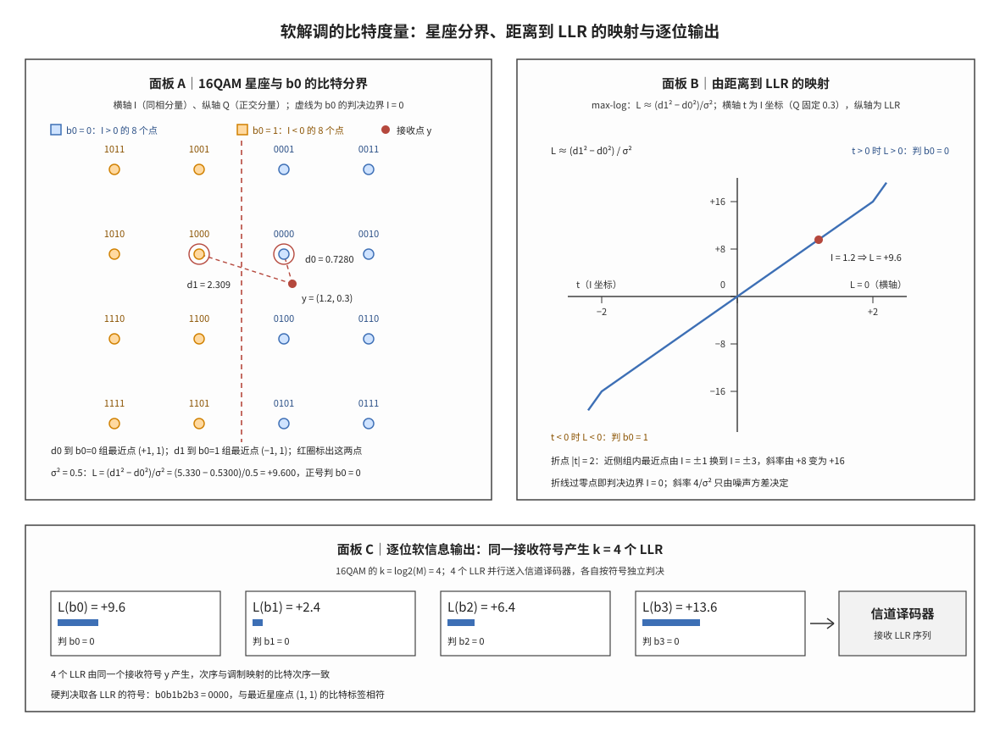

# 软解调

## 符号与记号约定

本节先于全文任何公式固定符号与运算符的写法，后文遇到不熟悉的符号可回到此处查表，正文不再逐处重复解释。表中「含义与取值」一列同时给出物理意义与取值来源，便于与数值例逐项对照；「协议锚点」一列按三类给出出处：协议量写 TS 38.211 的条款，派生量写「由 §5.1.4 导出」，非协议量标「非 3GPP 标准」或「教科书」，使每个符号都能追到定义它的文本或明确其实现域属性。

| 符号 | 读法 | 含义与取值 | 协议锚点 |
|:---|:---|:---|:---|
| $M$ | M | 调制阶数，即星座点个数；16 阶正交幅度调制（16-Quadrature Amplitude Modulation, 16QAM）取 $M=16$，64QAM 取 $M=64$ | TS 38.211 §5.1.4（16QAM）、§5.1.5（64QAM） |
| $k$ | k | 一个调制符号承载的编码比特数，$k=\log_2 M$；16QAM 取 $k=4$ | 由 §5.1.4 导出（每符号比特数） |
| $i$ | i | 比特在一个调制符号内的序号，取 $i=0,1,\dots,k-1$，从最高位起编号 | TS 38.211 §5.1.4（符号索引） |
| $b_i$ | b 下标 i | 第 $i$ 个编码比特，取 0 或 1；数值例用 $b_0$、$b_1$、$b_2$、$b_3$ 四个比特 | TS 38.211 §5.1.4（四元组的四个比特） |
| $y$ | y | 接收端均衡后的复基带符号，由发送星座点叠加噪声得到；数值例取 $y=(1.2,0.3)$ | 非 3GPP 标准（接收机观测） |
| $s$ | s | 星座点的复坐标，取自 $I$ 与 $Q$ 各属于 $\{-3,-1,+1,+3\}$ 的 16 个组合 | TS 38.211 §5.1.4（星座点取值） |
| $I$ | I | 同相分量（in-phase），接收符号或星座点的实部；数值例 $I=1.2$ | TS 38.211 §5.1.4（复符号实部） |
| $Q$ | Q | 正交分量（quadrature），接收符号或星座点的虚部；数值例 $Q=0.3$ | TS 38.211 §5.1.4（复符号虚部） |
| $\mathcal{S}_{i,0}$ | S 下标 i 零 | 第 $i$ 个比特取 0 的全部星座点组成的集合，16QAM 下含 $M/2=8$ 个点 | 由 §5.1.4 导出 |
| $\mathcal{S}_{i,1}$ | S 下标 i 一 | 第 $i$ 个比特取 1 的全部星座点组成的集合，同样含 $M/2=8$ 个点 | 由 §5.1.4 导出 |
| $d$ | d | 接收点到某个星座点的欧氏距离，取非负实数；$d^2$ 是复平面上两点差的模平方，也是距离形式的输入 | 非 3GPP 标准（欧氏距离） |
| $d_0$ | d 下标 零 | 接收点到 $\mathcal{S}_{i,0}$ 的最近欧氏距离（Euclidean distance），即组内各点距离的最小值；其平方 $d_0^2$ 进入距离差 | 由 §5.1.4 导出 |
| $d_1$ | d 下标 一 | 接收点到 $\mathcal{S}_{i,1}$ 的最近欧氏距离，同样是组内最小值；其平方 $d_1^2$ 与 $d_0^2$ 相减得到 LLR | 由 §5.1.4 导出 |
| $\sigma^2$ | sigma 方 | 噪声方差，按复基带总方差口径：每个实维方差为 $\sigma^2/2$，高斯密度写作 $\exp(-d^2/\sigma^2)$，故距离差除以 $\sigma^2$ 得 LLR；数值例取 $\sigma^2=0.5$。单维调制例外，该维方差即 $\sigma^2$ | 非 3GPP 标准（噪声方差口径） |
| $L(b_i)$ | L 括号 b 下标 i | 第 $i$ 个比特的对数似然比（Log-Likelihood Ratio, LLR），无量纲实数，取值 $(-\infty,+\infty)$；符号定判决方向，幅度定可靠度 | 由 §5.1.4 导出；LLR 定义属实现域 |
| $P$ | P | 概率，取 $[0,1]$；条件概率写作 $P(b_i=0\mid y)$ | 教科书（概率论） |
| $z_i$ | z 下标 i | 对数求和式中第 $i$ 项的指数，$z_i=-d^2/\sigma^2$，$s$ 遍历某个比特子集 | 由 §5.1.4 导出（最大对数近似的指数项） |
| $t$ | t | 面板 B 的横轴，接收点的 $I$ 坐标；该面板把 $Q$ 固定为 0.3，使 $t$ 与一对距离一一对应 | 非 3GPP 标准（面板 B 绘图变量） |
| $\ln$、$\exp$、$e$ | 自然对数、指数、自然对数底 | 精确 LLR 的分子分母是似然求和，求和项以 $e$ 为底，取 $\ln$ 后表现为 log-sum-exp 结构 | 教科书（数学记号） |
| $\sum$、$\min$、$\max$ | 求和、取最小、取最大 | 下标只表示遍历范围；$\min_{s\in\mathcal{S}_{i,0}}$ 表示在集合内取最小，不进入被取最小的量本身 | 教科书（数学记号） |

运算符与书写约定如下。全文的对数一律取自然对数，底为 $e$；换底只改变 LLR 的绝对尺度，不改变符号与判决，跨文献比较数值前必须先确认底。上下标的语义固定：下标表示序号或归属（$b_i$ 是第 $i$ 个比特，$\mathcal{S}_{i,0}$ 是该比特取 0 的点集），上标表示乘方（$\sigma^2$ 是方差，$d_0^2$ 是距离的平方）。绝对值符号 $|y-s|$ 表示复平面上的欧氏距离，只含幅度、不含相位。两个最近距离按 $d_0=\min_{s\in\mathcal{S}_{i,0}}|y-s|$ 与 $d_1=\min_{s\in\mathcal{S}_{i,1}}|y-s|$ 计算，即在各自的点集内取距离的最小值；$d_0^2$ 与 $d_1^2$ 是这两个距离的平方，主公式中使用的是平方而不是距离本身。

噪声方差的口径需要单独说明，因为同一个符号在不同文献里可能指不同的量。本笔记把 $\sigma^2$ 记为复基带噪声的总方差：每个实维的方差是 $\sigma^2/2$，高斯密度按 $\exp(-|y-s|^2/\sigma^2)$ 计算，于是距离差到 LLR 的换算式中分母为 $\sigma^2$。若某文献把每个实维的方差记作 $\sigma^2$，同一式子写作 $L\approx(d_1^2-d_0^2)/(2\sigma^2)$；两种写法数值完全一致，差别只在 $\sigma^2$ 的定义。全文与配图均按前一种口径解释。

符号固定之后，本笔记的主题可以一句话概括：软解调（Soft Demodulation）把接收符号 $y$ 换算成每个编码比特的一个实数，这个实数是对数似然比（Log-Likelihood Ratio, LLR）。一句话本质：**软解调是在星座几何上按比特分组比较距离、再把距离差换算成带符号实数的过程——符号给出该比特的判决，绝对值给出该判决的可靠程度，译码器由此同时得到判决与可信度。**

硬判决在输出 0 或 1 的那一刻就把「有多确定」丢掉了，译码器只能把每个比特同等对待；软解调把同一批接收样本换算成 $k=\log_2 M$ 个实数，判决与可靠度一并交出。本笔记先固定符号与前置对象，再给出逐比特 LLR 的精确式与最大对数近似，用一个 16QAM 的手算例把 $d_0$、$d_1$ 与 $L(b_0)$ 算到小数点后三位，最后划清精确式与近似式的差别、判决边界附近的行为，以及协议规定与接收机实现之间的边界。

## 独立解释任务

任务目标：解释软解调如何把接收符号 $y$ 换算成逐比特 LLR，说明精确式为何要对两个比特子集分别求和、最大对数近似为何可以用两次最近点搜索替代指数求和，给出 16QAM 的 $b_0$ 在给定接收点与给定噪声方差下的完整手算过程，并交代该过程在 LTE/NR 译码链路中的位置——均衡器之后、信道译码器之前，输出即译码器直接消费的 LLR 序列。

## 前置概念

本节列出后文反复使用的六个对象。若已熟悉星座、格雷映射、欧氏距离、噪声方差、软判决与最大对数近似，可直接跳到「科学定义」；若某一节读不通，多半是本节某个对象尚未建立。

星座（constellation）是调制方式为全部可能发送符号规定的复平面位置集合。16QAM 把 4 个比特映射为 16 个点，同相分量与正交分量各取四个幅度，两类取值的组合构成一个 $4\times4$ 的方形格点阵，相邻点在每个坐标轴上相距 2 个单位。数值例使用未归一化的整数坐标，38.211 的映射另乘归一化因子（16QAM 为 1/√10）；噪声方差必须按同一坐标系的单位给出，否则 LLR 的绝对值不可比。星座的几何形状决定软解调的难度：点越密，同样的噪声越容易把接收点推过某个比特的判决边界；每个比特对应的两个点集越大，精确 LLR 的求和项也越多。参见 [[Modulation_Constellations_调制星座]]。

格雷映射（Gray mapping）是比特到星座点的一种排布约定：相邻星座点只相差一个比特。这一约定让一个符号错误通常只错一个比特，也让逐比特软解调可以独立进行——每个比特的两个点集都是若干整行或整列星座点的并集，判决边界因此退化为与坐标轴平行的直线或直线的组合。本笔记与配图采用 38.211 的 16QAM 映射：实部与虚部分别写成 $I=(1-2b_0)\left[2-(1-2b_2)\right]$ 与 $Q=(1-2b_1)\left[2-(1-2b_3)\right]$，再乘归一化因子（16QAM 为 1/√10）。$b_0$ 决定 $I$ 的符号（$b_0=0$ 对应 $I>0$），$b_2$ 决定 $I$ 的幅度（$b_2=0$ 取内圈幅度 1、$b_2=1$ 取外圈幅度 3），$b_1$ 与 $b_3$ 以同样方式决定 $Q$。于是 $b_0$ 的判决边界是 $I=0$ 一条直线，$b_2$ 的判决边界是 $I=-2$ 与 $I=+2$ 两条直线。协议规定的映射表见 [[Modulation_Mapping_调制映射]]。

欧氏距离（Euclidean distance）是复平面上两点之间的直线距离，$|y-s|$ 由实部差与虚部差的平方和开方得到。软解调只用距离的平方：平方消去开方、保持远近次序，并且与高斯密度的指数项直接对应。距离的比较按比特分组进行——同一个接收点对每个比特要量两次，分别取到两个点集各自最近点的距离，两组各取一次最小值。

加性白高斯噪声（Additive White Gaussian Noise, AWGN）是接收建模的默认假设：$y=s+n$，噪声 $n$ 零均值、两个实维独立同分布、每维方差 $\sigma^2/2$。噪声方差是软解调唯一的链路参数，它不改变 LLR 的符号，只按 $1/\sigma^2$ 缩放幅度：方差被高估时 LLR 整体偏小，译码器对可靠比特的权重不足；被低估时则相反，软信息过强会让译码器过度相信个别比特。参见 [[AWGN_信道模型]]。

软判决（soft decision）指接收端保留每个比特的可靠度、输出实数而非 0 或 1；硬判决（hard decision）只输出 0 或 1，等价于对软信息取符号。两者在判决结果上往往一致，差别全在幅度上：同一组硬判决可能来自可靠度完全不同的两种接收状态。软判决相对硬判决的译码增益通常记为 2 至 3 dB，指的是达到同一误块率所需的信噪比之差，来源正是这部分被硬判决丢掉的幅度。参见 [[LLR_对数似然比]]。

最大对数近似（max-log approximation）是把对数和 $\ln\sum_i\exp(z_i)$ 用 $\max_i z_i$ 替代的近似。把它分别用在 LLR 的分子与分母上，指数求和就退化为在一个点集内找最近点，运算量从 $M/2$ 次指数运算降为两次最小值搜索。近似的代价是丢掉每侧的 log-sum-exp 修正项，该项恒为正，大小取决于该侧次近点与最近点的距离差；若某侧只有一个点，或各点距离相差悬殊，该项趋于 0，近似退化为恒等。二进制相移键控（Binary Phase Shift Keying, BPSK）每侧只有一个点，其闭式解因此不含任何近似误差。以上六个对象构成本笔记的全部前提；它们并非同时出现，而是在接收机从硬判决走向软判决的过程中被逐层引入。

## 起源与演进

(1) **起点：硬判决丢弃可靠度。** 早期接收机在解调后直接输出比特，判决由最近星座点给出，可信度随之丢弃，译码器拿到的是等权重的 0 或 1，无法区分「几乎确定」与「勉强判对」的比特。在相同的发送功率下，这种信息损失表现为译码所需信噪比的整体抬升，量级达到 2 至 3 dB。

(2) **软判决与 LLR 的引入。** 把每个比特的后验概率之比取对数，得到既有方向又有幅度的实数，这就是 LLR 的起点。LLR 的符号对应硬判决结果，绝对值对应两个假设概率的悬殊程度；取对数还带来一个运算上的好处——独立观测的似然相乘在对数域变成相加，软合并因此只需一次加法。

(3) **逐比特求和结构的建立。** 高阶调制下每个比特对应多个星座点，精确 LLR 必须对两个点集分别求和：分子遍历取 0 的全部点，分母遍历取 1 的全部点。这一步使 LLR 的计算量与调制阶数成正比，也解释了为什么 BPSK、QPSK 有闭式解，而 16QAM 以上只剩求和式。

(4) **最大对数近似与工程折中。** 把对数和换成组内最大值，求和式退化为两次最近点搜索，计算量与调制阶数近似无关，便于流水线实现。代价是丢掉 log-sum-exp 修正项，幅度出现偏差，低信噪比、每侧点数多时更明显，工程上常用固定尺度因子补偿。LTE 与 NR 在物理层规范里只规定调制映射与比特排列，NR 的映射表覆盖到 256QAM，LLR 的生成算法留给接收机实现，精确式与近似式因此长期并存。

## 科学定义

软解调的定义分三层：概率层的似然比、几何层的距离差、实现层的最近点搜索。以下三小节依次给出概率定义与两类闭式解、距离形式的近似式及其分段线性结构，最后用一个可以逐项复核的 16QAM 手算例把两层连接起来。

### 从二进制判决到逐比特对数似然比

设第 $i$ 个比特的两个竞争假设为该比特取 0 与取 1，软信息定义为两个后验概率之比的对数：

$$
L(b_i)=\ln\frac{P(b_i=0\mid y)}{P(b_i=1\mid y)}
$$

$L(b_i)>0$ 表示取 0 的证据更强，$L(b_i)<0$ 表示取 1 的证据更强，$L(b_i)=0$ 表示两者相当。硬判决就是对这个实数取符号，因此软解调比硬判决多出的正是绝对值这一维信息。

按贝叶斯公式把后验概率展开成似然与先验的乘积，分母上的观测概率在比值中抵消：

$$
L(b_i)=\ln\frac{P(y\mid b_i=0)}{P(y\mid b_i=1)}+\ln\frac{P(b_i=0)}{P(b_i=1)}
$$

先验等概时第二项为 0，LLR 退化为纯似然比。以下若不特别说明均按先验等概处理；先验不等概时只需在结果上加一个由先验比决定的常数偏置，符号与幅度的结构不变。

BPSK 只有实维，噪声方差就是 $\sigma^2$，两个星座点为 $s=+1$（比特 0）与 $s=-1$（比特 1）。把高斯密度代入上式，指数相除后取对数：

$$
L(y)=\ln\frac{\exp\left(-\frac{(y-1)^2}{2\sigma^2}\right)}{\exp\left(-\frac{(y+1)^2}{2\sigma^2}\right)}=\frac{(y+1)^2-(y-1)^2}{2\sigma^2}=\frac{2y}{\sigma^2}
$$

这是过原点的直线，斜率为 $2/\sigma^2$，符号与观测同号，判决边界为 $y=0$。正交相移键控（Quadrature Phase Shift Keying, QPSK）的 I、Q 两路各是一个单维的 BPSK，两路噪声独立、方差相同，故一个 QPSK 符号给出两个互不影响的 LLR，判决边界为 $I=0$ 与 $Q=0$ 两条直线。这两类调制每侧点集都只有一个点，上面的闭式解不含任何近似。

16QAM 及以上不再有闭式解。第 $i$ 个比特取 0 与取 1 的星座点各有 $M/2$ 个，精确 LLR 要对两个点集分别求和：

$$
L(b_i)=\ln\frac{\sum_{s\in\mathcal{S}_{i,0}}\exp\left(-\frac{|y-s|^2}{\sigma^2}\right)}{\sum_{s\in\mathcal{S}_{i,1}}\exp\left(-\frac{|y-s|^2}{\sigma^2}\right)}
$$

分子分母各是一次对数求和。式子的几何含义清楚：哪个点集里有更靠近 $y$ 的点，对应的似然和就大，LLR 的符号就指向那一侧。计算量落在求和项数上，16QAM 每侧 8 项、64QAM 每侧 32 项，直接实现要对每个比特做一遍指数运算。

### 距离形式与最大对数近似

把对数和用组内最大值替代，指数求和退化为在一个点集内找最近点。记 $z_i=-|y-s|^2/\sigma^2$，对分子分母各用一次近似：

$$
L(b_i)\approx\ln\frac{\max_{s\in\mathcal{S}_{i,0}}\exp\left(-\frac{|y-s|^2}{\sigma^2}\right)}{\max_{s\in\mathcal{S}_{i,1}}\exp\left(-\frac{|y-s|^2}{\sigma^2}\right)}=\frac{1}{\sigma^2}\left(\min_{s\in\mathcal{S}_{i,1}}|y-s|^2-\min_{s\in\mathcal{S}_{i,0}}|y-s|^2\right)
$$

把两个最小值分别记为 $d_0^2$ 与 $d_1^2$，得到全文使用的主公式：

$$
L(b_i)\approx\frac{d_1^2-d_0^2}{\sigma^2}
$$

符号由两个距离的大小关系直接给出：$d_1<d_0$ 时分子为负，$L(b_i)<0$，判 1；$d_0<d_1$ 时判 0；$d_1=d_0$ 时 LLR 为 0，恰好落在判决边界上。幅度由平方差与噪声方差共同给出：两个距离相差越大、噪声越小，LLR 的绝对值越大。

平方差还可以写成 $(d_1-d_0)(d_1+d_0)$。在两组最近点关于判决边界大致对称的区域里，$d_1+d_0$ 近似为常数，LLR 于是与距离差 $d_1-d_0$ 成正比，这就是等价的线性近似：距离每变化一个单位，LLR 按固定斜率变化。距离差的形式便于排序与实现，平方差的形式便于与似然对应，两者在局部等价。

同一条近似式还给出 LLR 随接收点位置的分段线性结构。固定 $Q$ 只让 $I$ 变化时，每个点集内的最近点在相邻两列之间切换之前保持不变，$L$ 与 $I$ 严格线性；切换发生在两列的中点，此处斜率跳变。16QAM 的 $b_0$ 在 $|I|\le2$ 内斜率为 $4/\sigma^2$，越过 $|I|=2$ 后近侧组内最近点由 $I=+1$ 换到 $I=+3$（$I<0$ 一侧对称地由 $I=-1$ 换到 $I=-3$），斜率加倍。这一结构在面板 B 中可见：折点位置由星座几何决定，与噪声方差无关；斜率由 $\sigma^2$ 决定。面板 B 画的是 $b_0$ 的 LLR；$b_0$ 的两个点集按 $I$ 的符号划分，减号映射改变的是 $b_2$、$b_3$ 的内外层归属，因此这条折线的折点与过零点不受影响。

### 16QAM 逐位 LLR 的手算数值例

取 16QAM、接收点 $y=(1.2,0.3)$、噪声方差 $\sigma^2=0.5$，比特排布按「前置概念」给出的 38.211 映射：$b_0$ 与 $b_2$ 决定 $I$ 的符号与幅度，$b_1$ 与 $b_3$ 决定 $Q$，其中 $b_2=0$ 取内圈、$b_2=1$ 取外圈，$b_3$ 同理。先算 $b_0$。$b_0=0$ 的点集是 $I>0$ 的两列共 8 点，$b_0=1$ 的点集是 $I<0$ 的两列共 8 点。

在 $b_0=0$ 一侧，离 $y$ 最近的点是 $(+1,+1)$——$I$ 取最靠近 1.2 的内圈正幅度 $+1$，$Q$ 取最靠近 0.3 的 $+1$：

$$
d_0^2=(1-1.2)^2+(1-0.3)^2=0.0400+0.4900=0.5300,\quad d_0=0.7280
$$

在 $b_0=1$ 一侧，最近的点是 $(-1,+1)$：

$$
d_1^2=(-1-1.2)^2+(1-0.3)^2=4.8400+0.4900=5.330,\quad d_1=2.309
$$

代入主公式：

$$
L(b_0)=\frac{5.330-0.5300}{0.5}=\frac{4.800}{0.5}=+9.600
$$

符号为正，判 $b_0=0$；绝对值 9.600 说明该判决很可靠——到 $b_0=0$ 组的最近距离不到到 $b_0=1$ 组的三分之一，两组距离平方相差 4.800，除以噪声方差 0.5 后放大为 9.600。

其余三位按同一流程计算，结果列入下表。$d_0^2$ 与 $d_1^2$ 由对应两点的坐标差平方和得到，$L(b_i)$ 由主公式换算；每一行的两侧最近点、距离平方与 LLR 都来自同一组公式，可逐行复核。

| 比特 | 组 0 的最近点 | $d_0^2$ | $d_0$ | 组 1 的最近点 | $d_1^2$ | $d_1$ | $L(b_i)$ | 判决 |
|:---|:---|:---|:---|:---|:---|:---|:---|:---|
| $b_0$ | $(+1,+1)$ | 0.5300 | 0.7280 | $(-1,+1)$ | 5.330 | 2.309 | $+9.600$ | 0 |
| $b_1$ | $(+1,+1)$ | 0.5300 | 0.7280 | $(+1,-1)$ | 1.730 | 1.315 | $+2.400$ | 0 |
| $b_2$ | $(+1,+1)$ | 0.5300 | 0.7280 | $(+3,+1)$ | 3.730 | 1.931 | $+6.400$ | 0 |
| $b_3$ | $(+1,+1)$ | 0.5300 | 0.7280 | $(+1,+3)$ | 7.330 | 2.707 | $+13.60$ | 0 |

四个 LLR 全为正，逐位判决得到 $b_0b_1b_2b_3=0000$。这一结果与最近星座点一致：离 $y$ 最近的点正是 $(+1,+1)$，按 38.211 的减号映射其标签为 $0000$。逐位判决与最近点判决的一致性是先验等概下的必然结果——最近点使每个比特的似然比都朝自己的方向偏。

幅度的排序提供额外信息：$|L(b_3)|=13.60$ 最大，因为 $Q=0.3$ 离 $Q=+1$ 很近，而 $b_3=1$ 的点集在 $Q=-3$ 与 $Q=+3$ 两行，最近距离拉开到 2.707；$|L(b_1)|=2.400$ 最小，因为 $b_1$ 的判决边界是 $Q=0$，最近的异侧点 $(+1,-1)$ 就在相邻一行，距离只有 1.315。译码器拿到的正是这一组幅度：$b_3$ 的 13.60 与 $b_1$ 的 2.400 相差五倍以上，迭代译码据此给两者不同的权重。

**图 1｜16QAM 的比特分界、距离到 LLR 的映射与逐位输出。** 面板 A 按 38.211 的减号映射给 16 个星座点标注 $b_0b_1b_2b_3$，按 $b_0$ 的取值分色（$I>0$ 为 0、$I<0$ 为 1），虚线给出 $I=0$ 的判决边界，并标出 $y=(1.2,0.3)$ 到两组各自最近点的距离 $d_0=0.7280$ 与 $d_1=2.309$；面板 B 把同一对距离换算成 LLR，横轴取接收点的 $I$ 坐标、纵轴取 LLR，折线在 $|t|\le2$ 段斜率为 $+8$、越过折点后斜率加倍，过零点即判决边界；面板 C 给出 $y$ 产生的四个 LLR（$+9.6$、$+2.4$、$+6.4$、$+13.6$）的数值、符号与相对幅度，以及它们并行送入信道译码器的去向。三块面板合起来说明一个接收符号如何变成 $k$ 个带符号实数，以及判决与幅度如何在同一组距离上同时得到。

## 直观模型

软解调的数值结构由三个对象确定：星座点的位置、每个比特的两个点集、两组各自最近点到接收点的距离。本节按这三个对象展开，再补上它们共同决定的两条结构性质——分段线性与并行输出，最后列出成立前提。

**距离比较结构。** 固定一个比特，星座被分成两个各含 $M/2$ 个点的子集，接收点对每个子集各量一次最近距离，得到一对数 $(d_0,d_1)$。这对数只依赖星座几何与接收点位置，与噪声方差无关；噪声方差只出现在把这对数换算成 LLR 的最后一步。判决方向由两个距离的大小关系给出：$d_1<d_0$ 时判 1，$d_0<d_1$ 时判 0，两者相等时落在判决边界上、LLR 为 0。可靠度由两个距离的差距给出，差距越大越可靠。

**分段线性映射。** 沿一个坐标轴改变接收点、固定另一个坐标，LLR 是位置的折线函数。最近点在同一列内不变时，$L$ 与位置严格线性；最近点换列时，$d_1^2$ 的表达式换成另一条抛物线，两段相减后斜率跳变，折点落在相邻两列的中点。折点位置只由星座几何决定，斜率则由 $1/\sigma^2$ 决定。折线在判决边界处过零，两侧符号相反，因此「折点」与「过零点」是两个不同的位置：对 $b_0$，过零点在 $I=0$，折点在 $I=-2$ 与 $I=+2$。

**边界与幅度。** 判决边界是使两个距离相等的点集，对 $b_0$ 就是 $I=0$ 一条直线。边界附近的比特天然不可靠：取 $Q=0$，接收点偏离边界 0.05 个单位时 $d_0^2$ 与 $d_1^2$ 只差 0.2，$b_0$ 的 LLR 只有 $+0.4$ 左右；偏离方向相反，LLR 变成 $-0.4$，判决翻转。幅度随偏离距离增长，增长速率由斜率给出；在边界上 LLR 恰为 0，两个假设证据相当，判决由噪声决定。

**并行结构。** 一个接收符号同时产生 $k$ 个 LLR，它们共享同一个 $y$ 与同一个 $\sigma^2$，但分组方式各不相同：$b_0$ 与 $b_2$ 沿 $I$ 方向切分点集，$b_1$ 与 $b_3$ 沿 $Q$ 方向切分。16QAM 的四个 LLR 因此可以看作同一个接收点在两个坐标轴上的两对距离差，每一对各自独立换算。硬判决取四个符号，得到的比特串与最近星座点的比特标签相同（先验等概时成立）；软解调的额外输出是四个幅度，它们给出这四个判决的相对权重。

**成立前提。** 上述结构依赖四个前提：先验等概，否则 LLR 要加常数偏置；噪声方差已知且各维相同，否则两个方向的距离要分别按方差归一；比特映射已知，否则两组点集无法确定；噪声为高斯，否则指数项的形式改变。前提不成立时判决方向可能仍然正确，幅度则失去后验概率比的含义。这些前提划出了若干容易混淆的边界，下一节把最常见的几类逐条分开。

## 常见误解

| 误解 | 正确理解 |
|:---|:---|
| 软解调输出比特判决 | 输出 LLR：符号是判决、幅度是可靠度；判决只是取符号这一步。 |
| LLR 都只能近似 | BPSK、QPSK 每侧只有一个点，闭式解精确；16QAM 以上才有求和与近似之分。 |
| 最大对数近似只找最近星座点 | 须对 $b_i=0$ 与 $b_i=1$ 两组分别取最小距离再相减，只取全局最近点会丢掉另一侧的依据。 |
| 硬判决的损失很小 | 丢掉幅度使译码所需信噪比抬升 2 至 3 dB，与软判决增益的常见量级一致。 |
| 精确 LLR 与最大对数近似只差一个常数因子 | 差值是两侧 log-sum-exp 修正项之差，随接收点位置与噪声方差变化：本例 $b_0$ 差 0.002，$b_3$ 差 0.086。 |
| 判决边界附近 LLR 的符号稳定 | 边界处 LLR 为 0，两侧符号相反；偏离 0.05 个单位只给出约 0.4 的幅度，噪声稍大即可翻转符号。 |
| 一个接收符号只输出一个软信息 | 输出 $k=\log_2 M$ 个：16QAM 四个、64QAM 六个，每个比特有自己的两组点集与判决边界。 |
| 软解调公式是 3GPP 强制 | 协议只规定比特到星座点的映射；LLR 的生成、近似与定标属接收机实现域。 |
| 噪声方差只影响幅度、不影响判决 | 幅度决定译码器对各比特的权重，方差失配使软信息过强或过弱，间接改变译码结果。 |

## 边界情形

误解澄清之后，还有三类偏差值得单独量化，它们决定软信息在真实链路上是否可信。本例可以逐项核对近似的误差。$b_0$ 的精确值为 $+9.602$，最大对数近似给出 $+9.600$，差 0.002；$b_3$ 的精确值为 $+13.686$，近似式给出 $+13.600$，差 0.086。差值来自两侧的 log-sum-exp 修正项：$b_0$ 两侧的次近点与最近点在归一化距离平方上都相差 2.4，两个修正项几乎相等（0.088 与 0.087），在比值中抵消；$b_3$ 取 0 的一侧次近点与最近点只相差 2.4（$(+1,-1)$），取 1 的一侧则相差 6.4，修正项只在一侧累积，差值升到 0.086。一般规律是：最大对数近似使 LLR 向 0 收缩的量等于两侧修正项之差，每侧次近点越近、项数越多，收缩越明显；低信噪比下该项变大，精确式与近似式的差别随之变大。若修正项之差反号，即较远一侧的点反而更密，近似的幅度会偏大而非偏小，偏差方向并不固定。

判决边界附近的符号稳定性是第二种值得单独说明的情形。取 $Q=0$，令 $I$ 在 0 附近取两点：$y=(0.05,0)$ 时 $d_0^2=1.9025$、$d_1^2=2.1025$，$L=+0.40$；$y=(-0.05,0)$ 时两个距离互换，$L=-0.40$。$I$ 坐标只差 0.1，LLR 的符号就翻转，判决随之翻转，而幅度都只有 0.4。这类比特在译码器里的权重很小，判决错误可由译码增益纠正；若噪声方差被低估，边界附近的幅度被放大，翻转的比特会以更大的权重进入译码器，反而更难纠正；若方差被高估，所有幅度一起缩小，边界附近的信息接近失效。

第三种情形是点集不连通。$b_2$ 取 0 的点集是 $I=-1$ 与 $I=+1$ 两列，取 1 的点集是 $I=-3$ 与 $I=+3$ 两列，判决边界为 $I=-2$ 与 $I=+2$ 两条直线；$b_3$ 同理沿 $Q$ 方向。对这类比特，最近点可能在同一点集的两列之间切换，折点与过零点因此分离——$b_2$ 的过零点在 $I=-2$ 与 $I=+2$，折点却在 $I=0$。实现时若按单一斜率外推，会在折点附近给出明显偏差，这是查表式近似在高阶调制上必须按区间分段的原因。

## 协议锚点

软解调横跨协议与实现两侧：输入侧的比特排列由物理层规范唯一规定，输出侧的 LLR 数值不在协议范围之内。

- **调制映射（输入侧）**：TS 36.211 Rel-19 §7.1.1（BPSK）、§7.1.2（QPSK）、§7.1.3 至 §7.1.6（16QAM 及以上）给出 LTE 的星座点与比特排列，本地锚点 `3GPP_Rel19/processed/TS_36.211_36211-j30_s06-s08`；NR 侧对应 TS 38.211 Rel-19 §5.1.2（BPSK）、§5.1.3（QPSK）、§5.1.4 至 §5.1.7（16QAM 及以上），本地锚点 `3GPP_Rel19/processed/TS_38.211_38211-j30`。
- **调度上下文**：TS 38.214 Rel-19 §5.1.3、§6.1.4 给出下行与上行的调制阶数、目标码率与资源分配，决定一次传输里 LLR 序列的长度与每个符号承载的比特数，本地锚点 `3GPP_Rel19/processed/TS_38.214_38214-j30`。
- **译码器输入侧**：TS 38.212 Rel-19 §5.3.2 与 TS 36.212 Rel-19 §5.1.4 定义的编码与速率匹配环节，决定 LLR 序列在软缓存中的地址与长度；译码算法本身不规定 LLR 的数值定标。
- **非 3GPP 标准**：LLR 的定义与符号约定、最大对数近似、尺度因子、量化位宽与裁剪门限均属接收机实现域，跨厂商比较数值前必须先统一口径。

## 关键要点

1. 软解调输出 LLR：符号定判决方向，幅度定可靠度；硬判决只是取符号这一步。
2. 16QAM 每符号产生 $k=\log_2 M=4$ 个 LLR，每个比特各有自己的两组点集与判决边界。
3. 精确 LLR 要分别对两组点集做指数求和；最大对数近似用组内最近点替代求和，得到 $L\approx(d_1^2-d_0^2)/\sigma^2$。
4. 手算例：$y=(1.2,0.3)$、$\sigma^2=0.5$ 时 $d_0=0.7280$、$d_1=2.309$，$L(b_0)=+9.600$，判 $b_0=0$。
5. 同例四个 LLR 为 $+9.600$、$+2.400$、$+6.400$、$+13.60$，硬判决 $0000$，与最近点 $(+1,+1)$ 的标签一致。
6. $L$ 随 $I$ 分段线性，折点在相邻星座列的中点，斜率由 $1/\sigma^2$ 决定，判决边界处 $L=0$。
7. 精确式与近似式的差是两侧 log-sum-exp 修正项之差：本例 $b_0$ 差 0.002、$b_3$ 差 0.086。
8. 判决边界附近 $|L|$ 很小、符号随噪声抖动；噪声方差估计偏大或偏小会整体缩放软信息。
9. 协议只规定比特到星座点的映射，LLR 的生成与近似属接收机实现域。

## 图谱关联

- [[Modulation_Constellations_调制星座]]
- [[Modulation_Mapping_调制映射]]
- [[LLR_对数似然比]]
- [[AWGN_信道模型]]
- [[Probability_Bayes_概率与贝叶斯]]
- [[LLR_Quantization_LLR量化]]
- [[T2.13_BPSK_QPSK_soft_demapping]]
- [[T2.14_QAM_Max_Log_MAP_demapping]]
- [[概念图谱入口]]
- 关系语义：软解调位于均衡器之后、信道译码器之前，按调制映射把接收符号换算成逐比特 LLR；LLR 的符号进入硬判决与软缓存合并，幅度进入迭代译码的权重计算，量化与定标决定这份软信息能否在硬件中保真。
