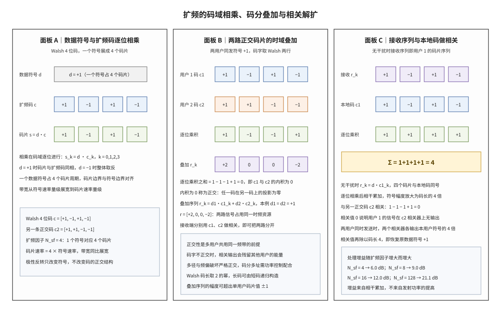

# Spreading 扩频与解扩

## 符号与记号约定
| 符号 | 含义与取值 | 协议锚点 |
|:---|:---|:---|
| $d$ | 一个数据符号的取值，本笔记按二相调制取 $+1$ 或 $-1$；在一个符号周期内保持不变 | 非 3GPP 标准 |
| $d_1$、$d_2$ | 用户 1、用户 2 各自发送的数据符号，取值 $+1$ 或 $-1$ | 非 3GPP 标准 |
| $c$ | 一条扩频码字，是长度为 $N_{sf}$、分量取 $+1$ 或 $-1$ 的矢量 | TS 25.213（本地未收录） |
| $c_1$、$c_2$ | 用户 1、用户 2 的码字矢量，两条码字互相正交 | TS 25.213（本地未收录） |
| $s_1$、$s_2$ | 用户 1、用户 2 扩频后的码片序列矢量 | 由 TS 25.213 导出 |
| $k$ | 码片序号，取值 $0,1,\ldots,N_{sf}-1$ | 本笔记导出 |
| $i$ | 用户序号，用于指称多用户中的某一路 | 本笔记导出 |
| $c_k$ | 码字第 $k$ 个码片的取值，$c_k\in\{+1,-1\}$ | TS 25.213（本地未收录） |
| $c_{1,k}$ | 用户 1 的码字第 $k$ 个码片；第一个下标是用户号，第二个是码片号 | TS 25.213（本地未收录） |
| $c_{2,k}$ | 用户 2 的码字第 $k$ 个码片；第一个下标是用户号，第二个是码片号 | TS 25.213（本地未收录） |
| $s$ | 扩频后的码片序列矢量，$s=d\,c$，长度与码字相同 | 由 TS 25.213 导出（$s=d\,c$） |
| $r_k$ | 接收序列的第 $k$ 个码片采样 | 实现域 |
| $n_k$ | 第 $k$ 个码片上叠加的噪声与干扰采样；无干扰时为零 | 非 3GPP 标准 |
| $d_i$、$d_j$ | 第 $i$ 个、第 $j$ 个用户发送的数据符号，$i$ 与 $j$ 为用户序号 | 非 3GPP 标准 |
| $c_i$ | 第 $i$ 个用户的码字矢量 | TS 25.213（本地未收录） |
| $c_{i,k}$ | 第 $i$ 个用户码字的第 $k$ 个码片 | TS 25.213（本地未收录） |
| $s_k$ | 扩频后的第 $k$ 个码片，$s_k=d\,c_k$ | 由 TS 25.213 导出（$s_k=d\,c_k$） |
| $n$ | 叠加在接收码片序列上的噪声与干扰矢量，与发送码片序列同长；无干扰时各分量为零 | 非 3GPP 标准（噪声模型） |
| $r$ | 一个符号周期内接收到的码片序列矢量，$r=s+n$ | 实现域 |

**表 2｜速率、扩频因子与相关量**

| 符号 | 含义与取值 | 协议锚点 |
|:---|:---|:---|
| $R_c$ | 码片速率（chip rate），单位时间内发送的码片数，单位码片每秒（Mcps） | TS 25.213（3.84 Mcps） |
| $R_s$ | 符号速率（symbol rate），单位时间内发送的数据符号数，等于码片速率除以扩频因子，单位符号每秒 | 由 TS 25.213 导出（本笔记由码片速率与扩频因子换算） |
| $N_{sf}$ | 扩频因子（spreading factor），一个数据符号所对应的码片数，$N_{sf}=R_c/R_s$，为 2 的整数次幂 | TS 25.213（本地未收录） |
| $T_s$、$T_c$ | 符号周期与码片周期，满足 $T_s=N_{sf}T_c$ | 由 TS 25.213 导出（本笔记由码片周期与扩频因子换算） |
| $G_p$ | 处理增益（processing gain），$G_p=10\lg N_{sf}$，单位 dB | 非 3GPP 标准 |
| $\rho$ | 两条码字的归一化相关系数，$\rho=\frac{1}{N_{sf}}\sum_k c_{1,k}c_{2,k}$；正交码取 $\rho=0$ | 非 3GPP 标准 |
| $y$ | 相关器的输出，等于接收序列与本地码字的逐位乘积之和 | 实现域 |
| $y_1$、$y_2$ | 用用户 1、用户 2 的本地码分别做相关得到的输出 | 实现域 |
| $y_i$ | 用第 $i$ 个用户的本地码做相关得到的输出 | 实现域 |
| $P$ | 每码片上的信号功率，用于计算相关前后的信噪比 | 非 3GPP 标准 |
| $\sigma^{2}$ | 每码片上的噪声功率，$\sigma$ 为噪声标准差 | 非 3GPP 标准 |
| $\hat d$ | 由相关输出除以码长得到的符号估计 | 实现域 |

表 1 与表 2 的「协议锚点」列按三类口径填写：协议直接规定的量给出标准号，可得时并给出条款号；本笔记由公式导出的中间量标注「本笔记导出」并附导出式；处理增益、相关运算与噪声模型等不属于 3GPP 规定的内容标注「非 3GPP 标准」或「实现域」。WCDMA 的扩频码与扩频因子由 TS 25.213 规定，本仓库未收录 TS 25 系列，故只给标准号；LTE 与 NR 不采用扩频体制，其物理层条款中不存在这些量。

运算符与记号惯例：$\sum_k$ 表示在一个符号周期内对 $N_{sf}$ 个码片求和，求和上下限由码片序号 $k$ 的取值给出，本笔记不重复写出；$\frac{1}{N_{sf}}$ 是相关输出的归一化因子，除以它以后相关值回到符号取值的量纲；$\lg$ 表示以 10 为底的对数，与 $\log_{10}$ 同义，处理增益用它换算成 dB；矢量不加箭头，$c$、$s$、$r$ 指整条序列，带下标 $k$ 的量指其中一个码片；$c_1\cdot c_2$ 表示两条码字的逐位乘积之和，与 $\sum_k c_{1,k}c_{2,k}$ 是同一运算的两种写法；$\sqrt{N_{sf}}$ 表示 $N_{sf}$ 的平方根，用于比较幅度增长与功率增长；$\hat d$ 表示由相关输出反算出的符号估计，帽子记号只表示估计，不改变量纲。三个速率与周期量互为倒数关系，同一关系有几种等价写法：码片速率与符号速率之比即扩频因子（$N_{sf}=R_c/R_s$），等价地符号速率等于码片速率除以扩频因子（$R_s=R_c/N_{sf}$）；符号周期与码片周期同理由扩频因子联系（$T_s=N_{sf}T_c$）。

扩频（Spread Spectrum）把窄带数据符号映射到一条高速率的码片序列上，使发送信号占用的带宽远大于数据本身所需的带宽；解扩（De-spreading）在接收端用同一条码片序列做相关运算，把目标信号的能量重新集中到一个符号上，同时使不相关的干扰在求和过程中不累积。一句话本质：**扩频是数据符号与扩频码在码片域逐位相乘，解扩是接收序列在本地码矢量上的内积投影；正交码使多个用户在同一个时频资源上互不投影，这就是码分多址的由来。**
## 解释目标与范围

本节目标：讲清直接序列扩频（Direct Sequence Spread Spectrum, DSSS）的码域乘法与相关解扩机制，说明处理增益 $G_p=10\lg N_{sf}$ 的来源与适用边界，手算 4 位 Walsh 码的正交性内积、两用户叠加后的解扩结果与若干扩频因子对应的 dB 值，并说明扩频与码分多址（Code Division Multiple Access, CDMA）的关系以及 LTE/NR 不采用扩频体制的原因。

要完成这一解释，需要先交代六个对象：多址方式中的码分多址、正交码与 Walsh 函数、码片与符号这两个时间粒度、处理增益这一指标，以及相关运算这一接收端操作。它们分属系统层与信号层两个层次，下面按从系统到信号的顺序逐段说明。

## 前置概念

码分多址（Code Division Multiple Access, CDMA）是一种多址方式：多个用户在同一时间、同一频带上发送信号，接收端不按时间片或频带分割用户，而按码字区分用户，每个用户被分配一条与其他用户正交的码字。它解决的是「多用户如何共享同一段频谱」这一问题，代价是接收端必须知道目标用户的码字并完成同步，相关运算的复杂度随用户数与码长上升，与频分、时分多址的取舍见 [[Multiple_Access_多址接入]]。

正交码（orthogonal code）是分量取 $+1$ 与 $-1$、两两内积为零的码字集合，内积为零意味着一条码字在另一条码字方向上的投影为零，接收端用一个码字做相关时得不到另一个码字成分的输出。Walsh 函数（Walsh function）是这类码字的典型构造：长度为 $N_{sf}$ 的 Walsh 码共有 $N_{sf}$ 条，可由哈达玛矩阵（Hadamard matrix）的行或列给出，码长取 2 的整数次幂，任意两条不同码字的内积为零、任一条码字与自身的内积为 $N_{sf}$。WCDMA 使用的正交可变扩频因子码（Orthogonal Variable Spreading Factor, OVSF）以 Walsh 码为基础，通过码树在不同扩频因子上保持正交，码树与多址分配的讨论见 [[Multiple_Access_多址接入]]；与之相对，Gold 序列一类伪随机码不保证严格正交，只保证互相关足够低，用于加扰而非用户区分，参见 [[Gold_序列加扰]]。

码片（chip）是扩频之后的最小时间单元，一个码片携带一个极性值；符号（symbol）是调制映射的输出，一个符号在扩频之前占一个符号周期。两者的关系由扩频因子固定：一个符号周期被等分为 $N_{sf}$ 个码片周期，符号取值在整段 $N_{sf}$ 个码片上保持不变，码片序列只是把这个取值按码字逐位展开。由此得到两条速率关系 $R_c=N_{sf}R_s$ 与 $T_s=N_{sf}T_c$，它们是后文所有带宽与增益计算的起点；调制符号本身的构造见 [[Modulation_Mapping_调制映射]]。

处理增益（processing gain）是扩频体制的核心指标，定义为码片速率与符号速率之比的分贝值，$G_p=10\lg(R_c/R_s)=10\lg N_{sf}$。它描述的是解扩前后信噪比的改善量，不是发射功率的增加量：扩频不改变发送总功率，只把同一份能量摊到更宽的频带上，使功率谱密度下降；解扩再把分散在 $N_{sf}$ 个码片上的信号能量相干相加，噪声则不相干相加。分贝换算的细节见 [[dB_分贝]]。

相关运算（correlation）是接收端的解扩操作：把接收序列与本地码字逐位相乘，再把一个符号周期内的乘积求和，得到一个标量。若接收序列恰为同一条码字扩频的信号，乘积全为 $+1$，求和结果等于码长；若接收序列是另一条正交码扩频的信号，乘积正负各半，求和结果为零。噪声背景下的相关输出是一个随机量，其均值由信号成分决定、方差由噪声功率与码长共同决定，噪声模型见 [[AWGN_信道模型]]。六个对象至此交代完毕，下面按演进顺序说明扩频为何被引入、又如何从抗干扰手段发展为多址体制。

## 起源与演进

(1) **起点：窄带信号在干扰与截获面前的脆弱性。** 早期的军用通信面临两类威胁：一类是窄带干扰，只要干扰功率集中在信号带宽内，接收端的信噪比就被直接压低；另一类是对手的侦测，窄带信号的功率谱密度高，容易被发现和定位。扩频针对这两类威胁各给出一个手段：把信号带宽展宽一到三个数量级，使窄带干扰只覆盖展宽后带宽的一小部分，解扩时这部分干扰不随信号累积；同时把同一份功率摊到更宽的频带上，使功率谱密度降到噪声背景附近。第三个动机随后出现：既然不同码字可以互不干扰地占用同一频带，码字就可以用来区分用户，这使扩频从抗干扰技术变成多址技术。

(2) **直接序列扩频：数据符号与码片序列逐位相乘。** 直接序列扩频是最基本的一种实现：把数据符号 $d$ 与一条高速率的码片序列 $c$ 相乘，得到发送序列 $s_k=d\,c_k$。由于 $R_c$ 远大于 $R_s$，一个符号被展开成 $N_{sf}$ 个码片，发送信号的带宽从 $R_s$ 量级扩展到 $R_c$ 量级。这里没有改变符号的取值，只改变了它在时间上的分布：$d=+1$ 时码片序列与码字同相，$d=-1$ 时整条码片序列取反，信息保存在极性的翻转关系里。以 Walsh 4 位码 $c=[+1,-1,+1,-1]$ 为例，$d=+1$ 时发送 $[+1,-1,+1,-1]$，$d=-1$ 时发送 $[-1,+1,-1,+1]$，两组码片在每一位上都相反。

(3) **处理增益：相干累加换来的信噪比改善。** 解扩把 $N_{sf}$ 个码片上的信号按同号相加，信号幅度累加为原来的 $N_{sf}$ 倍；噪声在码片间不相关，幅度只按 $\sqrt{N_{sf}}$ 增长，因此功率信噪比改善 $N_{sf}$ 倍，写成 dB 就是 $G_p=10\lg N_{sf}$。WCDMA 的码片速率为 3.84 Mcps，语音业务经信道编码后的符号速率约为 30 kbps，$N_{sf}=3.84\times10^{6}/(30\times10^{3})=128$，处理增益为 $10\lg128\approx21.1$ dB。这个数字的含义是：在相同的每码片信噪比下，解扩后的信噪比高出约 21 dB，接收端因而可以在信号功率低于噪声功率的条件下工作。

(4) **同步：相关峰出现的前提。** 相关运算只有在本地码与发送码逐码片对齐时才产生 $N_{sf}$ 的峰值；本地码偏移一个码片，码片配对关系整体错位，相关峰迅速消失，相关值跌到远低于 $N_{sf}$ 的水平，具体取值由码字与偏移量共同决定。接收端因此必须先完成码片级同步：用滑动相关或匹配滤波器在不确定的时延范围内搜索相关峰，捕获之后再跟踪时延与频偏的变化。同步误差是扩频系统实际性能与理论处理增益之间差距的主要来源，定时同步的通用讨论见 [[Timing_Sync_定时同步]]。

(5) **从抗干扰到码分多址，再到宽带体制的取舍。** 码分多址把扩频与正交码分配结合起来：每个用户一条码字，所有用户同时同频发送，接收端用目标用户的码字解扩，其他用户的信号因正交而在相关器中不产生输出。IS-95 与 WCDMA 采用这一体制，前者用于第二代，后者用于第三代。第四代与第五代转向正交频分多址（Orthogonal Frequency Division Multiple Access, OFDMA）：多径条件下正交码不再严格正交，多用户干扰随负载上升；全带宽共享使频率选择性调度难以按用户分配资源；OFDMA 把用户分配到不同的子载波上，调度器可以直接规避干扰，接收机结构也更简单。扩频并没有消失，它在卫星导航、抗干扰通信与低功率谱密度的隐蔽通信中仍是主要手段。

## 科学定义

上一节按时间顺序说明了扩频的动机与演进，本节把它写成可运算的形式：先给出码域乘法的定义与速率关系，再给出相关解扩的表达式并用三组数值把内积、叠加与处理增益算一遍，最后讨论码分多址成立的条件与体制边界。符号的读法与取值见表 1 与表 2，本节直接引用，不再重复定义。

### 直接序列扩频的码域乘法

设一个数据符号 $d\in\{+1,-1\}$ 在符号周期 $T_s$ 内保持不变，扩频码为长度 $N_{sf}$ 的矢量 $c$，第 $k$ 个分量记为 $c_k$，每个分量取 $+1$ 或 $-1$。直接序列扩频把符号与码字逐位相乘，得到发送的码片序列

$$s_k=d\,c_k,\qquad k=0,1,\ldots,N_{sf}-1$$

这个式子说明三件事。第一，扩频是标量乘矢量：$d$ 只决定整条码片序列的极性，码字的形状由 $c$ 决定，因此同一码字可以承载任意符号，接收端只要知道 $c$ 就能从极性反推 $d$。第二，码片取值仍为 $+1$ 或 $-1$，扩频不改变信号的调制方式，只改变每个符号占用的时间单元数，这一性质使 $c_k\cdot c_k=1$，为后文解扩时消去码字提供了依据。第三，符号边界与码片边界对齐，一个符号周期恰好包含 $N_{sf}$ 个完整码片，跨符号的码片不混用，这是同步与相关器按符号周期积分的前提。

速率关系由时间粒度直接得到。符号周期 $T_s$ 内发送一个符号、$N_{sf}$ 个码片，故 $T_s=N_{sf}T_c$，取倒数得 $R_c=N_{sf}R_s$。带宽与速率同阶：扩频前信号的主要能量集中在 $R_s$ 量级，扩频后集中在 $R_c$ 量级，带宽扩展的倍数约为 $N_{sf}$。这一扩展不是把信息复制 $N_{sf}$ 份，而是把同一份符号能量分散到 $N_{sf}$ 个码片上，总能量不变、功率谱密度下降为原来的约 $1/N_{sf}$，这是扩频信号难以被侦测的原因，也是解扩能够把能量重新集中的原因。

以 Walsh 4 位码为例，取 $N_{sf}=4$、$c=[+1,-1,+1,-1]$。当 $d=+1$ 时，$s=[+1,-1,+1,-1]$，码片序列与码字完全相同；当 $d=-1$ 时，$s=[-1,+1,-1,+1]$，每一位都取反。两种情形下码片序列的绝对值都为 1，差别只在极性，接收端要判断的正是这个极性。图 1 的面板 A 把这个乘法画成三行方格：第一行是一个横跨四个码片位置的数据符号，第二行是码字，第三行是逐位相乘的结果。码片序列既已成形，下一个问题是接收端如何从含噪的码片序列中把符号取回来，这由相关运算完成。

### 相关解扩与处理增益

接收端收到的码片序列为 $r_k=s_k+n_k$，其中 $n_k$ 是噪声与干扰的采样。解扩用与发送端相同的本地码字 $c$ 做相关，即逐位相乘后求和：

$$y=\sum_{k=0}^{N_{sf}-1}r_k c_k=\sum_{k=0}^{N_{sf}-1}\left(d\,c_k+n_k\right)c_k=d\sum_{k=0}^{N_{sf}-1}c_k\cdot c_k+\sum_{k=0}^{N_{sf}-1}n_k c_k=d\,N_{sf}+\sum_{k=0}^{N_{sf}-1}n_k c_k$$

第一项是信号成分，因为 $c_k\cdot c_k=1$，它恰好等于符号取值乘以码长；第二项是噪声成分，噪声采样与码片相乘后仍是零均值随机量，求和只使其方差按 $N_{sf}$ 增长，不产生相干累积。除以 $N_{sf}$ 得到符号估计 $\hat d=y/N_{sf}=d+\frac{1}{N_{sf}}\sum_k n_k c_k$，无噪声时 $\hat d=d$，判决就是把 $\hat d$ 的符号取出来。

多用户情形要在求和号内多写几项。设用户 $i$ 发送符号 $d_i$、使用码字 $c_i$，接收序列为各用户码片序列之和 $r_k=\sum_i d_i c_{i,k}+n_k$；接收端用用户 1 的码字相关，得

$$y_1=\sum_k r_k c_{1,k}=d_1 N_{sf}+\sum_{i\ne1}d_i\sum_k c_{i,k}c_{1,k}+\sum_k n_k c_{1,k}$$

第二项中的 $\sum_k c_{i,k}c_{1,k}$ 就是两条码字的内积。若码字两两正交，该项为零，用户 1 的相关输出中不含其他用户的数据，多用户干扰被码字结构消去；若不正交，该项等于 $N_{sf}\rho$，其他用户的数据按相关系数 $\rho$ 泄漏进来。这一项是码分多址容量受限于多用户干扰的直接来源，也是后文讨论体制边界时的核心量。

用 4 位 Walsh 码把上述过程算一遍。取

$$c_1=[+1,-1,+1,-1],\qquad c_2=[+1,+1,-1,-1]$$

两条码字的内积为 $c_1\cdot c_2=(+1)(+1)+(-1)(+1)+(+1)(-1)+(-1)(-1)=1-1-1+1=0$，故 $\rho=0$，两码正交。码字自身的范数平方为 $c_1\cdot c_1=1+1+1+1=4=N_{sf}$，这是相关峰的高度。同族的另两条码字逐对计算内积同样为零，四条码字构成 $N_{sf}=4$ 维空间中一组互相正交的基。

两用户叠加的解扩结果可以直接逐位核对。设 $d_1=+1$、$d_2=+1$，则 $s_1=[+1,-1,+1,-1]$、$s_2=[+1,+1,-1,-1]$，叠加序列为 $r=[+2,0,0,-2]$；用 $c_1$ 相关得 $y_1=(+2)(+1)+0\cdot(-1)+0\cdot(+1)+(-2)(-1)=2+0+0+2=4=d_1N_{sf}$，用 $c_2$ 相关得 $y_2=(+2)(+1)+0\cdot(+1)+0\cdot(-1)+(-2)(-1)=4=d_2N_{sf}$。若改为 $d_2=-1$，则 $s_2=[-1,-1,+1,+1]$、$r=[0,-2,+2,0]$，$y_1=0+2+2+0=4$ 不变，$y_2=0-2-2+0=-4=d_2N_{sf}$，两个用户分别恢复。两组数值说明：叠加使码片幅度可以超出 $+1$ 与 $-1$，但相关输出只保留本用户码字方向上的分量，另一用户的分量因正交而被消去。图 1 的面板 B 与面板 C 分别对应两种情形：面板 B 用叠加序列说明多用户共存，面板 C 用单用户序列说明相关峰与正交码的零点；若把面板 B 的叠加序列送入 $c_2$ 的相关器，输出是 $d_2N_{sf}$ 而不是零，这正说明正交码解出的是各自用户的数据。

处理增益由相关输出的信噪比给出。设每码片上的信号功率为 $P$、噪声功率为 $\sigma^{2}$，相关后信号幅度累加为 $N_{sf}$ 倍、功率累加为 $N_{sf}\cdot N_{sf}$ 倍，噪声功率按 $N_{sf}$ 倍增长，故输出信噪比与输入信噪比之比为 $N_{sf}$，写成 dB 即 $G_p=10\lg N_{sf}$。常见扩频因子的取值如下表，第二列是按 $10\lg N_{sf}$ 算出的分贝值，第三列给出对应的符号速率（码片速率固定为 3.84 Mcps）。

| $N_{sf}$ | $G_p$（dB） | 对应符号速率（3.84 Mcps） | 典型用途 |
|:---|:---|:---|:---|
| 4 | 6.02 | 960 ksps | 高速数据 |
| 8 | 9.03 | 480 ksps | 中速数据 |
| 16 | 12.04 | 240 ksps | 低速数据 |
| 64 | 18.06 | 60 ksps | 话音与信令 |
| 128 | 21.07 | 30 ksps | WCDMA 语音 |
| 256 | 24.08 | 15 ksps | 低速率、强抗干扰 |

表中每一行都可反算验证：$10\lg4=6.02$、$10\lg128=21.07$，分贝值随扩频因子每翻一倍增加约 3.01 dB，这与「功率比翻倍为 3 dB」的换算一致。需要注意，相关输出 $y=d\cdot N_{sf}$ 是幅度意义上的累加值，不能直接当作 dB 数：$N_{sf}=4$ 时相关值为 4，而处理增益是 $10\lg4\approx6.02$ dB，二者不是同一个量。

**图 1｜扩频与解扩在码域的三段运算。** 面板 A 把数据符号 $d=+1$ 与 Walsh 4 位码 $c=[+1,-1,+1,-1]$ 逐位相乘，得到码片序列 $s=[+1,-1,+1,-1]$，一个符号横跨四个码片位置。面板 B 取 Walsh 码的两行 $c_1$、$c_2$，逐位乘积之和为 $0$，标出两码正交，并把两路码片序列相加得到 $r=[+2,0,0,-2]$。面板 C 令接收序列等于用户 1 的码片序列，与 $c_1$ 相关得 $4$、与 $c_2$ 相关得 $0$，相关值除以码长即恢复符号 $+1$。

单用户的乘法与相关既已清楚，剩下的问题是把同一套运算同时用于多个用户时，正交码字能提供多大的隔离度，这决定了它能支撑何种多址体制。

### 从扩频到码分多址及其体制边界

码分多址把上述机制用于多用户：给每个用户分配一条码字，所有用户在同一时频资源上同时发送，接收端用目标用户的码字相关，其他用户的正交分量不产生输出。这一体制成立需要三个条件。其一是码字在接收端保持正交，收发两端必须在码片级对齐，多径分量到达时间不同会使同一用户的码片在相关窗内错位，正交性随之退化。其二是各用户到达接收端的功率大致相当，若某个用户的功率远高于其他用户，它的非理想正交分量会淹没弱用户，这就是远近效应，功率控制因此成为码分多址的必要环节，见 [[Power_Control_上行功率控制]]。其三是码字资源足够分配，长度为 $N_{sf}$ 的 Walsh 码只有 $N_{sf}$ 条正交码字，用户数与扩频因子的乘积受限于码树容量，见 [[Multiple_Access_多址接入]]。

正交性在真实信道中的退化是码分多址容量受限的根源。多径使同一码字的不同副本以不同时延到达，相关器把它们按错位的码片配对，产生自干扰；频偏与相位噪声使码片极性在积分区间内缓慢旋转，正交码字之间的内积不再严格为零；相邻小区的干扰码字与本小区码字在异步条件下没有正交关系，只能按互相关特性统计处理。工程上用导频信道做信道估计、用瑞克接收机合并多径、用功率控制抑制远近效应，这些手段都在补偿正交性的损失，而不能恢复严格正交。

第四代与第五代移动通信转向正交频分多址，原因可以归结为三条。第一，宽带传输下多径时延扩展跨越大量码片，正交码的自干扰与多用户干扰随带宽与负载上升，容量难以随带宽线性增长。第二，频率选择性调度需要把不同用户分配到信道质量不同的子载波上，码分多址让所有用户占用整个频带，调度器没有频域自由度，多输入多输出（Multiple Input Multiple Output, MIMO）的频域预编码也难以按用户实施。第三，OFDMA 把子载波作为资源单位，用户间在频域天然正交，接收机只需快速傅里叶变换与单抽头均衡，实现复杂度与能耗都低于码分多址的瑞克接收机。NR 上行采用的变换预编码正交频分复用（Discrete Fourier Transform Spread OFDM, DFT-s-OFDM）常被误认为扩频，它实际是 DFT 预编码降低峰均比，不使用码片序列，也不提供处理增益，见 [[DFT_sOFDM_上行波形]]。

扩频思想在其他系统中仍然活跃，下表对比三种扩频方式，区别在于扩展的是频带、载波频率还是发射时刻。

| 方式 | 扩展维度 | 代表系统 |
|:---|:---|:---|
| 直接序列扩频（DSSS） | 用高速码片序列扩展频带 | WCDMA、GPS、北斗 |
| 跳频扩频（Frequency Hopping Spread Spectrum, FHSS） | 载波频率按伪随机序列跳变 | 蓝牙、部分军用电台 |
| 跳时扩频（Time Hopping Spread Spectrum, THSS） | 发射时刻按伪随机序列跳变 | 超宽带与军用通信 |

三种方式的共同点是发送端按伪随机规律扩展信号在某个维度上的占位，接收端按同一规律做相关或同步，从而在扩展维度上获得处理增益；区别在于扩展的维度不同，DSSS 扩展频带、FHSS 扩展频率占用、THSS 扩展时间占用。卫星导航系统使用 DSSS 的一个直接原因是可以同时获得处理增益与测距分辨率：码片越短，相关峰越尖锐，到达时间的估计越精确，这与通信中的抗干扰需求相互独立。

## 直观模型

从几何上看，扩频与解扩是码域矢量空间中的一次标量乘法与一次内积投影。长度为 $N_{sf}$、分量取 $+1$ 或 $-1$ 的码字是 $N_{sf}$ 维空间中的一个矢量，数据符号是标量，扩频把码字矢量按符号的极性伸缩，解扩把接收矢量投影回本地码字方向，投影长度除以码长就是符号估计。这一节用矢量与投影的语言把前文的代数式重述一遍，不引入新的量。

码域矢量空间的第一个性质是能量守恒。码字 $c$ 的范数平方为 $c\cdot c=\sum_k c_k\cdot c_k=N_{sf}$，扩频后的矢量 $s=d\,c$ 满足 $s\cdot s=d\cdot d\cdot N_{sf}=N_{sf}$，与 $d$ 的取值无关：$d=+1$ 时矢量方向不变，$d=-1$ 时矢量反向，长度都不变。因此扩频改变的是矢量在空间中的方向分布与占用带宽，不改变它的长度；多个符号的码片序列在时间上依次排列，每个符号对应空间中的一条矢量，整条发送信号是这些矢量的分段拼接。

第二个性质是正交码构成一组坐标轴。长度为 $N_{sf}$ 的 Walsh 码共有 $N_{sf}$ 条，两两内积为零、各自范数平方为 $N_{sf}$，它们张成整个 $N_{sf}$ 维空间，任意一条码字在其他码字方向上的投影为零。把每个用户分配到一条码字，相当于给每个用户分配一根坐标轴；多用户同时发送时，接收矢量是各用户矢量之和 $r=\sum_i d_i c_i$，用户 $i$ 的相关输出是 $r$ 在 $c_i$ 方向上的投影 $y_i=r\cdot c_i=d_iN_{sf}$，其他用户的分量因落在正交方向上而不进入该投影。除以 $N_{sf}$ 得到的 $\hat d_i$ 就是接收矢量在这根坐标轴上的归一化坐标，多用户分离在这一表示下就是读出各坐标轴上的坐标值。

第三个性质是处理增益的几何来源。噪声矢量在整个空间中各向同性，它在某一根坐标轴上的投影长度按 $\sqrt{N_{sf}}$ 增长；信号矢量恰好沿该轴，投影长度按 $N_{sf}$ 增长。两者之比给出幅度信噪比的 $\sqrt{N_{sf}}$ 倍改善，平方后即功率信噪比的 $N_{sf}$ 倍改善。正交性退化时，其他用户的矢量不再与该轴垂直，投影中出现 $d_jN_{sf}\rho$ 的泄漏项，$\rho$ 越大泄漏越多；定时误差、多径与频偏做的正是让码字矢量之间产生非零夹角这件事，因此工程上对同步精度的要求可以直接从相关系数的容限反推。

## 常见误解

| 误解 | 正确理解 |
|:---|:---|
| 扩频会提高发射功率，因此抗干扰 | 扩频不改变发送总功率，只把同一份能量摊到更宽的频带上，使功率谱密度下降；抗干扰能力来自解扩时的相干累加，不是功率放大。 |
| 处理增益 21 dB 意味着可以把任何干扰压低 21 dB | 处理增益描述的是目标信号与不相关干扰（含白噪声）在相关前后的信噪比之比；对使用同一码字的干扰、对与信号同向的窄带分量，相关运算不提供这一增益。 |
| 相关输出等于 4，所以处理增益是 4 dB 或 12 dB | 相关输出 4 是幅度累加值 $d\cdot N_{sf}$；功率信噪比的改善为 $N_{sf}$ 倍，即 $10\lg4\approx6.02$ dB。幅度增益与功率增益不能混用。 |
| 正交码在任何信道下都严格正交 | 正交性以码片级对齐为前提；多径、定时误差、频偏与异步邻区干扰都会使内积偏离零，产生多用户干扰，工程上用同步、均衡与功率控制抑制其影响。 |
| 扩频等同于加密 | 扩频降低功率谱密度、提高抗截获性，但码字一旦已知即可解扩；保密性来自密钥与加密算法，不由扩频码提供。 |
| CDMA、扩频、WCDMA 是同一件事 | 扩频是物理层的信号处理，CDMA 是用正交码实现的多址方式，WCDMA 是第三代中的一个具体制式，三者是技术、体制与标准三个层次。 |
| 4G/5G 不用扩频，说明扩频已经过时 | 转向 OFDMA 是宽带、调度与多天线条件下的工程取舍；扩频在卫星导航、抗干扰通信与低功率谱密度传输中仍是主流手段。 |
| 扩频因子越大越好 | $N_{sf}$ 越大处理增益越高，但在码片速率固定时符号速率按比例下降、可分配的正交码字越少，在符号速率固定时占用带宽按比例增加；扩频因子是增益、速率、带宽与容量之间的折中。 |
| 码片就是编码比特 | 码片是扩频之后的时间单元，一个编码比特可能先经过调制映射为符号、再展开为 $N_{sf}$ 个码片；码片数不等于编码比特数，两者的计数口径不同。 |

## 协议锚点

- **WCDMA 的扩频与调制**：第三代合作伙伴计划（3rd Generation Partnership Project, 3GPP）的 TS 25.213 规定频分双工模式的扩频与调制，包括信道化码与扰码的使用；本地 `3GPP_Rel19` 未收录 TS 25 系列，锚点仅指标准，不核验具体条款。
- **LTE 的物理层**：TS 36.211 规定物理信道与调制，下行采用正交频分多址、上行采用单载波频分多址，§5.3.3 的变换预编码同样不使用扩频码，因而不存在扩频因子这一参数；本地锚点为 `3GPP_Rel19/processed/TS_36.211_36211-j30_s00-s05`。
- **NR 的物理层**：TS 38.211 §5.3 规定正交频分复用的基带信号生成，§6.3.1.4 规定变换预编码（transform precoding）；后者是 DFT-s-OFDM 的预编码步骤，不涉及码片序列与处理增益，不能与扩频混为一谈。本地锚点为 `3GPP_Rel19/processed/TS_38.211_38211-j30`。
- **实现域边界**：扩频码的选取、相关器的结构、同步算法与处理增益的标定属于接收机实现域；3GPP 规定发送端的码字与调制方式，并对解调性能提出要求，但不规定相关器结构、同步算法与增益标定方法。
- **非 3GPP 标准项**：直接序列扩频、跳频与跳时扩频、Walsh 码、处理增益与相关运算均为通信原理与扩频通信的标准内容，不来自任何 TS/TR 条款；本笔记的 4 位 Walsh 码数值例为教学构造，不对应某一具体协议配置。

## 关键要点

1. 扩频的码域定义是 $s_k=d\,c_k$：数据符号只决定整条码片序列的极性，码字决定码片的排列，两者相乘把符号展成 $N_{sf}$ 个码片。
2. 速率关系为 $R_c=N_{sf}R_s$、$T_s=N_{sf}T_c$，带宽按 $N_{sf}$ 倍扩展，发送总能量不变、功率谱密度下降。
3. 解扩是相关运算 $y=\sum_k r_k c_k$，无噪声时 $y=d\cdot N_{sf}$，除以 $N_{sf}$ 恢复符号；噪声只按 $\sqrt{N_{sf}}$ 增长，故功率信噪比改善 $N_{sf}$ 倍。
4. 处理增益为 $G_p=10\lg N_{sf}$：$N_{sf}=4$ 时 6.02 dB，$N_{sf}=128$ 时 21.07 dB，扩频因子每翻一倍增加约 3.01 dB。
5. 4 位 Walsh 码的任意两条不同码字内积为零、自身内积为 4；两用户同发 $+1$ 时叠加序列为 $[+2,0,0,-2]$，分别相关得 $4$ 与 $4$，改为 $d_2=-1$ 时得 $4$ 与 $-4$。
6. 码分多址成立依赖三个条件：码字在接收端保持正交、各用户到达功率大致相当、码字资源足够分配；多径、频偏与远近效应都会破坏第一条，功率控制与同步是必要配套。
7. 扩频不等于加密，处理增益不等于发射功率增益，相关输出的幅度值不等于 dB 处理增益；这三组量纲与语义的区分是理解扩频时的常见错误来源。
8. LTE/NR 转向 OFDMA 是宽带调度与多天线条件下的取舍，NR 上行的 DFT-s-OFDM 是降低峰均比的预编码，不是扩频；扩频在卫星导航与抗干扰通信中仍在使用。

## 图谱关联

- [[概念图谱入口]]
- [[Multiple_Access_多址接入]]
- [[Power_Control_上行功率控制]]
- [[Gold_序列加扰]]
- [[AWGN_信道模型]]
- [[dB_分贝]]
- [[Timing_Sync_定时同步]]
- [[DFT_sOFDM_上行波形]]
- [[Modulation_Mapping_调制映射]]
- [[T2.8_OFDM_CFO_SFO_frequency_synchronization]]
- 关系语义：扩频是码分多址的物理层基础，正交码把多用户映射到码域的不同坐标轴上；相关解扩的相干累加与分集合并、软合并同属「按已知符号加权求和」的运算族，而 OFDMA 体制下的同步仍是解调前提（T2.8）。
